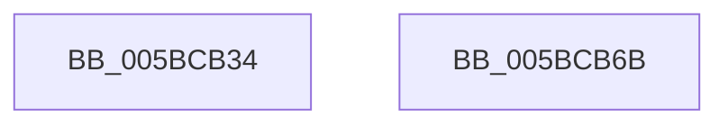

# KiInitializeCoreControlBlock

- RVA: `0x005BCB34`–`0x005BCB6C` (길이 `56` bytes)
- VA: `0x00000001405BCB34`
- 실행 섹션: `.text`
- PDB 이름 있음: `예`; PDB Function 태그: `아니요`
- unwind 정보 RVA: `0x0005CF00`
- 디코드: `17`개 명령, `56/56` bytes 표시
- 미해석 바이트: `0` (있으면 어셈블리에 `.byte`로 보존)

> 이 문서는 커널 이미지의 기계어와 PDB 기호를 분석해 생성했습니다. 4번과 5번은 함수 원형과 자료형을 바이너리 사용 방식에서 추정한 C 해석이며 원본 소스 복구 결과는 아닙니다.

## 1. Dependencies

- 직접 호출 지점: **1**; 고유 호출 대상: **1**
- 직접 호출자로 확인된 함수: **1**
- RIP 상대 이미지 참조: **0**

### Outgoing calls
- `0x005BCB58` → [memset](../6C/memset_function_006C6C40.md) (function, `0x006C6C40`)

### Direct callers
- [KiInitializeKernel](../../pagelk/B6/KiInitializeKernel_function_00B68D20.md) at `0x00B68FC1`

### Static image references
- 디코드된 RIP-relative 메모리 참조가 없습니다.

## 2. Other-region calls and transfers

- 다른 실행 섹션으로 향하는 call: **0**
- 별도 외부 분기/꼬리 이동을 확인하지 못했습니다.

## 3. Assembly (complete function range)

```asm
005BCB34  40 53                           push rbx
005BCB36  48 83 EC 20                     sub rsp, 0x20
005BCB3A  0F 57 C0                        xorps xmm0, xmm0
005BCB3D  48 8B DA                        mov rbx, rdx
005BCB40  0F 11 01                        movups xmmword ptr [rcx], xmm0
005BCB43  0F 11 41 10                     movups xmmword ptr [rcx + 0x10], xmm0
005BCB47  0F 11 41 20                     movups xmmword ptr [rcx + 0x20], xmm0
005BCB4B  48 89 51 28                     mov qword ptr [rcx + 0x28], rdx
005BCB4F  33 D2                           xor edx, edx
005BCB51  48 8B CB                        mov rcx, rbx
005BCB54  44 8D 42 40                     lea r8d, [rdx + 0x40]
005BCB58  E8 E3 A0 10 00                  call 0x1406c6c40
005BCB5D  48 C7 43 10 01 00 00 00         mov qword ptr [rbx + 0x10], 1
005BCB65  48 83 C4 20                     add rsp, 0x20
005BCB69  5B                              pop rbx
005BCB6A  C3                              ret
005BCB6B  CC                              int3
```

## 4. C-style interpretation (structured pseudocode)

```c
__int64 __fastcall KiInitializeCoreControlBlock(__int64 a1, __int64 a2)
{
    __int64 result;
    __int64 v_rsp;

    v_rsp = (v_rsp) - (32);
    *(unsigned __int64 *)(a1) = v_xmm0;
    *(unsigned __int64 *)(a1 + 16) = v_xmm0;
    *(unsigned __int64 *)(a1 + 32) = v_xmm0;
    *(unsigned __int64 *)(a1 + 40) = a2;
    a2 = 0;
    result = memset(0, a2, a2 + 64, a4);
    *(unsigned __int64 *)(a2 + 16) = 1;
    v_rsp = (v_rsp) + (32);
    return result;
}
```

## 5. (Beta) C Style

```c
int64_t KiInitializeCoreControlBlock(void *Arg1, void *Arg2)
{
    uint8_t *arg1 = (uint8_t *)Arg1;
    uint8_t *arg2 = (uint8_t *)Arg2;

    int64_t result;
    int64_t local_rsp;

    local_rsp = (local_rsp) - (32);
    *(uint64_t *)(arg1) = v_xmm0;
    *(uint64_t *)(arg1 + 0x10) = v_xmm0;
    *(uint64_t *)(arg1 + 0x20) = v_xmm0;
    *(void **)(arg1 + 0x28) = Arg2;
    Arg2 = 0;
    result = memset(0, Arg2, Arg2 + 64, a4);
    *(uint64_t *)(arg2 + 0x10) = 1;
    local_rsp = (local_rsp) + (32);
    return result;
}
```

### 관측된 메모리 오프셋

구조체 형식이 확인되지 않은 접근은 인자 기준의 오프셋으로만 기록했습니다.

| 기준 인자 | 오프셋 표현 | 폭 (bit) | 접근 |
|---|---:|---:|---|
| `Arg1` | `+ 0x0` | `128` | `R` |
| `Arg1` | `+ 0x10` | `128` | `R` |
| `Arg1` | `+ 0x20` | `128` | `R` |
| `Arg1` | `+ 0x28` | `64` | `W` |
| `Arg2` | `+ 0x10` | `64` | `W` |

## 6. Execution-region graph

[열기: 2D/3D 그래프와 함수 탐색 컨트롤 패널](../../../control-panel.html?section=text&rva=0x005BCB34&view=graph)

- 2D 그래프는 위에서 아래로 흐르고, 3D 그래프는 빈 공간을 드래그해 회전합니다. Shift+드래그는 이동, 휠은 확대·축소, 함수 노드 선택은 대상 보고서 이동입니다.

### Static fallback


