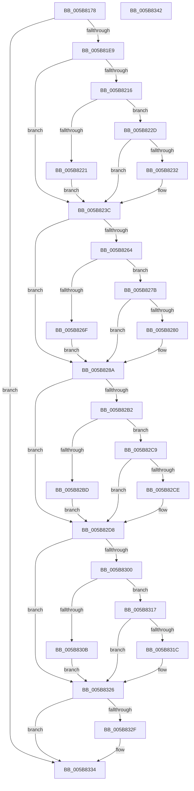

# KiInitializeNormalPriorityAntiStarvationPolicies

- RVA: `0x005B8178`–`0x005B8343` (길이 `459` bytes)
- VA: `0x00000001405B8178`
- 실행 섹션: `.text`
- PDB 이름 있음: `예`; PDB Function 태그: `아니요`
- unwind 정보 RVA: `0x000C9DEC`
- 디코드: `105`개 명령, `459/459` bytes 표시
- 미해석 바이트: `0` (있으면 어셈블리에 `.byte`로 보존)

> 이 문서는 커널 이미지의 기계어와 PDB 기호를 분석해 생성했습니다. 4번과 5번은 함수 원형과 자료형을 바이너리 사용 방식에서 추정한 C 해석이며 원본 소스 복구 결과는 아닙니다.

## 1. Dependencies

- 직접 호출 지점: **7**; 고유 호출 대상: **4**
- 직접 호출자로 확인된 함수: **1**
- RIP 상대 이미지 참조: **13**

### Outgoing calls
- `0x005B81A7` → [RtlInitUnicodeString](../42/RtlInitUnicodeString_function_0042A780.md) (function, `0x0042A780`)
- `0x005B81DC` → [ZwOpenKey](../6A/ZwOpenKey_function_006AD310.md) (function, `0x006AD310`)
- `0x005B820D` → [RtlQueryImageFileKeyOption](../../page/A2/RtlQueryImageFileKeyOption_function_00A2D110.md) (function, `0x00A2D110`)
- `0x005B825B` → [RtlQueryImageFileKeyOption](../../page/A2/RtlQueryImageFileKeyOption_function_00A2D110.md) (function, `0x00A2D110`)
- `0x005B82A9` → [RtlQueryImageFileKeyOption](../../page/A2/RtlQueryImageFileKeyOption_function_00A2D110.md) (function, `0x00A2D110`)
- `0x005B82F7` → [RtlQueryImageFileKeyOption](../../page/A2/RtlQueryImageFileKeyOption_function_00A2D110.md) (function, `0x00A2D110`)
- `0x005B832F` → [ZwClose](../6A/ZwClose_function_006AD2B0.md) (function, `0x006AD2B0`)

### Direct callers
- [KeInitSystem](../../init/C7/KeInitSystem_function_00C71660.md) at `0x00C71C0C`

### Static image references
- `0x005B818A` → RVA `0x006CB9D0` (` ?? ::FNODOBFM::`string'`; read)
- `0x005B81EF` → RVA `0x00FC50C8` (`ALMOSTRO`; read)
- `0x005B81FA` → RVA `0x006CB9A0` (` ?? ::FNODOBFM::`string'`; read)
- `0x005B8221` → RVA `0x00FC50C8` (`ALMOSTRO`; write)
- `0x005B8242` → RVA `0x00FC50CC` (`ALMOSTRO`; read)
- `0x005B824D` → RVA `0x006CBAA0` (` ?? ::FNODOBFM::`string'`; read)
- `0x005B826F` → RVA `0x00FC50CC` (`ALMOSTRO`; write)
- `0x005B8290` → RVA `0x00FC508C` (`ALMOSTRO`; read)
- `0x005B829B` → RVA `0x006CBA70` (` ?? ::FNODOBFM::`string'`; read)
- `0x005B82BD` → RVA `0x00FC508C` (`ALMOSTRO`; write)
- `0x005B82DE` → RVA `0x00FC509C` (`ALMOSTRO`; read)
- `0x005B82E9` → RVA `0x006CBAC0` (` ?? ::FNODOBFM::`string'`; read)
- `0x005B830B` → RVA `0x00FC509C` (`ALMOSTRO`; write)

## 2. Other-region calls and transfers

- 다른 실행 섹션으로 향하는 call: **4**
  - `0x005B820D` → [RtlQueryImageFileKeyOption](../../page/A2/RtlQueryImageFileKeyOption_function_00A2D110.md) (`.text` → `PAGE`)
  - `0x005B825B` → [RtlQueryImageFileKeyOption](../../page/A2/RtlQueryImageFileKeyOption_function_00A2D110.md) (`.text` → `PAGE`)
  - `0x005B82A9` → [RtlQueryImageFileKeyOption](../../page/A2/RtlQueryImageFileKeyOption_function_00A2D110.md) (`.text` → `PAGE`)
  - `0x005B82F7` → [RtlQueryImageFileKeyOption](../../page/A2/RtlQueryImageFileKeyOption_function_00A2D110.md) (`.text` → `PAGE`)
- 별도 외부 분기/꼬리 이동을 확인하지 못했습니다.

## 3. Assembly (complete function range)

```asm
005B8178  48 89 7C 24 10                  mov qword ptr [rsp + 0x10], rdi
005B817D  55                              push rbp
005B817E  48 8B EC                        mov rbp, rsp
005B8181  48 83 EC 70                     sub rsp, 0x70
005B8185  48 83 65 10 00                  and qword ptr [rbp + 0x10], 0
005B818A  48 8D 15 3F 38 11 00            lea rdx, [rip + 0x11383f]
005B8191  33 C0                           xor eax, eax
005B8193  48 8D 4D C0                     lea rcx, [rbp - 0x40]
005B8197  21 45 EC                        and dword ptr [rbp - 0x14], eax
005B819A  0F 57 C0                        xorps xmm0, xmm0
005B819D  89 45 D4                        mov dword ptr [rbp - 0x2c], eax
005B81A0  21 45 D4                        and dword ptr [rbp - 0x2c], eax
005B81A3  0F 11 45 C0                     movups xmmword ptr [rbp - 0x40], xmm0
005B81A7  E8 D4 25 E7 FF                  call 0x14042a780
005B81AC  48 83 65 D8 00                  and qword ptr [rbp - 0x28], 0
005B81B1  48 8D 45 C0                     lea rax, [rbp - 0x40]
005B81B5  0F 57 C0                        xorps xmm0, xmm0
005B81B8  48 89 45 E0                     mov qword ptr [rbp - 0x20], rax
005B81BC  4C 8D 45 D0                     lea r8, [rbp - 0x30]
005B81C0  C7 45 D0 30 00 00 00            mov dword ptr [rbp - 0x30], 0x30
005B81C7  BA 01 00 00 00                  mov edx, 1
005B81CC  C7 45 E8 40 02 00 00            mov dword ptr [rbp - 0x18], 0x240
005B81D3  48 8D 4D 10                     lea rcx, [rbp + 0x10]
005B81D7  F3 0F 7F 45 F0                  movdqu xmmword ptr [rbp - 0x10], xmm0
005B81DC  E8 2F 51 0F 00                  call 0x1406ad310
005B81E1  85 C0                           test eax, eax
005B81E3  0F 88 4B 01 00 00               js 0x1405b8334
005B81E9  48 83 64 24 28 00               and qword ptr [rsp + 0x28], 0
005B81EF  4C 8D 0D D2 CE A0 00            lea r9, [rip + 0xa0ced2]
005B81F6  48 8B 4D 10                     mov rcx, qword ptr [rbp + 0x10]
005B81FA  48 8D 15 9F 37 11 00            lea rdx, [rip + 0x11379f]
005B8201  BF 04 00 00 00                  mov edi, 4
005B8206  44 8B C7                        mov r8d, edi
005B8209  89 7C 24 20                     mov dword ptr [rsp + 0x20], edi
005B820D  E8 FE 4E 47 00                  call 0x140a2d110
005B8212  85 C0                           test eax, eax
005B8214  78 26                           js 0x1405b823c
005B8216  8B 05 AC CE A0 00               mov eax, dword ptr [rip + 0xa0ceac]
005B821C  83 F8 07                        cmp eax, 7
005B821F  73 0C                           jae 0x1405b822d
005B8221  C7 05 9D CE A0 00 07 00 00 00   mov dword ptr [rip + 0xa0ce9d], 7
005B822B  EB 0F                           jmp 0x1405b823c
005B822D  83 F8 46                        cmp eax, 0x46
005B8230  76 0A                           jbe 0x1405b823c
005B8232  C7 05 8C CE A0 00 46 00 00 00   mov dword ptr [rip + 0xa0ce8c], 0x46
005B823C  48 83 64 24 28 00               and qword ptr [rsp + 0x28], 0
005B8242  4C 8D 0D 83 CE A0 00            lea r9, [rip + 0xa0ce83]
005B8249  48 8B 4D 10                     mov rcx, qword ptr [rbp + 0x10]
005B824D  48 8D 15 4C 38 11 00            lea rdx, [rip + 0x11384c]
005B8254  44 8B C7                        mov r8d, edi
005B8257  89 7C 24 20                     mov dword ptr [rsp + 0x20], edi
005B825B  E8 B0 4E 47 00                  call 0x140a2d110
005B8260  85 C0                           test eax, eax
005B8262  78 26                           js 0x1405b828a
005B8264  8B 05 62 CE A0 00               mov eax, dword ptr [rip + 0xa0ce62]
005B826A  83 F8 06                        cmp eax, 6
005B826D  73 0C                           jae 0x1405b827b
005B826F  C7 05 53 CE A0 00 06 00 00 00   mov dword ptr [rip + 0xa0ce53], 6
005B8279  EB 0F                           jmp 0x1405b828a
005B827B  83 F8 46                        cmp eax, 0x46
005B827E  76 0A                           jbe 0x1405b828a
005B8280  C7 05 42 CE A0 00 46 00 00 00   mov dword ptr [rip + 0xa0ce42], 0x46
005B828A  48 83 64 24 28 00               and qword ptr [rsp + 0x28], 0
005B8290  4C 8D 0D F5 CD A0 00            lea r9, [rip + 0xa0cdf5]
005B8297  48 8B 4D 10                     mov rcx, qword ptr [rbp + 0x10]
005B829B  48 8D 15 CE 37 11 00            lea rdx, [rip + 0x1137ce]
005B82A2  44 8B C7                        mov r8d, edi
005B82A5  89 7C 24 20                     mov dword ptr [rsp + 0x20], edi
005B82A9  E8 62 4E 47 00                  call 0x140a2d110
005B82AE  85 C0                           test eax, eax
005B82B0  78 26                           js 0x1405b82d8
005B82B2  8B 05 D4 CD A0 00               mov eax, dword ptr [rip + 0xa0cdd4]
005B82B8  83 F8 01                        cmp eax, 1
005B82BB  73 0C                           jae 0x1405b82c9
005B82BD  C7 05 C5 CD A0 00 01 00 00 00   mov dword ptr [rip + 0xa0cdc5], 1
005B82C7  EB 0F                           jmp 0x1405b82d8
005B82C9  83 F8 0A                        cmp eax, 0xa
005B82CC  76 0A                           jbe 0x1405b82d8
005B82CE  C7 05 B4 CD A0 00 0A 00 00 00   mov dword ptr [rip + 0xa0cdb4], 0xa
005B82D8  48 83 64 24 28 00               and qword ptr [rsp + 0x28], 0
005B82DE  4C 8D 0D B7 CD A0 00            lea r9, [rip + 0xa0cdb7]
005B82E5  48 8B 4D 10                     mov rcx, qword ptr [rbp + 0x10]
005B82E9  48 8D 15 D0 37 11 00            lea rdx, [rip + 0x1137d0]
005B82F0  44 8B C7                        mov r8d, edi
005B82F3  89 7C 24 20                     mov dword ptr [rsp + 0x20], edi
005B82F7  E8 14 4E 47 00                  call 0x140a2d110
005B82FC  85 C0                           test eax, eax
005B82FE  78 26                           js 0x1405b8326
005B8300  8B 05 96 CD A0 00               mov eax, dword ptr [rip + 0xa0cd96]
005B8306  83 F8 01                        cmp eax, 1
005B8309  73 0C                           jae 0x1405b8317
005B830B  C7 05 87 CD A0 00 01 00 00 00   mov dword ptr [rip + 0xa0cd87], 1
005B8315  EB 0F                           jmp 0x1405b8326
005B8317  83 F8 14                        cmp eax, 0x14
005B831A  76 0A                           jbe 0x1405b8326
005B831C  C7 05 76 CD A0 00 14 00 00 00   mov dword ptr [rip + 0xa0cd76], 0x14
005B8326  48 8B 4D 10                     mov rcx, qword ptr [rbp + 0x10]
005B832A  48 85 C9                        test rcx, rcx
005B832D  74 05                           je 0x1405b8334
005B832F  E8 7C 4F 0F 00                  call 0x1406ad2b0
005B8334  48 8B BC 24 88 00 00 00         mov rdi, qword ptr [rsp + 0x88]
005B833C  48 83 C4 70                     add rsp, 0x70
005B8340  5D                              pop rbp
005B8341  C3                              ret
005B8342  CC                              int3
```

## 4. C-style interpretation (structured pseudocode)

```c
__int64 __fastcall KiInitializeNormalPriorityAntiStarvationPolicies(void)
{
    __int64 result;
    __int64 v_rsp;
    unsigned __int64 v_stack_m18;
    unsigned int v_stack_m1C;
    unsigned int v_stack_m20;
    unsigned __int64 v_stack_m28;
    unsigned __int64 v_stack_m30;
    unsigned int v_stack_m34;
    unsigned __int64 v_stack_m38;
    unsigned __int64 v_stack_m48;
    unsigned __int64 v_stack_m50;
    unsigned int v_stack_m58;
    unsigned __int64 v_stack_p10;
    unsigned __int64 v_stack_p8;

    v_stack_p10 = v_rdi;
    v_rsp = (v_rsp) - (112);
    result = 0;
    v_stack_m34 = 0;
    v_stack_m48 = v_xmm0;
    result = RtlInitUnicodeString(v_stack_m48, v_rip + 1128511, a3, a4);
    v_stack_m28 = v_stack_m48;
    v_stack_m38 = 48;
    v_stack_m20 = 576;
    v_stack_m18 = v_xmm0;
    result = ZwOpenKey(v_stack_p8, 1, v_stack_m38, a4);
    if (sign_flag) goto loc_005B8334;
    v_stack_m58 = 4;
    result = RtlQueryImageFileKeyOption(v_stack_p8, v_rip + 1128351, 4, v_rip + 10538706);
    if (sign_flag) goto loc_005B823C;
    if (((unsigned int)((unsigned int)(*(unsigned int *)(v_rip + 10538668)))) >= 7) goto loc_005B822D;
    *(unsigned int *)(v_rip + 10538653) = 7;
    goto loc_005B823C;
loc_005B822D:
    if (((unsigned int)((unsigned int)(*(unsigned int *)(v_rip + 10538668)))) >= = 70) {
        *(unsigned int *)(v_rip + 10538636) = 70;
    }
    v_stack_m58 = 4;
    result = RtlQueryImageFileKeyOption(v_stack_p8, v_rip + 1128524, 4, v_rip + 10538627);
    if (sign_flag) goto loc_005B828A;
    if (((unsigned int)((unsigned int)(*(unsigned int *)(v_rip + 10538594)))) >= 6) goto loc_005B827B;
    *(unsigned int *)(v_rip + 10538579) = 6;
    goto loc_005B828A;
loc_005B827B:
    if (((unsigned int)((unsigned int)(*(unsigned int *)(v_rip + 10538594)))) >= = 70) {
        *(unsigned int *)(v_rip + 10538562) = 70;
    }
    v_stack_m58 = 4;
    result = RtlQueryImageFileKeyOption(v_stack_p8, v_rip + 1128398, 4, v_rip + 10538485);
    if (sign_flag) goto loc_005B82D8;
    if (((unsigned int)((unsigned int)(*(unsigned int *)(v_rip + 10538452)))) >= 1) goto loc_005B82C9;
    *(unsigned int *)(v_rip + 10538437) = 1;
    goto loc_005B82D8;
loc_005B82C9:
    if (((unsigned int)((unsigned int)(*(unsigned int *)(v_rip + 10538452)))) >= = 10) {
        *(unsigned int *)(v_rip + 10538420) = 10;
    }
    v_stack_m58 = 4;
    result = RtlQueryImageFileKeyOption(v_stack_p8, v_rip + 1128400, 4, v_rip + 10538423);
    if (sign_flag) goto loc_005B8326;
    if (((unsigned int)((unsigned int)(*(unsigned int *)(v_rip + 10538390)))) >= 1) goto loc_005B8317;
    *(unsigned int *)(v_rip + 10538375) = 1;
    goto loc_005B8326;
loc_005B8317:
    if (((unsigned int)((unsigned int)(*(unsigned int *)(v_rip + 10538390)))) >= = 20) {
        *(unsigned int *)(v_rip + 10538358) = 20;
    }
    result = (unsigned int)(*(unsigned int *)(v_rip + 10538390));
    if (v_stack_p8 != 0) {
        result = ZwClose(v_stack_p8, v_rip + 1128400, 4, v_rip + 10538423);
    }
    v_rsp = (v_rsp) + (112);
    return result;
}
```

## 5. (Beta) C Style

```c
void KiInitializeNormalPriorityAntiStarvationPolicies(void)
{
    int64_t result;
    int64_t local_rsp;
    uint64_t v_stack_m18;
    uint32_t v_stack_m1C;
    uint32_t v_stack_m20;
    uint64_t v_stack_m28;
    uint64_t v_stack_m30;
    uint32_t v_stack_m34;
    uint64_t v_stack_m38;
    uint64_t v_stack_m48;
    uint64_t v_stack_m50;
    uint32_t v_stack_m58;
    uint64_t v_stack_p10;
    uint64_t v_stack_p8;

    v_stack_p10 = local_rdi;
    local_rsp = (local_rsp) - (112);
    result = 0;
    v_stack_m34 = 0;
    v_stack_m48 = v_xmm0;
    result = RtlInitUnicodeString(v_stack_m48, v_rip + 1128511, a3, a4);
    v_stack_m28 = v_stack_m48;
    v_stack_m38 = 48;
    v_stack_m20 = 576;
    v_stack_m18 = v_xmm0;
    result = ZwOpenKey(v_stack_p8, 1, v_stack_m38, a4);
    if (sign_flag) goto loc_005B8334;
    v_stack_m58 = 4;
    result = RtlQueryImageFileKeyOption(v_stack_p8, v_rip + 1128351, 4, v_rip + 10538706);
    if (sign_flag) goto loc_005B823C;
    if (((uint32_t)((uint32_t)(*(uint32_t *)(v_rip + 0xA0CEAC)))) >= 7) goto loc_005B822D;
    *(uint32_t *)(v_rip + 0xA0CE9D) = 7;
    goto loc_005B823C;
loc_005B822D:
    if (((uint32_t)((uint32_t)(*(uint32_t *)(v_rip + 0xA0CEAC)))) >= = 70) {
        *(uint32_t *)(v_rip + 0xA0CE8C) = 70;
    }
    v_stack_m58 = 4;
    result = RtlQueryImageFileKeyOption(v_stack_p8, v_rip + 1128524, 4, v_rip + 10538627);
    if (sign_flag) goto loc_005B828A;
    if (((uint32_t)((uint32_t)(*(uint32_t *)(v_rip + 0xA0CE62)))) >= 6) goto loc_005B827B;
    *(uint32_t *)(v_rip + 0xA0CE53) = 6;
    goto loc_005B828A;
loc_005B827B:
    if (((uint32_t)((uint32_t)(*(uint32_t *)(v_rip + 0xA0CE62)))) >= = 70) {
        *(uint32_t *)(v_rip + 0xA0CE42) = 70;
    }
    v_stack_m58 = 4;
    result = RtlQueryImageFileKeyOption(v_stack_p8, v_rip + 1128398, 4, v_rip + 10538485);
    if (sign_flag) goto loc_005B82D8;
    if (((uint32_t)((uint32_t)(*(uint32_t *)(v_rip + 0xA0CDD4)))) >= 1) goto loc_005B82C9;
    *(uint32_t *)(v_rip + 0xA0CDC5) = 1;
    goto loc_005B82D8;
loc_005B82C9:
    if (((uint32_t)((uint32_t)(*(uint32_t *)(v_rip + 0xA0CDD4)))) >= = 10) {
        *(uint32_t *)(v_rip + 0xA0CDB4) = 10;
    }
    v_stack_m58 = 4;
    result = RtlQueryImageFileKeyOption(v_stack_p8, v_rip + 1128400, 4, v_rip + 10538423);
    if (sign_flag) goto loc_005B8326;
    if (((uint32_t)((uint32_t)(*(uint32_t *)(v_rip + 0xA0CD96)))) >= 1) goto loc_005B8317;
    *(uint32_t *)(v_rip + 0xA0CD87) = 1;
    goto loc_005B8326;
loc_005B8317:
    if (((uint32_t)((uint32_t)(*(uint32_t *)(v_rip + 0xA0CD96)))) >= = 20) {
        *(uint32_t *)(v_rip + 0xA0CD76) = 20;
    }
    result = (uint32_t)(*(uint32_t *)(v_rip + 0xA0CD96));
    if (v_stack_p8 != 0) {
        result = ZwClose(v_stack_p8, v_rip + 1128400, 4, v_rip + 10538423);
    }
    local_rsp = (local_rsp) + (112);
    return result;
}
```

## 6. Execution-region graph

[열기: 2D/3D 그래프와 함수 탐색 컨트롤 패널](../../../control-panel.html?section=text&rva=0x005B8178&view=graph)

- 2D 그래프는 위에서 아래로 흐르고, 3D 그래프는 빈 공간을 드래그해 회전합니다. Shift+드래그는 이동, 휠은 확대·축소, 함수 노드 선택은 대상 보고서 이동입니다.

### Static fallback


