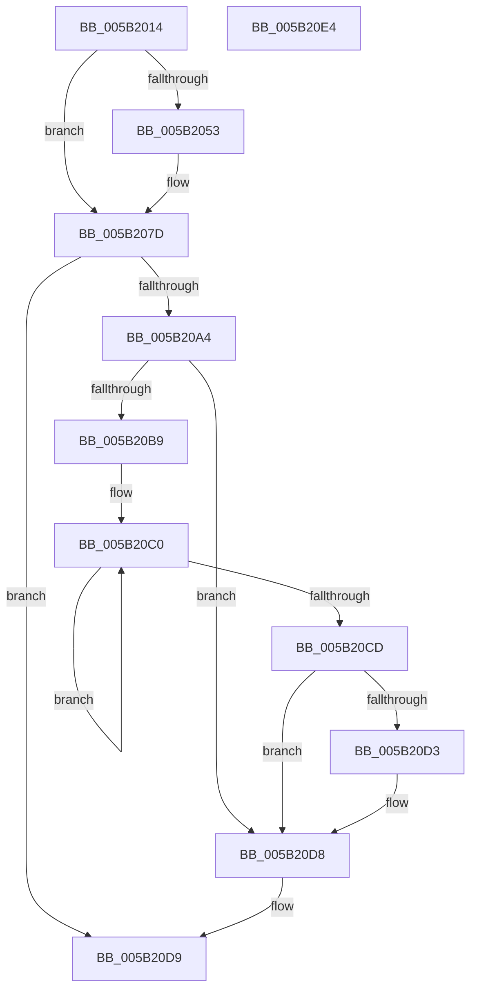

# KiInitializeProcessorCycleAccumulation

- RVA: `0x005B2014`–`0x005B20E5` (길이 `209` bytes)
- VA: `0x00000001405B2014`
- 실행 섹션: `.text`
- PDB 이름 있음: `예`; PDB Function 태그: `아니요`
- unwind 정보 RVA: `0x00068D5C`
- 디코드: `57`개 명령, `209/209` bytes 표시
- 미해석 바이트: `0` (있으면 어셈블리에 `.byte`로 보존)

> 이 문서는 커널 이미지의 기계어와 PDB 기호를 분석해 생성했습니다. 4번과 5번은 함수 원형과 자료형을 바이너리 사용 방식에서 추정한 C 해석이며 원본 소스 복구 결과는 아닙니다.

## 1. Dependencies

- 직접 호출 지점: **4**; 고유 호출 대상: **4**
- 직접 호출자로 확인된 함수: **2**
- RIP 상대 이미지 참조: **0**

### Outgoing calls
- `0x005B2042` → [RtlpComputeFraction](../4F/RtlpComputeFraction_function_004FC140.md) (function, `0x004FC140`)
- `0x005B208A` → [KeDisableInterrupts](../21/KeDisableInterrupts_function_00217BE0.md) (function, `0x00217BE0`)
- `0x005B2094` → [KiRebaselineProcessorStartCycles](KiRebaselineProcessorStartCycles_function_005B20EC.md) (function, `0x005B20EC`)
- `0x005B20D3` → [KiRemoveSystemWorkPriorityKick](../26/KiRemoveSystemWorkPriorityKick_function_002631D0.md) (function, `0x002631D0`)

### Direct callers
- [KiInitializeKernel](../../pagelk/B6/KiInitializeKernel_function_00B68D20.md) at `0x00B695EC`
- [KeInitializeClock](../../init/C7/KeInitializeClock_function_00C70C30.md) at `0x00C7111D`

### Static image references
- 디코드된 RIP-relative 메모리 참조가 없습니다.

## 2. Other-region calls and transfers

- 다른 실행 섹션으로 향하는 call: **0**
- 별도 외부 분기/꼬리 이동을 확인하지 못했습니다.

## 3. Assembly (complete function range)

```asm
005B2014  48 89 5C 24 10                  mov qword ptr [rsp + 0x10], rbx
005B2019  57                              push rdi
005B201A  48 83 EC 20                     sub rsp, 0x20
005B201E  8B 41 44                        mov eax, dword ptr [rcx + 0x44]
005B2021  4C 8D 44 24 30                  lea r8, [rsp + 0x30]
005B2026  48 8B F9                        mov rdi, rcx
005B2029  C6 44 24 30 00                  mov byte ptr [rsp + 0x30], 0
005B202E  48 69 C8 40 42 0F 00            imul rcx, rax, 0xf4240
005B2035  48 BA 00 03 00 00 80 F7 FF FF   movabs rdx, 0xfffff78000000300
005B203F  48 8B 12                        mov rdx, qword ptr [rdx]
005B2042  E8 F9 A0 F4 FF                  call 0x1404fc140
005B2047  4C 8B C8                        mov r9, rax
005B204A  0F BE 44 24 30                  movsx eax, byte ptr [rsp + 0x30]
005B204F  84 C0                           test al, al
005B2051  79 2A                           jns 0x1405b207d
005B2053  8B C8                           mov ecx, eax
005B2055  44 8B C0                        mov r8d, eax
005B2058  F7 D1                           not ecx
005B205A  B8 01 00 00 00                  mov eax, 1
005B205F  D3 E0                           shl eax, cl
005B2061  49 03 C1                        add rax, r9
005B2064  49 3B C1                        cmp rax, r9
005B2067  49 0F 42 C1                     cmovb rax, r9
005B206B  41 F7 D8                        neg r8d
005B206E  4C 8B C8                        mov r9, rax
005B2071  41 8A C8                        mov cl, r8b
005B2074  49 D3 E9                        shr r9, cl
005B2077  32 C0                           xor al, al
005B2079  88 44 24 30                     mov byte ptr [rsp + 0x30], al
005B207D  4C 89 8F B0 00 00 00            mov qword ptr [rdi + 0xb0], r9
005B2084  88 87 AC 00 00 00               mov byte ptr [rdi + 0xac], al
005B208A  E8 51 5B C6 FF                  call 0x140217be0
005B208F  48 8B CF                        mov rcx, rdi
005B2092  8A D8                           mov bl, al
005B2094  E8 53 00 00 00                  call 0x1405b20ec
005B2099  C6 87 DC 86 00 00 01            mov byte ptr [rdi + 0x86dc], 1
005B20A0  84 DB                           test bl, bl
005B20A2  74 35                           je 0x1405b20d9
005B20A4  65 48 8B 0C 25 20 00 00 00      mov rcx, qword ptr gs:[0x20]
005B20AD  4C 8B 81 B8 8E 00 00            mov r8, qword ptr [rcx + 0x8eb8]
005B20B4  4D 85 C0                        test r8, r8
005B20B7  74 1F                           je 0x1405b20d8
005B20B9  41 0F 0D 08                     prefetchw byte ptr [r8]
005B20BD  41 8B 00                        mov eax, dword ptr [r8]
005B20C0  8B D0                           mov edx, eax
005B20C2  0F BA F2 15                     btr edx, 0x15
005B20C6  F0 41 0F B1 10                  lock cmpxchg dword ptr [r8], edx
005B20CB  75 F3                           jne 0x1405b20c0
005B20CD  0F BA E0 15                     bt eax, 0x15
005B20D1  73 05                           jae 0x1405b20d8
005B20D3  E8 F8 10 CB FF                  call 0x1402631d0
005B20D8  FB                              sti
005B20D9  48 8B 5C 24 38                  mov rbx, qword ptr [rsp + 0x38]
005B20DE  48 83 C4 20                     add rsp, 0x20
005B20E2  5F                              pop rdi
005B20E3  C3                              ret
005B20E4  CC                              int3
```

## 4. C-style interpretation (structured pseudocode)

```c
__int64 __fastcall KiInitializeProcessorCycleAccumulation(__int64 a1)
{
    __int64 result;
    __int64 v_rsp;
    unsigned __int64 v_stack_p10;
    unsigned __int64 v_stack_p8;

    v_stack_p10 = v_rbx;
    v_rsp = (v_rsp) - (32);
    v_stack_p8 = 0;
    a1 = (a1) * ((unsigned int)(*(unsigned int *)(a1 + 68)));
    result = RtlpComputeFraction(a1, *(unsigned __int64 *)(a2), v_stack_p8, a4);
    result = (__int8)(v_stack_p8);
    if (sign_flag) {
        a1 = (unsigned int)((__int8)(v_stack_p8));
        a3 = (unsigned int)((__int8)(v_stack_p8));
        a1 = (unsigned int)(~(a1));
        result = 1;
        result = (unsigned int)((result) << ((unsigned __int8)(a1)));
        result = (result) + (result);
        if (result < result) { result = result; }
        a3 = (unsigned int)(-(a3));
        a4 = result;
        a1 = (unsigned __int8)(a3);
        a4 = (a4) >> ((unsigned __int8)(a1));
        result = 0;
        v_stack_p8 = 0;
    }
    *(unsigned __int64 *)(a1 + 176) = a4;
    *(unsigned __int8 *)(a1 + 172) = 0;
    result = KeDisableInterrupts(a1, *(unsigned __int64 *)(a2), a3, a4);
    result = KiRebaselineProcessorStartCycles(a1, *(unsigned __int64 *)(a2), a3, a4);
    *(unsigned __int8 *)(a1 + 34524) = 1;
    if ((unsigned __int8)((unsigned __int8)(result)) == 0) goto loc_005B20D9;
    if (*(unsigned __int64 *)(*(unsigned __int64 *)(gs_base + (0 + 32)) + 36536) == 0) goto loc_005B20D8;
loc_005B20C0:
    if (*(unsigned __int64 *)(*(unsigned __int64 *)(gs_base + (0 + 32)) + 36536) != 0) goto loc_005B20C0;
    result = (unsigned int)(*(unsigned int *)(*(unsigned __int64 *)(*(unsigned __int64 *)(gs_base + (0 + 32)) + 36536)));
    if (!(condition_is_above_or_equal)) {
        result = KiRemoveSystemWorkPriorityKick(*(unsigned __int64 *)(gs_base + (0 + 32)), (unsigned int)((unsigned int)((unsigned int)(*(unsigned int *)(*(unsigned __int64 *)(*(unsigned __int64 *)(gs_base + (0 + 32)) + 36536))))), *(unsigned __int64 *)(*(unsigned __int64 *)(gs_base + (0 + 32)) + 36536), a4);
    }
loc_005B20D9:
    v_rsp = (v_rsp) + (32);
    return result;
}
```

## 5. (Beta) C Style

```c
int64_t KiInitializeProcessorCycleAccumulation(void *Arg1)
{
    uint8_t *arg1 = (uint8_t *)Arg1;

    int64_t result;
    int64_t local_rsp;
    uint64_t v_stack_p10;
    uint64_t v_stack_p8;

    v_stack_p10 = local_rbx;
    local_rsp = (local_rsp) - (32);
    v_stack_p8 = 0;
    Arg1 = (Arg1) * ((uint32_t)(*(uint32_t *)(arg1 + 0x44)));
    result = RtlpComputeFraction(Arg1, *(uint64_t *)(a2), v_stack_p8, a4);
    result = (int8_t)(v_stack_p8);
    if (sign_flag) {
        Arg1 = (uint32_t)((int8_t)(v_stack_p8));
        a3 = (uint32_t)((int8_t)(v_stack_p8));
        Arg1 = (uint32_t)(~(Arg1));
        result = 1;
        result = (uint32_t)((result) << ((uint8_t)(Arg1)));
        result = (result) + (result);
        if (result < result) { result = result; }
        a3 = (uint32_t)(-(a3));
        a4 = result;
        Arg1 = (uint8_t)(a3);
        a4 = (a4) >> ((uint8_t)(Arg1));
        result = 0;
        v_stack_p8 = 0;
    }
    *(uint64_t *)(arg1 + 0xB0) = a4;
    *(uint8_t *)(arg1 + 0xAC) = 0;
    result = KeDisableInterrupts(Arg1, *(uint64_t *)(a2), a3, a4);
    result = KiRebaselineProcessorStartCycles(Arg1, *(uint64_t *)(a2), a3, a4);
    *(uint8_t *)(arg1 + 0x86DC) = 1;
    if ((uint8_t)((uint8_t)(result)) == 0) goto loc_005B20D9;
    if (*(uint64_t *)(*(uint64_t *)(gs_base + (0 + 0x20)) + 0x8EB8) == 0) goto loc_005B20D8;
loc_005B20C0:
    if (*(uint64_t *)(*(uint64_t *)(gs_base + (0 + 0x20)) + 0x8EB8) != 0) goto loc_005B20C0;
    result = (uint32_t)(*(uint32_t *)(*(uint64_t *)(*(uint64_t *)(gs_base + (0 + 0x20)) + 0x8EB8)));
    if (!(condition_is_above_or_equal)) {
        result = KiRemoveSystemWorkPriorityKick(*(uint64_t *)(gs_base + (0 + 0x20)), (uint32_t)((uint32_t)((uint32_t)(*(uint32_t *)(*(uint64_t *)(*(uint64_t *)(gs_base + (0 + 0x20)) + 0x8EB8))))), *(uint64_t *)(*(uint64_t *)(gs_base + (0 + 0x20)) + 0x8EB8), a4);
    }
loc_005B20D9:
    local_rsp = (local_rsp) + (32);
    return result;
}
```

### 관측된 메모리 오프셋

구조체 형식이 확인되지 않은 접근은 인자 기준의 오프셋으로만 기록했습니다.

| 기준 인자 | 오프셋 표현 | 폭 (bit) | 접근 |
|---|---:|---:|---|
| `Arg1` | `+ 0x44` | `32` | `R` |
| `Arg1` | `+ 0xAC` | `8` | `W` |
| `Arg1` | `+ 0xB0` | `64` | `W` |
| `Arg1` | `+ 0x86DC` | `8` | `W` |

## 6. Execution-region graph

[열기: 2D/3D 그래프와 함수 탐색 컨트롤 패널](../../../control-panel.html?section=text&rva=0x005B2014&view=graph)

- 2D 그래프는 위에서 아래로 흐르고, 3D 그래프는 빈 공간을 드래그해 회전합니다. Shift+드래그는 이동, 휠은 확대·축소, 함수 노드 선택은 대상 보고서 이동입니다.

### Static fallback


