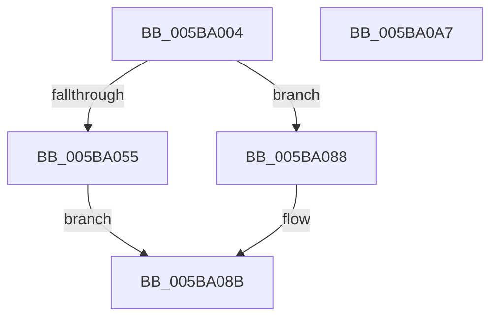

# KiInitializeProcessorXSaveStructures

- RVA: `0x005BA004`–`0x005BA0A8` (길이 `164` bytes)
- VA: `0x00000001405BA004`
- 실행 섹션: `.text`
- PDB 이름 있음: `예`; PDB Function 태그: `아니요`
- unwind 정보 RVA: `0x00066400`
- 디코드: `38`개 명령, `164/164` bytes 표시
- 미해석 바이트: `0` (있으면 어셈블리에 `.byte`로 보존)

> 이 문서는 커널 이미지의 기계어와 PDB 기호를 분석해 생성했습니다. 4번과 5번은 함수 원형과 자료형을 바이너리 사용 방식에서 추정한 C 해석이며 원본 소스 복구 결과는 아닙니다.

## 1. Dependencies

- 직접 호출 지점: **2**; 고유 호출 대상: **2**
- 직접 호출자로 확인된 함수: **1**
- RIP 상대 이미지 참조: **3**

### Outgoing calls
- `0x005BA048` → [ExAllocatePool2](../../poolcode/B8/ExAllocatePool2_function_00B820F0.md) (function, `0x00B820F0`)
- `0x005BA081` → [ExInitializeSystemLookasideList](../../pagelk/B7/ExInitializeSystemLookasideList_function_00B7E57C.md) (function, `0x00B7E57C`)

### Direct callers
- [KiCompleteKernelInit](../../pagelk/B6/KiCompleteKernelInit_function_00B66090.md) at `0x00B66256`

### Static image references
- `0x005BA018` → RVA `0x00F225E8` (`.data`; read)
- `0x005BA01E` → RVA `0x00E15980` (`.data`; read)
- `0x005BA05E` → RVA `0x00EFAC00` (`.data`; read)

## 2. Other-region calls and transfers

- 다른 실행 섹션으로 향하는 call: **2**
  - `0x005BA048` → [ExAllocatePool2](../../poolcode/B8/ExAllocatePool2_function_00B820F0.md) (`.text` → `POOLCODE`)
  - `0x005BA081` → [ExInitializeSystemLookasideList](../../pagelk/B7/ExInitializeSystemLookasideList_function_00B7E57C.md) (`.text` → `PAGELK`)
- 별도 외부 분기/꼬리 이동을 확인하지 못했습니다.

## 3. Assembly (complete function range)

```asm
005BA004  48 89 5C 24 08                  mov qword ptr [rsp + 8], rbx
005BA009  48 89 6C 24 10                  mov qword ptr [rsp + 0x10], rbp
005BA00E  48 89 74 24 18                  mov qword ptr [rsp + 0x18], rsi
005BA013  57                              push rdi
005BA014  48 83 EC 30                     sub rsp, 0x30
005BA018  8B 05 CA 85 96 00               mov eax, dword ptr [rip + 0x9685ca]
005BA01E  48 8D 2D 5B B9 85 00            lea rbp, [rip + 0x85b95b]
005BA025  BA 80 00 00 00                  mov edx, 0x80
005BA02A  48 89 A9 98 08 00 00            mov qword ptr [rcx + 0x898], rbp
005BA031  85 C0                           test eax, eax
005BA033  48 8B F9                        mov rdi, rcx
005BA036  BE 10 00 00 00                  mov esi, 0x10
005BA03B  41 B8 58 53 61 4C               mov r8d, 0x4c615358
005BA041  66 0F 45 F0                     cmovne si, ax
005BA045  8D 4A C0                        lea ecx, [rdx - 0x40]
005BA048  E8 A3 80 5C 00                  call 0x140b820f0
005BA04D  48 8B D8                        mov rbx, rax
005BA050  48 85 C0                        test rax, rax
005BA053  74 33                           je 0x1405ba088
005BA055  A1 E8 03 00 00 80 F7 FF FF      movabs eax, dword ptr [0xfffff780000003e8]
005BA05E  48 8D 0D 9B 0B 94 00            lea rcx, [rip + 0x940b9b]
005BA065  48 89 4C 24 28                  mov qword ptr [rsp + 0x28], rcx
005BA06A  BA 00 02 00 00                  mov edx, 0x200
005BA06F  41 B9 58 53 61 4C               mov r9d, 0x4c615358
005BA075  66 89 74 24 20                  mov word ptr [rsp + 0x20], si
005BA07A  48 8B CB                        mov rcx, rbx
005BA07D  44 8D 40 3F                     lea r8d, [rax + 0x3f]
005BA081  E8 F6 44 5C 00                  call 0x140b7e57c
005BA086  EB 03                           jmp 0x1405ba08b
005BA088  48 8B DD                        mov rbx, rbp
005BA08B  48 8B 6C 24 48                  mov rbp, qword ptr [rsp + 0x48]
005BA090  48 8B 74 24 50                  mov rsi, qword ptr [rsp + 0x50]
005BA095  48 89 9F 90 08 00 00            mov qword ptr [rdi + 0x890], rbx
005BA09C  48 8B 5C 24 40                  mov rbx, qword ptr [rsp + 0x40]
005BA0A1  48 83 C4 30                     add rsp, 0x30
005BA0A5  5F                              pop rdi
005BA0A6  C3                              ret
005BA0A7  CC                              int3
```

## 4. C-style interpretation (structured pseudocode)

```c
__int64 __fastcall KiInitializeProcessorXSaveStructures(__int64 a1)
{
    __int64 result;
    __int64 v_rsi;
    __int64 v_rsp;
    unsigned __int64 v_stack_m10;
    unsigned __int16 v_stack_m18;
    unsigned __int64 v_stack_p10;
    unsigned __int64 v_stack_p18;
    unsigned __int64 v_stack_p8;

    v_stack_p8 = v_rbx;
    v_stack_p10 = v_rbp;
    v_stack_p18 = v_rsi;
    v_rsp = (v_rsp) - (48);
    *(unsigned __int64 *)(a1 + 2200) = v_rip + 8763739;
    v_rsi = 16;
    if ((unsigned int)((unsigned int)(*(unsigned int *)(v_rip + 9864650))) != 0) { v_rsi = (unsigned __int16)((unsigned int)(*(unsigned int *)(v_rip + 9864650))); }
    result = ExAllocatePool2(128 - 64, 128, (unsigned int)(0x4C615358ULL), a4);
    if (result == 0) goto loc_005BA088;
    v_stack_m10 = v_rip + 9702299;
    v_stack_m18 = (unsigned __int16)(v_rsi);
    result = ExInitializeSystemLookasideList(result, 512, result + 63, (unsigned int)(0x4C615358ULL));
    goto loc_005BA08B;
loc_005BA088:
loc_005BA08B:
    *(unsigned __int64 *)(a1 + 2192) = v_rip + 8763739;
    v_rsp = (v_rsp) + (48);
    return result;
}
```

## 5. (Beta) C Style

```c
int64_t KiInitializeProcessorXSaveStructures(void *Arg1)
{
    uint8_t *arg1 = (uint8_t *)Arg1;

    int64_t result;
    int64_t local_rsi;
    int64_t local_rsp;
    uint64_t v_stack_m10;
    uint16_t v_stack_m18;
    uint64_t v_stack_p10;
    uint64_t v_stack_p18;
    uint64_t v_stack_p8;

    v_stack_p8 = local_rbx;
    v_stack_p10 = local_rbp;
    v_stack_p18 = local_rsi;
    local_rsp = (local_rsp) - (48);
    *(uint64_t *)(arg1 + 0x898) = v_rip + 8763739;
    local_rsi = 16;
    if ((uint32_t)((uint32_t)(*(uint32_t *)(v_rip + 0x9685CA))) != 0) { local_rsi = (uint16_t)((uint32_t)(*(uint32_t *)(v_rip + 0x9685CA))); }
    result = ExAllocatePool2(128 - 64, 128, (uint32_t)(0x4C615358ULL), a4);
    if (result == 0) goto loc_005BA088;
    v_stack_m10 = v_rip + 9702299;
    v_stack_m18 = (uint16_t)(local_rsi);
    result = ExInitializeSystemLookasideList(result, 512, result + 63, (uint32_t)(0x4C615358ULL));
    goto loc_005BA08B;
loc_005BA088:
loc_005BA08B:
    *(uint64_t *)(arg1 + 0x890) = v_rip + 8763739;
    local_rsp = (local_rsp) + (48);
    return result;
}
```

### 관측된 메모리 오프셋

구조체 형식이 확인되지 않은 접근은 인자 기준의 오프셋으로만 기록했습니다.

| 기준 인자 | 오프셋 표현 | 폭 (bit) | 접근 |
|---|---:|---:|---|
| `Arg1` | `+ 0x890` | `64` | `W` |
| `Arg1` | `+ 0x898` | `64` | `W` |

## 6. Execution-region graph

[열기: 2D/3D 그래프와 함수 탐색 컨트롤 패널](../../../control-panel.html?section=text&rva=0x005BA004&view=graph)

- 2D 그래프는 위에서 아래로 흐르고, 3D 그래프는 빈 공간을 드래그해 회전합니다. Shift+드래그는 이동, 휠은 확대·축소, 함수 노드 선택은 대상 보고서 이동입니다.

### Static fallback


