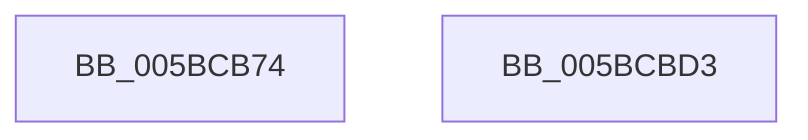

# KiInitializeSchedulerSubNode

- RVA: `0x005BCB74`–`0x005BCBD4` (길이 `96` bytes)
- VA: `0x00000001405BCB74`
- 실행 섹션: `.text`
- PDB 이름 있음: `예`; PDB Function 태그: `아니요`
- unwind 정보 RVA: `0x0005CAAC`
- 디코드: `23`개 명령, `96/96` bytes 표시
- 미해석 바이트: `0` (있으면 어셈블리에 `.byte`로 보존)

> 이 문서는 커널 이미지의 기계어와 PDB 기호를 분석해 생성했습니다. 4번과 5번은 함수 원형과 자료형을 바이너리 사용 방식에서 추정한 C 해석이며 원본 소스 복구 결과는 아닙니다.

## 1. Dependencies

- 직접 호출 지점: **2**; 고유 호출 대상: **1**
- 직접 호출자로 확인된 함수: **2**
- RIP 상대 이미지 참조: **0**

### Outgoing calls
- `0x005BCB8C` → [memset](../6C/memset_function_006C6C40.md) (function, `0x006C6C40`)
- `0x005BCBC3` → [memset](../6C/memset_function_006C6C40.md) (function, `0x006C6C40`)

### Direct callers
- [KiAllocateSchedulerSubNode](KiAllocateSchedulerSubNode_function_005BC45C.md) at `0x005BC4C2`
- [KiConfigureInitialNodes](KiConfigureInitialNodes_function_005BC738.md) at `0x005BC7FB`

### Static image references
- 디코드된 RIP-relative 메모리 참조가 없습니다.

## 2. Other-region calls and transfers

- 다른 실행 섹션으로 향하는 call: **0**
- 별도 외부 분기/꼬리 이동을 확인하지 못했습니다.

## 3. Assembly (complete function range)

```asm
005BCB74  48 89 5C 24 08                  mov qword ptr [rsp + 8], rbx
005BCB79  57                              push rdi
005BCB7A  48 83 EC 20                     sub rsp, 0x20
005BCB7E  48 8B DA                        mov rbx, rdx
005BCB81  41 B8 00 03 00 00               mov r8d, 0x300
005BCB87  33 D2                           xor edx, edx
005BCB89  48 8B F9                        mov rdi, rcx
005BCB8C  E8 AF A0 10 00                  call 0x1406c6c40
005BCB91  0F B7 43 02                     movzx eax, word ptr [rbx + 2]
005BCB95  48 8D 8F C0 01 00 00            lea rcx, [rdi + 0x1c0]
005BCB9C  66 89 87 8A 00 00 00            mov word ptr [rdi + 0x8a], ax
005BCBA3  BA FF 00 00 00                  mov edx, 0xff
005BCBA8  0F B7 03                        movzx eax, word ptr [rbx]
005BCBAB  41 B8 40 00 00 00               mov r8d, 0x40
005BCBB1  66 89 87 8C 00 00 00            mov word ptr [rdi + 0x8c], ax
005BCBB8  0F B7 43 06                     movzx eax, word ptr [rbx + 6]
005BCBBC  66 89 87 88 00 00 00            mov word ptr [rdi + 0x88], ax
005BCBC3  E8 78 A0 10 00                  call 0x1406c6c40
005BCBC8  48 8B 5C 24 30                  mov rbx, qword ptr [rsp + 0x30]
005BCBCD  48 83 C4 20                     add rsp, 0x20
005BCBD1  5F                              pop rdi
005BCBD2  C3                              ret
005BCBD3  CC                              int3
```

## 4. C-style interpretation (structured pseudocode)

```c
__int64 __fastcall KiInitializeSchedulerSubNode(__int64 a1, __int64 a2)
{
    __int64 result;
    __int64 v_rsp;
    unsigned __int64 v_stack_p8;

    v_stack_p8 = v_rbx;
    v_rsp = (v_rsp) - (32);
    a2 = 0;
    result = memset(a1, a2, 768, a4);
    *(unsigned __int16 *)(a1 + 138) = (unsigned __int16)(*(unsigned __int16 *)(a2 + 2));
    *(unsigned __int16 *)(a1 + 140) = (unsigned __int16)(*(unsigned __int16 *)(a2));
    *(unsigned __int16 *)(a1 + 136) = (unsigned __int16)(*(unsigned __int16 *)(a2 + 6));
    result = memset(a1 + 448, 255, 64, a4);
    v_rsp = (v_rsp) + (32);
    return result;
}
```

## 5. (Beta) C Style

```c
int64_t KiInitializeSchedulerSubNode(void *Arg1, void *Arg2)
{
    uint8_t *arg1 = (uint8_t *)Arg1;
    uint8_t *arg2 = (uint8_t *)Arg2;

    int64_t result;
    int64_t local_rsp;
    uint64_t v_stack_p8;

    v_stack_p8 = local_rbx;
    local_rsp = (local_rsp) - (32);
    Arg2 = 0;
    result = memset(Arg1, Arg2, 768, a4);
    *(uint16_t *)(arg1 + 0x8A) = (uint16_t)(*(uint16_t *)(arg2 + 0x2));
    *(uint16_t *)(arg1 + 0x8C) = (uint16_t)(*(uint16_t *)(arg2));
    *(uint16_t *)(arg1 + 0x88) = (uint16_t)(*(uint16_t *)(arg2 + 0x6));
    result = memset(Arg1 + 448, 255, 64, a4);
    local_rsp = (local_rsp) + (32);
    return result;
}
```

### 관측된 메모리 오프셋

구조체 형식이 확인되지 않은 접근은 인자 기준의 오프셋으로만 기록했습니다.

| 기준 인자 | 오프셋 표현 | 폭 (bit) | 접근 |
|---|---:|---:|---|
| `Arg1` | `+ 0x88` | `16` | `W` |
| `Arg1` | `+ 0x8A` | `16` | `W` |
| `Arg1` | `+ 0x8C` | `16` | `W` |
| `Arg1` | `+ 0x1C0` | `64` | `R` |
| `Arg2` | `+ 0x0` | `16` | `R` |
| `Arg2` | `+ 0x2` | `16` | `R` |
| `Arg2` | `+ 0x6` | `16` | `R` |

## 6. Execution-region graph

[열기: 2D/3D 그래프와 함수 탐색 컨트롤 패널](../../../control-panel.html?section=text&rva=0x005BCB74&view=graph)

- 2D 그래프는 위에서 아래로 흐르고, 3D 그래프는 빈 공간을 드래그해 회전합니다. Shift+드래그는 이동, 휠은 확대·축소, 함수 노드 선택은 대상 보고서 이동입니다.

### Static fallback


