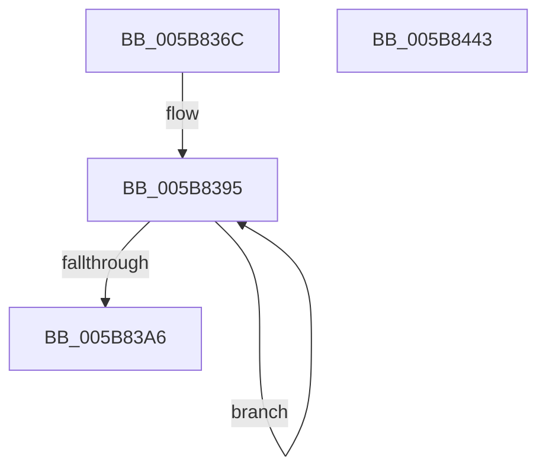

# KiInitializeSharedReadyQueue

- RVA: `0x005B836C`–`0x005B8444` (길이 `216` bytes)
- VA: `0x00000001405B836C`
- 실행 섹션: `.text`
- PDB 이름 있음: `예`; PDB Function 태그: `아니요`
- unwind 정보 RVA: `0x00060BC4`
- 디코드: `44`개 명령, `216/216` bytes 표시
- 미해석 바이트: `0` (있으면 어셈블리에 `.byte`로 보존)

> 이 문서는 커널 이미지의 기계어와 PDB 기호를 분석해 생성했습니다. 4번과 5번은 함수 원형과 자료형을 바이너리 사용 방식에서 추정한 C 해석이며 원본 소스 복구 결과는 아닙니다.

## 1. Dependencies

- 직접 호출 지점: **1**; 고유 호출 대상: **1**
- 직접 호출자로 확인된 함수: **1**
- RIP 상대 이미지 참조: **1**

### Outgoing calls
- `0x005B83B6` → [memset](../6C/memset_function_006C6C40.md) (function, `0x006C6C40`)

### Direct callers
- [KiInitPrcb](../../pagelk/B6/KiInitPrcb_function_00B66644.md) at `0x00B666B3`

### Static image references
- `0x005B8406` → RVA `0x004508F0` (`KiSoftParkElectionDpcRoutine`; read)

## 2. Other-region calls and transfers

- 다른 실행 섹션으로 향하는 call: **0**
- 별도 외부 분기/꼬리 이동을 확인하지 못했습니다.

## 3. Assembly (complete function range)

```asm
005B836C  48 89 5C 24 08                  mov qword ptr [rsp + 8], rbx
005B8371  48 89 74 24 10                  mov qword ptr [rsp + 0x10], rsi
005B8376  57                              push rdi
005B8377  48 83 EC 20                     sub rsp, 0x20
005B837B  33 F6                           xor esi, esi
005B837D  48 8D 41 40                     lea rax, [rcx + 0x40]
005B8381  48 8B D9                        mov rbx, rcx
005B8384  48 89 31                        mov qword ptr [rcx], rsi
005B8387  48 89 71 08                     mov qword ptr [rcx + 8], rsi
005B838B  48 8B FA                        mov rdi, rdx
005B838E  48 89 71 10                     mov qword ptr [rcx + 0x10], rsi
005B8392  8D 4E 20                        lea ecx, [rsi + 0x20]
005B8395  48 89 40 08                     mov qword ptr [rax + 8], rax
005B8399  48 89 00                        mov qword ptr [rax], rax
005B839C  48 83 C0 10                     add rax, 0x10
005B83A0  48 83 E9 01                     sub rcx, 1
005B83A4  75 EF                           jne 0x1405b8395
005B83A6  BA 3F 00 00 00                  mov edx, 0x3f
005B83AB  48 8D 8B 40 02 00 00            lea rcx, [rbx + 0x240]
005B83B2  44 8D 42 01                     lea r8d, [rdx + 1]
005B83B6  E8 85 E8 10 00                  call 0x1406c6c40
005B83BB  C6 83 C0 02 00 00 01            mov byte ptr [rbx + 0x2c0], 1
005B83C2  8A 87 D1 00 00 00               mov al, byte ptr [rdi + 0xd1]
005B83C8  88 83 C1 02 00 00               mov byte ptr [rbx + 0x2c1], al
005B83CE  C6 83 C2 02 00 00 01            mov byte ptr [rbx + 0x2c2], 1
005B83D5  C6 83 C4 02 00 00 01            mov byte ptr [rbx + 0x2c4], 1
005B83DC  0F B6 87 D0 00 00 00            movzx eax, byte ptr [rdi + 0xd0]
005B83E3  66 89 83 C6 02 00 00            mov word ptr [rbx + 0x2c6], ax
005B83EA  48 8B 87 C8 00 00 00            mov rax, qword ptr [rdi + 0xc8]
005B83F1  48 89 83 C8 02 00 00            mov qword ptr [rbx + 0x2c8], rax
005B83F8  48 8B 87 C0 00 00 00            mov rax, qword ptr [rdi + 0xc0]
005B83FF  48 89 83 D0 02 00 00            mov qword ptr [rbx + 0x2d0], rax
005B8406  48 8D 05 E3 84 E9 FF            lea rax, [rip - 0x167b1d]
005B840D  48 89 B3 58 03 00 00            mov qword ptr [rbx + 0x358], rsi
005B8414  48 89 B3 30 03 00 00            mov qword ptr [rbx + 0x330], rsi
005B841B  48 8B 74 24 38                  mov rsi, qword ptr [rsp + 0x38]
005B8420  48 89 83 38 03 00 00            mov qword ptr [rbx + 0x338], rax
005B8427  C7 83 20 03 00 00 13 01 00 00   mov dword ptr [rbx + 0x320], 0x113
005B8431  48 89 9B 40 03 00 00            mov qword ptr [rbx + 0x340], rbx
005B8438  48 8B 5C 24 30                  mov rbx, qword ptr [rsp + 0x30]
005B843D  48 83 C4 20                     add rsp, 0x20
005B8441  5F                              pop rdi
005B8442  C3                              ret
005B8443  CC                              int3
```

## 4. C-style interpretation (structured pseudocode)

```c
__int64 __fastcall KiInitializeSharedReadyQueue(__int64 a1, __int64 a2)
{
    __int64 result;
    __int64 v_rsi;
    __int64 v_rsp;
    unsigned __int64 v_stack_p10;
    unsigned __int64 v_stack_p8;

    v_stack_p8 = v_rbx;
    v_stack_p10 = v_rsi;
    v_rsp = (v_rsp) - (32);
    v_rsi = 0;
    *(unsigned __int64 *)(a1) = 0;
    *(unsigned __int64 *)(a1 + 8) = 0;
    *(unsigned __int64 *)(a1 + 16) = 0;
loc_005B8395:
    *(unsigned __int64 *)(a1 + 64 + 8) = a1 + 64;
    *(unsigned __int64 *)(a1 + 64) = a1 + 64;
    result = (a1 + 64) + (16);
    a1 = (v_rsi + 32) - (1);
    if (condition_is_not_equal) goto loc_005B8395;
    result = memset(a1 + 576, 63, 63 + 1, a4);
    *(unsigned __int8 *)(a1 + 704) = 1;
    *(unsigned __int8 *)(a1 + 705) = (unsigned __int8)(*(unsigned __int8 *)(a2 + 209));
    *(unsigned __int8 *)(a1 + 706) = 1;
    *(unsigned __int8 *)(a1 + 708) = 1;
    *(unsigned __int16 *)(a1 + 710) = (unsigned __int16)(*(unsigned __int8 *)(a2 + 208));
    *(unsigned __int64 *)(a1 + 712) = *(unsigned __int64 *)(a2 + 200);
    *(unsigned __int64 *)(a1 + 720) = *(unsigned __int64 *)(a2 + 192);
    *(unsigned __int64 *)(a1 + 856) = 0;
    *(unsigned __int64 *)(a1 + 816) = 0;
    *(unsigned __int64 *)(a1 + 824) = v_rip - 1473309;
    *(unsigned int *)(a1 + 800) = 275;
    *(unsigned __int64 *)(a1 + 832) = a1;
    v_rsp = (v_rsp) + (32);
    return v_rip - 1473309;
}
```

## 5. (Beta) C Style

```c
int64_t KiInitializeSharedReadyQueue(void *Arg1, void *Arg2)
{
    uint8_t *arg1 = (uint8_t *)Arg1;
    uint8_t *arg2 = (uint8_t *)Arg2;

    int64_t result;
    int64_t local_rsi;
    int64_t local_rsp;
    uint64_t v_stack_p10;
    uint64_t v_stack_p8;

    v_stack_p8 = local_rbx;
    v_stack_p10 = local_rsi;
    local_rsp = (local_rsp) - (32);
    local_rsi = 0;
    *(uint64_t *)(arg1) = 0;
    *(uint64_t *)(arg1 + 0x8) = 0;
    *(uint64_t *)(arg1 + 0x10) = 0;
loc_005B8395:
    *(void **)(arg1 + 0x40 + 0x8) = Arg1 + 64;
    *(void **)(arg1 + 0x40) = Arg1 + 64;
    result = (Arg1 + 64) + (16);
    Arg1 = (local_rsi + 32) - (1);
    if (condition_is_not_equal) goto loc_005B8395;
    result = memset(Arg1 + 576, 63, 63 + 1, a4);
    *(uint8_t *)(arg1 + 0x2C0) = 1;
    *(uint8_t *)(arg1 + 0x2C1) = (uint8_t)(*(uint8_t *)(arg2 + 0xD1));
    *(uint8_t *)(arg1 + 0x2C2) = 1;
    *(uint8_t *)(arg1 + 0x2C4) = 1;
    *(uint16_t *)(arg1 + 0x2C6) = (uint16_t)(*(uint8_t *)(arg2 + 0xD0));
    *(uint64_t *)(arg1 + 0x2C8) = *(uint64_t *)(arg2 + 0xC8);
    *(uint64_t *)(arg1 + 0x2D0) = *(uint64_t *)(arg2 + 0xC0);
    *(uint64_t *)(arg1 + 0x358) = 0;
    *(uint64_t *)(arg1 + 0x330) = 0;
    *(uint64_t *)(arg1 + 0x338) = v_rip - 1473309;
    *(uint32_t *)(arg1 + 0x320) = 275;
    *(void **)(arg1 + 0x340) = Arg1;
    local_rsp = (local_rsp) + (32);
    return v_rip - 1473309;
}
```

### 관측된 메모리 오프셋

구조체 형식이 확인되지 않은 접근은 인자 기준의 오프셋으로만 기록했습니다.

| 기준 인자 | 오프셋 표현 | 폭 (bit) | 접근 |
|---|---:|---:|---|
| `Arg1` | `+ 0x0` | `64` | `W` |
| `Arg1` | `+ 0x8` | `64` | `W` |
| `Arg1` | `+ 0x10` | `64` | `W` |
| `Arg1` | `+ 0x40` | `64` | `R` |
| `Arg1` | `+ 0x240` | `64` | `R` |
| `Arg1` | `+ 0x2C0` | `8` | `W` |
| `Arg1` | `+ 0x2C1` | `8` | `W` |
| `Arg1` | `+ 0x2C2` | `8` | `W` |
| `Arg1` | `+ 0x2C4` | `8` | `W` |
| `Arg1` | `+ 0x2C6` | `16` | `W` |
| `Arg1` | `+ 0x2C8` | `64` | `W` |
| `Arg1` | `+ 0x2D0` | `64` | `W` |
| `Arg1` | `+ 0x320` | `32` | `W` |
| `Arg1` | `+ 0x330` | `64` | `W` |
| `Arg1` | `+ 0x338` | `64` | `W` |
| `Arg1` | `+ 0x340` | `64` | `W` |
| `Arg1` | `+ 0x358` | `64` | `W` |
| `Arg2` | `+ 0xC0` | `64` | `R` |
| `Arg2` | `+ 0xC8` | `64` | `R` |
| `Arg2` | `+ 0xD0` | `8` | `R` |
| `Arg2` | `+ 0xD1` | `8` | `R` |

## 6. Execution-region graph

[열기: 2D/3D 그래프와 함수 탐색 컨트롤 패널](../../../control-panel.html?section=text&rva=0x005B836C&view=graph)

- 2D 그래프는 위에서 아래로 흐르고, 3D 그래프는 빈 공간을 드래그해 회전합니다. Shift+드래그는 이동, 휠은 확대·축소, 함수 노드 선택은 대상 보고서 이동입니다.

### Static fallback


