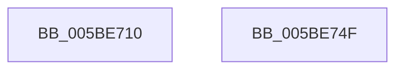

# KiInitializeSoftwareInterruptBatch

- RVA: `0x005BE710`–`0x005BE750` (길이 `64` bytes)
- VA: `0x00000001405BE710`
- 실행 섹션: `.text`
- PDB 이름 있음: `예`; PDB Function 태그: `아니요`
- unwind 정보 RVA: `0x0005CF00`
- 디코드: `18`개 명령, `64/64` bytes 표시
- 미해석 바이트: `0` (있으면 어셈블리에 `.byte`로 보존)

> 이 문서는 커널 이미지의 기계어와 PDB 기호를 분석해 생성했습니다. 4번과 5번은 함수 원형과 자료형을 바이너리 사용 방식에서 추정한 C 해석이며 원본 소스 복구 결과는 아닙니다.

## 1. Dependencies

- 직접 호출 지점: **2**; 고유 호출 대상: **1**
- 직접 호출자로 확인된 함수: **1**
- RIP 상대 이미지 참조: **0**

### Outgoing calls
- `0x005BE721` → [memset](../6C/memset_function_006C6C40.md) (function, `0x006C6C40`)
- `0x005BE744` → [memset](../6C/memset_function_006C6C40.md) (function, `0x006C6C40`)

### Direct callers
- [KiInitPrcb](../../pagelk/B6/KiInitPrcb_function_00B66644.md) at `0x00B669A8`

### Static image references
- 디코드된 RIP-relative 메모리 참조가 없습니다.

## 2. Other-region calls and transfers

- 다른 실행 섹션으로 향하는 call: **0**
- 별도 외부 분기/꼬리 이동을 확인하지 못했습니다.

## 3. Assembly (complete function range)

```asm
005BE710  40 53                           push rbx
005BE712  48 83 EC 20                     sub rsp, 0x20
005BE716  33 D2                           xor edx, edx
005BE718  41 B8 10 02 00 00               mov r8d, 0x210
005BE71E  48 8B D9                        mov rbx, rcx
005BE721  E8 1A 85 10 00                  call 0x1406c6c40
005BE726  83 4B 04 FF                     or dword ptr [rbx + 4], 0xffffffff
005BE72A  48 8D 4B 10                     lea rcx, [rbx + 0x10]
005BE72E  C6 03 02                        mov byte ptr [rbx], 2
005BE731  33 D2                           xor edx, edx
005BE733  83 63 0C 00                     and dword ptr [rbx + 0xc], 0
005BE737  41 B8 00 01 00 00               mov r8d, 0x100
005BE73D  C7 43 08 01 00 20 00            mov dword ptr [rbx + 8], 0x200001
005BE744  E8 F7 84 10 00                  call 0x1406c6c40
005BE749  48 83 C4 20                     add rsp, 0x20
005BE74D  5B                              pop rbx
005BE74E  C3                              ret
005BE74F  CC                              int3
```

## 4. C-style interpretation (structured pseudocode)

```c
__int64 __fastcall KiInitializeSoftwareInterruptBatch(__int64 a1, int a2)
{
    __int64 result;
    __int64 v_rsp;

    v_rsp = (v_rsp) - (32);
    a2 = 0;
    result = memset(a1, a2, 528, a4);
    *(unsigned __int8 *)(a1) = 2;
    a2 = 0;
    *(unsigned int *)(a1 + 8) = 0x200001ULL;
    result = memset(a1 + 16, a2, 256, a4);
    v_rsp = (v_rsp) + (32);
    return result;
}
```

## 5. (Beta) C Style

```c
int64_t KiInitializeSoftwareInterruptBatch(void *Arg1, int32_t Arg2)
{
    uint8_t *arg1 = (uint8_t *)Arg1;

    int64_t result;
    int64_t local_rsp;

    local_rsp = (local_rsp) - (32);
    Arg2 = 0;
    result = memset(Arg1, Arg2, 528, a4);
    *(uint8_t *)(arg1) = 2;
    Arg2 = 0;
    *(uint32_t *)(arg1 + 0x8) = 0x200001ULL;
    result = memset(Arg1 + 16, Arg2, 256, a4);
    local_rsp = (local_rsp) + (32);
    return result;
}
```

### 관측된 메모리 오프셋

구조체 형식이 확인되지 않은 접근은 인자 기준의 오프셋으로만 기록했습니다.

| 기준 인자 | 오프셋 표현 | 폭 (bit) | 접근 |
|---|---:|---:|---|
| `Arg1` | `+ 0x0` | `8` | `W` |
| `Arg1` | `+ 0x4` | `32` | `R/W` |
| `Arg1` | `+ 0x8` | `32` | `W` |
| `Arg1` | `+ 0xC` | `32` | `R/W` |
| `Arg1` | `+ 0x10` | `64` | `R` |

## 6. Execution-region graph

[열기: 2D/3D 그래프와 함수 탐색 컨트롤 패널](../../../control-panel.html?section=text&rva=0x005BE710&view=graph)

- 2D 그래프는 위에서 아래로 흐르고, 3D 그래프는 빈 공간을 드래그해 회전합니다. Shift+드래그는 이동, 휠은 확대·축소, 함수 노드 선택은 대상 보고서 이동입니다.

### Static fallback


