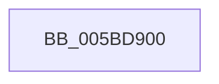

# KiInterruptHandler

- RVA: `0x005BD900`–`0x005BD922` (길이 `34` bytes)
- VA: `0x00000001405BD900`
- 실행 섹션: `.text`
- PDB 이름 있음: `예`; PDB Function 태그: `아니요`
- unwind 정보 RVA: `0x000622F0`
- 디코드: `11`개 명령, `34/34` bytes 표시
- 미해석 바이트: `0` (있으면 어셈블리에 `.byte`로 보존)

> 이 문서는 커널 이미지의 기계어와 PDB 기호를 분석해 생성했습니다. 4번과 5번은 함수 원형과 자료형을 바이너리 사용 방식에서 추정한 C 해석이며 원본 소스 복구 결과는 아닙니다.

## 1. Dependencies

- 직접 호출 지점: **1**; 고유 호출 대상: **1**
- 직접 호출자로 확인된 함수: **0**
- RIP 상대 이미지 참조: **0**

### Outgoing calls
- `0x005BD91C` → [KeBugCheckEx](../4F/KeBugCheckEx_function_004FD660.md) (function, `0x004FD660`)

### Direct callers
- 이 함수 시작 RVA로 연결되는 직접 call은 확인되지 않았습니다. 간접 호출은 완전히 역산할 수 없습니다.

### Static image references
- 디코드된 RIP-relative 메모리 참조가 없습니다.

## 2. Other-region calls and transfers

- 다른 실행 섹션으로 향하는 call: **0**
- 별도 외부 분기/꼬리 이동을 확인하지 못했습니다.

## 3. Assembly (complete function range)

```asm
005BD900  48 83 EC 38                     sub rsp, 0x38
005BD904  8B 41 04                        mov eax, dword ptr [rcx + 4]
005BD907  48 8B D1                        mov rdx, rcx
005BD90A  24 66                           and al, 0x66
005BD90C  F6 D8                           neg al
005BD90E  1B C9                           sbb ecx, ecx
005BD910  48 83 64 24 20 00               and qword ptr [rsp + 0x20], 0
005BD916  83 C1 3D                        add ecx, 0x3d
005BD919  45 33 C9                        xor r9d, r9d
005BD91C  E8 3F FD F3 FF                  call 0x1404fd660
005BD921  CC                              int3
```

## 4. C-style interpretation (structured pseudocode)

```c
__int64 __fastcall KiInterruptHandler(__int64 a1, __int64 a2, __int64 a3, int a4)
{
    __int64 result;
    __int64 v_rsp;
    unsigned __int64 v_stack_m18;

    v_rsp = (v_rsp) - (56);
    result = (unsigned __int8)(((unsigned int)(*(unsigned int *)(a1 + 4))) & (102));
    result = (unsigned __int8)(-(result));
    a1 = (unsigned int)((a1) + (61));
    a4 = 0;
    result = KeBugCheckEx(a1, a1, a3, a4);
    return result;
}
```

## 5. (Beta) C Style

```c
int64_t KiInterruptHandler(void *Arg1, int64_t Arg2, int64_t Arg3, int32_t Arg4)
{
    uint8_t *arg1 = (uint8_t *)Arg1;

    int64_t result;
    int64_t local_rsp;
    uint64_t v_stack_m18;

    local_rsp = (local_rsp) - (56);
    result = (uint8_t)(((uint32_t)(*(uint32_t *)(arg1 + 0x4))) & (102));
    result = (uint8_t)(-(result));
    Arg1 = (uint32_t)((Arg1) + (61));
    Arg4 = 0;
    result = KeBugCheckEx(Arg1, Arg1, Arg3, Arg4);
    return result;
}
```

### 관측된 메모리 오프셋

구조체 형식이 확인되지 않은 접근은 인자 기준의 오프셋으로만 기록했습니다.

| 기준 인자 | 오프셋 표현 | 폭 (bit) | 접근 |
|---|---:|---:|---|
| `Arg1` | `+ 0x4` | `32` | `R` |

## 6. Execution-region graph

[열기: 2D/3D 그래프와 함수 탐색 컨트롤 패널](../../../control-panel.html?section=text&rva=0x005BD900&view=graph)

- 2D 그래프는 위에서 아래로 흐르고, 3D 그래프는 빈 공간을 드래그해 회전합니다. Shift+드래그는 이동, 휠은 확대·축소, 함수 노드 선택은 대상 보고서 이동입니다.

### Static fallback


