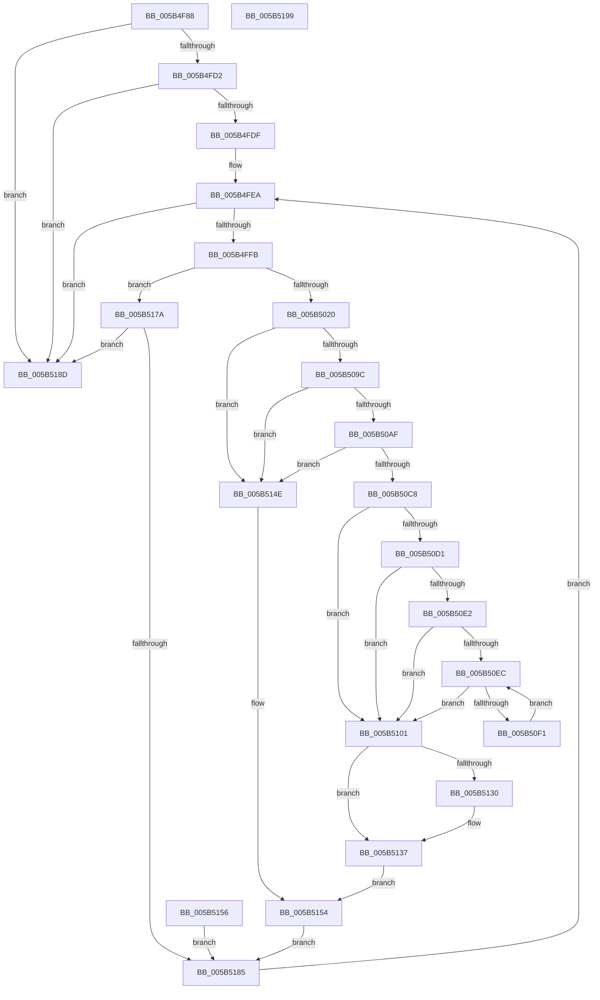

# KiInvokeBugCheckAddTriageDumpDataCallbacks

- RVA: `0x005B4F88`–`0x005B519A` (길이 `530` bytes)
- VA: `0x00000001405B4F88`
- 실행 섹션: `.text`
- PDB 이름 있음: `예`; PDB Function 태그: `아니요`
- unwind 정보 RVA: `0x000C9BF4`
- 디코드: `120`개 명령, `530/530` bytes 표시
- 미해석 바이트: `0` (있으면 어셈블리에 `.byte`로 보존)

> 이 문서는 커널 이미지의 기계어와 PDB 기호를 분석해 생성했습니다. 4번과 5번은 함수 원형과 자료형을 바이너리 사용 방식에서 추정한 C 해석이며 원본 소스 복구 결과는 아닙니다.

## 1. Dependencies

- 직접 호출 지점: **6**; 고유 호출 대상: **6**
- 직접 호출자로 확인된 함수: **1**
- RIP 상대 이미지 참조: **10**

### Outgoing calls
- `0x005B5013` → [KeValidateBugCheckCallbackRecord](KeValidateBugCheckCallbackRecord_function_005B39C0.md) (function, `0x005B39C0`)
- `0x005B5089` → [guard_dispatch_icall](../6B/guard_dispatch_icall_function_006BAAD0.md) (function, `0x006BAAD0`)
- `0x005B50A2` → [KiValidateTriageDumpDataArray](KiValidateTriageDumpDataArray_function_005B55E8.md) (function, `0x005B55E8`)
- `0x005B50BB` → [KiValidateComponentName](KiValidateComponentName_function_005B553C.md) (function, `0x005B553C`)
- `0x005B50C8` → [Feature_TriageDumpDataExtension__private_IsEnabledDeviceUsageNoInline](Feature_TriageDumpDataExtension__private_IsEnabledDeviceUsageNoInline_function_005B2658.md) (function, `0x005B2658`)
- `0x005B50F7` → [KiDeduplicateTriageDumpDataArrays](KiDeduplicateTriageDumpDataArrays_function_005B4748.md) (function, `0x005B4748`)

### Direct callers
- [KeBugCheck2](KeBugCheck2_function_005B27D0.md) at `0x005B361B`

### Static image references
- `0x005B4FB6` → RVA `0x00F234A0` (`.data`; read)
- `0x005B4FD2` → RVA `0x00F234A8` (`.data`; read)
- `0x005B4FE3` → RVA `0x00F23490` (`.data`; read)
- `0x005B5039` → RVA `0x00F47580` (`.data`; read)
- `0x005B5043` → RVA `0x00F47588` (`.data`; read)
- `0x005B504F` → RVA `0x00F47590` (`.data`; read)
- `0x005B505B` → RVA `0x00F47598` (`.data`; read)
- `0x005B5067` → RVA `0x00F475A0` (`.data`; read)
- `0x005B50E2` → RVA `0x00F23498` (`.data`; read)
- `0x005B5141` → RVA `0x00F23498` (`.data`; write)

## 2. Other-region calls and transfers

- 다른 실행 섹션으로 향하는 call: **0**
- 별도 외부 분기/꼬리 이동을 확인하지 못했습니다.

## 3. Assembly (complete function range)

```asm
005B4F88  88 4C 24 08                     mov byte ptr [rsp + 8], cl
005B4F8C  4C 8B DC                        mov r11, rsp
005B4F8F  53                              push rbx
005B4F90  56                              push rsi
005B4F91  57                              push rdi
005B4F92  41 56                           push r14
005B4F94  41 57                           push r15
005B4F96  48 83 EC 70                     sub rsp, 0x70
005B4F9A  0F 57 C0                        xorps xmm0, xmm0
005B4F9D  33 C0                           xor eax, eax
005B4F9F  0F 11 44 24 38                  movups xmmword ptr [rsp + 0x38], xmm0
005B4FA4  0F 11 44 24 48                  movups xmmword ptr [rsp + 0x48], xmm0
005B4FA9  0F 11 44 24 58                  movups xmmword ptr [rsp + 0x58], xmm0
005B4FAE  49 89 43 D0                     mov qword ptr [r11 - 0x30], rax
005B4FB2  41 21 43 08                     and dword ptr [r11 + 8], eax
005B4FB6  48 8D 35 E3 E4 96 00            lea rsi, [rip + 0x96e4e3]
005B4FBD  48 89 74 24 30                  mov qword ptr [rsp + 0x30], rsi
005B4FC2  48 8B 1D D7 E4 96 00            mov rbx, qword ptr [rip + 0x96e4d7]
005B4FC9  48 85 DB                        test rbx, rbx
005B4FCC  0F 84 BB 01 00 00               je 0x1405b518d
005B4FD2  48 39 05 CF E4 96 00            cmp qword ptr [rip + 0x96e4cf], rax
005B4FD9  0F 84 AE 01 00 00               je 0x1405b518d
005B4FDF  49 89 73 10                     mov qword ptr [r11 + 0x10], rsi
005B4FE3  4C 8D 35 A6 E4 96 00            lea r14, [rip + 0x96e4a6]
005B4FEA  48 89 9C 24 B0 00 00 00         mov qword ptr [rsp + 0xb0], rbx
005B4FF2  48 3B DE                        cmp rbx, rsi
005B4FF5  0F 84 92 01 00 00               je 0x1405b518d
005B4FFB  48 89 9C 24 B8 00 00 00         mov qword ptr [rsp + 0xb8], rbx
005B5003  4C 8D 84 24 A8 00 00 00         lea r8, [rsp + 0xa8]
005B500B  BA 07 00 00 00                  mov edx, 7
005B5010  48 8B CB                        mov rcx, rbx
005B5013  E8 A8 E9 FF FF                  call 0x1405b39c0
005B5018  84 C0                           test al, al
005B501A  0F 84 5A 01 00 00               je 0x1405b517a
005B5020  48 C7 44 24 38 00 00 00 00      mov qword ptr [rsp + 0x38], 0
005B5029  C7 44 24 40 01 00 00 00         mov dword ptr [rsp + 0x40], 1
005B5031  C7 44 24 44 00 00 00 02         mov dword ptr [rsp + 0x44], 0x2000000
005B5039  8B 05 41 25 99 00               mov eax, dword ptr [rip + 0x992541]
005B503F  89 44 24 48                     mov dword ptr [rsp + 0x48], eax
005B5043  48 8B 05 3E 25 99 00            mov rax, qword ptr [rip + 0x99253e]
005B504A  48 89 44 24 50                  mov qword ptr [rsp + 0x50], rax
005B504F  48 8B 05 3A 25 99 00            mov rax, qword ptr [rip + 0x99253a]
005B5056  48 89 44 24 58                  mov qword ptr [rsp + 0x58], rax
005B505B  48 8B 05 36 25 99 00            mov rax, qword ptr [rip + 0x992536]
005B5062  48 89 44 24 60                  mov qword ptr [rsp + 0x60], rax
005B5067  48 8B 05 32 25 99 00            mov rax, qword ptr [rip + 0x992532]
005B506E  48 89 44 24 68                  mov qword ptr [rsp + 0x68], rax
005B5073  48 8B 43 10                     mov rax, qword ptr [rbx + 0x10]
005B5077  41 B9 38 00 00 00               mov r9d, 0x38
005B507D  4C 8D 44 24 38                  lea r8, [rsp + 0x38]
005B5082  48 8B D3                        mov rdx, rbx
005B5085  41 8D 49 CF                     lea ecx, [r9 - 0x31]
005B5089  E8 42 5A 10 00                  call 0x1406baad0
005B508E  48 8B 4C 24 38                  mov rcx, qword ptr [rsp + 0x38]
005B5093  48 85 C9                        test rcx, rcx
005B5096  0F 84 B2 00 00 00               je 0x1405b514e
005B509C  41 B8 00 00 00 02               mov r8d, 0x2000000
005B50A2  E8 41 05 00 00                  call 0x1405b55e8
005B50A7  84 C0                           test al, al
005B50A9  0F 84 9F 00 00 00               je 0x1405b514e
005B50AF  48 8D 94 24 A0 00 00 00         lea rdx, [rsp + 0xa0]
005B50B7  48 8B 4B 18                     mov rcx, qword ptr [rbx + 0x18]
005B50BB  E8 7C 04 00 00                  call 0x1405b553c
005B50C0  84 C0                           test al, al
005B50C2  0F 84 86 00 00 00               je 0x1405b514e
005B50C8  E8 8B D5 FF FF                  call 0x1405b2658
005B50CD  85 C0                           test eax, eax
005B50CF  74 30                           je 0x1405b5101
005B50D1  4C 8B 7C 24 38                  mov r15, qword ptr [rsp + 0x38]
005B50D6  48 8B 3D B3 E3 96 00            mov rdi, qword ptr [rip + 0x96e3b3]
005B50DD  48 85 FF                        test rdi, rdi
005B50E0  74 1F                           je 0x1405b5101
005B50E2  48 83 3D AE E3 96 00 00         cmp qword ptr [rip + 0x96e3ae], 0
005B50EA  74 15                           je 0x1405b5101
005B50EC  49 3B FE                        cmp rdi, r14
005B50EF  74 10                           je 0x1405b5101
005B50F1  48 8B D7                        mov rdx, rdi
005B50F4  49 8B CF                        mov rcx, r15
005B50F7  E8 4C F6 FF FF                  call 0x1405b4748
005B50FC  48 8B 3F                        mov rdi, qword ptr [rdi]
005B50FF  EB EB                           jmp 0x1405b50ec
005B5101  48 8B 53 18                     mov rdx, qword ptr [rbx + 0x18]
005B5105  48 8B 44 24 38                  mov rax, qword ptr [rsp + 0x38]
005B510A  48 89 50 28                     mov qword ptr [rax + 0x28], rdx
005B510E  8B 94 24 A0 00 00 00            mov edx, dword ptr [rsp + 0xa0]
005B5115  FF C2                           inc edx
005B5117  48 8B 44 24 38                  mov rax, qword ptr [rsp + 0x38]
005B511C  89 50 20                        mov dword ptr [rax + 0x20], edx
005B511F  48 8B 44 24 38                  mov rax, qword ptr [rsp + 0x38]
005B5124  48 8B 15 6D E3 96 00            mov rdx, qword ptr [rip + 0x96e36d]
005B512B  4C 39 32                        cmp qword ptr [rdx], r14
005B512E  74 07                           je 0x1405b5137
005B5130  B9 03 00 00 00                  mov ecx, 3
005B5135  CD 29                           int 0x29
005B5137  4C 89 30                        mov qword ptr [rax], r14
005B513A  48 89 50 08                     mov qword ptr [rax + 8], rdx
005B513E  48 89 02                        mov qword ptr [rdx], rax
005B5141  48 89 05 50 E3 96 00            mov qword ptr [rip + 0x96e350], rax
005B5148  C6 43 2C 03                     mov byte ptr [rbx + 0x2c], 3
005B514C  EB 06                           jmp 0x1405b5154
005B514E  66 C7 43 2C 04 01               mov word ptr [rbx + 0x2c], 0x104
005B5154  EB 2F                           jmp 0x1405b5185
005B5156  48 8B 84 24 B8 00 00 00         mov rax, qword ptr [rsp + 0xb8]
005B515E  66 C7 40 2C 04 02               mov word ptr [rax + 0x2c], 0x204
005B5164  4C 8D 35 25 E3 96 00            lea r14, [rip + 0x96e325]
005B516B  48 8B 74 24 30                  mov rsi, qword ptr [rsp + 0x30]
005B5170  48 8B 9C 24 B0 00 00 00         mov rbx, qword ptr [rsp + 0xb0]
005B5178  EB 0B                           jmp 0x1405b5185
005B517A  48 83 BC 24 A8 00 00 00 00      cmp qword ptr [rsp + 0xa8], 0
005B5183  74 08                           je 0x1405b518d
005B5185  48 8B 1B                        mov rbx, qword ptr [rbx]
005B5188  E9 5D FE FF FF                  jmp 0x1405b4fea
005B518D  48 83 C4 70                     add rsp, 0x70
005B5191  41 5F                           pop r15
005B5193  41 5E                           pop r14
005B5195  5F                              pop rdi
005B5196  5E                              pop rsi
005B5197  5B                              pop rbx
005B5198  C3                              ret
005B5199  CC                              int3
```

## 4. C-style interpretation (structured pseudocode)

```c
__int64 __fastcall KiInvokeBugCheckAddTriageDumpDataCallbacks(unsigned __int8 a1)
{
    __int64 result;
    __int64 v_rsp;
    unsigned __int64 v_stack_m30;
    unsigned __int64 v_stack_m38;
    unsigned __int64 v_stack_m40;
    unsigned __int64 v_stack_m48;
    unsigned __int64 v_stack_m50;
    unsigned int v_stack_m54;
    unsigned int v_stack_m58;
    unsigned __int64 v_stack_m60;
    unsigned __int64 v_stack_m68;
    unsigned __int64 v_stack_p10;
    unsigned __int64 v_stack_p18;
    unsigned __int64 v_stack_p20;
    unsigned __int8 v_stack_p8;

    v_stack_p8 = a1;
    v_rsp = (v_rsp) - (112);
    result = 0;
    v_stack_m60 = v_xmm0;
    v_stack_m50 = v_xmm0;
    v_stack_m40 = v_xmm0;
    *(unsigned __int64 *)(v_rsp - 48) = 0;
    v_stack_m68 = v_rip + 9888995;
    if (*(unsigned __int64 *)(v_rip + 9888983) == 0) goto loc_005B518D;
    if ((*(unsigned __int64 *)(v_rip + 9888975)) == 0) goto loc_005B518D;
    *(unsigned __int64 *)(v_rsp + 16) = v_rip + 9888995;
loc_005B4FEA:
    v_stack_p18 = *(unsigned __int64 *)(v_rip + 9888983);
    if ((*(unsigned __int64 *)(v_rip + 9888983)) == (v_rip + 9888995)) goto loc_005B518D;
    v_stack_p20 = *(unsigned __int64 *)(v_rip + 9888983);
    result = KeValidateBugCheckCallbackRecord(*(unsigned __int64 *)(v_rip + 9888983), 7, v_stack_p10, a4);
    if ((unsigned __int8)(result) == 0) goto loc_005B517A;
    v_stack_m60 = 0;
    v_stack_m58 = 1;
    v_stack_m54 = 0x2000000ULL;
    v_stack_m50 = (unsigned int)((unsigned int)(*(unsigned int *)(v_rip + 10036545)));
    v_stack_m48 = *(unsigned __int64 *)(v_rip + 10036542);
    v_stack_m40 = *(unsigned __int64 *)(v_rip + 10036538);
    v_stack_m38 = *(unsigned __int64 *)(v_rip + 10036534);
    v_stack_m30 = *(unsigned __int64 *)(v_rip + 10036530);
    result = guard_dispatch_icall(56 - 49, *(unsigned __int64 *)(v_rip + 9888983), v_stack_m60, 56);
    if (v_stack_m60 == 0) goto loc_005B514E;
    result = KiValidateTriageDumpDataArray(v_stack_m60, *(unsigned __int64 *)(v_rip + 9888983), (unsigned int)(0x2000000ULL), 56);
    if ((unsigned __int8)(result) == 0) goto loc_005B514E;
    result = KiValidateComponentName(*(unsigned __int64 *)(*(unsigned __int64 *)(v_rip + 9888983) + 24), v_stack_p8, (unsigned int)(0x2000000ULL), 56);
    if ((unsigned __int8)(result) == 0) goto loc_005B514E;
    result = Feature_TriageDumpDataExtension__private_IsEnabledDeviceUsageNoInline(*(unsigned __int64 *)(*(unsigned __int64 *)(v_rip + 9888983) + 24), v_stack_p8, (unsigned int)(0x2000000ULL), 56);
    if ((unsigned int)(result) == 0) goto loc_005B5101;
    if (*(unsigned __int64 *)(v_rip + 9888691) == 0) goto loc_005B5101;
    if ((*(unsigned __int64 *)(v_rip + 9888686)) == 0) goto loc_005B5101;
loc_005B50EC:
    if ((*(unsigned __int64 *)(v_rip + 9888691)) == (v_rip + 9888934)) goto loc_005B5101;
    result = KiDeduplicateTriageDumpDataArrays(v_stack_m60, *(unsigned __int64 *)(v_rip + 9888691), (unsigned int)(0x2000000ULL), 56);
    goto loc_005B50EC;
loc_005B5101:
    *(unsigned __int64 *)(v_stack_m60 + 40) = *(unsigned __int64 *)(*(unsigned __int64 *)(v_rip + 9888983) + 24);
    a2 = (unsigned int)(((unsigned int)(v_stack_p8)) + 1);
    *(unsigned int *)(v_stack_m60 + 32) = (unsigned int)(a2);
    if ((*(unsigned __int64 *)(*(unsigned __int64 *)(v_rip + 9888621))) != (v_rip + 9888934)) {
        a1 = 3;
    }
    *(unsigned __int64 *)(v_stack_m60) = v_rip + 9888934;
    *(unsigned __int64 *)(v_stack_m60 + 8) = *(unsigned __int64 *)(v_rip + 9888621);
    *(unsigned __int64 *)(*(unsigned __int64 *)(v_rip + 9888621)) = v_stack_m60;
    *(unsigned __int64 *)(v_rip + 9888592) = v_stack_m60;
    *(unsigned __int8 *)(*(unsigned __int64 *)(v_rip + 9888983) + 44) = 3;
    goto loc_005B5154;
loc_005B514E:
    *(unsigned __int16 *)(*(unsigned __int64 *)(v_rip + 9888983) + 44) = 260;
loc_005B5154:
    goto loc_005B5185;
loc_005B517A:
    if (v_stack_p10 == 0) goto loc_005B518D;
loc_005B5185:
    goto loc_005B4FEA;
loc_005B518D:
    v_rsp = (v_rsp) + (112);
    return v_stack_m60;
}
```

## 5. (Beta) C Style

```c
int64_t KiInvokeBugCheckAddTriageDumpDataCallbacks(uint8_t Arg1)
{
    int64_t result;
    int64_t local_rsp;
    uint64_t v_stack_m30;
    uint64_t v_stack_m38;
    uint64_t v_stack_m40;
    uint64_t v_stack_m48;
    uint64_t v_stack_m50;
    uint32_t v_stack_m54;
    uint32_t v_stack_m58;
    uint64_t v_stack_m60;
    uint64_t v_stack_m68;
    uint64_t v_stack_p10;
    uint64_t v_stack_p18;
    uint64_t v_stack_p20;
    uint8_t v_stack_p8;

    v_stack_p8 = Arg1;
    local_rsp = (local_rsp) - (112);
    result = 0;
    v_stack_m60 = v_xmm0;
    v_stack_m50 = v_xmm0;
    v_stack_m40 = v_xmm0;
    *(uint64_t *)(local_rsp - 0x30) = 0;
    v_stack_m68 = v_rip + 9888995;
    if (*(uint64_t *)(v_rip + 0x96E4D7) == 0) goto loc_005B518D;
    if ((*(uint64_t *)(v_rip + 0x96E4CF)) == 0) goto loc_005B518D;
    *(uint64_t *)(local_rsp + 0x10) = v_rip + 9888995;
loc_005B4FEA:
    v_stack_p18 = *(uint64_t *)(v_rip + 0x96E4D7);
    if ((*(uint64_t *)(v_rip + 0x96E4D7)) == (v_rip + 9888995)) goto loc_005B518D;
    v_stack_p20 = *(uint64_t *)(v_rip + 0x96E4D7);
    result = KeValidateBugCheckCallbackRecord(*(uint64_t *)(v_rip + 0x96E4D7), 7, v_stack_p10, a4);
    if ((uint8_t)(result) == 0) goto loc_005B517A;
    v_stack_m60 = 0;
    v_stack_m58 = 1;
    v_stack_m54 = 0x2000000ULL;
    v_stack_m50 = (uint32_t)((uint32_t)(*(uint32_t *)(v_rip + 0x992541)));
    v_stack_m48 = *(uint64_t *)(v_rip + 0x99253E);
    v_stack_m40 = *(uint64_t *)(v_rip + 0x99253A);
    v_stack_m38 = *(uint64_t *)(v_rip + 0x992536);
    v_stack_m30 = *(uint64_t *)(v_rip + 0x992532);
    result = guard_dispatch_icall(56 - 49, *(uint64_t *)(v_rip + 0x96E4D7), v_stack_m60, 56);
    if (v_stack_m60 == 0) goto loc_005B514E;
    result = KiValidateTriageDumpDataArray(v_stack_m60, *(uint64_t *)(v_rip + 0x96E4D7), (uint32_t)(0x2000000ULL), 56);
    if ((uint8_t)(result) == 0) goto loc_005B514E;
    result = KiValidateComponentName(*(uint64_t *)(*(uint64_t *)(v_rip + 0x96E4D7) + 0x18), v_stack_p8, (uint32_t)(0x2000000ULL), 56);
    if ((uint8_t)(result) == 0) goto loc_005B514E;
    result = Feature_TriageDumpDataExtension__private_IsEnabledDeviceUsageNoInline(*(uint64_t *)(*(uint64_t *)(v_rip + 0x96E4D7) + 0x18), v_stack_p8, (uint32_t)(0x2000000ULL), 56);
    if ((uint32_t)(result) == 0) goto loc_005B5101;
    if (*(uint64_t *)(v_rip + 0x96E3B3) == 0) goto loc_005B5101;
    if ((*(uint64_t *)(v_rip + 0x96E3AE)) == 0) goto loc_005B5101;
loc_005B50EC:
    if ((*(uint64_t *)(v_rip + 0x96E3B3)) == (v_rip + 9888934)) goto loc_005B5101;
    result = KiDeduplicateTriageDumpDataArrays(v_stack_m60, *(uint64_t *)(v_rip + 0x96E3B3), (uint32_t)(0x2000000ULL), 56);
    goto loc_005B50EC;
loc_005B5101:
    *(uint64_t *)(v_stack_m60 + 0x28) = *(uint64_t *)(*(uint64_t *)(v_rip + 0x96E4D7) + 0x18);
    a2 = (uint32_t)(((uint32_t)(v_stack_p8)) + 1);
    *(uint32_t *)(v_stack_m60 + 0x20) = (uint32_t)(a2);
    if ((*(uint64_t *)(*(uint64_t *)(v_rip + 0x96E36D))) != (v_rip + 9888934)) {
        Arg1 = 3;
    }
    *(uint64_t *)(v_stack_m60) = v_rip + 9888934;
    *(uint64_t *)(v_stack_m60 + 0x8) = *(uint64_t *)(v_rip + 0x96E36D);
    *(uint64_t *)(*(uint64_t *)(v_rip + 0x96E36D)) = v_stack_m60;
    *(uint64_t *)(v_rip + 0x96E350) = v_stack_m60;
    *(uint8_t *)(*(uint64_t *)(v_rip + 0x96E4D7) + 0x2C) = 3;
    goto loc_005B5154;
loc_005B514E:
    *(uint16_t *)(*(uint64_t *)(v_rip + 0x96E4D7) + 0x2C) = 260;
loc_005B5154:
    goto loc_005B5185;
loc_005B517A:
    if (v_stack_p10 == 0) goto loc_005B518D;
loc_005B5185:
    goto loc_005B4FEA;
loc_005B518D:
    local_rsp = (local_rsp) + (112);
    return v_stack_m60;
}
```

## 6. Execution-region graph

[열기: 2D/3D 그래프와 함수 탐색 컨트롤 패널](../../../control-panel.html?section=text&rva=0x005B4F88&view=graph)

- 2D 그래프는 위에서 아래로 흐르고, 3D 그래프는 빈 공간을 드래그해 회전합니다. Shift+드래그는 이동, 휠은 확대·축소, 함수 노드 선택은 대상 보고서 이동입니다.

### Static fallback


