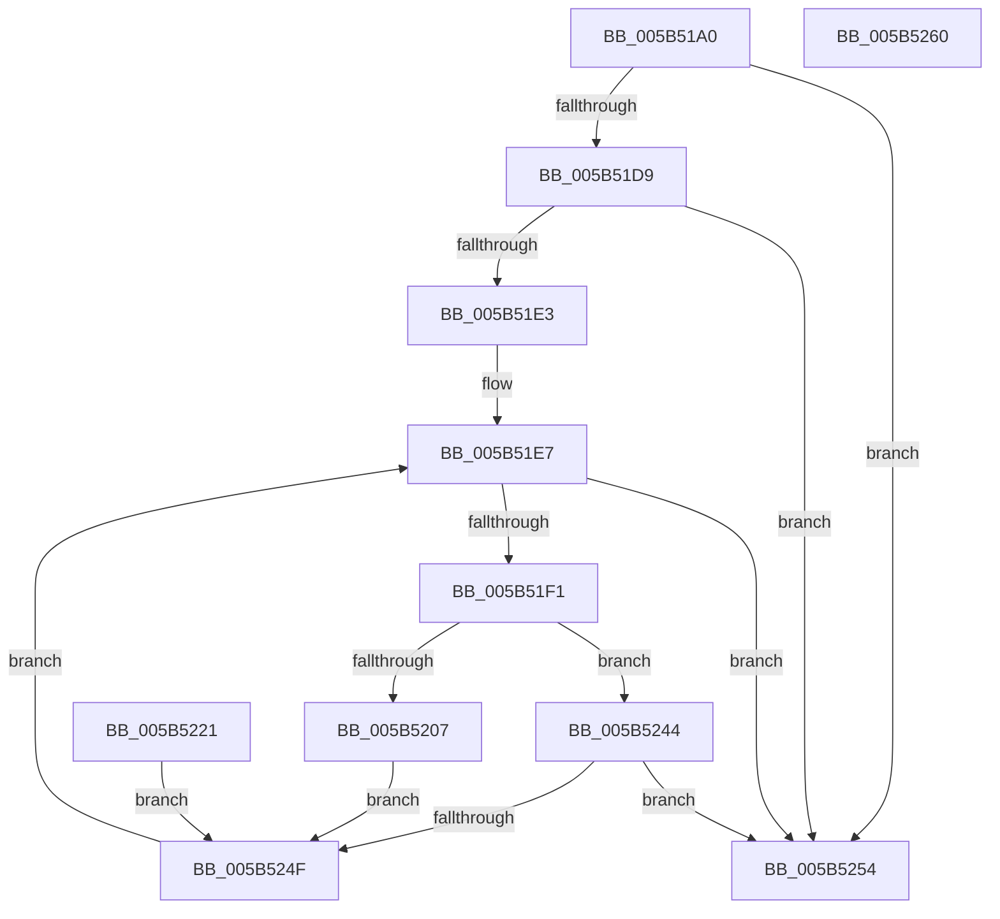

# KiInvokeBugCheckEntryCallbacks

- RVA: `0x005B51A0`–`0x005B5261` (길이 `193` bytes)
- VA: `0x00000001405B51A0`
- 실행 섹션: `.text`
- PDB 이름 있음: `예`; PDB Function 태그: `아니요`
- unwind 정보 RVA: `0x000C9C3C`
- 디코드: `57`개 명령, `193/193` bytes 표시
- 미해석 바이트: `0` (있으면 어셈블리에 `.byte`로 보존)

> 이 문서는 커널 이미지의 기계어와 PDB 기호를 분석해 생성했습니다. 4번과 5번은 함수 원형과 자료형을 바이너리 사용 방식에서 추정한 C 해석이며 원본 소스 복구 결과는 아닙니다.

## 1. Dependencies

- 직접 호출 지점: **2**; 고유 호출 대상: **2**
- 직접 호출자로 확인된 함수: **3**
- RIP 상대 이미지 참조: **2**

### Outgoing calls
- `0x005B51FE` → [KeValidateBugCheckCallbackRecord](KeValidateBugCheckCallbackRecord_function_005B39C0.md) (function, `0x005B39C0`)
- `0x005B5216` → [guard_dispatch_icall](../6B/guard_dispatch_icall_function_006BAAD0.md) (function, `0x006BAAD0`)

### Direct callers
- [KeBugCheck2](KeBugCheck2_function_005B27D0.md) at `0x005B35F2`
- [KeBugCheck2](KeBugCheck2_function_005B27D0.md) at `0x005B35FF`
- [KeBugCheck2](KeBugCheck2_function_005B27D0.md) at `0x005B360E`
- [KiAttemptBugcheckRecovery](../5C/KiAttemptBugcheckRecovery_function_005C6D24.md) at `0x005C6DB7`
- [KiAttemptBugcheckRecovery](../5C/KiAttemptBugcheckRecovery_function_005C6D24.md) at `0x005C6E40`
- [KiDeferredBugcheckRecoveryWorker](../5C/KiDeferredBugcheckRecoveryWorker_function_005C75A0.md) at `0x005C7666`
- [KiDeferredBugcheckRecoveryWorker](../5C/KiDeferredBugcheckRecoveryWorker_function_005C75A0.md) at `0x005C76C3`

### Static image references
- `0x005B51C1` → RVA `0x00F234A0` (`.data`; read)
- `0x005B51D9` → RVA `0x00F234A8` (`.data`; read)

## 2. Other-region calls and transfers

- 다른 실행 섹션으로 향하는 call: **0**
- 별도 외부 분기/꼬리 이동을 확인하지 못했습니다.

## 3. Assembly (complete function range)

```asm
005B51A0  48 8B C4                        mov rax, rsp
005B51A3  44 89 40 18                     mov dword ptr [rax + 0x18], r8d
005B51A7  48 89 50 10                     mov qword ptr [rax + 0x10], rdx
005B51AB  89 48 08                        mov dword ptr [rax + 8], ecx
005B51AE  53                              push rbx
005B51AF  56                              push rsi
005B51B0  57                              push rdi
005B51B1  41 56                           push r14
005B51B3  41 57                           push r15
005B51B5  48 83 EC 40                     sub rsp, 0x40
005B51B9  45 8B F0                        mov r14d, r8d
005B51BC  4C 8B FA                        mov r15, rdx
005B51BF  8B F1                           mov esi, ecx
005B51C1  48 8D 3D D8 E2 96 00            lea rdi, [rip + 0x96e2d8]
005B51C8  48 89 7C 24 38                  mov qword ptr [rsp + 0x38], rdi
005B51CD  48 8B 1D CC E2 96 00            mov rbx, qword ptr [rip + 0x96e2cc]
005B51D4  48 85 DB                        test rbx, rbx
005B51D7  74 7B                           je 0x1405b5254
005B51D9  48 83 3D C7 E2 96 00 00         cmp qword ptr [rip + 0x96e2c7], 0
005B51E1  74 71                           je 0x1405b5254
005B51E3  48 89 78 20                     mov qword ptr [rax + 0x20], rdi
005B51E7  48 89 5C 24 30                  mov qword ptr [rsp + 0x30], rbx
005B51EC  48 3B DF                        cmp rbx, rdi
005B51EF  74 63                           je 0x1405b5254
005B51F1  4C 8D 84 24 88 00 00 00         lea r8, [rsp + 0x88]
005B51F9  8B D6                           mov edx, esi
005B51FB  48 8B CB                        mov rcx, rbx
005B51FE  E8 BD E7 FF FF                  call 0x1405b39c0
005B5203  84 C0                           test al, al
005B5205  74 3D                           je 0x1405b5244
005B5207  48 8B 43 10                     mov rax, qword ptr [rbx + 0x10]
005B520B  45 8B CE                        mov r9d, r14d
005B520E  4D 8B C7                        mov r8, r15
005B5211  48 8B D3                        mov rdx, rbx
005B5214  8B CE                           mov ecx, esi
005B5216  E8 B5 58 10 00                  call 0x1406baad0
005B521B  C6 43 2C 03                     mov byte ptr [rbx + 0x2c], 3
005B521F  EB 2E                           jmp 0x1405b524f
005B5221  48 8B 5C 24 30                  mov rbx, qword ptr [rsp + 0x30]
005B5226  66 C7 43 2C 04 00               mov word ptr [rbx + 0x2c], 4
005B522C  44 8B B4 24 80 00 00 00         mov r14d, dword ptr [rsp + 0x80]
005B5234  4C 8B 7C 24 78                  mov r15, qword ptr [rsp + 0x78]
005B5239  8B 74 24 70                     mov esi, dword ptr [rsp + 0x70]
005B523D  48 8B 7C 24 38                  mov rdi, qword ptr [rsp + 0x38]
005B5242  EB 0B                           jmp 0x1405b524f
005B5244  48 83 BC 24 88 00 00 00 00      cmp qword ptr [rsp + 0x88], 0
005B524D  74 05                           je 0x1405b5254
005B524F  48 8B 1B                        mov rbx, qword ptr [rbx]
005B5252  EB 93                           jmp 0x1405b51e7
005B5254  48 83 C4 40                     add rsp, 0x40
005B5258  41 5F                           pop r15
005B525A  41 5E                           pop r14
005B525C  5F                              pop rdi
005B525D  5E                              pop rsi
005B525E  5B                              pop rbx
005B525F  C3                              ret
005B5260  CC                              int3
```

## 4. C-style interpretation (structured pseudocode)

```c
__int64 __fastcall KiInvokeBugCheckEntryCallbacks(int a1, __int64 a2, int a3)
{
    __int64 result;
    __int64 v_rsp;
    unsigned __int64 v_stack_m30;
    unsigned __int64 v_stack_m38;
    unsigned __int64 v_stack_p10;
    unsigned int v_stack_p18;
    unsigned __int64 v_stack_p20;
    unsigned int v_stack_p8;

    *(unsigned int *)(v_rsp + 24) = a3;
    *(unsigned __int64 *)(v_rsp + 16) = a2;
    *(unsigned int *)(v_rsp + 8) = a1;
    v_rsp = (v_rsp) - (64);
    v_stack_m30 = v_rip + 9888472;
    if (*(unsigned __int64 *)(v_rip + 9888460) == 0) goto loc_005B5254;
    if ((*(unsigned __int64 *)(v_rip + 9888455)) == 0) goto loc_005B5254;
    *(unsigned __int64 *)(v_rsp + 32) = v_rip + 9888472;
loc_005B51E7:
    v_stack_m38 = *(unsigned __int64 *)(v_rip + 9888460);
    if ((*(unsigned __int64 *)(v_rip + 9888460)) == (v_rip + 9888472)) goto loc_005B5254;
    result = KeValidateBugCheckCallbackRecord(*(unsigned __int64 *)(v_rip + 9888460), (unsigned int)((unsigned int)((unsigned int)(a1))), v_stack_p20, a4);
    if ((unsigned __int8)(result) == 0) goto loc_005B5244;
    result = guard_dispatch_icall((unsigned int)((unsigned int)((unsigned int)(a1))), *(unsigned __int64 *)(v_rip + 9888460), a2, (unsigned int)((unsigned int)((unsigned int)(a3))));
    *(unsigned __int8 *)(*(unsigned __int64 *)(v_rip + 9888460) + 44) = 3;
    goto loc_005B524F;
loc_005B5244:
    if (v_stack_p20 == 0) goto loc_005B5254;
loc_005B524F:
    goto loc_005B51E7;
loc_005B5254:
    v_rsp = (v_rsp) + (64);
    return result;
}
```

## 5. (Beta) C Style

```c
int64_t KiInvokeBugCheckEntryCallbacks(int32_t Arg1, int64_t Arg2, int32_t Arg3)
{
    int64_t result;
    int64_t local_rsp;
    uint64_t v_stack_m30;
    uint64_t v_stack_m38;
    uint64_t v_stack_p10;
    uint32_t v_stack_p18;
    uint64_t v_stack_p20;
    uint32_t v_stack_p8;

    *(uint32_t *)(local_rsp + 0x18) = Arg3;
    *(uint64_t *)(local_rsp + 0x10) = Arg2;
    *(uint32_t *)(local_rsp + 0x8) = Arg1;
    local_rsp = (local_rsp) - (64);
    v_stack_m30 = v_rip + 9888472;
    if (*(uint64_t *)(v_rip + 0x96E2CC) == 0) goto loc_005B5254;
    if ((*(uint64_t *)(v_rip + 0x96E2C7)) == 0) goto loc_005B5254;
    *(uint64_t *)(local_rsp + 0x20) = v_rip + 9888472;
loc_005B51E7:
    v_stack_m38 = *(uint64_t *)(v_rip + 0x96E2CC);
    if ((*(uint64_t *)(v_rip + 0x96E2CC)) == (v_rip + 9888472)) goto loc_005B5254;
    result = KeValidateBugCheckCallbackRecord(*(uint64_t *)(v_rip + 0x96E2CC), (uint32_t)((uint32_t)((uint32_t)(Arg1))), v_stack_p20, a4);
    if ((uint8_t)(result) == 0) goto loc_005B5244;
    result = guard_dispatch_icall((uint32_t)((uint32_t)((uint32_t)(Arg1))), *(uint64_t *)(v_rip + 0x96E2CC), Arg2, (uint32_t)((uint32_t)((uint32_t)(Arg3))));
    *(uint8_t *)(*(uint64_t *)(v_rip + 0x96E2CC) + 0x2C) = 3;
    goto loc_005B524F;
loc_005B5244:
    if (v_stack_p20 == 0) goto loc_005B5254;
loc_005B524F:
    goto loc_005B51E7;
loc_005B5254:
    local_rsp = (local_rsp) + (64);
    return result;
}
```

## 6. Execution-region graph

[열기: 2D/3D 그래프와 함수 탐색 컨트롤 패널](../../../control-panel.html?section=text&rva=0x005B51A0&view=graph)

- 2D 그래프는 위에서 아래로 흐르고, 3D 그래프는 빈 공간을 드래그해 회전합니다. Shift+드래그는 이동, 휠은 확대·축소, 함수 노드 선택은 대상 보고서 이동입니다.

### Static fallback


