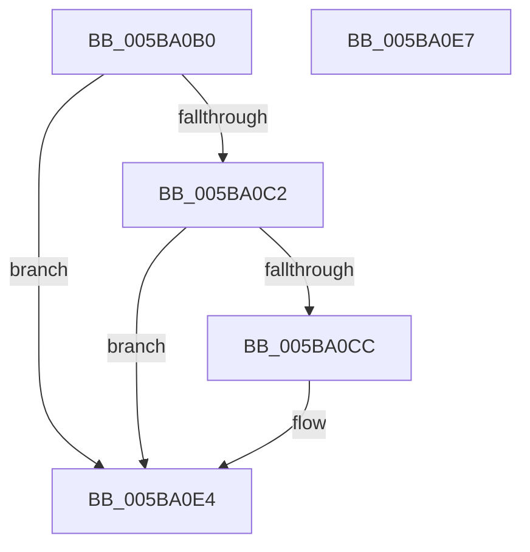

# KiIpiUpdateExtendedSupervisorState

- RVA: `0x005BA0B0`–`0x005BA0E8` (길이 `56` bytes)
- VA: `0x00000001405BA0B0`
- 실행 섹션: `.text`
- PDB 이름 있음: `예`; PDB Function 태그: `아니요`
- unwind 정보 RVA: `0x000DB714`
- 디코드: `15`개 명령, `56/56` bytes 표시
- 미해석 바이트: `0` (있으면 어셈블리에 `.byte`로 보존)

> 이 문서는 커널 이미지의 기계어와 PDB 기호를 분석해 생성했습니다. 4번과 5번은 함수 원형과 자료형을 바이너리 사용 방식에서 추정한 C 해석이며 원본 소스 복구 결과는 아닙니다.

## 1. Dependencies

- 직접 호출 지점: **0**; 고유 호출 대상: **0**
- 직접 호출자로 확인된 함수: **0**
- RIP 상대 이미지 참조: **0**

### Outgoing calls
- 직접 디코드된 call 명령이 없습니다.

### Direct callers
- 이 함수 시작 RVA로 연결되는 직접 call은 확인되지 않았습니다. 간접 호출은 완전히 역산할 수 없습니다.

### Static image references
- 디코드된 RIP-relative 메모리 참조가 없습니다.

## 2. Other-region calls and transfers

- 다른 실행 섹션으로 향하는 call: **0**
- 별도 외부 분기/꼬리 이동을 확인하지 못했습니다.

## 3. Assembly (complete function range)

```asm
005BA0B0  65 4C 8B 04 25 20 00 00 00      mov r8, qword ptr gs:[0x20]
005BA0B9  41 8B 40 24                     mov eax, dword ptr [r8 + 0x24]
005BA0BD  3B 41 08                        cmp eax, dword ptr [rcx + 8]
005BA0C0  73 22                           jae 0x1405ba0e4
005BA0C2  49 83 B8 C0 06 00 00 00         cmp qword ptr [r8 + 0x6c0], 0
005BA0CA  75 18                           jne 0x1405ba0e4
005BA0CC  8B D0                           mov edx, eax
005BA0CE  48 8B 01                        mov rax, qword ptr [rcx]
005BA0D1  48 8B 0C D0                     mov rcx, qword ptr [rax + rdx*8]
005BA0D5  48 83 C1 3F                     add rcx, 0x3f
005BA0D9  48 83 E1 C0                     and rcx, 0xffffffffffffffc0
005BA0DD  49 89 88 C0 06 00 00            mov qword ptr [r8 + 0x6c0], rcx
005BA0E4  33 C0                           xor eax, eax
005BA0E6  C3                              ret
005BA0E7  CC                              int3
```

## 4. C-style interpretation (structured pseudocode)

```c
__int64 __fastcall KiIpiUpdateExtendedSupervisorState(__int64 a1)
{
    __int64 result;

    if (((unsigned int)((unsigned int)(*(unsigned int *)(*(unsigned __int64 *)(gs_base + (0 + 32)) + 36)))) >= (*(unsigned int *)(a1 + 8))) goto loc_005BA0E4;
    result = (unsigned int)(*(unsigned int *)(*(unsigned __int64 *)(gs_base + (0 + 32)) + 36));
    if ((*(unsigned __int64 *)(*(unsigned __int64 *)(gs_base + (0 + 32)) + 1728)) == 0) {
        a2 = (unsigned int)((unsigned int)(*(unsigned int *)(*(unsigned __int64 *)(gs_base + (0 + 32)) + 36)));
        result = *(unsigned __int64 *)(a1);
        a1 = *(unsigned __int64 *)(result + a2 * 8);
        a1 = (a1) + (63);
        a1 = (a1) & (-64);
        *(unsigned __int64 *)(*(unsigned __int64 *)(gs_base + (0 + 32)) + 1728) = a1;
    }
    result = 0;
    return result;
}
```

## 5. (Beta) C Style

```c
int64_t KiIpiUpdateExtendedSupervisorState(void *Arg1)
{
    uint8_t *arg1 = (uint8_t *)Arg1;

    int64_t result;

    if (((uint32_t)((uint32_t)(*(uint32_t *)(*(uint64_t *)(gs_base + (0 + 0x20)) + 0x24)))) >= (*(uint32_t *)(arg1 + 0x8))) goto loc_005BA0E4;
    result = (uint32_t)(*(uint32_t *)(*(uint64_t *)(gs_base + (0 + 0x20)) + 0x24));
    if ((*(uint64_t *)(*(uint64_t *)(gs_base + (0 + 0x20)) + 0x6C0)) == 0) {
        a2 = (uint32_t)((uint32_t)(*(uint32_t *)(*(uint64_t *)(gs_base + (0 + 0x20)) + 0x24)));
        result = *(uint64_t *)(arg1);
        Arg1 = *(uint64_t *)(result + a2 * 8);
        Arg1 = (Arg1) + (63);
        Arg1 = (Arg1) & (-64);
        *(void **)(*(uint64_t *)(gs_base + (0 + 0x20)) + 0x6C0) = Arg1;
    }
    result = 0;
    return result;
}
```

### 관측된 메모리 오프셋

구조체 형식이 확인되지 않은 접근은 인자 기준의 오프셋으로만 기록했습니다.

| 기준 인자 | 오프셋 표현 | 폭 (bit) | 접근 |
|---|---:|---:|---|
| `Arg1` | `+ 0x0` | `64` | `R` |
| `Arg1` | `+ 0x8` | `32` | `R` |

## 6. Execution-region graph

[열기: 2D/3D 그래프와 함수 탐색 컨트롤 패널](../../../control-panel.html?section=text&rva=0x005BA0B0&view=graph)

- 2D 그래프는 위에서 아래로 흐르고, 3D 그래프는 빈 공간을 드래그해 회전합니다. Shift+드래그는 이동, 휠은 확대·축소, 함수 노드 선택은 대상 보고서 이동입니다.

### Static fallback


