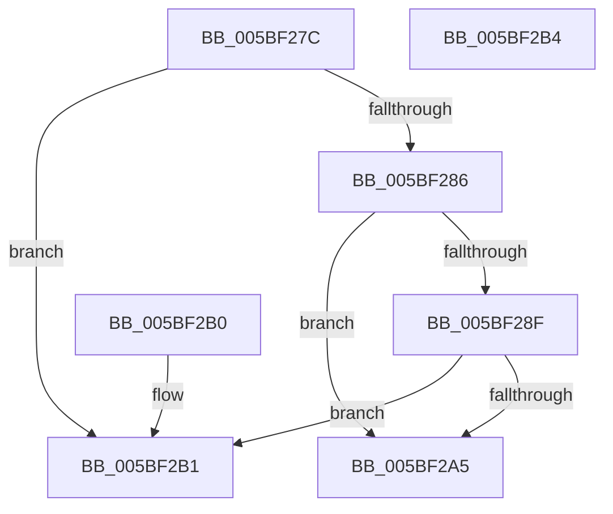

# KiIsBranchConfusionMitigationDesired

- RVA: `0x005BF27C`–`0x005BF2B5` (길이 `57` bytes)
- VA: `0x00000001405BF27C`
- 실행 섹션: `.text`
- PDB 이름 있음: `예`; PDB Function 태그: `아니요`
- unwind 정보 RVA: `0x000DB714`
- 디코드: `19`개 명령, `57/57` bytes 표시
- 미해석 바이트: `0` (있으면 어셈블리에 `.byte`로 보존)

> 이 문서는 커널 이미지의 기계어와 PDB 기호를 분석해 생성했습니다. 4번과 5번은 함수 원형과 자료형을 바이너리 사용 방식에서 추정한 C 해석이며 원본 소스 복구 결과는 아닙니다.

## 1. Dependencies

- 직접 호출 지점: **0**; 고유 호출 대상: **0**
- 직접 호출자로 확인된 함수: **2**
- RIP 상대 이미지 참조: **2**

### Outgoing calls
- 직접 디코드된 call 명령이 없습니다.

### Direct callers
- [KiOptimizeSpecCtrlSettingsWorker](KiOptimizeSpecCtrlSettingsWorker_function_005BF5A0.md) at `0x005C0025`
- [KiOptimizeSpecCtrlSettingsWorker](KiOptimizeSpecCtrlSettingsWorker_function_005BF5A0.md) at `0x005C01E3`
- [KiDetectKvaLeakage](../5C/KiDetectKvaLeakage_function_005C4CD0.md) at `0x005C4D39`

### Static image references
- `0x005BF27C` → RVA `0x00F10EC0` (`.data`; read)
- `0x005BF2A5` → RVA `0x00F10EC3` (`.data`; read)

## 2. Other-region calls and transfers

- 다른 실행 섹션으로 향하는 call: **0**
- 별도 외부 분기/꼬리 이동을 확인하지 못했습니다.

## 3. Assembly (complete function range)

```asm
005BF27C  8B 05 3E 1C 95 00               mov eax, dword ptr [rip + 0x951c3e]
005BF282  A8 05                           test al, 5
005BF284  75 2B                           jne 0x1405bf2b1
005BF286  80 B9 8D 00 00 00 01            cmp byte ptr [rcx + 0x8d], 1
005BF28D  75 16                           jne 0x1405bf2a5
005BF28F  48 8B 02                        mov rax, qword ptr [rdx]
005BF292  F6 05 27 1C 95 00 40            test byte ptr [rip + 0x951c27], 0x40
005BF299  0F 94 C1                        sete cl
005BF29C  A8 10                           test al, 0x10
005BF29E  0F 94 C0                        sete al
005BF2A1  84 C8                           test al, cl
005BF2A3  75 0C                           jne 0x1405bf2b1
005BF2A5  0F B6 05 17 1C 95 00            movzx eax, byte ptr [rip + 0x951c17]
005BF2AC  83 E0 01                        and eax, 1
005BF2AF  C3                              ret
005BF2B0  CC                              int3
005BF2B1  33 C0                           xor eax, eax
005BF2B3  C3                              ret
005BF2B4  CC                              int3
```

## 4. C-style interpretation (structured pseudocode)

```c
__int64 __fastcall KiIsBranchConfusionMitigationDesired(__int64 a1, __int64 a2)
{
    __int64 result;

    if ((((unsigned __int8)((unsigned int)(*(unsigned int *)(v_rip + 9772094)))) & (5)) != 0) goto loc_005BF2B1;
    if ((*(unsigned __int8 *)(a1 + 141)) != 1) goto loc_005BF2A5;
    a1 = (((*(unsigned __int8 *)(v_rip + 9772071)) & (64)) == 0) ? 1 : 0;
    result = ((((unsigned __int8)(*(unsigned __int64 *)(a2))) & (16)) == 0) ? 1 : 0;
    if ((((unsigned __int8)(result)) & ((unsigned __int8)(a1))) != 0) goto loc_005BF2B1;
loc_005BF2A5:
    result = (unsigned int)((*(unsigned __int8 *)(v_rip + 9772055)) & (1));
    return result;
loc_005BF2B1:
    result = 0;
    return result;
}
```

## 5. (Beta) C Style

```c
int64_t KiIsBranchConfusionMitigationDesired(void *Arg1, void *Arg2)
{
    uint8_t *arg1 = (uint8_t *)Arg1;
    uint8_t *arg2 = (uint8_t *)Arg2;

    int64_t result;

    if ((((uint8_t)((uint32_t)(*(uint32_t *)(v_rip + 0x951C3E)))) & (5)) != 0) goto loc_005BF2B1;
    if ((*(uint8_t *)(arg1 + 0x8D)) != 1) goto loc_005BF2A5;
    Arg1 = (((*(uint8_t *)(v_rip + 0x951C27)) & (64)) == 0) ? 1 : 0;
    result = ((((uint8_t)(*(uint64_t *)(arg2))) & (16)) == 0) ? 1 : 0;
    if ((((uint8_t)(result)) & ((uint8_t)(Arg1))) != 0) goto loc_005BF2B1;
loc_005BF2A5:
    result = (uint32_t)((*(uint8_t *)(v_rip + 0x951C17)) & (1));
    return result;
loc_005BF2B1:
    result = 0;
    return result;
}
```

### 관측된 메모리 오프셋

구조체 형식이 확인되지 않은 접근은 인자 기준의 오프셋으로만 기록했습니다.

| 기준 인자 | 오프셋 표현 | 폭 (bit) | 접근 |
|---|---:|---:|---|
| `Arg1` | `+ 0x8D` | `8` | `R` |
| `Arg2` | `+ 0x0` | `64` | `R` |

## 6. Execution-region graph

[열기: 2D/3D 그래프와 함수 탐색 컨트롤 패널](../../../control-panel.html?section=text&rva=0x005BF27C&view=graph)

- 2D 그래프는 위에서 아래로 흐르고, 3D 그래프는 빈 공간을 드래그해 회전합니다. Shift+드래그는 이동, 휠은 확대·축소, 함수 노드 선택은 대상 보고서 이동입니다.

### Static fallback


