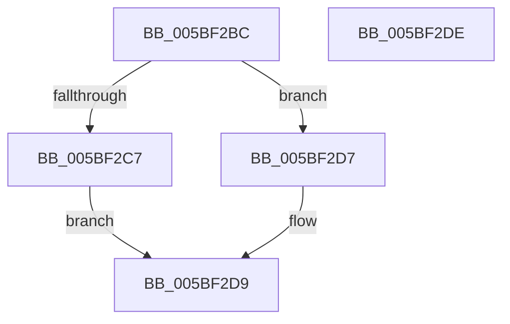

# KiIsBranchConfusionMitigationSupported

- RVA: `0x005BF2BC`–`0x005BF2DF` (길이 `35` bytes)
- VA: `0x00000001405BF2BC`
- 실행 섹션: `.text`
- PDB 이름 있음: `예`; PDB Function 태그: `아니요`
- unwind 정보 RVA: `0x0005C788`
- 디코드: `14`개 명령, `35/35` bytes 표시
- 미해석 바이트: `0` (있으면 어셈블리에 `.byte`로 보존)

> 이 문서는 커널 이미지의 기계어와 PDB 기호를 분석해 생성했습니다. 4번과 5번은 함수 원형과 자료형을 바이너리 사용 방식에서 추정한 C 해석이며 원본 소스 복구 결과는 아닙니다.

## 1. Dependencies

- 직접 호출 지점: **1**; 고유 호출 대상: **1**
- 직접 호출자로 확인된 함수: **2**
- RIP 상대 이미지 참조: **0**

### Outgoing calls
- `0x005BF2C7` → [SpcIsHyperVCr3RspErrataPresent](../6A/SpcIsHyperVCr3RspErrataPresent_function_006A788C.md) (function, `0x006A788C`)

### Direct callers
- [KiOptimizeSpecCtrlSettingsWorker](KiOptimizeSpecCtrlSettingsWorker_function_005BF5A0.md) at `0x005C0041`
- [KiOptimizeSpecCtrlSettingsWorker](KiOptimizeSpecCtrlSettingsWorker_function_005BF5A0.md) at `0x005C01D0`
- [KiDetectKvaLeakage](../5C/KiDetectKvaLeakage_function_005C4CD0.md) at `0x005C4D47`

### Static image references
- 디코드된 RIP-relative 메모리 참조가 없습니다.

## 2. Other-region calls and transfers

- 다른 실행 섹션으로 향하는 call: **0**
- 별도 외부 분기/꼬리 이동을 확인하지 못했습니다.

## 3. Assembly (complete function range)

```asm
005BF2BC  48 83 EC 28                     sub rsp, 0x28
005BF2C0  48 8B 02                        mov rax, qword ptr [rdx]
005BF2C3  A8 04                           test al, 4
005BF2C5  74 10                           je 0x1405bf2d7
005BF2C7  E8 C0 85 0E 00                  call 0x1406a788c
005BF2CC  33 C9                           xor ecx, ecx
005BF2CE  85 C0                           test eax, eax
005BF2D0  0F 94 C1                        sete cl
005BF2D3  8B C1                           mov eax, ecx
005BF2D5  EB 02                           jmp 0x1405bf2d9
005BF2D7  33 C0                           xor eax, eax
005BF2D9  48 83 C4 28                     add rsp, 0x28
005BF2DD  C3                              ret
005BF2DE  CC                              int3
```

## 4. C-style interpretation (structured pseudocode)

```c
__int64 __fastcall KiIsBranchConfusionMitigationSupported(int a1, __int64 a2)
{
    __int64 result;
    __int64 v_rsp;

    v_rsp = (v_rsp) - (40);
    if ((((unsigned __int8)(*(unsigned __int64 *)(a2))) & (4)) == 0) goto loc_005BF2D7;
    result = SpcIsHyperVCr3RspErrataPresent(a1, a2, a3, a4);
    a1 = 0;
    a1 = ((unsigned int)(result) == 0) ? 1 : 0;
    goto loc_005BF2D9;
loc_005BF2D7:
    result = 0;
loc_005BF2D9:
    v_rsp = (v_rsp) + (40);
    return result;
}
```

## 5. (Beta) C Style

```c
int64_t KiIsBranchConfusionMitigationSupported(int32_t Arg1, void *Arg2)
{
    uint8_t *arg2 = (uint8_t *)Arg2;

    int64_t result;
    int64_t local_rsp;

    local_rsp = (local_rsp) - (40);
    if ((((uint8_t)(*(uint64_t *)(arg2))) & (4)) == 0) goto loc_005BF2D7;
    result = SpcIsHyperVCr3RspErrataPresent(Arg1, Arg2, a3, a4);
    Arg1 = 0;
    Arg1 = ((uint32_t)(result) == 0) ? 1 : 0;
    goto loc_005BF2D9;
loc_005BF2D7:
    result = 0;
loc_005BF2D9:
    local_rsp = (local_rsp) + (40);
    return result;
}
```

### 관측된 메모리 오프셋

구조체 형식이 확인되지 않은 접근은 인자 기준의 오프셋으로만 기록했습니다.

| 기준 인자 | 오프셋 표현 | 폭 (bit) | 접근 |
|---|---:|---:|---|
| `Arg2` | `+ 0x0` | `64` | `R` |

## 6. Execution-region graph

[열기: 2D/3D 그래프와 함수 탐색 컨트롤 패널](../../../control-panel.html?section=text&rva=0x005BF2BC&view=graph)

- 2D 그래프는 위에서 아래로 흐르고, 3D 그래프는 빈 공간을 드래그해 회전합니다. Shift+드래그는 이동, 휠은 확대·축소, 함수 노드 선택은 대상 보고서 이동입니다.

### Static fallback


