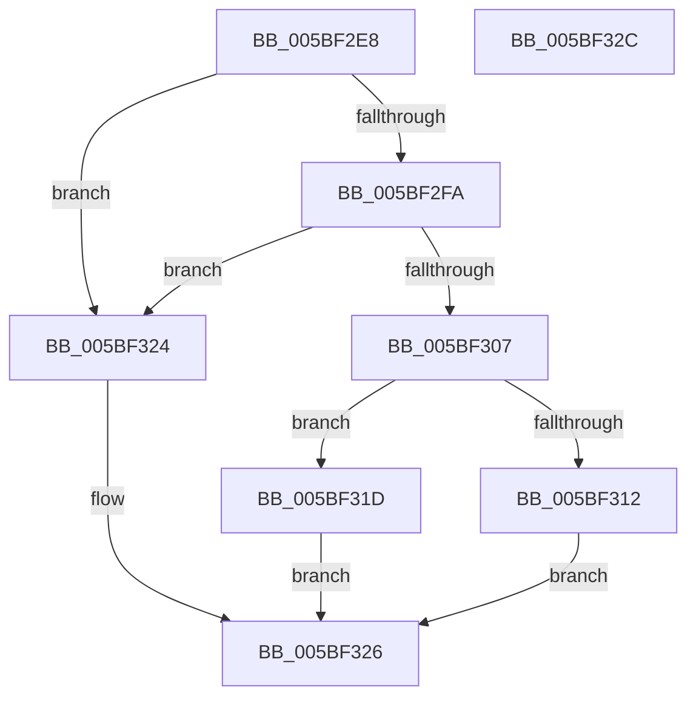

# KiIsBranchConfusionPresent

- RVA: `0x005BF2E8`–`0x005BF32D` (길이 `69` bytes)
- VA: `0x00000001405BF2E8`
- 실행 섹션: `.text`
- PDB 이름 있음: `예`; PDB Function 태그: `아니요`
- unwind 정보 RVA: `0x0005CF00`
- 디코드: `22`개 명령, `69/69` bytes 표시
- 미해석 바이트: `0` (있으면 어셈블리에 `.byte`로 보존)

> 이 문서는 커널 이미지의 기계어와 PDB 기호를 분석해 생성했습니다. 4번과 5번은 함수 원형과 자료형을 바이너리 사용 방식에서 추정한 C 해석이며 원본 소스 복구 결과는 아닙니다.

## 1. Dependencies

- 직접 호출 지점: **1**; 고유 호출 대상: **1**
- 직접 호출자로 확인된 함수: **2**
- RIP 상대 이미지 참조: **1**

### Outgoing calls
- `0x005BF307` → [HviIsAnyHypervisorPresent](../4A/HviIsAnyHypervisorPresent_function_004ADC50.md) (function, `0x004ADC50`)

### Direct callers
- [KiDetectHardwareSpecControlFeatures](KiDetectHardwareSpecControlFeatures_function_005BEC4C.md) at `0x005BEF7E`
- [KiOptimizeSpecCtrlSettingsWorker](KiOptimizeSpecCtrlSettingsWorker_function_005BF5A0.md) at `0x005C0006`
- [KiOptimizeSpecCtrlSettingsWorker](KiOptimizeSpecCtrlSettingsWorker_function_005BF5A0.md) at `0x005C01C0`

### Static image references
- `0x005BF2FA` → RVA `0x00FC6B60` (`ALMOSTRO`; read)

## 2. Other-region calls and transfers

- 다른 실행 섹션으로 향하는 call: **0**
- 별도 외부 분기/꼬리 이동을 확인하지 못했습니다.

## 3. Assembly (complete function range)

```asm
005BF2E8  40 53                           push rbx
005BF2EA  48 83 EC 20                     sub rsp, 0x20
005BF2EE  80 B9 8D 00 00 00 01            cmp byte ptr [rcx + 0x8d], 1
005BF2F5  48 8B D9                        mov rbx, rcx
005BF2F8  75 2A                           jne 0x1405bf324
005BF2FA  48 F7 05 5B 78 A0 00 00 00 00 01  test qword ptr [rip + 0xa0785b], 0x1000000
005BF305  75 1D                           jne 0x1405bf324
005BF307  E8 44 E9 EE FF                  call 0x1404adc50
005BF30C  33 D2                           xor edx, edx
005BF30E  84 C0                           test al, al
005BF310  75 0B                           jne 0x1405bf31d
005BF312  80 7B 40 19                     cmp byte ptr [rbx + 0x40], 0x19
005BF316  0F 95 C2                        setne dl
005BF319  8B C2                           mov eax, edx
005BF31B  EB 09                           jmp 0x1405bf326
005BF31D  B8 01 00 00 00                  mov eax, 1
005BF322  EB 02                           jmp 0x1405bf326
005BF324  33 C0                           xor eax, eax
005BF326  48 83 C4 20                     add rsp, 0x20
005BF32A  5B                              pop rbx
005BF32B  C3                              ret
005BF32C  CC                              int3
```

## 4. C-style interpretation (structured pseudocode)

```c
__int64 __fastcall KiIsBranchConfusionPresent(__int64 a1, int a2)
{
    __int64 result;
    __int64 v_rsp;

    v_rsp = (v_rsp) - (32);
    if ((*(unsigned __int8 *)(a1 + 141)) != 1) goto loc_005BF324;
    if (((*(unsigned __int64 *)(v_rip + 10516571)) & (0x1000000ULL)) != 0) goto loc_005BF324;
    result = HviIsAnyHypervisorPresent(a1, a2, a3, a4);
    a2 = 0;
    if ((unsigned __int8)(result) != 0) goto loc_005BF31D;
    a2 = ((*(unsigned __int8 *)(a1 + 64)) != 25) ? 1 : 0;
    goto loc_005BF326;
loc_005BF31D:
    goto loc_005BF326;
loc_005BF324:
    result = 0;
loc_005BF326:
    v_rsp = (v_rsp) + (32);
    return result;
}
```

## 5. (Beta) C Style

```c
int64_t KiIsBranchConfusionPresent(void *Arg1, int32_t Arg2)
{
    uint8_t *arg1 = (uint8_t *)Arg1;

    int64_t result;
    int64_t local_rsp;

    local_rsp = (local_rsp) - (32);
    if ((*(uint8_t *)(arg1 + 0x8D)) != 1) goto loc_005BF324;
    if (((*(uint64_t *)(v_rip + 0xA0785B)) & (0x1000000ULL)) != 0) goto loc_005BF324;
    result = HviIsAnyHypervisorPresent(Arg1, Arg2, a3, a4);
    Arg2 = 0;
    if ((uint8_t)(result) != 0) goto loc_005BF31D;
    Arg2 = ((*(uint8_t *)(arg1 + 0x40)) != 25) ? 1 : 0;
    goto loc_005BF326;
loc_005BF31D:
    goto loc_005BF326;
loc_005BF324:
    result = 0;
loc_005BF326:
    local_rsp = (local_rsp) + (32);
    return result;
}
```

### 관측된 메모리 오프셋

구조체 형식이 확인되지 않은 접근은 인자 기준의 오프셋으로만 기록했습니다.

| 기준 인자 | 오프셋 표현 | 폭 (bit) | 접근 |
|---|---:|---:|---|
| `Arg1` | `+ 0x40` | `8` | `R` |
| `Arg1` | `+ 0x8D` | `8` | `R` |

## 6. Execution-region graph

[열기: 2D/3D 그래프와 함수 탐색 컨트롤 패널](../../../control-panel.html?section=text&rva=0x005BF2E8&view=graph)

- 2D 그래프는 위에서 아래로 흐르고, 3D 그래프는 빈 공간을 드래그해 회전합니다. Shift+드래그는 이동, 휠은 확대·축소, 함수 노드 선택은 대상 보고서 이동입니다.

### Static fallback


