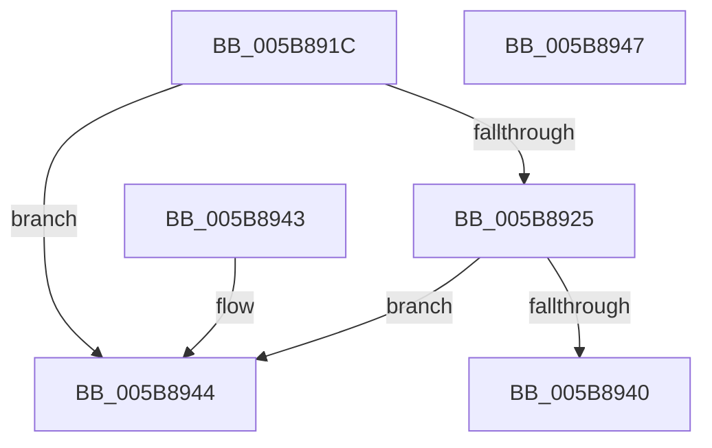

# KiIsIntelPebsSupported

- RVA: `0x005B891C`–`0x005B8948` (길이 `44` bytes)
- VA: `0x00000001405B891C`
- 실행 섹션: `.text`
- PDB 이름 있음: `예`; PDB Function 태그: `아니요`
- unwind 정보 RVA: `0x000DB714`
- 디코드: `15`개 명령, `44/44` bytes 표시
- 미해석 바이트: `0` (있으면 어셈블리에 `.byte`로 보존)

> 이 문서는 커널 이미지의 기계어와 PDB 기호를 분석해 생성했습니다. 4번과 5번은 함수 원형과 자료형을 바이너리 사용 방식에서 추정한 C 해석이며 원본 소스 복구 결과는 아닙니다.

## 1. Dependencies

- 직접 호출 지점: **0**; 고유 호출 대상: **0**
- 직접 호출자로 확인된 함수: **2**
- RIP 상대 이미지 참조: **0**

### Outgoing calls
- 직접 디코드된 call 명령이 없습니다.

### Direct callers
- [KeAllocateProcessorProfileStructures](KeAllocateProcessorProfileStructures_function_005B14B0.md) at `0x005B15E7`
- [KeProcessorProfileControlArea](KeProcessorProfileControlArea_function_005B184C.md) at `0x005B18DE`

### Static image references
- 디코드된 RIP-relative 메모리 참조가 없습니다.

## 2. Other-region calls and transfers

- 다른 실행 섹션으로 향하는 call: **0**
- 별도 외부 분기/꼬리 이동을 확인하지 못했습니다.

## 3. Assembly (complete function range)

```asm
005B891C  80 B9 8D 00 00 00 02            cmp byte ptr [rcx + 0x8d], 2
005B8923  75 1F                           jne 0x1405b8944
005B8925  B9 A0 01 00 00                  mov ecx, 0x1a0
005B892A  0F 32                           rdmsr
005B892C  48 C1 E2 20                     shl rdx, 0x20
005B8930  48 0B C2                        or rax, rdx
005B8933  25 80 10 00 00                  and eax, 0x1080
005B8938  48 3D 80 00 00 00               cmp rax, 0x80
005B893E  75 04                           jne 0x1405b8944
005B8940  B0 01                           mov al, 1
005B8942  C3                              ret
005B8943  CC                              int3
005B8944  32 C0                           xor al, al
005B8946  C3                              ret
005B8947  CC                              int3
```

## 4. C-style interpretation (structured pseudocode)

```c
__int64 __fastcall KiIsIntelPebsSupported(__int64 a1, __int64 a2)
{
    __int64 result;

    if ((*(unsigned __int8 *)(a1 + 141)) != 2) goto loc_005B8944;
    a2 = (a2) << (32);
    result = (result) | (a2);
    result = (unsigned int)((result) & (0x1080ULL));
    if (result != 128) goto loc_005B8944;
    return 1;
loc_005B8944:
    result = 0;
    return result;
}
```

## 5. (Beta) C Style

```c
int64_t KiIsIntelPebsSupported(void *Arg1, int64_t Arg2)
{
    uint8_t *arg1 = (uint8_t *)Arg1;

    int64_t result;

    if ((*(uint8_t *)(arg1 + 0x8D)) != 2) goto loc_005B8944;
    Arg2 = (Arg2) << (32);
    result = (result) | (Arg2);
    result = (uint32_t)((result) & (0x1080ULL));
    if (result != 128) goto loc_005B8944;
    return 1;
loc_005B8944:
    result = 0;
    return result;
}
```

### 관측된 메모리 오프셋

구조체 형식이 확인되지 않은 접근은 인자 기준의 오프셋으로만 기록했습니다.

| 기준 인자 | 오프셋 표현 | 폭 (bit) | 접근 |
|---|---:|---:|---|
| `Arg1` | `+ 0x8D` | `8` | `R` |

## 6. Execution-region graph

[열기: 2D/3D 그래프와 함수 탐색 컨트롤 패널](../../../control-panel.html?section=text&rva=0x005B891C&view=graph)

- 2D 그래프는 위에서 아래로 흐르고, 3D 그래프는 빈 공간을 드래그해 회전합니다. Shift+드래그는 이동, 휠은 확대·축소, 함수 노드 선택은 대상 보고서 이동입니다.

### Static fallback


