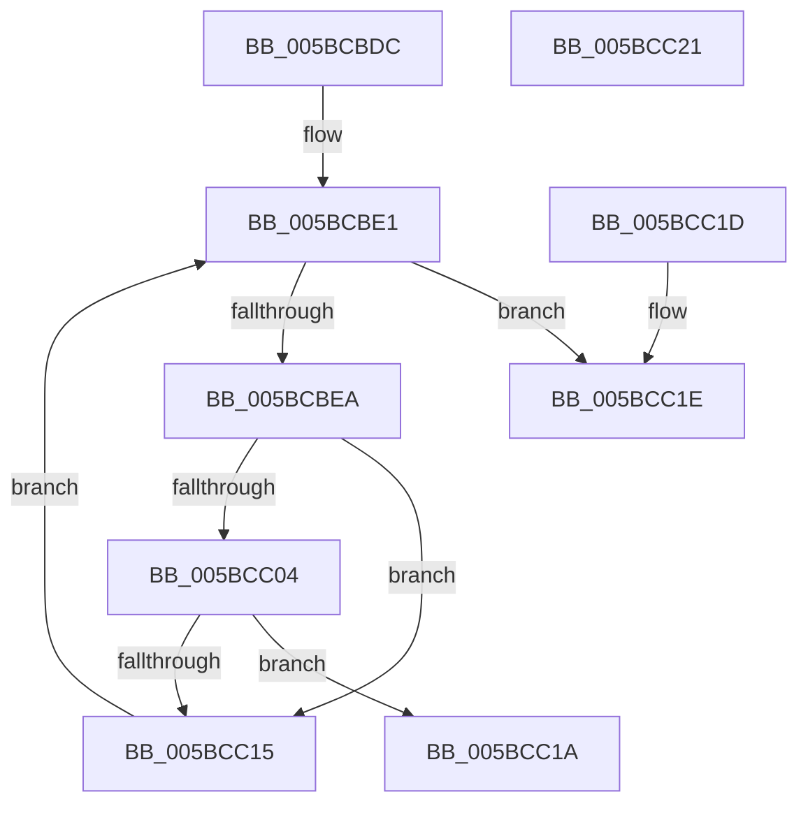

# KiIsNodeFull

- RVA: `0x005BCBDC`–`0x005BCC22` (길이 `70` bytes)
- VA: `0x00000001405BCBDC`
- 실행 섹션: `.text`
- PDB 이름 있음: `예`; PDB Function 태그: `아니요`
- unwind 정보 RVA: `0x000DB714`
- 디코드: `22`개 명령, `70/70` bytes 표시
- 미해석 바이트: `0` (있으면 어셈블리에 `.byte`로 보존)

> 이 문서는 커널 이미지의 기계어와 PDB 기호를 분석해 생성했습니다. 4번과 5번은 함수 원형과 자료형을 바이너리 사용 방식에서 추정한 C 해석이며 원본 소스 복구 결과는 아닙니다.

## 1. Dependencies

- 직접 호출 지점: **0**; 고유 호출 대상: **0**
- 직접 호출자로 확인된 함수: **1**
- RIP 상대 이미지 참조: **2**

### Outgoing calls
- 직접 디코드된 call 명령이 없습니다.

### Direct callers
- [KiQueryProcessorNode](KiQueryProcessorNode_function_005BCC70.md) at `0x005BCD1C`
- [KiQueryProcessorNode](KiQueryProcessorNode_function_005BCC70.md) at `0x005BCD48`

### Static image references
- `0x005BCBE1` → RVA `0x00F21AC8` (`.data`; read)
- `0x005BCBEA` → RVA `0x00F21AF0` (`.data`; read)

## 2. Other-region calls and transfers

- 다른 실행 섹션으로 향하는 call: **0**
- 별도 외부 분기/꼬리 이동을 확인하지 못했습니다.

## 3. Assembly (complete function range)

```asm
005BCBDC  4C 8B D1                        mov r10, rcx
005BCBDF  33 D2                           xor edx, edx
005BCBE1  66 3B 15 E0 4E 96 00            cmp dx, word ptr [rip + 0x964ee0]
005BCBE8  73 34                           jae 0x1405bcc1e
005BCBEA  4C 8B 0D FF 4E 96 00            mov r9, qword ptr [rip + 0x964eff]
005BCBF1  0F B7 C2                        movzx eax, dx
005BCBF4  4C 8D 04 40                     lea r8, [rax + rax*2]
005BCBF8  41 0F B7 02                     movzx eax, word ptr [r10]
005BCBFC  66 43 39 44 C1 02               cmp word ptr [r9 + r8*8 + 2], ax
005BCC02  75 11                           jne 0x1405bcc15
005BCC04  F3 4B 0F B8 4C C1 10            popcnt rcx, qword ptr [r9 + r8*8 + 0x10]
005BCC0B  43 0F B6 44 C1 04               movzx eax, byte ptr [r9 + r8*8 + 4]
005BCC11  3B C8                           cmp ecx, eax
005BCC13  72 05                           jb 0x1405bcc1a
005BCC15  66 FF C2                        inc dx
005BCC18  EB C7                           jmp 0x1405bcbe1
005BCC1A  32 C0                           xor al, al
005BCC1C  C3                              ret
005BCC1D  CC                              int3
005BCC1E  B0 01                           mov al, 1
005BCC20  C3                              ret
005BCC21  CC                              int3
```

## 4. C-style interpretation (structured pseudocode)

```c
__int64 __fastcall KiIsNodeFull(__int64 a1, int a2)
{
    __int64 result;

    a2 = 0;
loc_005BCBE1:
    if (0 >= (*(unsigned __int16 *)(v_rip + 9850592))) goto loc_005BCC1E;
    if ((*(unsigned __int16 *)(*(unsigned __int64 *)(v_rip + 9850623) + 0 + 0 * 2 * 8 + 2)) != ((unsigned __int16)(*(unsigned __int16 *)(a1)))) goto loc_005BCC15;
    if (((unsigned int)(a1)) < ((unsigned int)(*(unsigned __int8 *)(*(unsigned __int64 *)(v_rip + 9850623) + 0 + 0 * 2 * 8 + 4)))) goto loc_005BCC1A;
loc_005BCC15:
    a2 = (unsigned __int16)((a2) + 1);
    goto loc_005BCBE1;
loc_005BCC1A:
    result = 0;
    return result;
loc_005BCC1E:
    return 1;
}
```

## 5. (Beta) C Style

```c
int64_t KiIsNodeFull(void *Arg1, int32_t Arg2)
{
    uint8_t *arg1 = (uint8_t *)Arg1;

    int64_t result;

    Arg2 = 0;
loc_005BCBE1:
    if (0 >= (*(uint16_t *)(v_rip + 0x964EE0))) goto loc_005BCC1E;
    if ((*(uint16_t *)(*(uint64_t *)(v_rip + 0x964EFF) + 0x0 + 0x0 * 2 * 8 + 0x2)) != ((uint16_t)(*(uint16_t *)(arg1)))) goto loc_005BCC15;
    if (((uint32_t)(Arg1)) < ((uint32_t)(*(uint8_t *)(*(uint64_t *)(v_rip + 0x964EFF) + 0x0 + 0x0 * 2 * 8 + 0x4)))) goto loc_005BCC1A;
loc_005BCC15:
    Arg2 = (uint16_t)((Arg2) + 1);
    goto loc_005BCBE1;
loc_005BCC1A:
    result = 0;
    return result;
loc_005BCC1E:
    return 1;
}
```

### 관측된 메모리 오프셋

구조체 형식이 확인되지 않은 접근은 인자 기준의 오프셋으로만 기록했습니다.

| 기준 인자 | 오프셋 표현 | 폭 (bit) | 접근 |
|---|---:|---:|---|
| `Arg1` | `+ 0x0` | `16` | `R` |

## 6. Execution-region graph

[열기: 2D/3D 그래프와 함수 탐색 컨트롤 패널](../../../control-panel.html?section=text&rva=0x005BCBDC&view=graph)

- 2D 그래프는 위에서 아래로 흐르고, 3D 그래프는 빈 공간을 드래그해 회전합니다. Shift+드래그는 이동, 휠은 확대·축소, 함수 노드 선택은 대상 보고서 이동입니다.

### Static fallback


