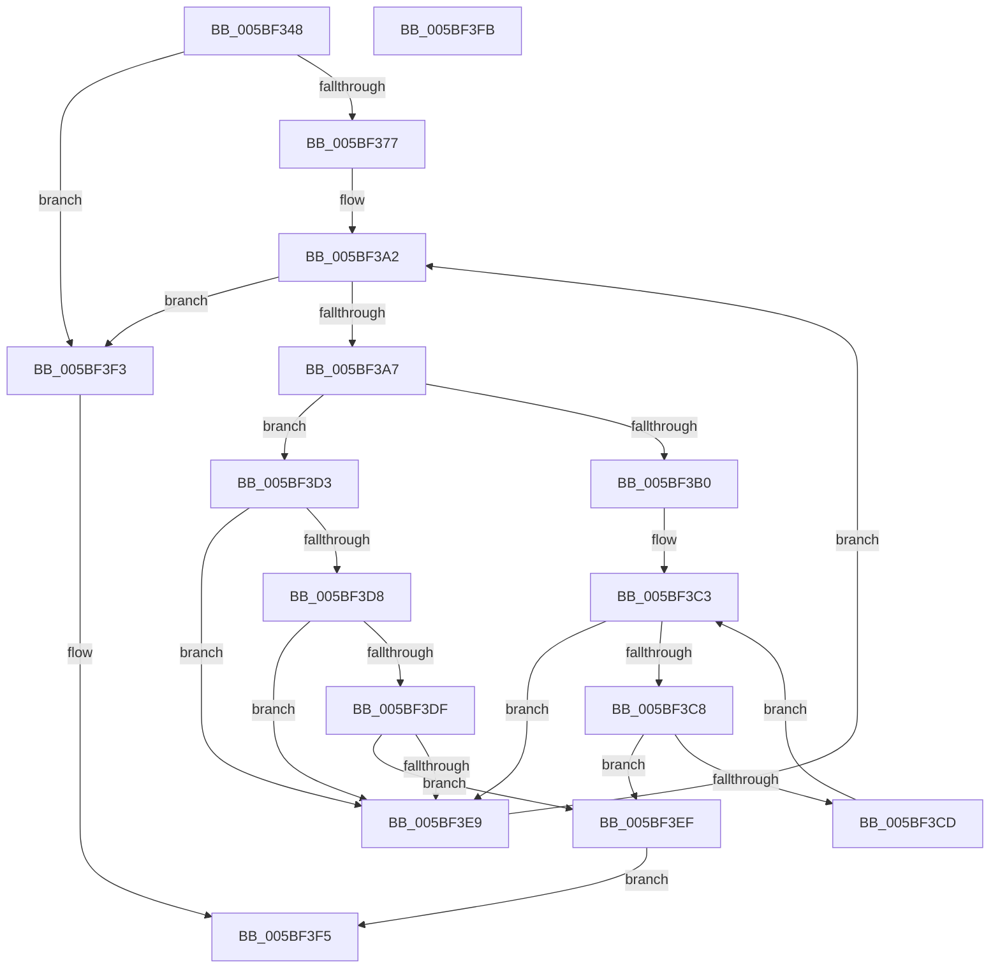

# KiIsPgiKernel

- RVA: `0x005BF348`–`0x005BF3FC` (길이 `180` bytes)
- VA: `0x00000001405BF348`
- 실행 섹션: `.text`
- PDB 이름 있음: `예`; PDB Function 태그: `아니요`
- unwind 정보 RVA: `0x0005CF00`
- 디코드: `54`개 명령, `180/180` bytes 표시
- 미해석 바이트: `0` (있으면 어셈블리에 `.byte`로 보존)

> 이 문서는 커널 이미지의 기계어와 PDB 기호를 분석해 생성했습니다. 4번과 5번은 함수 원형과 자료형을 바이너리 사용 방식에서 추정한 C 해석이며 원본 소스 복구 결과는 아닙니다.

## 1. Dependencies

- 직접 호출 지점: **1**; 고유 호출 대상: **1**
- 직접 호출자로 확인된 함수: **1**
- RIP 상대 이미지 참조: **1**

### Outgoing calls
- `0x005BF36A` → [RtlImageDirectoryEntryToData](../43/RtlImageDirectoryEntryToData_function_004328D0.md) (function, `0x004328D0`)

### Direct callers
- [KiDetermineRetpolineEnablement](KiDetermineRetpolineEnablement_function_005BF1C0.md) at `0x005BF1F1`

### Static image references
- `0x005BF353` → RVA `0x00000000` (`image boundary/outside`; read)

## 2. Other-region calls and transfers

- 다른 실행 섹션으로 향하는 call: **0**
- 별도 외부 분기/꼬리 이동을 확인하지 못했습니다.

## 3. Assembly (complete function range)

```asm
005BF348  40 53                           push rbx
005BF34A  48 83 EC 20                     sub rsp, 0x20
005BF34E  83 64 24 30 00                  and dword ptr [rsp + 0x30], 0
005BF353  48 8D 1D A6 0C A4 FF            lea rbx, [rip - 0x5bf35a]
005BF35A  48 8B CB                        mov rcx, rbx
005BF35D  4C 8D 4C 24 30                  lea r9, [rsp + 0x30]
005BF362  41 B8 06 00 00 00               mov r8d, 6
005BF368  B2 01                           mov dl, 1
005BF36A  E8 61 35 E7 FF                  call 0x1404328d0
005BF36F  4C 8B C0                        mov r8, rax
005BF372  48 85 C0                        test rax, rax
005BF375  74 7C                           je 0x1405bf3f3
005BF377  8B 4C 24 30                     mov ecx, dword ptr [rsp + 0x30]
005BF37B  48 B8 93 24 49 92 24 49 92 24   movabs rax, 0x2492492492492493
005BF385  48 F7 E1                        mul rcx
005BF388  41 BA 00 49 47 50               mov r10d, 0x50474900
005BF38E  48 2B CA                        sub rcx, rdx
005BF391  48 D1 E9                        shr rcx, 1
005BF394  48 03 CA                        add rcx, rdx
005BF397  48 C1 E9 04                     shr rcx, 4
005BF39B  4C 6B C9 1C                     imul r9, rcx, 0x1c
005BF39F  4D 03 C8                        add r9, r8
005BF3A2  4D 3B C1                        cmp r8, r9
005BF3A5  73 4C                           jae 0x1405bf3f3
005BF3A7  41 8B 40 0C                     mov eax, dword ptr [r8 + 0xc]
005BF3AB  83 F8 0A                        cmp eax, 0xa
005BF3AE  75 23                           jne 0x1405bf3d3
005BF3B0  41 8B 48 14                     mov ecx, dword ptr [r8 + 0x14]
005BF3B4  41 8B 40 10                     mov eax, dword ptr [r8 + 0x10]
005BF3B8  48 03 CB                        add rcx, rbx
005BF3BB  48 C1 E8 02                     shr rax, 2
005BF3BF  48 8D 14 81                     lea rdx, [rcx + rax*4]
005BF3C3  48 3B CA                        cmp rcx, rdx
005BF3C6  73 21                           jae 0x1405bf3e9
005BF3C8  44 39 11                        cmp dword ptr [rcx], r10d
005BF3CB  74 22                           je 0x1405bf3ef
005BF3CD  48 83 C1 04                     add rcx, 4
005BF3D1  EB F0                           jmp 0x1405bf3c3
005BF3D3  83 F8 0D                        cmp eax, 0xd
005BF3D6  75 11                           jne 0x1405bf3e9
005BF3D8  41 83 78 10 10                  cmp dword ptr [r8 + 0x10], 0x10
005BF3DD  72 0A                           jb 0x1405bf3e9
005BF3DF  41 8B 40 14                     mov eax, dword ptr [r8 + 0x14]
005BF3E3  44 39 14 18                     cmp dword ptr [rax + rbx], r10d
005BF3E7  74 06                           je 0x1405bf3ef
005BF3E9  49 83 C0 1C                     add r8, 0x1c
005BF3ED  EB B3                           jmp 0x1405bf3a2
005BF3EF  B0 01                           mov al, 1
005BF3F1  EB 02                           jmp 0x1405bf3f5
005BF3F3  32 C0                           xor al, al
005BF3F5  48 83 C4 20                     add rsp, 0x20
005BF3F9  5B                              pop rbx
005BF3FA  C3                              ret
005BF3FB  CC                              int3
```

## 4. C-style interpretation (structured pseudocode)

```c
__int64 __fastcall KiIsPgiKernel(void)
{
    __int64 result;
    __int64 v_rsp;
    unsigned int v_stack_p8;

    v_rsp = (v_rsp) - (32);
    result = RtlImageDirectoryEntryToData(v_rip - 6026074, 1, 6, v_stack_p8);
    if (result == 0) goto loc_005BF3F3;
    a1 = ((unsigned int)(v_stack_p8)) - (1);
    a1 = (a1) >> (1);
    a1 = (a1) + (1);
    a1 = (a1) >> (4);
    a4 = (v_stack_p8) * (a1);
    a4 = (a4) + (result);
loc_005BF3A2:
    if (result >= a4) goto loc_005BF3F3;
    if (((unsigned int)((unsigned int)(*(unsigned int *)(result + 12)))) != 10) goto loc_005BF3D3;
    a1 = ((unsigned int)(*(unsigned int *)(result + 20))) + (v_rip - 6026074);
    result = ((unsigned int)(*(unsigned int *)(result + 16))) >> (2);
loc_005BF3C3:
    if (a1 >= (a1 + result * 4)) goto loc_005BF3E9;
    if ((*(unsigned int *)(a1)) == ((unsigned int)((unsigned int)(0x50474900ULL)))) goto loc_005BF3EF;
    a1 = (a1) + (4);
    goto loc_005BF3C3;
loc_005BF3D3:
    if (((unsigned int)(result)) != 13) goto loc_005BF3E9;
    if ((*(unsigned int *)(result + 16)) < 16) goto loc_005BF3E9;
    if ((*(unsigned int *)((unsigned int)(*(unsigned int *)(result + 20)) + v_rip - 6026074 * 1)) == ((unsigned int)((unsigned int)(0x50474900ULL)))) goto loc_005BF3EF;
loc_005BF3E9:
    a3 = (result) + (28);
    goto loc_005BF3A2;
loc_005BF3EF:
    goto loc_005BF3F5;
loc_005BF3F3:
    result = 0;
loc_005BF3F5:
    v_rsp = (v_rsp) + (32);
    return result;
}
```

## 5. (Beta) C Style

```c
void KiIsPgiKernel(void)
{
    int64_t result;
    int64_t local_rsp;
    uint32_t v_stack_p8;

    local_rsp = (local_rsp) - (32);
    result = RtlImageDirectoryEntryToData(v_rip - 6026074, 1, 6, v_stack_p8);
    if (result == 0) goto loc_005BF3F3;
    a1 = ((uint32_t)(v_stack_p8)) - (1);
    a1 = (a1) >> (1);
    a1 = (a1) + (1);
    a1 = (a1) >> (4);
    a4 = (v_stack_p8) * (a1);
    a4 = (a4) + (result);
loc_005BF3A2:
    if (result >= a4) goto loc_005BF3F3;
    if (((uint32_t)((uint32_t)(*(uint32_t *)(result + 0xC)))) != 10) goto loc_005BF3D3;
    a1 = ((uint32_t)(*(uint32_t *)(result + 0x14))) + (v_rip - 6026074);
    result = ((uint32_t)(*(uint32_t *)(result + 0x10))) >> (2);
loc_005BF3C3:
    if (a1 >= (a1 + result * 4)) goto loc_005BF3E9;
    if ((*(uint32_t *)(a1)) == ((uint32_t)((uint32_t)(0x50474900ULL)))) goto loc_005BF3EF;
    a1 = (a1) + (4);
    goto loc_005BF3C3;
loc_005BF3D3:
    if (((uint32_t)(result)) != 13) goto loc_005BF3E9;
    if ((*(uint32_t *)(result + 0x10)) < 16) goto loc_005BF3E9;
    if ((*(uint32_t *)((uint32_t)(*(uint32_t *)(result + 0x14)) + v_rip - 0x5BF35A * 1)) == ((uint32_t)((uint32_t)(0x50474900ULL)))) goto loc_005BF3EF;
loc_005BF3E9:
    a3 = (result) + (28);
    goto loc_005BF3A2;
loc_005BF3EF:
    goto loc_005BF3F5;
loc_005BF3F3:
    result = 0;
loc_005BF3F5:
    local_rsp = (local_rsp) + (32);
    return result;
}
```

## 6. Execution-region graph

[열기: 2D/3D 그래프와 함수 탐색 컨트롤 패널](../../../control-panel.html?section=text&rva=0x005BF348&view=graph)

- 2D 그래프는 위에서 아래로 흐르고, 3D 그래프는 빈 공간을 드래그해 회전합니다. Shift+드래그는 이동, 휠은 확대·축소, 함수 노드 선택은 대상 보고서 이동입니다.

### Static fallback


