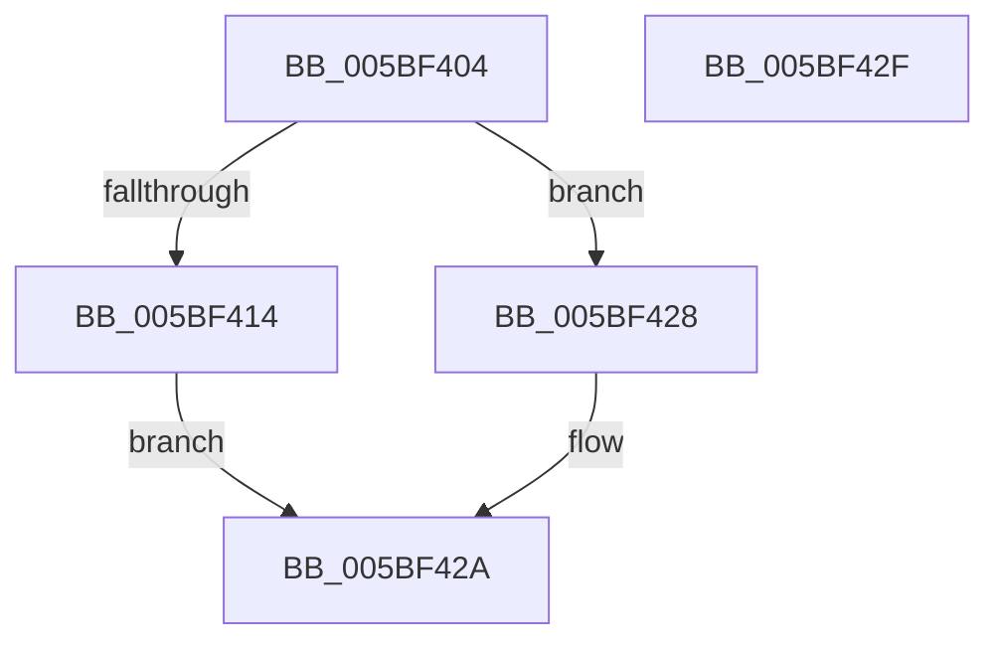

# KiIsSafeBoot

- RVA: `0x005BF404`–`0x005BF430` (길이 `44` bytes)
- VA: `0x00000001405BF404`
- 실행 섹션: `.text`
- PDB 이름 있음: `예`; PDB Function 태그: `아니요`
- unwind 정보 RVA: `0x0005C788`
- 디코드: `13`개 명령, `44/44` bytes 표시
- 미해석 바이트: `0` (있으면 어셈블리에 `.byte`로 보존)

> 이 문서는 커널 이미지의 기계어와 PDB 기호를 분석해 생성했습니다. 4번과 5번은 함수 원형과 자료형을 바이너리 사용 방식에서 추정한 C 해석이며 원본 소스 복구 결과는 아닙니다.

## 1. Dependencies

- 직접 호출 지점: **1**; 고유 호출 대상: **1**
- 직접 호출자로 확인된 함수: **2**
- RIP 상대 이미지 참조: **1**

### Outgoing calls
- `0x005BF41B` → [strstr](../4F/strstr_function_004FF680.md) (function, `0x004FF680`)

### Direct callers
- [KiDetermineImportOptimizationEnablement](KiDetermineImportOptimizationEnablement_function_005BF178.md) at `0x005BF181`
- [KiDetermineRetpolineEnablement](KiDetermineRetpolineEnablement_function_005BF1C0.md) at `0x005BF1D8`

### Static image references
- `0x005BF414` → RVA `0x006CBB00` (` ?? ::FNODOBFM::`string'`; read)

## 2. Other-region calls and transfers

- 다른 실행 섹션으로 향하는 call: **0**
- 별도 외부 분기/꼬리 이동을 확인하지 못했습니다.

## 3. Assembly (complete function range)

```asm
005BF404  48 83 EC 28                     sub rsp, 0x28
005BF408  48 8B 89 D8 00 00 00            mov rcx, qword ptr [rcx + 0xd8]
005BF40F  48 85 C9                        test rcx, rcx
005BF412  74 14                           je 0x1405bf428
005BF414  48 8D 15 E5 C6 10 00            lea rdx, [rip + 0x10c6e5]
005BF41B  E8 60 02 F4 FF                  call 0x1404ff680
005BF420  48 85 C0                        test rax, rax
005BF423  0F 95 C0                        setne al
005BF426  EB 02                           jmp 0x1405bf42a
005BF428  32 C0                           xor al, al
005BF42A  48 83 C4 28                     add rsp, 0x28
005BF42E  C3                              ret
005BF42F  CC                              int3
```

## 4. C-style interpretation (structured pseudocode)

```c
__int64 __fastcall KiIsSafeBoot(__int64 a1)
{
    __int64 result;
    __int64 v_rsp;

    v_rsp = (v_rsp) - (40);
    if (*(unsigned __int64 *)(a1 + 216) == 0) goto loc_005BF428;
    result = strstr(*(unsigned __int64 *)(a1 + 216), v_rip + 1099493, a3, a4);
    result = (result != 0) ? 1 : 0;
    goto loc_005BF42A;
loc_005BF428:
    result = 0;
loc_005BF42A:
    v_rsp = (v_rsp) + (40);
    return result;
}
```

## 5. (Beta) C Style

```c
int64_t KiIsSafeBoot(void *Arg1)
{
    uint8_t *arg1 = (uint8_t *)Arg1;

    int64_t result;
    int64_t local_rsp;

    local_rsp = (local_rsp) - (40);
    if (*(uint64_t *)(arg1 + 0xD8) == 0) goto loc_005BF428;
    result = strstr(*(uint64_t *)(arg1 + 0xD8), v_rip + 1099493, a3, a4);
    result = (result != 0) ? 1 : 0;
    goto loc_005BF42A;
loc_005BF428:
    result = 0;
loc_005BF42A:
    local_rsp = (local_rsp) + (40);
    return result;
}
```

### 관측된 메모리 오프셋

구조체 형식이 확인되지 않은 접근은 인자 기준의 오프셋으로만 기록했습니다.

| 기준 인자 | 오프셋 표현 | 폭 (bit) | 접근 |
|---|---:|---:|---|
| `Arg1` | `+ 0xD8` | `64` | `R` |

## 6. Execution-region graph

[열기: 2D/3D 그래프와 함수 탐색 컨트롤 패널](../../../control-panel.html?section=text&rva=0x005BF404&view=graph)

- 2D 그래프는 위에서 아래로 흐르고, 3D 그래프는 빈 공간을 드래그해 회전합니다. Shift+드래그는 이동, 휠은 확대·축소, 함수 노드 선택은 대상 보고서 이동입니다.

### Static fallback


