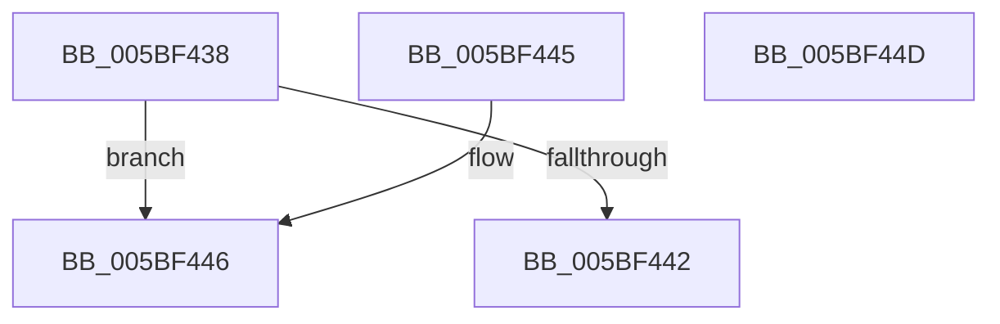

# KiIsTsaMitigationDesired

- RVA: `0x005BF438`–`0x005BF44E` (길이 `22` bytes)
- VA: `0x00000001405BF438`
- 실행 섹션: `.text`
- PDB 이름 있음: `예`; PDB Function 태그: `아니요`
- unwind 정보 RVA: `0x000DB714`
- 디코드: `10`개 명령, `22/22` bytes 표시
- 미해석 바이트: `0` (있으면 어셈블리에 `.byte`로 보존)

> 이 문서는 커널 이미지의 기계어와 PDB 기호를 분석해 생성했습니다. 4번과 5번은 함수 원형과 자료형을 바이너리 사용 방식에서 추정한 C 해석이며 원본 소스 복구 결과는 아닙니다.

## 1. Dependencies

- 직접 호출 지점: **0**; 고유 호출 대상: **0**
- 직접 호출자로 확인된 함수: **2**
- RIP 상대 이미지 참조: **1**

### Outgoing calls
- 직접 디코드된 call 명령이 없습니다.

### Direct callers
- [KiOptimizeSpecCtrlSettingsWorker](KiOptimizeSpecCtrlSettingsWorker_function_005BF5A0.md) at `0x005C006A`
- [KiDetectKvaLeakage](../5C/KiDetectKvaLeakage_function_005C4CD0.md) at `0x005C4D83`

### Static image references
- `0x005BF438` → RVA `0x00F10EC0` (`.data`; read)

## 2. Other-region calls and transfers

- 다른 실행 섹션으로 향하는 call: **0**
- 별도 외부 분기/꼬리 이동을 확인하지 못했습니다.

## 3. Assembly (complete function range)

```asm
005BF438  8B 05 82 1A 95 00               mov eax, dword ptr [rip + 0x951a82]
005BF43E  A8 05                           test al, 5
005BF440  74 04                           je 0x1405bf446
005BF442  33 C0                           xor eax, eax
005BF444  C3                              ret
005BF445  CC                              int3
005BF446  C1 E8 1E                        shr eax, 0x1e
005BF449  83 E0 01                        and eax, 1
005BF44C  C3                              ret
005BF44D  CC                              int3
```

## 4. C-style interpretation (structured pseudocode)

```c
__int64 __fastcall KiIsTsaMitigationDesired(void)
{
    __int64 result;

    if ((((unsigned __int8)((unsigned int)(*(unsigned int *)(v_rip + 9771650)))) & (5)) == 0) goto loc_005BF446;
    result = 0;
    return result;
loc_005BF446:
    result = (unsigned int)((result) >> (30));
    result = (unsigned int)((result) & (1));
    return result;
}
```

## 5. (Beta) C Style

```c
void KiIsTsaMitigationDesired(void)
{
    int64_t result;

    if ((((uint8_t)((uint32_t)(*(uint32_t *)(v_rip + 0x951A82)))) & (5)) == 0) goto loc_005BF446;
    result = 0;
    return result;
loc_005BF446:
    result = (uint32_t)((result) >> (30));
    result = (uint32_t)((result) & (1));
    return result;
}
```

## 6. Execution-region graph

[열기: 2D/3D 그래프와 함수 탐색 컨트롤 패널](../../../control-panel.html?section=text&rva=0x005BF438&view=graph)

- 2D 그래프는 위에서 아래로 흐르고, 3D 그래프는 빈 공간을 드래그해 회전합니다. Shift+드래그는 이동, 휠은 확대·축소, 함수 노드 선택은 대상 보고서 이동입니다.

### Static fallback


