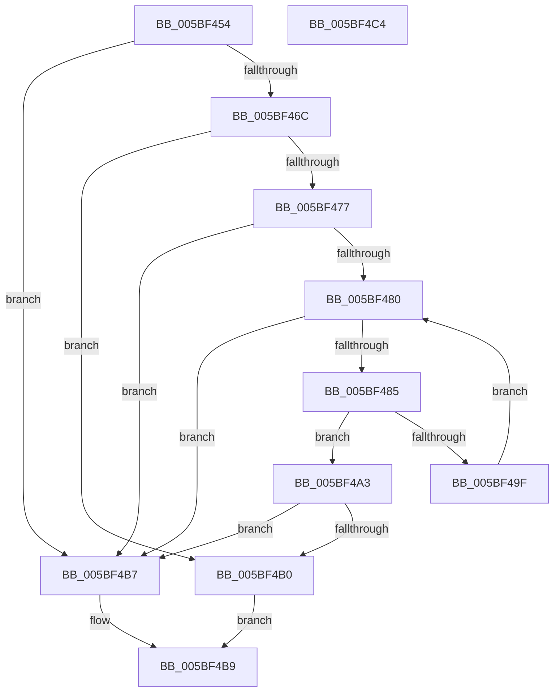

# KiIsTsaMitigationSupported

- RVA: `0x005BF454`–`0x005BF4C5` (길이 `113` bytes)
- VA: `0x00000001405BF454`
- 실행 섹션: `.text`
- PDB 이름 있음: `예`; PDB Function 태그: `아니요`
- unwind 정보 RVA: `0x0005CAAC`
- 디코드: `35`개 명령, `113/113` bytes 표시
- 미해석 바이트: `0` (있으면 어셈블리에 `.byte`로 보존)

> 이 문서는 커널 이미지의 기계어와 PDB 기호를 분석해 생성했습니다. 4번과 5번은 함수 원형과 자료형을 바이너리 사용 방식에서 추정한 C 해석이며 원본 소스 복구 결과는 아닙니다.

## 1. Dependencies

- 직접 호출 지점: **2**; 고유 호출 대상: **2**
- 직접 호출자로 확인된 함수: **2**
- RIP 상대 이미지 참조: **2**

### Outgoing calls
- `0x005BF461` → [SpcIsHyperVCr3RspErrataPresent](../6A/SpcIsHyperVCr3RspErrataPresent_function_006A788C.md) (function, `0x006A788C`)
- `0x005BF477` → [HviIsAnyHypervisorPresent](../4A/HviIsAnyHypervisorPresent_function_004ADC50.md) (function, `0x004ADC50`)

### Direct callers
- [KiOptimizeSpecCtrlSettingsWorker](KiOptimizeSpecCtrlSettingsWorker_function_005BF5A0.md) at `0x005C0082`
- [KiDetectKvaLeakage](../5C/KiDetectKvaLeakage_function_005C4CD0.md) at `0x005C4D8F`

### Static image references
- `0x005BF46C` → RVA `0x00FC6B60` (`ALMOSTRO`; read)
- `0x005BF485` → RVA `0x00E0B100` (`.data`; read)

## 2. Other-region calls and transfers

- 다른 실행 섹션으로 향하는 call: **0**
- 별도 외부 분기/꼬리 이동을 확인하지 못했습니다.

## 3. Assembly (complete function range)

```asm
005BF454  48 89 5C 24 08                  mov qword ptr [rsp + 8], rbx
005BF459  57                              push rdi
005BF45A  48 83 EC 20                     sub rsp, 0x20
005BF45E  48 8B F9                        mov rdi, rcx
005BF461  E8 26 84 0E 00                  call 0x1406a788c
005BF466  33 DB                           xor ebx, ebx
005BF468  85 C0                           test eax, eax
005BF46A  75 4B                           jne 0x1405bf4b7
005BF46C  48 0F BA 25 EB 76 A0 00 2C      bt qword ptr [rip + 0xa076eb], 0x2c
005BF475  72 39                           jb 0x1405bf4b0
005BF477  E8 D4 E7 EE FF                  call 0x1404adc50
005BF47C  84 C0                           test al, al
005BF47E  75 37                           jne 0x1405bf4b7
005BF480  83 FB 0F                        cmp ebx, 0xf
005BF483  73 32                           jae 0x1405bf4b7
005BF485  48 8D 05 74 BC 84 00            lea rax, [rip + 0x84bc74]
005BF48C  8B CB                           mov ecx, ebx
005BF48E  48 C1 E1 04                     shl rcx, 4
005BF492  48 03 C8                        add rcx, rax
005BF495  8B 87 C8 06 00 00               mov eax, dword ptr [rdi + 0x6c8]
005BF49B  39 01                           cmp dword ptr [rcx], eax
005BF49D  74 04                           je 0x1405bf4a3
005BF49F  FF C3                           inc ebx
005BF4A1  EB DD                           jmp 0x1405bf480
005BF4A3  48 8B 49 08                     mov rcx, qword ptr [rcx + 8]
005BF4A7  48 39 8F A8 8F 00 00            cmp qword ptr [rdi + 0x8fa8], rcx
005BF4AE  72 07                           jb 0x1405bf4b7
005BF4B0  B8 01 00 00 00                  mov eax, 1
005BF4B5  EB 02                           jmp 0x1405bf4b9
005BF4B7  33 C0                           xor eax, eax
005BF4B9  48 8B 5C 24 30                  mov rbx, qword ptr [rsp + 0x30]
005BF4BE  48 83 C4 20                     add rsp, 0x20
005BF4C2  5F                              pop rdi
005BF4C3  C3                              ret
005BF4C4  CC                              int3
```

## 4. C-style interpretation (structured pseudocode)

```c
__int64 __fastcall KiIsTsaMitigationSupported(__int64 a1)
{
    __int64 result;
    __int64 v_rbx;
    __int64 v_rsp;
    unsigned __int64 v_stack_p8;

    v_stack_p8 = v_rbx;
    v_rsp = (v_rsp) - (32);
    result = SpcIsHyperVCr3RspErrataPresent(a1, a2, a3, a4);
    v_rbx = 0;
    if ((unsigned int)(result) != 0) goto loc_005BF4B7;
    if (condition_is_below) goto loc_005BF4B0;
    result = HviIsAnyHypervisorPresent(a1, a2, a3, a4);
    if ((unsigned __int8)(result) != 0) goto loc_005BF4B7;
loc_005BF480:
    if (0 >= 15) goto loc_005BF4B7;
    a1 = (0) << (4);
    a1 = (a1) + (v_rip + 8698996);
    if ((*(unsigned int *)(a1)) == ((unsigned int)((unsigned int)(*(unsigned int *)(a1 + 1736))))) goto loc_005BF4A3;
    v_rbx = (unsigned int)((v_rbx) + 1);
    goto loc_005BF480;
loc_005BF4A3:
    if ((*(unsigned __int64 *)(a1 + 36776)) < (*(unsigned __int64 *)(a1 + 8))) goto loc_005BF4B7;
loc_005BF4B0:
    goto loc_005BF4B9;
loc_005BF4B7:
    result = 0;
loc_005BF4B9:
    v_rsp = (v_rsp) + (32);
    return result;
}
```

## 5. (Beta) C Style

```c
int64_t KiIsTsaMitigationSupported(void *Arg1)
{
    uint8_t *arg1 = (uint8_t *)Arg1;

    int64_t result;
    int64_t local_rbx;
    int64_t local_rsp;
    uint64_t v_stack_p8;

    v_stack_p8 = local_rbx;
    local_rsp = (local_rsp) - (32);
    result = SpcIsHyperVCr3RspErrataPresent(Arg1, a2, a3, a4);
    local_rbx = 0;
    if ((uint32_t)(result) != 0) goto loc_005BF4B7;
    if (condition_is_below) goto loc_005BF4B0;
    result = HviIsAnyHypervisorPresent(Arg1, a2, a3, a4);
    if ((uint8_t)(result) != 0) goto loc_005BF4B7;
loc_005BF480:
    if (0 >= 15) goto loc_005BF4B7;
    Arg1 = (0) << (4);
    Arg1 = (Arg1) + (v_rip + 8698996);
    if ((*(uint32_t *)(arg1)) == ((uint32_t)((uint32_t)(*(uint32_t *)(arg1 + 0x6C8))))) goto loc_005BF4A3;
    local_rbx = (uint32_t)((local_rbx) + 1);
    goto loc_005BF480;
loc_005BF4A3:
    if ((*(uint64_t *)(arg1 + 0x8FA8)) < (*(uint64_t *)(arg1 + 0x8))) goto loc_005BF4B7;
loc_005BF4B0:
    goto loc_005BF4B9;
loc_005BF4B7:
    result = 0;
loc_005BF4B9:
    local_rsp = (local_rsp) + (32);
    return result;
}
```

### 관측된 메모리 오프셋

구조체 형식이 확인되지 않은 접근은 인자 기준의 오프셋으로만 기록했습니다.

| 기준 인자 | 오프셋 표현 | 폭 (bit) | 접근 |
|---|---:|---:|---|
| `Arg1` | `+ 0x6C8` | `32` | `R` |
| `Arg1` | `+ 0x8FA8` | `64` | `R` |

## 6. Execution-region graph

[열기: 2D/3D 그래프와 함수 탐색 컨트롤 패널](../../../control-panel.html?section=text&rva=0x005BF454&view=graph)

- 2D 그래프는 위에서 아래로 흐르고, 3D 그래프는 빈 공간을 드래그해 회전합니다. Shift+드래그는 이동, 휠은 확대·축소, 함수 노드 선택은 대상 보고서 이동입니다.

### Static fallback


