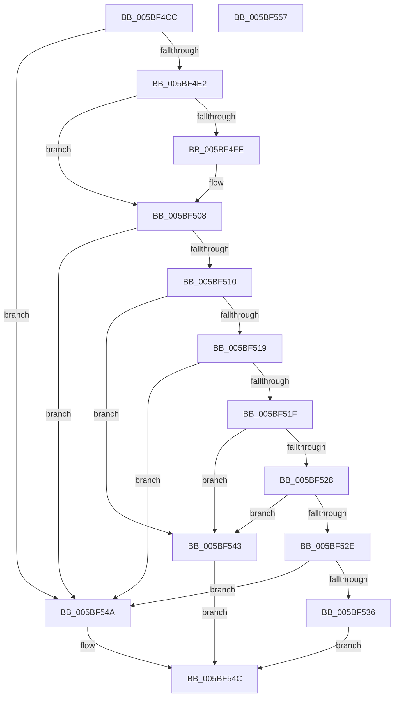

# KiIsTsaPresent

- RVA: `0x005BF4CC`–`0x005BF558` (길이 `140` bytes)
- VA: `0x00000001405BF4CC`
- 실행 섹션: `.text`
- PDB 이름 있음: `예`; PDB Function 태그: `아니요`
- unwind 정보 RVA: `0x0005CAAC`
- 디코드: `42`개 명령, `140/140` bytes 표시
- 미해석 바이트: `0` (있으면 어셈블리에 `.byte`로 보존)

> 이 문서는 커널 이미지의 기계어와 PDB 기호를 분석해 생성했습니다. 4번과 5번은 함수 원형과 자료형을 바이너리 사용 방식에서 추정한 C 해석이며 원본 소스 복구 결과는 아닙니다.

## 1. Dependencies

- 직접 호출 지점: **3**; 고유 호출 대상: **2**
- 직접 호출자로 확인된 함수: **1**
- RIP 상대 이미지 참조: **1**

### Outgoing calls
- `0x005BF4E2` → [Feature_3669964091__private_IsEnabledNoReportingNoInline](Feature_3669964091__private_IsEnabledNoReportingNoInline_function_005BE774.md) (function, `0x005BE774`)
- `0x005BF510` → [HviIsAnyHypervisorPresent](../4A/HviIsAnyHypervisorPresent_function_004ADC50.md) (function, `0x004ADC50`)
- `0x005BF51F` → [Feature_3669964091__private_IsEnabledNoReportingNoInline](Feature_3669964091__private_IsEnabledNoReportingNoInline_function_005BE774.md) (function, `0x005BE774`)

### Direct callers
- [KiDetectHardwareSpecControlFeatures](KiDetectHardwareSpecControlFeatures_function_005BEC4C.md) at `0x005BEF93`

### Static image references
- `0x005BF4F5` → RVA `0x00FC6B60` (`ALMOSTRO`; read)

## 2. Other-region calls and transfers

- 다른 실행 섹션으로 향하는 call: **0**
- 별도 외부 분기/꼬리 이동을 확인하지 못했습니다.

## 3. Assembly (complete function range)

```asm
005BF4CC  48 89 5C 24 08                  mov qword ptr [rsp + 8], rbx
005BF4D1  57                              push rdi
005BF4D2  48 83 EC 20                     sub rsp, 0x20
005BF4D6  80 B9 8D 00 00 00 01            cmp byte ptr [rcx + 0x8d], 1
005BF4DD  48 8B F9                        mov rdi, rcx
005BF4E0  75 68                           jne 0x1405bf54a
005BF4E2  E8 8D F2 FF FF                  call 0x1405be774
005BF4E7  33 DB                           xor ebx, ebx
005BF4E9  48 B9 00 00 00 00 00 8C 00 00   movabs rcx, 0x8c0000000000
005BF4F3  85 C0                           test eax, eax
005BF4F5  48 8B 05 64 76 A0 00            mov rax, qword ptr [rip + 0xa07664]
005BF4FC  75 0A                           jne 0x1405bf508
005BF4FE  48 B9 00 00 00 00 00 0C 00 00   movabs rcx, 0xc0000000000
005BF508  48 23 C1                        and rax, rcx
005BF50B  48 3B C1                        cmp rax, rcx
005BF50E  74 3A                           je 0x1405bf54a
005BF510  E8 3B E7 EE FF                  call 0x1404adc50
005BF515  84 C0                           test al, al
005BF517  75 2A                           jne 0x1405bf543
005BF519  80 7F 40 19                     cmp byte ptr [rdi + 0x40], 0x19
005BF51D  7C 2B                           jl 0x1405bf54a
005BF51F  E8 50 F2 FF FF                  call 0x1405be774
005BF524  85 C0                           test eax, eax
005BF526  75 1B                           jne 0x1405bf543
005BF528  80 7F 40 1A                     cmp byte ptr [rdi + 0x40], 0x1a
005BF52C  75 15                           jne 0x1405bf543
005BF52E  8A 4F 43                        mov cl, byte ptr [rdi + 0x43]
005BF531  80 F9 4F                        cmp cl, 0x4f
005BF534  76 14                           jbe 0x1405bf54a
005BF536  80 E9 60                        sub cl, 0x60
005BF539  80 F9 1F                        cmp cl, 0x1f
005BF53C  0F 97 C3                        seta bl
005BF53F  8B C3                           mov eax, ebx
005BF541  EB 09                           jmp 0x1405bf54c
005BF543  B8 01 00 00 00                  mov eax, 1
005BF548  EB 02                           jmp 0x1405bf54c
005BF54A  33 C0                           xor eax, eax
005BF54C  48 8B 5C 24 30                  mov rbx, qword ptr [rsp + 0x30]
005BF551  48 83 C4 20                     add rsp, 0x20
005BF555  5F                              pop rdi
005BF556  C3                              ret
005BF557  CC                              int3
```

## 4. C-style interpretation (structured pseudocode)

```c
__int64 __fastcall KiIsTsaPresent(__int64 a1)
{
    __int64 result;
    __int64 v_rbx;
    __int64 v_rsp;
    unsigned __int64 v_stack_p8;

    v_stack_p8 = v_rbx;
    v_rsp = (v_rsp) - (32);
    if ((*(unsigned __int8 *)(a1 + 141)) != 1) goto loc_005BF54A;
    result = Feature_3669964091__private_IsEnabledNoReportingNoInline(a1, a2, a3, a4);
    v_rbx = 0;
    if ((unsigned int)(result) == 0) {
    }
    result = (*(unsigned __int64 *)(v_rip + 10516068)) & (a1);
    if (result == a1) goto loc_005BF54A;
    result = HviIsAnyHypervisorPresent(a1, a2, a3, a4);
    if ((unsigned __int8)(result) != 0) goto loc_005BF543;
    if ((*(unsigned __int8 *)(a1 + 64)) < 25) goto loc_005BF54A;
    result = Feature_3669964091__private_IsEnabledNoReportingNoInline(a1, a2, a3, a4);
    if ((unsigned int)(result) != 0) goto loc_005BF543;
    if ((*(unsigned __int8 *)(a1 + 64)) != 26) goto loc_005BF543;
    if (((unsigned __int8)(*(unsigned __int8 *)(a1 + 67))) <= 79) goto loc_005BF54A;
    a1 = (unsigned __int8)((*(unsigned __int8 *)(a1 + 67)) - (96));
    v_rbx = (((unsigned __int8)(a1)) > 31) ? 1 : 0;
    goto loc_005BF54C;
loc_005BF543:
    goto loc_005BF54C;
loc_005BF54A:
    result = 0;
loc_005BF54C:
    v_rsp = (v_rsp) + (32);
    return result;
}
```

## 5. (Beta) C Style

```c
int64_t KiIsTsaPresent(void *Arg1)
{
    uint8_t *arg1 = (uint8_t *)Arg1;

    int64_t result;
    int64_t local_rbx;
    int64_t local_rsp;
    uint64_t v_stack_p8;

    v_stack_p8 = local_rbx;
    local_rsp = (local_rsp) - (32);
    if ((*(uint8_t *)(arg1 + 0x8D)) != 1) goto loc_005BF54A;
    result = Feature_3669964091__private_IsEnabledNoReportingNoInline(Arg1, a2, a3, a4);
    local_rbx = 0;
    if ((uint32_t)(result) == 0) {
    }
    result = (*(uint64_t *)(v_rip + 0xA07664)) & (Arg1);
    if (result == Arg1) goto loc_005BF54A;
    result = HviIsAnyHypervisorPresent(Arg1, a2, a3, a4);
    if ((uint8_t)(result) != 0) goto loc_005BF543;
    if ((*(uint8_t *)(arg1 + 0x40)) < 25) goto loc_005BF54A;
    result = Feature_3669964091__private_IsEnabledNoReportingNoInline(Arg1, a2, a3, a4);
    if ((uint32_t)(result) != 0) goto loc_005BF543;
    if ((*(uint8_t *)(arg1 + 0x40)) != 26) goto loc_005BF543;
    if (((uint8_t)(*(uint8_t *)(arg1 + 0x43))) <= 79) goto loc_005BF54A;
    Arg1 = (uint8_t)((*(uint8_t *)(arg1 + 0x43)) - (96));
    local_rbx = (((uint8_t)(Arg1)) > 31) ? 1 : 0;
    goto loc_005BF54C;
loc_005BF543:
    goto loc_005BF54C;
loc_005BF54A:
    result = 0;
loc_005BF54C:
    local_rsp = (local_rsp) + (32);
    return result;
}
```

### 관측된 메모리 오프셋

구조체 형식이 확인되지 않은 접근은 인자 기준의 오프셋으로만 기록했습니다.

| 기준 인자 | 오프셋 표현 | 폭 (bit) | 접근 |
|---|---:|---:|---|
| `Arg1` | `+ 0x40` | `8` | `R` |
| `Arg1` | `+ 0x43` | `8` | `R` |
| `Arg1` | `+ 0x8D` | `8` | `R` |

## 6. Execution-region graph

[열기: 2D/3D 그래프와 함수 탐색 컨트롤 패널](../../../control-panel.html?section=text&rva=0x005BF4CC&view=graph)

- 2D 그래프는 위에서 아래로 흐르고, 3D 그래프는 빈 공간을 드래그해 회전합니다. Shift+드래그는 이동, 휠은 확대·축소, 함수 노드 선택은 대상 보고서 이동입니다.

### Static fallback


