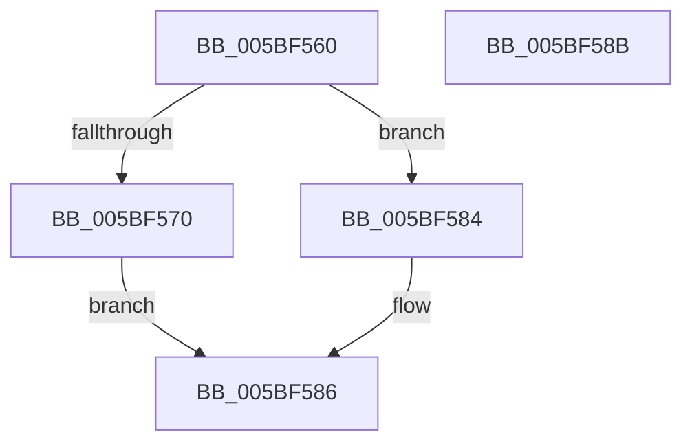

# KiIsWinPEBoot

- RVA: `0x005BF560`–`0x005BF58C` (길이 `44` bytes)
- VA: `0x00000001405BF560`
- 실행 섹션: `.text`
- PDB 이름 있음: `예`; PDB Function 태그: `아니요`
- unwind 정보 RVA: `0x0005C788`
- 디코드: `13`개 명령, `44/44` bytes 표시
- 미해석 바이트: `0` (있으면 어셈블리에 `.byte`로 보존)

> 이 문서는 커널 이미지의 기계어와 PDB 기호를 분석해 생성했습니다. 4번과 5번은 함수 원형과 자료형을 바이너리 사용 방식에서 추정한 C 해석이며 원본 소스 복구 결과는 아닙니다.

## 1. Dependencies

- 직접 호출 지점: **1**; 고유 호출 대상: **1**
- 직접 호출자로 확인된 함수: **2**
- RIP 상대 이미지 참조: **1**

### Outgoing calls
- `0x005BF577` → [strstr](../4F/strstr_function_004FF680.md) (function, `0x004FF680`)

### Direct callers
- [KiDetermineImportOptimizationEnablement](KiDetermineImportOptimizationEnablement_function_005BF178.md) at `0x005BF18D`
- [KiDetermineRetpolineEnablement](KiDetermineRetpolineEnablement_function_005BF1C0.md) at `0x005BF1E8`

### Static image references
- `0x005BF570` → RVA `0x006CBB30` (` ?? ::FNODOBFM::`string'`; read)

## 2. Other-region calls and transfers

- 다른 실행 섹션으로 향하는 call: **0**
- 별도 외부 분기/꼬리 이동을 확인하지 못했습니다.

## 3. Assembly (complete function range)

```asm
005BF560  48 83 EC 28                     sub rsp, 0x28
005BF564  48 8B 89 D8 00 00 00            mov rcx, qword ptr [rcx + 0xd8]
005BF56B  48 85 C9                        test rcx, rcx
005BF56E  74 14                           je 0x1405bf584
005BF570  48 8D 15 B9 C5 10 00            lea rdx, [rip + 0x10c5b9]
005BF577  E8 04 01 F4 FF                  call 0x1404ff680
005BF57C  48 85 C0                        test rax, rax
005BF57F  0F 95 C0                        setne al
005BF582  EB 02                           jmp 0x1405bf586
005BF584  32 C0                           xor al, al
005BF586  48 83 C4 28                     add rsp, 0x28
005BF58A  C3                              ret
005BF58B  CC                              int3
```

## 4. C-style interpretation (structured pseudocode)

```c
__int64 __fastcall KiIsWinPEBoot(__int64 a1)
{
    __int64 result;
    __int64 v_rsp;

    v_rsp = (v_rsp) - (40);
    if (*(unsigned __int64 *)(a1 + 216) == 0) goto loc_005BF584;
    result = strstr(*(unsigned __int64 *)(a1 + 216), v_rip + 1099193, a3, a4);
    result = (result != 0) ? 1 : 0;
    goto loc_005BF586;
loc_005BF584:
    result = 0;
loc_005BF586:
    v_rsp = (v_rsp) + (40);
    return result;
}
```

## 5. (Beta) C Style

```c
int64_t KiIsWinPEBoot(void *Arg1)
{
    uint8_t *arg1 = (uint8_t *)Arg1;

    int64_t result;
    int64_t local_rsp;

    local_rsp = (local_rsp) - (40);
    if (*(uint64_t *)(arg1 + 0xD8) == 0) goto loc_005BF584;
    result = strstr(*(uint64_t *)(arg1 + 0xD8), v_rip + 1099193, a3, a4);
    result = (result != 0) ? 1 : 0;
    goto loc_005BF586;
loc_005BF584:
    result = 0;
loc_005BF586:
    local_rsp = (local_rsp) + (40);
    return result;
}
```

### 관측된 메모리 오프셋

구조체 형식이 확인되지 않은 접근은 인자 기준의 오프셋으로만 기록했습니다.

| 기준 인자 | 오프셋 표현 | 폭 (bit) | 접근 |
|---|---:|---:|---|
| `Arg1` | `+ 0xD8` | `64` | `R` |

## 6. Execution-region graph

[열기: 2D/3D 그래프와 함수 탐색 컨트롤 패널](../../../control-panel.html?section=text&rva=0x005BF560&view=graph)

- 2D 그래프는 위에서 아래로 흐르고, 3D 그래프는 빈 공간을 드래그해 회전합니다. Shift+드래그는 이동, 휠은 확대·축소, 함수 노드 선택은 대상 보고서 이동입니다.

### Static fallback


