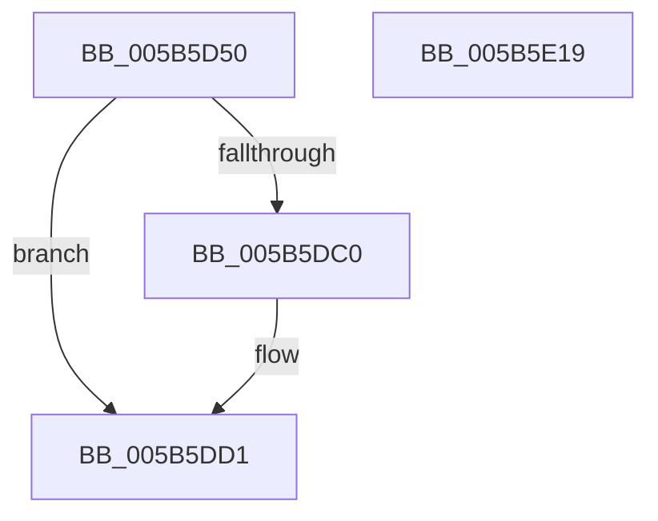

# KiLogSingleDpcSoftTimeoutEvent

- RVA: `0x005B5D50`–`0x005B5E1A` (길이 `202` bytes)
- VA: `0x00000001405B5D50`
- 실행 섹션: `.text`
- PDB 이름 있음: `예`; PDB Function 태그: `아니요`
- unwind 정보 RVA: `0x000C9DCC`
- 디코드: `48`개 명령, `202/202` bytes 표시
- 미해석 바이트: `0` (있으면 어셈블리에 `.byte`로 보존)

> 이 문서는 커널 이미지의 기계어와 PDB 기호를 분석해 생성했습니다. 4번과 5번은 함수 원형과 자료형을 바이너리 사용 방식에서 추정한 C 해석이며 원본 소스 복구 결과는 아닙니다.

## 1. Dependencies

- 직접 호출 지점: **4**; 고유 호출 대상: **4**
- 직접 호출자로 확인된 함수: **0**
- RIP 상대 이미지 참조: **2**

### Outgoing calls
- `0x005B5DB7` → [RtlPcToFileName](../3F/RtlPcToFileName_function_003FEBB0.md) (function, `0x003FEBB0`)
- `0x005B5DCC` → [RtlInitUnicodeString](../42/RtlInitUnicodeString_function_0042A780.md) (function, `0x0042A780`)
- `0x005B5DF1` → [EtwTraceSingleDpcSoftTimeout](../65/EtwTraceSingleDpcSoftTimeout_function_00650218.md) (function, `0x00650218`)
- `0x005B5E01` → [_security_check_cookie](../6A/_security_check_cookie_function_006AC640.md) (function, `0x006AC640`)

### Direct callers
- 이 함수 시작 RVA로 연결되는 직접 call은 확인되지 않았습니다. 간접 호출은 완전히 역산할 수 없습니다.

### Static image references
- `0x005B5D5F` → RVA `0x00E0A740` (`.data`; read)
- `0x005B5DC0` → RVA `0x006CB980` (` ?? ::FNODOBFM::`string'`; read)

## 2. Other-region calls and transfers

- 다른 실행 섹션으로 향하는 call: **0**
- 별도 외부 분기/꼬리 이동을 확인하지 못했습니다.

## 3. Assembly (complete function range)

```asm
005B5D50  48 89 5C 24 08                  mov qword ptr [rsp + 8], rbx
005B5D55  55                              push rbp
005B5D56  56                              push rsi
005B5D57  57                              push rdi
005B5D58  48 81 EC 50 01 00 00            sub rsp, 0x150
005B5D5F  48 8B 05 DA 49 85 00            mov rax, qword ptr [rip + 0x8549da]
005B5D66  48 33 C4                        xor rax, rsp
005B5D69  48 89 84 24 40 01 00 00         mov qword ptr [rsp + 0x140], rax
005B5D71  48 8B 82 D0 38 00 00            mov rax, qword ptr [rdx + 0x38d0]
005B5D78  0F 57 C0                        xorps xmm0, xmm0
005B5D7B  48 8B DA                        mov rbx, rdx
005B5D7E  49 8B F1                        mov rsi, r9
005B5D81  49 8B F8                        mov rdi, r8
005B5D84  8B 68 48                        mov ebp, dword ptr [rax + 0x48]
005B5D87  48 8B 48 40                     mov rcx, qword ptr [rax + 0x40]
005B5D8B  48 8B 82 D0 38 00 00            mov rax, qword ptr [rdx + 0x38d0]
005B5D92  48 8D 54 24 30                  lea rdx, [rsp + 0x30]
005B5D97  0F 11 44 24 30                  movups xmmword ptr [rsp + 0x30], xmm0
005B5D9C  C7 40 48 00 00 00 00            mov dword ptr [rax + 0x48], 0
005B5DA3  B8 00 01 00 00                  mov eax, 0x100
005B5DA8  66 89 44 24 32                  mov word ptr [rsp + 0x32], ax
005B5DAD  48 8D 44 24 40                  lea rax, [rsp + 0x40]
005B5DB2  48 89 44 24 38                  mov qword ptr [rsp + 0x38], rax
005B5DB7  E8 F4 8D E4 FF                  call 0x1403febb0
005B5DBC  85 C0                           test eax, eax
005B5DBE  79 11                           jns 0x1405b5dd1
005B5DC0  48 8D 15 B9 5B 11 00            lea rdx, [rip + 0x115bb9]
005B5DC7  48 8D 4C 24 30                  lea rcx, [rsp + 0x30]
005B5DCC  E8 AF 49 E7 FF                  call 0x14042a780
005B5DD1  48 8D 44 24 30                  lea rax, [rsp + 0x30]
005B5DD6  44 8B CD                        mov r9d, ebp
005B5DD9  48 89 44 24 28                  mov qword ptr [rsp + 0x28], rax
005B5DDE  4C 8B C3                        mov r8, rbx
005B5DE1  8B 83 CC 38 00 00               mov eax, dword ptr [rbx + 0x38cc]
005B5DE7  48 8B D6                        mov rdx, rsi
005B5DEA  48 8B CF                        mov rcx, rdi
005B5DED  89 44 24 20                     mov dword ptr [rsp + 0x20], eax
005B5DF1  E8 22 A4 09 00                  call 0x140650218
005B5DF6  48 8B 8C 24 40 01 00 00         mov rcx, qword ptr [rsp + 0x140]
005B5DFE  48 33 CC                        xor rcx, rsp
005B5E01  E8 3A 68 0F 00                  call 0x1406ac640
005B5E06  48 8B 9C 24 70 01 00 00         mov rbx, qword ptr [rsp + 0x170]
005B5E0E  48 81 C4 50 01 00 00            add rsp, 0x150
005B5E15  5F                              pop rdi
005B5E16  5E                              pop rsi
005B5E17  5D                              pop rbp
005B5E18  C3                              ret
005B5E19  CC                              int3
```

## 4. C-style interpretation (structured pseudocode)

```c
__int64 __fastcall KiLogSingleDpcSoftTimeoutEvent(__int64 a1, __int64 a2, __int64 a3, __int64 a4)
{
    __int64 result;
    __int64 v_rsp;
    unsigned __int64 v_stack_m128;
    unsigned __int64 v_stack_m130;
    unsigned __int16 v_stack_m136;
    unsigned __int64 v_stack_m138;
    unsigned __int64 v_stack_m140;
    unsigned int v_stack_m148;
    unsigned __int64 v_stack_m28;
    unsigned __int64 v_stack_p8;

    v_stack_p8 = v_rbx;
    v_rsp = (v_rsp) - (336);
    result = (*(unsigned __int64 *)(v_rip + 8735194)) ^ (v_rsp);
    v_stack_m28 = result;
    v_stack_m138 = v_xmm0;
    *(unsigned int *)(*(unsigned __int64 *)(a2 + 14544) + 72) = 0;
    v_stack_m136 = 256;
    v_stack_m130 = v_stack_m128;
    result = RtlPcToFileName(*(unsigned __int64 *)(*(unsigned __int64 *)(a2 + 14544) + 64), v_stack_m138, a3, a4);
    if (sign_flag) {
        a2 = v_rip + 1137593;
        a1 = v_stack_m138;
        result = RtlInitUnicodeString(a1, a2, a3, a4);
    }
    v_stack_m140 = v_stack_m138;
    v_stack_m148 = (unsigned int)((unsigned int)(*(unsigned int *)(a2 + 14540)));
    result = EtwTraceSingleDpcSoftTimeout(a3, a4, a2, (unsigned int)((unsigned int)((unsigned int)(*(unsigned int *)(*(unsigned __int64 *)(a2 + 14544) + 72)))));
    a1 = (v_stack_m28) ^ (v_rsp);
    result = _security_check_cookie(a1, a4, a2, (unsigned int)((unsigned int)((unsigned int)(*(unsigned int *)(*(unsigned __int64 *)(a2 + 14544) + 72)))));
    v_rsp = (v_rsp) + (336);
    return result;
}
```

## 5. (Beta) C Style

```c
int64_t KiLogSingleDpcSoftTimeoutEvent(int64_t Arg1, void *Arg2, int64_t Arg3, int64_t Arg4)
{
    uint8_t *arg2 = (uint8_t *)Arg2;

    int64_t result;
    int64_t local_rsp;
    uint64_t v_stack_m128;
    uint64_t v_stack_m130;
    uint16_t v_stack_m136;
    uint64_t v_stack_m138;
    uint64_t v_stack_m140;
    uint32_t v_stack_m148;
    uint64_t v_stack_m28;
    uint64_t v_stack_p8;

    v_stack_p8 = local_rbx;
    local_rsp = (local_rsp) - (336);
    result = (*(uint64_t *)(v_rip + 0x8549DA)) ^ (local_rsp);
    v_stack_m28 = result;
    v_stack_m138 = v_xmm0;
    *(uint32_t *)(*(uint64_t *)(arg2 + 0x38D0) + 0x48) = 0;
    v_stack_m136 = 256;
    v_stack_m130 = v_stack_m128;
    result = RtlPcToFileName(*(uint64_t *)(*(uint64_t *)(arg2 + 0x38D0) + 0x40), v_stack_m138, Arg3, Arg4);
    if (sign_flag) {
        Arg2 = v_rip + 1137593;
        Arg1 = v_stack_m138;
        result = RtlInitUnicodeString(Arg1, Arg2, Arg3, Arg4);
    }
    v_stack_m140 = v_stack_m138;
    v_stack_m148 = (uint32_t)((uint32_t)(*(uint32_t *)(arg2 + 0x38CC)));
    result = EtwTraceSingleDpcSoftTimeout(Arg3, Arg4, Arg2, (uint32_t)((uint32_t)((uint32_t)(*(uint32_t *)(*(uint64_t *)(arg2 + 0x38D0) + 0x48)))));
    Arg1 = (v_stack_m28) ^ (local_rsp);
    result = _security_check_cookie(Arg1, Arg4, Arg2, (uint32_t)((uint32_t)((uint32_t)(*(uint32_t *)(*(uint64_t *)(arg2 + 0x38D0) + 0x48)))));
    local_rsp = (local_rsp) + (336);
    return result;
}
```

### 관측된 메모리 오프셋

구조체 형식이 확인되지 않은 접근은 인자 기준의 오프셋으로만 기록했습니다.

| 기준 인자 | 오프셋 표현 | 폭 (bit) | 접근 |
|---|---:|---:|---|
| `Arg2` | `+ 0x38CC` | `32` | `R` |
| `Arg2` | `+ 0x38D0` | `64` | `R` |

## 6. Execution-region graph

[열기: 2D/3D 그래프와 함수 탐색 컨트롤 패널](../../../control-panel.html?section=text&rva=0x005B5D50&view=graph)

- 2D 그래프는 위에서 아래로 흐르고, 3D 그래프는 빈 공간을 드래그해 회전합니다. Shift+드래그는 이동, 휠은 확대·축소, 함수 노드 선택은 대상 보고서 이동입니다.

### Static fallback


