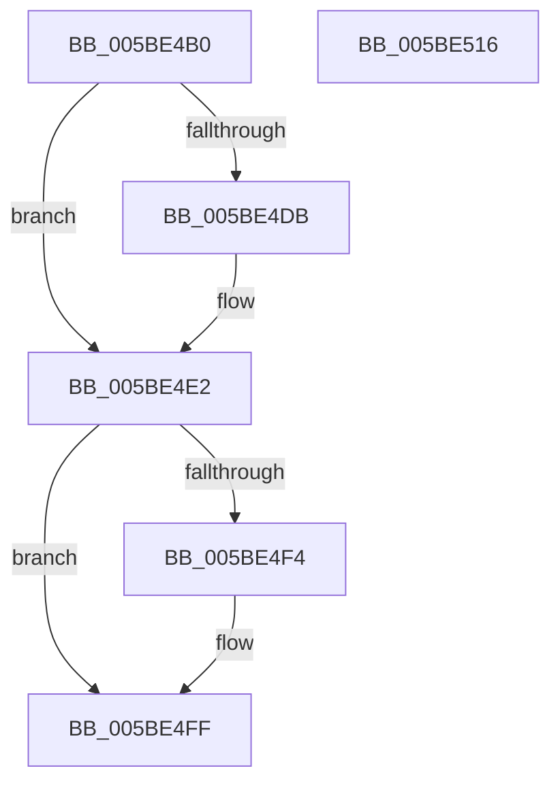

# KiMaskInterruptDpc

- RVA: `0x005BE4B0`–`0x005BE517` (길이 `103` bytes)
- VA: `0x00000001405BE4B0`
- 실행 섹션: `.text`
- PDB 이름 있음: `예`; PDB Function 태그: `아니요`
- unwind 정보 RVA: `0x00060BC4`
- 디코드: `29`개 명령, `103/103` bytes 표시
- 미해석 바이트: `0` (있으면 어셈블리에 `.byte`로 보존)

> 이 문서는 커널 이미지의 기계어와 PDB 기호를 분석해 생성했습니다. 4번과 5번은 함수 원형과 자료형을 바이너리 사용 방식에서 추정한 C 해석이며 원본 소스 복구 결과는 아닙니다.

## 1. Dependencies

- 직접 호출 지점: **3**; 고유 호출 대상: **3**
- 직접 호출자로 확인된 함수: **0**
- RIP 상대 이미지 참조: **1**

### Outgoing calls
- `0x005BE4DD` → [KiRaiseIrqlProcessIrqlFlags](../4F/KiRaiseIrqlProcessIrqlFlags_function_004F56FC.md) (function, `0x004F56FC`)
- `0x005BE4E6` → [KiMaskInterruptInternal](../4A/KiMaskInterruptInternal_function_004A74B4.md) (function, `0x004A74B4`)
- `0x005BE4FA` → [KiLowerIrqlProcessIrqlFlags](../4F/KiLowerIrqlProcessIrqlFlags_function_004F5698.md) (function, `0x004F5698`)

### Direct callers
- 이 함수 시작 RVA로 연결되는 직접 call은 확인되지 않았습니다. 간접 호출은 완전히 역산할 수 없습니다.

### Static image references
- `0x005BE4D2` → RVA `0x00FC6D20` (`ALMOSTRO`; read)

## 2. Other-region calls and transfers

- 다른 실행 섹션으로 향하는 call: **0**
- 별도 외부 분기/꼬리 이동을 확인하지 못했습니다.

## 3. Assembly (complete function range)

```asm
005BE4B0  48 89 5C 24 08                  mov qword ptr [rsp + 8], rbx
005BE4B5  48 89 74 24 10                  mov qword ptr [rsp + 0x10], rsi
005BE4BA  57                              push rdi
005BE4BB  48 83 EC 20                     sub rsp, 0x20
005BE4BF  49 8B F9                        mov rdi, r9
005BE4C2  49 8B F0                        mov rsi, r8
005BE4C5  44 0F 20 C3                     mov rbx, cr8
005BE4C9  BA 0F 00 00 00                  mov edx, 0xf
005BE4CE  44 0F 22 C2                     mov cr8, rdx
005BE4D2  83 3D 47 88 A0 00 00            cmp dword ptr [rip + 0xa08847], 0
005BE4D9  74 07                           je 0x1405be4e2
005BE4DB  8A CB                           mov cl, bl
005BE4DD  E8 1A 72 F3 FF                  call 0x1404f56fc
005BE4E2  8B D7                           mov edx, edi
005BE4E4  8B CE                           mov ecx, esi
005BE4E6  E8 C9 8F EE FF                  call 0x1404a74b4
005BE4EB  83 3D 2E 88 A0 00 00            cmp dword ptr [rip + 0xa0882e], 0
005BE4F2  74 0B                           je 0x1405be4ff
005BE4F4  44 0F 20 C1                     mov rcx, cr8
005BE4F8  8A D3                           mov dl, bl
005BE4FA  E8 99 71 F3 FF                  call 0x1404f5698
005BE4FF  0F B6 C3                        movzx eax, bl
005BE502  44 0F 22 C0                     mov cr8, rax
005BE506  48 8B 5C 24 30                  mov rbx, qword ptr [rsp + 0x30]
005BE50B  48 8B 74 24 38                  mov rsi, qword ptr [rsp + 0x38]
005BE510  48 83 C4 20                     add rsp, 0x20
005BE514  5F                              pop rdi
005BE515  C3                              ret
005BE516  CC                              int3
```

## 4. C-style interpretation (structured pseudocode)

```c
__int64 __fastcall KiMaskInterruptDpc(__int64 a1, __int64 a2, __int64 a3, __int64 a4)
{
    __int64 result;
    __int64 v_rsp;
    unsigned __int64 v_stack_p10;
    unsigned __int64 v_stack_p8;

    v_stack_p8 = v_rbx;
    v_stack_p10 = v_rsi;
    v_rsp = (v_rsp) - (32);
    if ((*(unsigned int *)(v_rip + 10520647)) != 0) {
        a1 = (unsigned __int8)(v_cr8);
        result = KiRaiseIrqlProcessIrqlFlags(a1, 15, a3, a4);
    }
    result = KiMaskInterruptInternal((unsigned int)((unsigned int)(a3)), (unsigned int)((unsigned int)(a4)), a3, a4);
    if ((*(unsigned int *)(v_rip + 10520622)) != 0) {
        a1 = 15;
        a2 = (unsigned __int8)(v_cr8);
        result = KiLowerIrqlProcessIrqlFlags(a1, a2, a3, a4);
    }
    v_rsp = (v_rsp) + (32);
    return (unsigned __int8)(v_cr8);
}
```

## 5. (Beta) C Style

```c
int64_t KiMaskInterruptDpc(int64_t Arg1, int64_t Arg2, int64_t Arg3, int64_t Arg4)
{
    int64_t result;
    int64_t local_rsp;
    uint64_t v_stack_p10;
    uint64_t v_stack_p8;

    v_stack_p8 = local_rbx;
    v_stack_p10 = local_rsi;
    local_rsp = (local_rsp) - (32);
    if ((*(uint32_t *)(v_rip + 0xA08847)) != 0) {
        Arg1 = (uint8_t)(v_cr8);
        result = KiRaiseIrqlProcessIrqlFlags(Arg1, 15, Arg3, Arg4);
    }
    result = KiMaskInterruptInternal((uint32_t)((uint32_t)(Arg3)), (uint32_t)((uint32_t)(Arg4)), Arg3, Arg4);
    if ((*(uint32_t *)(v_rip + 0xA0882E)) != 0) {
        Arg1 = 15;
        Arg2 = (uint8_t)(v_cr8);
        result = KiLowerIrqlProcessIrqlFlags(Arg1, Arg2, Arg3, Arg4);
    }
    local_rsp = (local_rsp) + (32);
    return (uint8_t)(v_cr8);
}
```

## 6. Execution-region graph

[열기: 2D/3D 그래프와 함수 탐색 컨트롤 패널](../../../control-panel.html?section=text&rva=0x005BE4B0&view=graph)

- 2D 그래프는 위에서 아래로 흐르고, 3D 그래프는 빈 공간을 드래그해 회전합니다. Shift+드래그는 이동, 휠은 확대·축소, 함수 노드 선택은 대상 보고서 이동입니다.

### Static fallback


