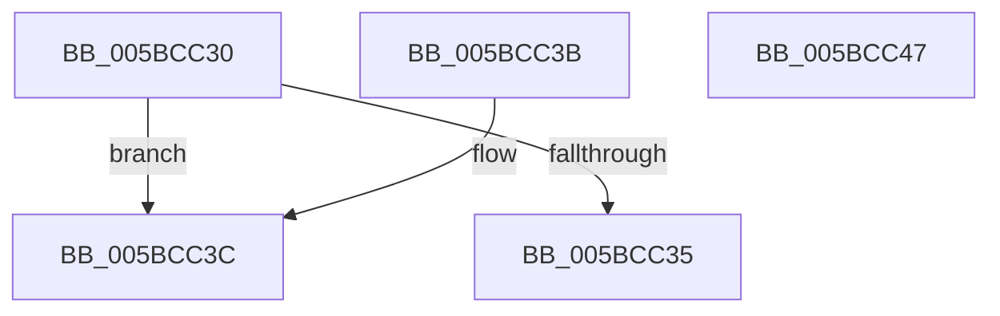

# KiNonNumaQueryNodeCapacity

- RVA: `0x005BCC30`–`0x005BCC48` (길이 `24` bytes)
- VA: `0x00000001405BCC30`
- 실행 섹션: `.text`
- PDB 이름 있음: `예`; PDB Function 태그: `아니요`
- unwind 정보 RVA: `0x000DB714`
- 디코드: `10`개 명령, `24/24` bytes 표시
- 미해석 바이트: `0` (있으면 어셈블리에 `.byte`로 보존)

> 이 문서는 커널 이미지의 기계어와 PDB 기호를 분석해 생성했습니다. 4번과 5번은 함수 원형과 자료형을 바이너리 사용 방식에서 추정한 C 해석이며 원본 소스 복구 결과는 아닙니다.

## 1. Dependencies

- 직접 호출 지점: **0**; 고유 호출 대상: **0**
- 직접 호출자로 확인된 함수: **0**
- RIP 상대 이미지 참조: **1**

### Outgoing calls
- 직접 디코드된 call 명령이 없습니다.

### Direct callers
- 이 함수 시작 RVA로 연결되는 직접 call은 확인되지 않았습니다. 간접 호출은 완전히 역산할 수 없습니다.

### Static image references
- `0x005BCC3C` → RVA `0x00FC5044` (`ALMOSTRO`; read)

## 2. Other-region calls and transfers

- 다른 실행 섹션으로 향하는 call: **0**
- 별도 외부 분기/꼬리 이동을 확인하지 못했습니다.

## 3. Assembly (complete function range)

```asm
005BCC30  66 85 C9                        test cx, cx
005BCC33  74 07                           je 0x1405bcc3c
005BCC35  B8 25 02 00 C0                  mov eax, 0xc0000225
005BCC3A  C3                              ret
005BCC3B  CC                              int3
005BCC3C  8B 05 02 84 A0 00               mov eax, dword ptr [rip + 0xa08402]
005BCC42  89 02                           mov dword ptr [rdx], eax
005BCC44  33 C0                           xor eax, eax
005BCC46  C3                              ret
005BCC47  CC                              int3
```

## 4. C-style interpretation (structured pseudocode)

```c
__int64 __fastcall KiNonNumaQueryNodeCapacity(unsigned __int16 a1, __int64 a2)
{
    __int64 result;

    if (a1 == 0) goto loc_005BCC3C;
    return (unsigned int)(0xC0000225ULL);
loc_005BCC3C:
    *(unsigned int *)(a2) = (unsigned int)((unsigned int)(*(unsigned int *)(v_rip + 10519554)));
    result = 0;
    return result;
}
```

## 5. (Beta) C Style

```c
int64_t KiNonNumaQueryNodeCapacity(uint16_t Arg1, void *Arg2)
{
    uint8_t *arg2 = (uint8_t *)Arg2;

    int64_t result;

    if (Arg1 == 0) goto loc_005BCC3C;
    return (uint32_t)(0xC0000225ULL);
loc_005BCC3C:
    *(uint32_t *)(arg2) = (uint32_t)((uint32_t)(*(uint32_t *)(v_rip + 0xA08402)));
    result = 0;
    return result;
}
```

### 관측된 메모리 오프셋

구조체 형식이 확인되지 않은 접근은 인자 기준의 오프셋으로만 기록했습니다.

| 기준 인자 | 오프셋 표현 | 폭 (bit) | 접근 |
|---|---:|---:|---|
| `Arg2` | `+ 0x0` | `32` | `W` |

## 6. Execution-region graph

[열기: 2D/3D 그래프와 함수 탐색 컨트롤 패널](../../../control-panel.html?section=text&rva=0x005BCC30&view=graph)

- 2D 그래프는 위에서 아래로 흐르고, 3D 그래프는 빈 공간을 드래그해 회전합니다. Shift+드래그는 이동, 휠은 확대·축소, 함수 노드 선택은 대상 보고서 이동입니다.

### Static fallback


