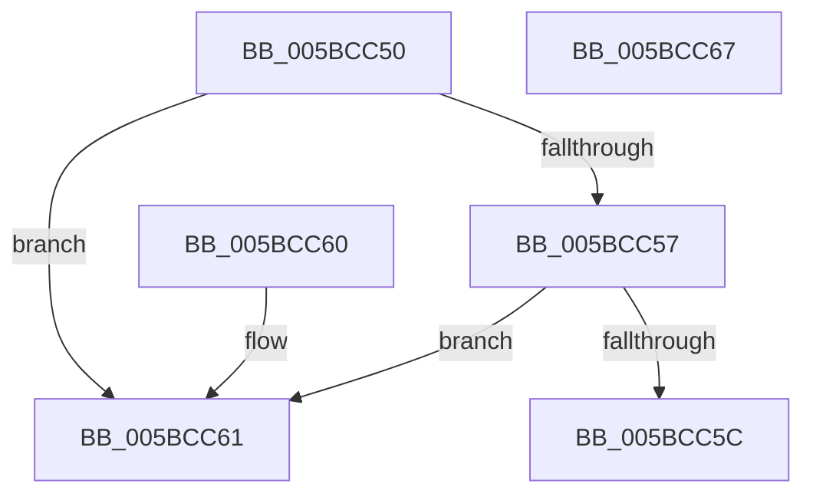

# KiNonNumaQueryNodeDistance

- RVA: `0x005BCC50`–`0x005BCC68` (길이 `24` bytes)
- VA: `0x00000001405BCC50`
- 실행 섹션: `.text`
- PDB 이름 있음: `예`; PDB Function 태그: `아니요`
- unwind 정보 RVA: `0x000DB714`
- 디코드: `11`개 명령, `24/24` bytes 표시
- 미해석 바이트: `0` (있으면 어셈블리에 `.byte`로 보존)

> 이 문서는 커널 이미지의 기계어와 PDB 기호를 분석해 생성했습니다. 4번과 5번은 함수 원형과 자료형을 바이너리 사용 방식에서 추정한 C 해석이며 원본 소스 복구 결과는 아닙니다.

## 1. Dependencies

- 직접 호출 지점: **0**; 고유 호출 대상: **0**
- 직접 호출자로 확인된 함수: **0**
- RIP 상대 이미지 참조: **0**

### Outgoing calls
- 직접 디코드된 call 명령이 없습니다.

### Direct callers
- 이 함수 시작 RVA로 연결되는 직접 call은 확인되지 않았습니다. 간접 호출은 완전히 역산할 수 없습니다.

### Static image references
- 디코드된 RIP-relative 메모리 참조가 없습니다.

## 2. Other-region calls and transfers

- 다른 실행 섹션으로 향하는 call: **0**
- 별도 외부 분기/꼬리 이동을 확인하지 못했습니다.

## 3. Assembly (complete function range)

```asm
005BCC50  33 C0                           xor eax, eax
005BCC52  66 85 C9                        test cx, cx
005BCC55  75 0A                           jne 0x1405bcc61
005BCC57  66 85 D2                        test dx, dx
005BCC5A  75 05                           jne 0x1405bcc61
005BCC5C  41 89 00                        mov dword ptr [r8], eax
005BCC5F  C3                              ret
005BCC60  CC                              int3
005BCC61  B8 25 02 00 C0                  mov eax, 0xc0000225
005BCC66  C3                              ret
005BCC67  CC                              int3
```

## 4. C-style interpretation (structured pseudocode)

```c
__int64 __fastcall KiNonNumaQueryNodeDistance(unsigned __int16 a1, unsigned __int16 a2, __int64 a3)
{
    __int64 result;

    result = 0;
    if (a1 != 0) goto loc_005BCC61;
    if (a2 != 0) goto loc_005BCC61;
    *(unsigned int *)(a3) = 0;
    return result;
loc_005BCC61:
    return (unsigned int)(0xC0000225ULL);
}
```

## 5. (Beta) C Style

```c
int64_t KiNonNumaQueryNodeDistance(uint16_t Arg1, uint16_t Arg2, void *Arg3)
{
    uint8_t *arg3 = (uint8_t *)Arg3;

    int64_t result;

    result = 0;
    if (Arg1 != 0) goto loc_005BCC61;
    if (Arg2 != 0) goto loc_005BCC61;
    *(uint32_t *)(arg3) = 0;
    return result;
loc_005BCC61:
    return (uint32_t)(0xC0000225ULL);
}
```

### 관측된 메모리 오프셋

구조체 형식이 확인되지 않은 접근은 인자 기준의 오프셋으로만 기록했습니다.

| 기준 인자 | 오프셋 표현 | 폭 (bit) | 접근 |
|---|---:|---:|---|
| `Arg3` | `+ 0x0` | `32` | `W` |

## 6. Execution-region graph

[열기: 2D/3D 그래프와 함수 탐색 컨트롤 패널](../../../control-panel.html?section=text&rva=0x005BCC50&view=graph)

- 2D 그래프는 위에서 아래로 흐르고, 3D 그래프는 빈 공간을 드래그해 회전합니다. Shift+드래그는 이동, 휠은 확대·축소, 함수 노드 선택은 대상 보고서 이동입니다.

### Static fallback


