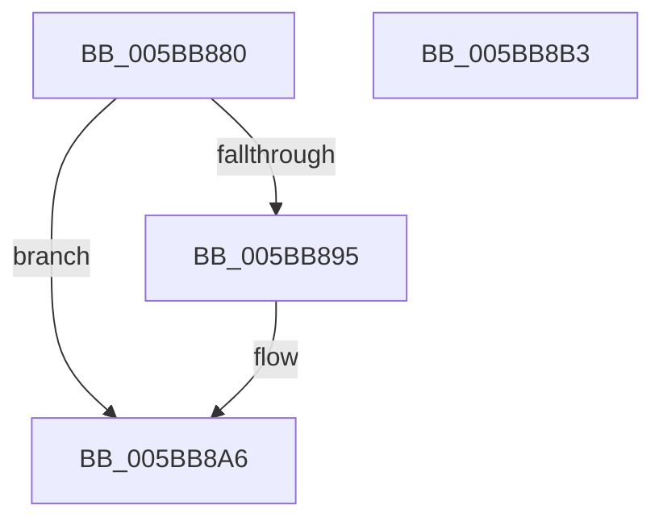

# KiOnlyClockInterruptPending

- RVA: `0x005BB880`–`0x005BB8B4` (길이 `52` bytes)
- VA: `0x00000001405BB880`
- 실행 섹션: `.text`
- PDB 이름 있음: `예`; PDB Function 태그: `아니요`
- unwind 정보 RVA: `0x0005CAAC`
- 디코드: `17`개 명령, `52/52` bytes 표시
- 미해석 바이트: `0` (있으면 어셈블리에 `.byte`로 보존)

> 이 문서는 커널 이미지의 기계어와 PDB 기호를 분석해 생성했습니다. 4번과 5번은 함수 원형과 자료형을 바이너리 사용 방식에서 추정한 C 해석이며 원본 소스 복구 결과는 아닙니다.

## 1. Dependencies

- 직접 호출 지점: **1**; 고유 호출 대상: **1**
- 직접 호출자로 확인된 함수: **1**
- RIP 상대 이미지 참조: **1**

### Outgoing calls
- `0x005BB89C` → [guard_dispatch_icall](../6B/guard_dispatch_icall_function_006BAAD0.md) (function, `0x006BAAD0`)

### Direct callers
- [KeResumeClockTimerFromIdle](KeResumeClockTimerFromIdle_function_005BACC4.md) at `0x005BAE0E`
- [KeResumeClockTimerFromIdle](KeResumeClockTimerFromIdle_function_005BACC4.md) at `0x005BAE82`
- [KeResumeClockTimerFromIdle](KeResumeClockTimerFromIdle_function_005BACC4.md) at `0x005BAFF8`

### Static image references
- `0x005BB895` → RVA `0x00E00AF8` (`.data`; read)

## 2. Other-region calls and transfers

- 다른 실행 섹션으로 향하는 call: **0**
- 별도 외부 분기/꼬리 이동을 확인하지 못했습니다.

## 3. Assembly (complete function range)

```asm
005BB880  48 89 5C 24 08                  mov qword ptr [rsp + 8], rbx
005BB885  57                              push rdi
005BB886  48 83 EC 20                     sub rsp, 0x20
005BB88A  80 3A 00                        cmp byte ptr [rdx], 0
005BB88D  48 8B FA                        mov rdi, rdx
005BB890  48 8B D9                        mov rbx, rcx
005BB893  75 11                           jne 0x1405bb8a6
005BB895  48 8B 05 5C 52 84 00            mov rax, qword ptr [rip + 0x84525c]
005BB89C  E8 2F F2 0F 00                  call 0x1406baad0
005BB8A1  88 03                           mov byte ptr [rbx], al
005BB8A3  C6 07 01                        mov byte ptr [rdi], 1
005BB8A6  8A 03                           mov al, byte ptr [rbx]
005BB8A8  48 8B 5C 24 30                  mov rbx, qword ptr [rsp + 0x30]
005BB8AD  48 83 C4 20                     add rsp, 0x20
005BB8B1  5F                              pop rdi
005BB8B2  C3                              ret
005BB8B3  CC                              int3
```

## 4. C-style interpretation (structured pseudocode)

```c
__int64 __fastcall KiOnlyClockInterruptPending(__int64 a1, __int64 a2)
{
    __int64 result;
    __int64 v_rsp;
    unsigned __int64 v_stack_p8;

    v_stack_p8 = v_rbx;
    v_rsp = (v_rsp) - (32);
    if ((*(unsigned __int8 *)(a2)) == 0) {
        result = *(unsigned __int64 *)(v_rip + 8671836);
        result = guard_dispatch_icall(a1, a2, a3, a4);
        *(unsigned __int8 *)(a1) = (unsigned __int8)(result);
        *(unsigned __int8 *)(a2) = 1;
    }
    v_rsp = (v_rsp) + (32);
    return *(unsigned __int8 *)(a1);
}
```

## 5. (Beta) C Style

```c
int64_t KiOnlyClockInterruptPending(void *Arg1, void *Arg2)
{
    uint8_t *arg1 = (uint8_t *)Arg1;
    uint8_t *arg2 = (uint8_t *)Arg2;

    int64_t result;
    int64_t local_rsp;
    uint64_t v_stack_p8;

    v_stack_p8 = local_rbx;
    local_rsp = (local_rsp) - (32);
    if ((*(uint8_t *)(arg2)) == 0) {
        result = *(uint64_t *)(v_rip + 0x84525C);
        result = guard_dispatch_icall(Arg1, Arg2, a3, a4);
        *(uint8_t *)(arg1) = (uint8_t)(result);
        *(uint8_t *)(arg2) = 1;
    }
    local_rsp = (local_rsp) + (32);
    return *(uint8_t *)(arg1);
}
```

### 관측된 메모리 오프셋

구조체 형식이 확인되지 않은 접근은 인자 기준의 오프셋으로만 기록했습니다.

| 기준 인자 | 오프셋 표현 | 폭 (bit) | 접근 |
|---|---:|---:|---|
| `Arg1` | `+ 0x0` | `8` | `R` |
| `Arg1` | `+ 0x0` | `8` | `W` |
| `Arg2` | `+ 0x0` | `8` | `R` |
| `Arg2` | `+ 0x0` | `8` | `W` |

## 6. Execution-region graph

[열기: 2D/3D 그래프와 함수 탐색 컨트롤 패널](../../../control-panel.html?section=text&rva=0x005BB880&view=graph)

- 2D 그래프는 위에서 아래로 흐르고, 3D 그래프는 빈 공간을 드래그해 회전합니다. Shift+드래그는 이동, 휠은 확대·축소, 함수 노드 선택은 대상 보고서 이동입니다.

### Static fallback


