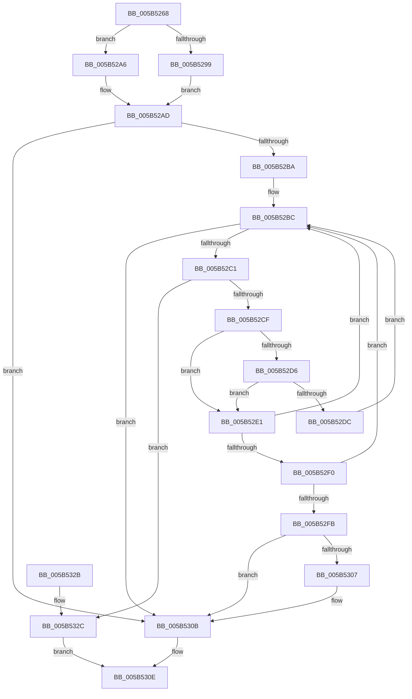

# KiPcToFileHeader

- RVA: `0x005B5268`–`0x005B5330` (길이 `200` bytes)
- VA: `0x00000001405B5268`
- 실행 섹션: `.text`
- PDB 이름 있음: `예`; PDB Function 태그: `아니요`
- unwind 정보 RVA: `0x000C9CA4`
- 디코드: `67`개 명령, `200/200` bytes 표시
- 미해석 바이트: `0` (있으면 어셈블리에 `.byte`로 보존)

> 이 문서는 커널 이미지의 기계어와 PDB 기호를 분석해 생성했습니다. 4번과 5번은 함수 원형과 자료형을 바이너리 사용 방식에서 추정한 C 해석이며 원본 소스 복구 결과는 아닙니다.

## 1. Dependencies

- 직접 호출 지점: **1**; 고유 호출 대상: **1**
- 직접 호출자로 확인된 함수: **2**
- RIP 상대 이미지 참조: **3**

### Outgoing calls
- `0x005B52C6` → [MmIsAddressValidEx](../27/MmIsAddressValidEx_function_0027FDD0.md) (function, `0x0027FDD0`)

### Direct callers
- [KeBugCheck2](KeBugCheck2_function_005B27D0.md) at `0x005B2D9F`
- [KeBugCheck2](KeBugCheck2_function_005B27D0.md) at `0x005B2E6B`
- [KeBugCheck2](KeBugCheck2_function_005B27D0.md) at `0x005B2EA6`
- [KiDumpParameterImages](KiDumpParameterImages_function_005B4CE0.md) at `0x005B4D52`
- [KiDumpParameterImages](KiDumpParameterImages_function_005B4CE0.md) at `0x005B4E50`

### Static image references
- `0x005B5284` → RVA `0x00FC41A0` (`.data`; read)
- `0x005B5299` → RVA `0x00FC6B20` (`ALMOSTRO`; read)
- `0x005B52A6` → RVA `0x00EF54C0` (`.data`; read)

## 2. Other-region calls and transfers

- 다른 실행 섹션으로 향하는 call: **0**
- 별도 외부 분기/꼬리 이동을 확인하지 못했습니다.

## 3. Assembly (complete function range)

```asm
005B5268  48 89 5C 24 08                  mov qword ptr [rsp + 8], rbx
005B526D  48 89 6C 24 10                  mov qword ptr [rsp + 0x10], rbp
005B5272  48 89 74 24 18                  mov qword ptr [rsp + 0x18], rsi
005B5277  57                              push rdi
005B5278  41 54                           push r12
005B527A  41 55                           push r13
005B527C  41 56                           push r14
005B527E  41 57                           push r15
005B5280  48 83 EC 20                     sub rsp, 0x20
005B5284  83 3D 15 EF A0 00 02            cmp dword ptr [rip + 0xa0ef15], 2
005B528B  4D 8B F9                        mov r15, r9
005B528E  45 8B E8                        mov r13d, r8d
005B5291  4C 8B E2                        mov r12, rdx
005B5294  48 8B E9                        mov rbp, rcx
005B5297  73 0D                           jae 0x1405b52a6
005B5299  4C 8B 35 80 18 A1 00            mov r14, qword ptr [rip + 0xa11880]
005B52A0  49 83 C6 10                     add r14, 0x10
005B52A4  EB 07                           jmp 0x1405b52ad
005B52A6  4C 8D 35 13 02 94 00            lea r14, [rip + 0x940213]
005B52AD  49 8B 3E                        mov rdi, qword ptr [r14]
005B52B0  33 DB                           xor ebx, ebx
005B52B2  41 88 19                        mov byte ptr [r9], bl
005B52B5  48 85 FF                        test rdi, rdi
005B52B8  74 51                           je 0x1405b530b
005B52BA  8B F3                           mov esi, ebx
005B52BC  49 3B FE                        cmp rdi, r14
005B52BF  74 4A                           je 0x1405b530b
005B52C1  33 D2                           xor edx, edx
005B52C3  48 8B CF                        mov rcx, rdi
005B52C6  E8 05 AB CC FF                  call 0x14027fdd0
005B52CB  84 C0                           test al, al
005B52CD  74 5D                           je 0x1405b532c
005B52CF  FF C6                           inc esi
005B52D1  83 FE 02                        cmp esi, 2
005B52D4  77 0B                           ja 0x1405b52e1
005B52D6  41 83 FD 01                     cmp r13d, 1
005B52DA  75 05                           jne 0x1405b52e1
005B52DC  48 8B 3F                        mov rdi, qword ptr [rdi]
005B52DF  EB DB                           jmp 0x1405b52bc
005B52E1  48 8B CF                        mov rcx, rdi
005B52E4  48 8B 3F                        mov rdi, qword ptr [rdi]
005B52E7  48 8B 51 30                     mov rdx, qword ptr [rcx + 0x30]
005B52EB  48 3B EA                        cmp rbp, rdx
005B52EE  72 CC                           jb 0x1405b52bc
005B52F0  8B 41 40                        mov eax, dword ptr [rcx + 0x40]
005B52F3  48 03 C2                        add rax, rdx
005B52F6  48 3B E8                        cmp rbp, rax
005B52F9  73 C1                           jae 0x1405b52bc
005B52FB  49 89 0C 24                     mov qword ptr [r12], rcx
005B52FF  48 8B DA                        mov rbx, rdx
005B5302  83 FE 02                        cmp esi, 2
005B5305  77 04                           ja 0x1405b530b
005B5307  41 C6 07 01                     mov byte ptr [r15], 1
005B530B  48 8B C3                        mov rax, rbx
005B530E  48 8B 5C 24 50                  mov rbx, qword ptr [rsp + 0x50]
005B5313  48 8B 6C 24 58                  mov rbp, qword ptr [rsp + 0x58]
005B5318  48 8B 74 24 60                  mov rsi, qword ptr [rsp + 0x60]
005B531D  48 83 C4 20                     add rsp, 0x20
005B5321  41 5F                           pop r15
005B5323  41 5E                           pop r14
005B5325  41 5D                           pop r13
005B5327  41 5C                           pop r12
005B5329  5F                              pop rdi
005B532A  C3                              ret
005B532B  CC                              int3
005B532C  33 C0                           xor eax, eax
005B532E  EB DE                           jmp 0x1405b530e
```

## 4. C-style interpretation (structured pseudocode)

```c
__int64 __fastcall KiPcToFileHeader(__int64 a1, __int64 a2, int a3, __int64 a4)
{
    __int64 result;
    __int64 v_r14;
    __int64 v_rbx;
    __int64 v_rsi;
    __int64 v_rsp;
    unsigned __int64 v_stack_p10;
    unsigned __int64 v_stack_p18;
    unsigned __int64 v_stack_p8;

    v_stack_p8 = v_rbx;
    v_stack_p10 = v_rbp;
    v_stack_p18 = v_rsi;
    v_rsp = (v_rsp) - (32);
    if ((*(unsigned int *)(v_rip + 10546965)) >= 2) goto loc_005B52A6;
    v_r14 = (*(unsigned __int64 *)(v_rip + 10557568)) + (16);
    goto loc_005B52AD;
loc_005B52A6:
loc_005B52AD:
    v_rbx = 0;
    *(unsigned __int8 *)(a4) = 0;
    if (*(unsigned __int64 *)(v_rip + 9699859) == 0) goto loc_005B530B;
loc_005B52BC:
    if ((*(unsigned __int64 *)(v_rip + 9699859)) == (v_rip + 9699859)) goto loc_005B530B;
    a2 = 0;
    result = MmIsAddressValidEx(*(unsigned __int64 *)(v_rip + 9699859), a2, a3, a4);
    if ((unsigned __int8)(result) == 0) goto loc_005B532C;
    v_rsi = (unsigned int)((0) + 1);
    if (((unsigned int)(v_rsi)) > 2) goto loc_005B52E1;
    if (((unsigned int)((unsigned int)(a3))) != 1) goto loc_005B52E1;
    goto loc_005B52BC;
loc_005B52E1:
    if (a1 < (*(unsigned __int64 *)(*(unsigned __int64 *)(*(unsigned __int64 *)(v_rip + 9699859)) + 48))) goto loc_005B52BC;
    result = ((unsigned int)(*(unsigned int *)(*(unsigned __int64 *)(*(unsigned __int64 *)(v_rip + 9699859)) + 64))) + (*(unsigned __int64 *)(*(unsigned __int64 *)(*(unsigned __int64 *)(v_rip + 9699859)) + 48));
    if (a1 >= result) goto loc_005B52BC;
    *(unsigned __int64 *)(a2) = *(unsigned __int64 *)(*(unsigned __int64 *)(v_rip + 9699859));
    if (((unsigned int)(v_rsi)) <= 2) {
        *(unsigned __int8 *)(a4) = 1;
    }
loc_005B530E:
    v_rsp = (v_rsp) + (32);
    return *(unsigned __int64 *)(*(unsigned __int64 *)(*(unsigned __int64 *)(v_rip + 9699859)) + 48);
loc_005B532C:
    result = 0;
    goto loc_005B530E;
}
```

## 5. (Beta) C Style

```c
int64_t KiPcToFileHeader(int64_t Arg1, void *Arg2, int32_t Arg3, void *Arg4)
{
    uint8_t *arg2 = (uint8_t *)Arg2;
    uint8_t *arg4 = (uint8_t *)Arg4;

    int64_t result;
    int64_t local_r14;
    int64_t local_rbx;
    int64_t local_rsi;
    int64_t local_rsp;
    uint64_t v_stack_p10;
    uint64_t v_stack_p18;
    uint64_t v_stack_p8;

    v_stack_p8 = local_rbx;
    v_stack_p10 = local_rbp;
    v_stack_p18 = local_rsi;
    local_rsp = (local_rsp) - (32);
    if ((*(uint32_t *)(v_rip + 0xA0EF15)) >= 2) goto loc_005B52A6;
    local_r14 = (*(uint64_t *)(v_rip + 0xA11880)) + (16);
    goto loc_005B52AD;
loc_005B52A6:
loc_005B52AD:
    local_rbx = 0;
    *(uint8_t *)(arg4) = 0;
    if (*(uint64_t *)(v_rip + 0x940213) == 0) goto loc_005B530B;
loc_005B52BC:
    if ((*(uint64_t *)(v_rip + 0x940213)) == (v_rip + 9699859)) goto loc_005B530B;
    Arg2 = 0;
    result = MmIsAddressValidEx(*(uint64_t *)(v_rip + 0x940213), Arg2, Arg3, Arg4);
    if ((uint8_t)(result) == 0) goto loc_005B532C;
    local_rsi = (uint32_t)((0) + 1);
    if (((uint32_t)(local_rsi)) > 2) goto loc_005B52E1;
    if (((uint32_t)((uint32_t)(Arg3))) != 1) goto loc_005B52E1;
    goto loc_005B52BC;
loc_005B52E1:
    if (Arg1 < (*(uint64_t *)(*(uint64_t *)(*(uint64_t *)(v_rip + 0x940213)) + 0x30))) goto loc_005B52BC;
    result = ((uint32_t)(*(uint32_t *)(*(uint64_t *)(*(uint64_t *)(v_rip + 0x940213)) + 0x40))) + (*(uint64_t *)(*(uint64_t *)(*(uint64_t *)(v_rip + 0x940213)) + 0x30));
    if (Arg1 >= result) goto loc_005B52BC;
    *(uint64_t *)(arg2) = *(uint64_t *)(*(uint64_t *)(v_rip + 0x940213));
    if (((uint32_t)(local_rsi)) <= 2) {
        *(uint8_t *)(arg4) = 1;
    }
loc_005B530E:
    local_rsp = (local_rsp) + (32);
    return *(uint64_t *)(*(uint64_t *)(*(uint64_t *)(v_rip + 0x940213)) + 0x30);
loc_005B532C:
    result = 0;
    goto loc_005B530E;
}
```

### 관측된 메모리 오프셋

구조체 형식이 확인되지 않은 접근은 인자 기준의 오프셋으로만 기록했습니다.

| 기준 인자 | 오프셋 표현 | 폭 (bit) | 접근 |
|---|---:|---:|---|
| `Arg2` | `+ 0x0` | `64` | `W` |
| `Arg4` | `+ 0x0` | `8` | `W` |

## 6. Execution-region graph

[열기: 2D/3D 그래프와 함수 탐색 컨트롤 패널](../../../control-panel.html?section=text&rva=0x005B5268&view=graph)

- 2D 그래프는 위에서 아래로 흐르고, 3D 그래프는 빈 공간을 드래그해 회전합니다. Shift+드래그는 이동, 휠은 확대·축소, 함수 노드 선택은 대상 보고서 이동입니다.

### Static fallback


