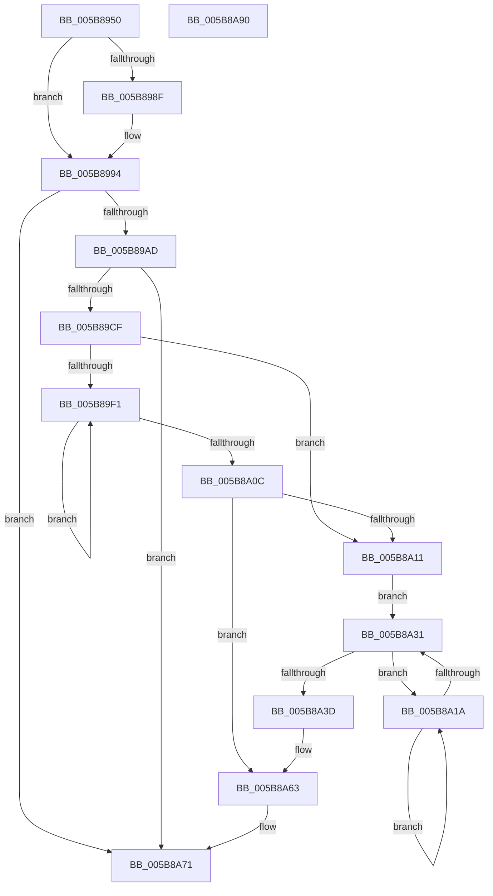

# KiProcessNMI

- RVA: `0x005B8950`–`0x005B8A91` (길이 `321` bytes)
- VA: `0x00000001405B8950`
- 실행 섹션: `.text`
- PDB 이름 있음: `예`; PDB Function 태그: `아니요`
- unwind 정보 RVA: `0x0005FEF8`
- 디코드: `83`개 명령, `321/321` bytes 표시
- 미해석 바이트: `0` (있으면 어셈블리에 `.byte`로 보존)

> 이 문서는 커널 이미지의 기계어와 PDB 기호를 분석해 생성했습니다. 4번과 5번은 함수 원형과 자료형을 바이너리 사용 방식에서 추정한 C 해석이며 원본 소스 복구 결과는 아닙니다.

## 1. Dependencies

- 직접 호출 지점: **11**; 고유 호출 대상: **8**
- 직접 호출자로 확인된 함수: **1**
- RIP 상대 이미지 참조: **6**

### Outgoing calls
- `0x005B897C` → [guard_dispatch_icall](../6B/guard_dispatch_icall_function_006BAAD0.md) (function, `0x006BAAD0`)
- `0x005B898F` → [KiFlushCurrentRsb](../6C/KiFlushCurrentRsb_function_006C6540.md) (function, `0x006C6540`)
- `0x005B899D` → [KiCheckForFreezeExecution](KiCheckForFreezeExecution_function_005B41E0.md) (function, `0x005B41E0`)
- `0x005B89C2` → [KeInterlockedSetProcessorAffinityEx](../35/KeInterlockedSetProcessorAffinityEx_function_00352560.md) (function, `0x00352560`)
- `0x005B89DD` → [guard_dispatch_icall](../6B/guard_dispatch_icall_function_006BAAD0.md) (function, `0x006BAAD0`)
- `0x005B89FC` → [guard_dispatch_icall](../6B/guard_dispatch_icall_function_006BAAD0.md) (function, `0x006BAAD0`)
- `0x005B8A20` → [KiCheckForFreezeExecution](KiCheckForFreezeExecution_function_005B41E0.md) (function, `0x005B41E0`)
- `0x005B8A34` → [KxTryToAcquireSpinLock](../46/KxTryToAcquireSpinLock_function_0046BE18.md) (function, `0x0046BE18`)
- `0x005B8A4A` → [HalHandleNMI](../54/HalHandleNMI_function_00545800.md) (function, `0x00545800`)
- `0x005B8A5E` → [KxReleaseSpinLock](../20/KxReleaseSpinLock_function_00206670.md) (function, `0x00206670`)
- `0x005B8A6C` → [KeInterlockedClearProcessorAffinityEx](../35/KeInterlockedClearProcessorAffinityEx_function_003524F0.md) (function, `0x003524F0`)

### Direct callers
- [KxNmiInterrupt](../6B/KxNmiInterrupt_function_006BD840.md) at `0x006BD8BD`

### Static image references
- `0x005B896D` → RVA `0x00E00BD8` (`.data`; read)
- `0x005B8981` → RVA `0x00FC6B48` (`ALMOSTRO`; read)
- `0x005B89B6` → RVA `0x00E0AA60` (`.data`; read)
- `0x005B89E2` → RVA `0x00F475A8` (`.data`; read)
- `0x005B8A11` → RVA `0x00FCF680` (`CACHEALI`; read)
- `0x005B8A3F` → RVA `0x00F4754C` (`.data`; read)

## 2. Other-region calls and transfers

- 다른 실행 섹션으로 향하는 call: **0**
- 별도 외부 분기/꼬리 이동을 확인하지 못했습니다.

## 3. Assembly (complete function range)

```asm
005B8950  48 8B C4                        mov rax, rsp
005B8953  48 89 58 08                     mov qword ptr [rax + 8], rbx
005B8957  48 89 68 10                     mov qword ptr [rax + 0x10], rbp
005B895B  48 89 70 18                     mov qword ptr [rax + 0x18], rsi
005B895F  48 89 78 20                     mov qword ptr [rax + 0x20], rdi
005B8963  41 54                           push r12
005B8965  41 56                           push r14
005B8967  41 57                           push r15
005B8969  48 83 EC 20                     sub rsp, 0x20
005B896D  48 8B 05 64 82 84 00            mov rax, qword ptr [rip + 0x848264]
005B8974  4C 8B F1                        mov r14, rcx
005B8977  33 C9                           xor ecx, ecx
005B8979  48 8B EA                        mov rbp, rdx
005B897C  E8 4F 21 10 00                  call 0x1406baad0
005B8981  48 8B 05 C0 E1 A0 00            mov rax, qword ptr [rip + 0xa0e1c0]
005B8988  48 0F BA E0 29                  bt rax, 0x29
005B898D  73 05                           jae 0x1405b8994
005B898F  E8 AC DB 10 00                  call 0x1406c6540
005B8994  0F AE E8                        lfence
005B8997  48 8B D5                        mov rdx, rbp
005B899A  49 8B CE                        mov rcx, r14
005B899D  E8 3E B8 FF FF                  call 0x1405b41e0
005B89A2  45 33 FF                        xor r15d, r15d
005B89A5  84 C0                           test al, al
005B89A7  0F 85 C4 00 00 00               jne 0x1405b8a71
005B89AD  65 48 8B 04 25 20 00 00 00      mov rax, qword ptr gs:[0x20]
005B89B6  48 8D 0D A3 20 85 00            lea rcx, [rip + 0x8520a3]
005B89BD  8B 70 24                        mov esi, dword ptr [rax + 0x24]
005B89C0  8B D6                           mov edx, esi
005B89C2  E8 99 9B D9 FF                  call 0x140352560
005B89C7  85 C0                           test eax, eax
005B89C9  0F 85 A2 00 00 00               jne 0x1405b8a71
005B89CF  48 8B 05 02 82 84 00            mov rax, qword ptr [rip + 0x848202]
005B89D6  45 8D 67 01                     lea r12d, [r15 + 1]
005B89DA  41 8B CC                        mov ecx, r12d
005B89DD  E8 EE 20 10 00                  call 0x1406baad0
005B89E2  48 8B 1D BF EB 98 00            mov rbx, qword ptr [rip + 0x98ebbf]
005B89E9  41 8A FF                        mov dil, r15b
005B89EC  48 85 DB                        test rbx, rbx
005B89EF  74 20                           je 0x1405b8a11
005B89F1  48 8B 43 08                     mov rax, qword ptr [rbx + 8]
005B89F5  40 8A D7                        mov dl, dil
005B89F8  48 8B 4B 10                     mov rcx, qword ptr [rbx + 0x10]
005B89FC  E8 CF 20 10 00                  call 0x1406baad0
005B8A01  48 8B 1B                        mov rbx, qword ptr [rbx]
005B8A04  40 0A F8                        or dil, al
005B8A07  48 85 DB                        test rbx, rbx
005B8A0A  75 E5                           jne 0x1405b89f1
005B8A0C  40 84 FF                        test dil, dil
005B8A0F  75 52                           jne 0x1405b8a63
005B8A11  48 8D 1D 68 6C A1 00            lea rbx, [rip + 0xa16c68]
005B8A18  EB 17                           jmp 0x1405b8a31
005B8A1A  48 8B D5                        mov rdx, rbp
005B8A1D  49 8B CE                        mov rcx, r14
005B8A20  E8 BB B7 FF FF                  call 0x1405b41e0
005B8A25  48 8B 05 54 6C A1 00            mov rax, qword ptr [rip + 0xa16c54]
005B8A2C  48 85 C0                        test rax, rax
005B8A2F  75 E9                           jne 0x1405b8a1a
005B8A31  48 8B CB                        mov rcx, rbx
005B8A34  E8 DF 33 EB FF                  call 0x14046be18
005B8A39  84 C0                           test al, al
005B8A3B  74 DD                           je 0x1405b8a1a
005B8A3D  33 C0                           xor eax, eax
005B8A3F  F0 44 0F B1 25 04 EB 98 00      lock cmpxchg dword ptr [rip + 0x98eb04], r12d
005B8A48  33 C9                           xor ecx, ecx
005B8A4A  E8 B1 CD F8 FF                  call 0x140545800
005B8A4F  41 8B C4                        mov eax, r12d
005B8A52  F0 44 0F B1 3D F1 EA 98 00      lock cmpxchg dword ptr [rip + 0x98eaf1], r15d
005B8A5B  48 8B CB                        mov rcx, rbx
005B8A5E  E8 0D DC C4 FF                  call 0x140206670
005B8A63  8B D6                           mov edx, esi
005B8A65  48 8D 0D F4 1F 85 00            lea rcx, [rip + 0x851ff4]
005B8A6C  E8 7F 9A D9 FF                  call 0x1403524f0
005B8A71  48 8B 5C 24 40                  mov rbx, qword ptr [rsp + 0x40]
005B8A76  48 8B 6C 24 48                  mov rbp, qword ptr [rsp + 0x48]
005B8A7B  48 8B 74 24 50                  mov rsi, qword ptr [rsp + 0x50]
005B8A80  48 8B 7C 24 58                  mov rdi, qword ptr [rsp + 0x58]
005B8A85  48 83 C4 20                     add rsp, 0x20
005B8A89  41 5F                           pop r15
005B8A8B  41 5E                           pop r14
005B8A8D  41 5C                           pop r12
005B8A8F  C3                              ret
005B8A90  CC                              int3
```

## 4. C-style interpretation (structured pseudocode)

```c
__int64 __fastcall KiProcessNMI(__int64 a1, __int64 a2)
{
    __int64 result;
    __int64 v_r15;
    __int64 v_rdi;
    __int64 v_rsp;
    unsigned __int64 v_stack_p10;
    unsigned __int64 v_stack_p18;
    unsigned __int64 v_stack_p20;
    unsigned __int64 v_stack_p8;

    *(unsigned __int64 *)(v_rsp + 8) = v_rbx;
    *(unsigned __int64 *)(v_rsp + 16) = v_rbp;
    *(unsigned __int64 *)(v_rsp + 24) = v_rsi;
    *(unsigned __int64 *)(v_rsp + 32) = v_rdi;
    v_rsp = (v_rsp) - (32);
    a1 = 0;
    result = guard_dispatch_icall(a1, a2, a3, a4);
    result = *(unsigned __int64 *)(v_rip + 10543552);
    if (!(condition_is_above_or_equal)) {
        result = KiFlushCurrentRsb(a1, a2, a3, a4);
    }
    result = KiCheckForFreezeExecution(0, a2, a3, a4);
    v_r15 = 0;
    if ((unsigned __int8)(result) != 0) goto loc_005B8A71;
    result = KeInterlockedSetProcessorAffinityEx(v_rip + 8724643, (unsigned int)((unsigned int)((unsigned int)(*(unsigned int *)(*(unsigned __int64 *)(gs_base + (0 + 32)) + 36)))), a3, a4);
    if ((unsigned int)(result) != 0) goto loc_005B8A71;
    result = guard_dispatch_icall((unsigned int)((unsigned int)(v_r15 + 1)), (unsigned int)((unsigned int)((unsigned int)(*(unsigned int *)(*(unsigned __int64 *)(gs_base + (0 + 32)) + 36)))), a3, a4);
    if (*(unsigned __int64 *)(v_rip + 10021823) == 0) goto loc_005B8A11;
loc_005B89F1:
    result = guard_dispatch_icall(*(unsigned __int64 *)(*(unsigned __int64 *)(v_rip + 10021823) + 16), 0, a3, a4);
    v_rdi = (unsigned __int8)((0) | ((unsigned __int8)(result)));
    if (*(unsigned __int64 *)(*(unsigned __int64 *)(v_rip + 10021823)) != 0) goto loc_005B89F1;
    if ((unsigned __int8)(v_rdi) != 0) goto loc_005B8A63;
loc_005B8A11:
    goto loc_005B8A31;
loc_005B8A1A:
    result = KiCheckForFreezeExecution(0, a2, a3, a4);
    if (*(unsigned __int64 *)(v_rip + 10579028) != 0) goto loc_005B8A1A;
loc_005B8A31:
    result = KxTryToAcquireSpinLock(v_rip + 10579048, a2, a3, a4);
    if ((unsigned __int8)(result) == 0) goto loc_005B8A1A;
    result = 0;
    a1 = 0;
    result = HalHandleNMI(a1, a2, a3, a4);
    result = KxReleaseSpinLock(v_rip + 10579048, a2, a3, a4);
loc_005B8A63:
    result = KeInterlockedClearProcessorAffinityEx(v_rip + 8724468, (unsigned int)((unsigned int)((unsigned int)(*(unsigned int *)(*(unsigned __int64 *)(gs_base + (0 + 32)) + 36)))), a3, a4);
loc_005B8A71:
    v_rsp = (v_rsp) + (32);
    return result;
}
```

## 5. (Beta) C Style

```c
int64_t KiProcessNMI(int64_t Arg1, int64_t Arg2)
{
    int64_t result;
    int64_t local_r15;
    int64_t local_rdi;
    int64_t local_rsp;
    uint64_t v_stack_p10;
    uint64_t v_stack_p18;
    uint64_t v_stack_p20;
    uint64_t v_stack_p8;

    *(uint64_t *)(local_rsp + 0x8) = local_rbx;
    *(uint64_t *)(local_rsp + 0x10) = local_rbp;
    *(uint64_t *)(local_rsp + 0x18) = local_rsi;
    *(uint64_t *)(local_rsp + 0x20) = local_rdi;
    local_rsp = (local_rsp) - (32);
    Arg1 = 0;
    result = guard_dispatch_icall(Arg1, Arg2, a3, a4);
    result = *(uint64_t *)(v_rip + 0xA0E1C0);
    if (!(condition_is_above_or_equal)) {
        result = KiFlushCurrentRsb(Arg1, Arg2, a3, a4);
    }
    result = KiCheckForFreezeExecution(0, Arg2, a3, a4);
    local_r15 = 0;
    if ((uint8_t)(result) != 0) goto loc_005B8A71;
    result = KeInterlockedSetProcessorAffinityEx(v_rip + 8724643, (uint32_t)((uint32_t)((uint32_t)(*(uint32_t *)(*(uint64_t *)(gs_base + (0 + 0x20)) + 0x24)))), a3, a4);
    if ((uint32_t)(result) != 0) goto loc_005B8A71;
    result = guard_dispatch_icall((uint32_t)((uint32_t)(local_r15 + 1)), (uint32_t)((uint32_t)((uint32_t)(*(uint32_t *)(*(uint64_t *)(gs_base + (0 + 0x20)) + 0x24)))), a3, a4);
    if (*(uint64_t *)(v_rip + 0x98EBBF) == 0) goto loc_005B8A11;
loc_005B89F1:
    result = guard_dispatch_icall(*(uint64_t *)(*(uint64_t *)(v_rip + 0x98EBBF) + 0x10), 0, a3, a4);
    local_rdi = (uint8_t)((0) | ((uint8_t)(result)));
    if (*(uint64_t *)(*(uint64_t *)(v_rip + 0x98EBBF)) != 0) goto loc_005B89F1;
    if ((uint8_t)(local_rdi) != 0) goto loc_005B8A63;
loc_005B8A11:
    goto loc_005B8A31;
loc_005B8A1A:
    result = KiCheckForFreezeExecution(0, Arg2, a3, a4);
    if (*(uint64_t *)(v_rip + 0xA16C54) != 0) goto loc_005B8A1A;
loc_005B8A31:
    result = KxTryToAcquireSpinLock(v_rip + 10579048, Arg2, a3, a4);
    if ((uint8_t)(result) == 0) goto loc_005B8A1A;
    result = 0;
    Arg1 = 0;
    result = HalHandleNMI(Arg1, Arg2, a3, a4);
    result = KxReleaseSpinLock(v_rip + 10579048, Arg2, a3, a4);
loc_005B8A63:
    result = KeInterlockedClearProcessorAffinityEx(v_rip + 8724468, (uint32_t)((uint32_t)((uint32_t)(*(uint32_t *)(*(uint64_t *)(gs_base + (0 + 0x20)) + 0x24)))), a3, a4);
loc_005B8A71:
    local_rsp = (local_rsp) + (32);
    return result;
}
```

## 6. Execution-region graph

[열기: 2D/3D 그래프와 함수 탐색 컨트롤 패널](../../../control-panel.html?section=text&rva=0x005B8950&view=graph)

- 2D 그래프는 위에서 아래로 흐르고, 3D 그래프는 빈 공간을 드래그해 회전합니다. Shift+드래그는 이동, 휠은 확대·축소, 함수 노드 선택은 대상 보고서 이동입니다.

### Static fallback


