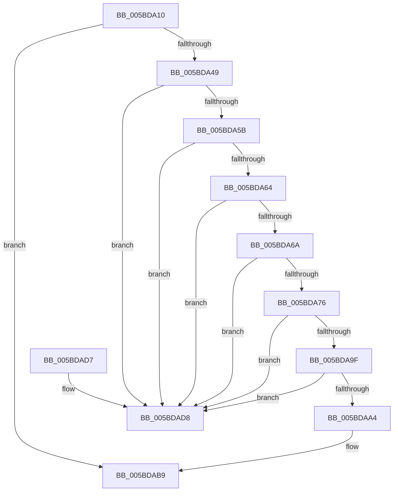

# KiProcessSecondarySignalList

- RVA: `0x005BDA10`–`0x005BDADF` (길이 `207` bytes)
- VA: `0x00000001405BDA10`
- 실행 섹션: `.text`
- PDB 이름 있음: `예`; PDB Function 태그: `아니요`
- unwind 정보 RVA: `0x000CA4CC`
- 디코드: `53`개 명령, `207/207` bytes 표시
- 미해석 바이트: `0` (있으면 어셈블리에 `.byte`로 보존)

> 이 문서는 커널 이미지의 기계어와 PDB 기호를 분석해 생성했습니다. 4번과 5번은 함수 원형과 자료형을 바이너리 사용 방식에서 추정한 C 해석이며 원본 소스 복구 결과는 아닙니다.

## 1. Dependencies

- 직접 호출 지점: **3**; 고유 호출 대상: **3**
- 직접 호출자로 확인된 함수: **0**
- RIP 상대 이미지 참조: **5**

### Outgoing calls
- `0x005BDA31` → [KiAcquireSecondarySignalListLock](KiAcquireSecondarySignalListLock_function_005BD9B8.md) (function, `0x005BD9B8`)
- `0x005BDAC3` → [KiReleaseSecondarySignalListLock](KiReleaseSecondarySignalListLock_function_005BDAE8.md) (function, `0x005BDAE8`)
- `0x005BDACC` → [KiProcessDisconnectList](../39/KiProcessDisconnectList_function_0039F804.md) (function, `0x0039F804`)

### Direct callers
- 이 함수 시작 RVA로 연결되는 직접 call은 확인되지 않았습니다. 간접 호출은 완전히 역산할 수 없습니다.

### Static image references
- `0x005BDA36` → RVA `0x00F110A0` (`.data`; read)
- `0x005BDA6A` → RVA `0x00F110A8` (`.data`; read)
- `0x005BDA92` → RVA `0x00F110A8` (`.data`; write)
- `0x005BDAB2` → RVA `0x00F110A0` (`.data`; write)
- `0x005BDABC` → RVA `0x00F11040` (`.data`; write)

## 2. Other-region calls and transfers

- 다른 실행 섹션으로 향하는 call: **0**
- 별도 외부 분기/꼬리 이동을 확인하지 못했습니다.

## 3. Assembly (complete function range)

```asm
005BDA10  40 55                           push rbp
005BDA12  48 8B EC                        mov rbp, rsp
005BDA15  48 83 EC 40                     sub rsp, 0x40
005BDA19  48 8D 45 E8                     lea rax, [rbp - 0x18]
005BDA1D  C6 45 E0 00                     mov byte ptr [rbp - 0x20], 0
005BDA21  48 89 45 F0                     mov qword ptr [rbp - 0x10], rax
005BDA25  48 8D 4D E0                     lea rcx, [rbp - 0x20]
005BDA29  48 8D 45 E8                     lea rax, [rbp - 0x18]
005BDA2D  48 89 45 E8                     mov qword ptr [rbp - 0x18], rax
005BDA31  E8 82 FF FF FF                  call 0x1405bd9b8
005BDA36  48 8B 15 63 36 95 00            mov rdx, qword ptr [rip + 0x953663]
005BDA3D  4C 8D 0D 5C 36 95 00            lea r9, [rip + 0x95365c]
005BDA44  49 3B D1                        cmp rdx, r9
005BDA47  74 70                           je 0x1405bdab9
005BDA49  48 8B 45 E8                     mov rax, qword ptr [rbp - 0x18]
005BDA4D  4C 8D 45 E8                     lea r8, [rbp - 0x18]
005BDA51  48 8B 4D F0                     mov rcx, qword ptr [rbp - 0x10]
005BDA55  4C 39 40 08                     cmp qword ptr [rax + 8], r8
005BDA59  75 7D                           jne 0x1405bdad8
005BDA5B  48 8D 45 E8                     lea rax, [rbp - 0x18]
005BDA5F  48 39 01                        cmp qword ptr [rcx], rax
005BDA62  75 74                           jne 0x1405bdad8
005BDA64  4C 39 4A 08                     cmp qword ptr [rdx + 8], r9
005BDA68  75 6E                           jne 0x1405bdad8
005BDA6A  48 8B 05 37 36 95 00            mov rax, qword ptr [rip + 0x953637]
005BDA71  4C 39 08                        cmp qword ptr [rax], r9
005BDA74  75 62                           jne 0x1405bdad8
005BDA76  4C 89 09                        mov qword ptr [rcx], r9
005BDA79  48 8D 55 E8                     lea rdx, [rbp - 0x18]
005BDA7D  48 8B 05 24 36 95 00            mov rax, qword ptr [rip + 0x953624]
005BDA84  48 89 45 F0                     mov qword ptr [rbp - 0x10], rax
005BDA88  48 89 10                        mov qword ptr [rax], rdx
005BDA8B  48 8B 05 0E 36 95 00            mov rax, qword ptr [rip + 0x95360e]
005BDA92  48 89 0D 0F 36 95 00            mov qword ptr [rip + 0x95360f], rcx
005BDA99  4C 39 48 08                     cmp qword ptr [rax + 8], r9
005BDA9D  75 39                           jne 0x1405bdad8
005BDA9F  4C 39 09                        cmp qword ptr [rcx], r9
005BDAA2  75 34                           jne 0x1405bdad8
005BDAA4  48 89 01                        mov qword ptr [rcx], rax
005BDAA7  48 89 48 08                     mov qword ptr [rax + 8], rcx
005BDAAB  4C 89 0D F6 35 95 00            mov qword ptr [rip + 0x9535f6], r9
005BDAB2  4C 89 0D E7 35 95 00            mov qword ptr [rip + 0x9535e7], r9
005BDAB9  8A 4D E0                        mov cl, byte ptr [rbp - 0x20]
005BDABC  C6 05 7D 35 95 00 00            mov byte ptr [rip + 0x95357d], 0
005BDAC3  E8 20 00 00 00                  call 0x1405bdae8
005BDAC8  48 8D 4D E8                     lea rcx, [rbp - 0x18]
005BDACC  E8 33 1D DE FF                  call 0x14039f804
005BDAD1  48 83 C4 40                     add rsp, 0x40
005BDAD5  5D                              pop rbp
005BDAD6  C3                              ret
005BDAD7  CC                              int3
005BDAD8  B9 03 00 00 00                  mov ecx, 3
005BDADD  CD 29                           int 0x29
```

## 4. C-style interpretation (structured pseudocode)

```c
__int64 __fastcall KiProcessSecondarySignalList(void)
{
    __int64 result;
    __int64 v_rsp;
    unsigned __int64 v_stack_m18;
    unsigned __int64 v_stack_m20;
    unsigned __int8 v_stack_m28;

    v_rsp = (v_rsp) - (64);
    v_stack_m28 = 0;
    v_stack_m18 = v_stack_m20;
    v_stack_m20 = v_stack_m20;
    result = KiAcquireSecondarySignalListLock(v_stack_m28, a2, a3, a4);
    if ((*(unsigned __int64 *)(v_rip + 9778787)) == (v_rip + 9778780)) goto loc_005BDAB9;
    if ((*(unsigned __int64 *)(v_stack_m20 + 8)) != v_stack_m20) goto loc_005BDAD8;
    if ((*(unsigned __int64 *)(v_stack_m18)) != v_stack_m20) goto loc_005BDAD8;
    if ((*(unsigned __int64 *)(*(unsigned __int64 *)(v_rip + 9778787) + 8)) != (v_rip + 9778780)) goto loc_005BDAD8;
    if ((*(unsigned __int64 *)(*(unsigned __int64 *)(v_rip + 9778743))) != (v_rip + 9778780)) goto loc_005BDAD8;
    *(unsigned __int64 *)(v_stack_m18) = v_rip + 9778780;
    v_stack_m18 = *(unsigned __int64 *)(v_rip + 9778724);
    *(unsigned __int64 *)(*(unsigned __int64 *)(v_rip + 9778724)) = v_stack_m20;
    *(unsigned __int64 *)(v_rip + 9778703) = v_stack_m18;
    if ((*(unsigned __int64 *)(*(unsigned __int64 *)(v_rip + 9778702) + 8)) != (v_rip + 9778780)) goto loc_005BDAD8;
    if ((*(unsigned __int64 *)(v_stack_m18)) != (v_rip + 9778780)) goto loc_005BDAD8;
    *(unsigned __int64 *)(v_stack_m18) = *(unsigned __int64 *)(v_rip + 9778702);
    *(unsigned __int64 *)(*(unsigned __int64 *)(v_rip + 9778702) + 8) = v_stack_m18;
    *(unsigned __int64 *)(v_rip + 9778678) = v_rip + 9778780;
    *(unsigned __int64 *)(v_rip + 9778663) = v_rip + 9778780;
loc_005BDAB9:
    *(unsigned __int8 *)(v_rip + 9778557) = 0;
    result = KiReleaseSecondarySignalListLock(v_stack_m28, v_stack_m20, v_stack_m20, v_rip + 9778780);
    result = KiProcessDisconnectList(v_stack_m20, v_stack_m20, v_stack_m20, v_rip + 9778780);
    v_rsp = (v_rsp) + (64);
    return result;
loc_005BDAD8:
    return result;
}
```

## 5. (Beta) C Style

```c
void KiProcessSecondarySignalList(void)
{
    int64_t result;
    int64_t local_rsp;
    uint64_t v_stack_m18;
    uint64_t v_stack_m20;
    uint8_t v_stack_m28;

    local_rsp = (local_rsp) - (64);
    v_stack_m28 = 0;
    v_stack_m18 = v_stack_m20;
    v_stack_m20 = v_stack_m20;
    result = KiAcquireSecondarySignalListLock(v_stack_m28, a2, a3, a4);
    if ((*(uint64_t *)(v_rip + 0x953663)) == (v_rip + 9778780)) goto loc_005BDAB9;
    if ((*(uint64_t *)(v_stack_m20 + 0x8)) != v_stack_m20) goto loc_005BDAD8;
    if ((*(uint64_t *)(v_stack_m18)) != v_stack_m20) goto loc_005BDAD8;
    if ((*(uint64_t *)(*(uint64_t *)(v_rip + 0x953663) + 0x8)) != (v_rip + 9778780)) goto loc_005BDAD8;
    if ((*(uint64_t *)(*(uint64_t *)(v_rip + 0x953637))) != (v_rip + 9778780)) goto loc_005BDAD8;
    *(uint64_t *)(v_stack_m18) = v_rip + 9778780;
    v_stack_m18 = *(uint64_t *)(v_rip + 0x953624);
    *(uint64_t *)(*(uint64_t *)(v_rip + 0x953624)) = v_stack_m20;
    *(uint64_t *)(v_rip + 0x95360F) = v_stack_m18;
    if ((*(uint64_t *)(*(uint64_t *)(v_rip + 0x95360E) + 0x8)) != (v_rip + 9778780)) goto loc_005BDAD8;
    if ((*(uint64_t *)(v_stack_m18)) != (v_rip + 9778780)) goto loc_005BDAD8;
    *(uint64_t *)(v_stack_m18) = *(uint64_t *)(v_rip + 0x95360E);
    *(uint64_t *)(*(uint64_t *)(v_rip + 0x95360E) + 0x8) = v_stack_m18;
    *(uint64_t *)(v_rip + 0x9535F6) = v_rip + 9778780;
    *(uint64_t *)(v_rip + 0x9535E7) = v_rip + 9778780;
loc_005BDAB9:
    *(uint8_t *)(v_rip + 0x95357D) = 0;
    result = KiReleaseSecondarySignalListLock(v_stack_m28, v_stack_m20, v_stack_m20, v_rip + 9778780);
    result = KiProcessDisconnectList(v_stack_m20, v_stack_m20, v_stack_m20, v_rip + 9778780);
    local_rsp = (local_rsp) + (64);
    return result;
loc_005BDAD8:
    return result;
}
```

## 6. Execution-region graph

[열기: 2D/3D 그래프와 함수 탐색 컨트롤 패널](../../../control-panel.html?section=text&rva=0x005BDA10&view=graph)

- 2D 그래프는 위에서 아래로 흐르고, 3D 그래프는 빈 공간을 드래그해 회전합니다. Shift+드래그는 이동, 휠은 확대·축소, 함수 노드 선택은 대상 보고서 이동입니다.

### Static fallback


