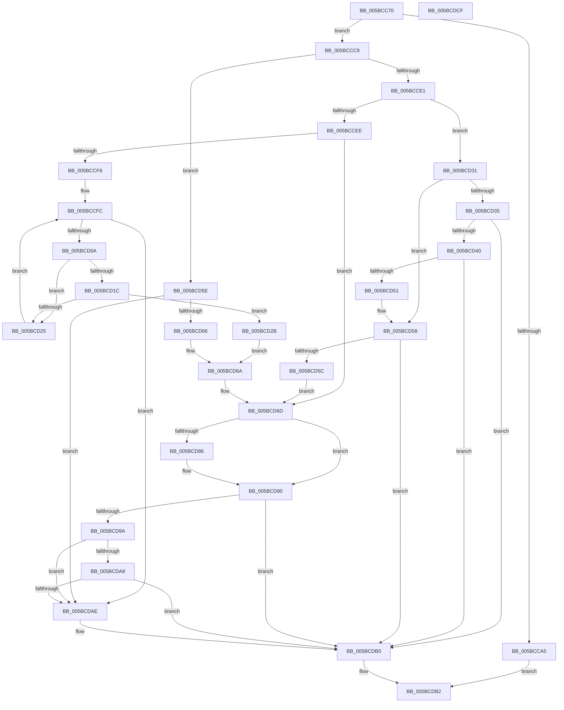

# KiQueryProcessorNode

- RVA: `0x005BCC70`–`0x005BCDD0` (길이 `352` bytes)
- VA: `0x00000001405BCC70`
- 실행 섹션: `.text`
- PDB 이름 있음: `예`; PDB Function 태그: `아니요`
- unwind 정보 RVA: `0x0005D79C`
- 디코드: `100`개 명령, `352/352` bytes 표시
- 미해석 바이트: `0` (있으면 어셈블리에 `.byte`로 보존)

> 이 문서는 커널 이미지의 기계어와 PDB 기호를 분석해 생성했습니다. 4번과 5번은 함수 원형과 자료형을 바이너리 사용 방식에서 추정한 C 해석이며 원본 소스 복구 결과는 아닙니다.

## 1. Dependencies

- 직접 호출 지점: **5**; 고유 호출 대상: **4**
- 직접 호출자로 확인된 함수: **2**
- RIP 상대 이미지 참조: **6**

### Outgoing calls
- `0x005BCCE3` → [guard_dispatch_icall](../6B/guard_dispatch_icall_function_006BAAD0.md) (function, `0x006BAAD0`)
- `0x005BCD1C` → [KiIsNodeFull](KiIsNodeFull_function_005BCBDC.md) (function, `0x005BCBDC`)
- `0x005BCD48` → [KiIsNodeFull](KiIsNodeFull_function_005BCBDC.md) (function, `0x005BCBDC`)
- `0x005BCD8B` → [HvlGetApicIdFromLpIndex](../58/HvlGetApicIdFromLpIndex_function_00584610.md) (function, `0x00584610`)
- `0x005BCD9E` → [HvlpGetLpcbByApicId](../58/HvlpGetLpcbByApicId_function_00585858.md) (function, `0x00585858`)

### Direct callers
- [KiStartDynamicProcessor](../../page/74/KiStartDynamicProcessor_function_007456C8.md) at `0x007457C1`
- [KeStartAllProcessors](../../init/C3/KeStartAllProcessors_function_00C36F78.md) at `0x00C37198`

### Static image references
- `0x005BCC8C` → RVA `0x00FC6A80` (`ALMOSTRO`; read)
- `0x005BCC92` → RVA `0x00000000` (`image boundary/outside`; read)
- `0x005BCCC9` → RVA `0x00F21AE8` (`.data`; read)
- `0x005BCCFC` → RVA `0x00FC5000` (`ALMOSTRO`; read)
- `0x005BCD5E` → RVA `0x00FC5044` (`ALMOSTRO`; read)
- `0x005BCD90` → RVA `0x00FC6A90` (`ALMOSTRO`; read)

## 2. Other-region calls and transfers

- 다른 실행 섹션으로 향하는 call: **0**
- 별도 외부 분기/꼬리 이동을 확인하지 못했습니다.

## 3. Assembly (complete function range)

```asm
005BCC70  48 89 5C 24 10                  mov qword ptr [rsp + 0x10], rbx
005BCC75  48 89 6C 24 18                  mov qword ptr [rsp + 0x18], rbp
005BCC7A  48 89 74 24 20                  mov qword ptr [rsp + 0x20], rsi
005BCC7F  57                              push rdi
005BCC80  41 54                           push r12
005BCC82  41 55                           push r13
005BCC84  41 56                           push r14
005BCC86  41 57                           push r15
005BCC88  48 83 EC 20                     sub rsp, 0x20
005BCC8C  8B 05 EE 9D A0 00               mov eax, dword ptr [rip + 0xa09dee]
005BCC92  4C 8D 35 67 33 A4 FF            lea r14, [rip - 0x5bcc99]
005BCC99  8B E9                           mov ebp, ecx
005BCC9B  49 8B F0                        mov rsi, r8
005BCC9E  4C 8B E2                        mov r12, rdx
005BCCA1  3B C8                           cmp ecx, eax
005BCCA3  73 24                           jae 0x1405bccc9
005BCCA5  0F AE E8                        lfence
005BCCA8  49 8B 84 EE 40 8C FC 00         mov rax, qword ptr [r14 + rbp*8 + 0xfc8c40]
005BCCB0  48 8B 88 C0 00 00 00            mov rcx, qword ptr [rax + 0xc0]
005BCCB7  0F B7 81 8A 00 00 00            movzx eax, word ptr [rcx + 0x8a]
005BCCBE  66 41 89 00                     mov word ptr [r8], ax
005BCCC2  33 C0                           xor eax, eax
005BCCC4  E9 E9 00 00 00                  jmp 0x1405bcdb2
005BCCC9  48 8B 05 18 4E 96 00            mov rax, qword ptr [rip + 0x964e18]
005BCCD0  45 33 ED                        xor r13d, r13d
005BCCD3  45 0F B7 38                     movzx r15d, word ptr [r8]
005BCCD7  BF 25 02 00 C0                  mov edi, 0xc0000225
005BCCDC  48 85 C0                        test rax, rax
005BCCDF  74 7D                           je 0x1405bcd5e
005BCCE1  8B CD                           mov ecx, ebp
005BCCE3  E8 E8 DD 0F 00                  call 0x1406baad0
005BCCE8  8B D8                           mov ebx, eax
005BCCEA  85 C0                           test eax, eax
005BCCEC  75 43                           jne 0x1405bcd31
005BCCEE  B8 FF FF 00 00                  mov eax, 0xffff
005BCCF3  66 39 06                        cmp word ptr [rsi], ax
005BCCF6  75 75                           jne 0x1405bcd6d
005BCCF8  45 0F B7 DD                     movzx r11d, r13w
005BCCFC  66 44 3B 1D FC 82 A0 00         cmp r11w, word ptr [rip + 0xa082fc]
005BCD04  0F 83 A4 00 00 00               jae 0x1405bcdae
005BCD0A  41 0F B7 C3                     movzx eax, r11w
005BCD0E  49 8B 8C C6 C0 F6 FC 00         mov rcx, qword ptr [r14 + rax*8 + 0xfcf6c0]
005BCD16  F6 41 0A 02                     test byte ptr [rcx + 0xa], 2
005BCD1A  74 09                           je 0x1405bcd25
005BCD1C  E8 BB FE FF FF                  call 0x1405bcbdc
005BCD21  84 C0                           test al, al
005BCD23  74 06                           je 0x1405bcd2b
005BCD25  66 41 FF C3                     inc r11w
005BCD29  EB D1                           jmp 0x1405bccfc
005BCD2B  66 44 89 1E                     mov word ptr [rsi], r11w
005BCD2F  EB 39                           jmp 0x1405bcd6a
005BCD31  3B C7                           cmp eax, edi
005BCD33  75 23                           jne 0x1405bcd58
005BCD35  B8 FF FF 00 00                  mov eax, 0xffff
005BCD3A  66 44 3B F8                     cmp r15w, ax
005BCD3E  74 70                           je 0x1405bcdb0
005BCD40  4B 8B 8C FE C0 F6 FC 00         mov rcx, qword ptr [r14 + r15*8 + 0xfcf6c0]
005BCD48  E8 8F FE FF FF                  call 0x1405bcbdc
005BCD4D  84 C0                           test al, al
005BCD4F  75 5F                           jne 0x1405bcdb0
005BCD51  41 8B DD                        mov ebx, r13d
005BCD54  66 44 89 3E                     mov word ptr [rsi], r15w
005BCD58  85 DB                           test ebx, ebx
005BCD5A  75 54                           jne 0x1405bcdb0
005BCD5C  EB 0F                           jmp 0x1405bcd6d
005BCD5E  3B 2D E0 82 A0 00               cmp ebp, dword ptr [rip + 0xa082e0]
005BCD64  73 48                           jae 0x1405bcdae
005BCD66  66 45 89 28                     mov word ptr [r8], r13w
005BCD6A  41 8B DD                        mov ebx, r13d
005BCD6D  0F B7 06                        movzx eax, word ptr [rsi]
005BCD70  49 8B 8C C6 C0 F6 FC 00         mov rcx, qword ptr [r14 + rax*8 + 0xfcf6c0]
005BCD78  F6 41 0A 02                     test byte ptr [rcx + 0xa], 2
005BCD7C  0F 44 DF                        cmove ebx, edi
005BCD7F  41 83 3C 24 FF                  cmp dword ptr [r12], -1
005BCD84  75 0A                           jne 0x1405bcd90
005BCD86  49 8B D4                        mov rdx, r12
005BCD89  8B CD                           mov ecx, ebp
005BCD8B  E8 80 78 FC FF                  call 0x140584610
005BCD90  8B 05 FA 9C A0 00               mov eax, dword ptr [rip + 0xa09cfa]
005BCD96  A8 02                           test al, 2
005BCD98  74 16                           je 0x1405bcdb0
005BCD9A  41 8B 0C 24                     mov ecx, dword ptr [r12]
005BCD9E  E8 B5 8A FC FF                  call 0x140585858
005BCDA3  48 85 C0                        test rax, rax
005BCDA6  74 06                           je 0x1405bcdae
005BCDA8  44 38 68 01                     cmp byte ptr [rax + 1], r13b
005BCDAC  75 02                           jne 0x1405bcdb0
005BCDAE  8B DF                           mov ebx, edi
005BCDB0  8B C3                           mov eax, ebx
005BCDB2  48 8B 5C 24 58                  mov rbx, qword ptr [rsp + 0x58]
005BCDB7  48 8B 6C 24 60                  mov rbp, qword ptr [rsp + 0x60]
005BCDBC  48 8B 74 24 68                  mov rsi, qword ptr [rsp + 0x68]
005BCDC1  48 83 C4 20                     add rsp, 0x20
005BCDC5  41 5F                           pop r15
005BCDC7  41 5E                           pop r14
005BCDC9  41 5D                           pop r13
005BCDCB  41 5C                           pop r12
005BCDCD  5F                              pop rdi
005BCDCE  C3                              ret
005BCDCF  CC                              int3
```

## 4. C-style interpretation (structured pseudocode)

```c
__int64 __fastcall KiQueryProcessorNode(int a1, __int64 a2, __int64 a3)
{
    __int64 result;
    __int64 v_r11;
    __int64 v_r13;
    __int64 v_rbx;
    __int64 v_rsp;
    unsigned __int64 v_stack_p10;
    unsigned __int64 v_stack_p18;
    unsigned __int64 v_stack_p20;

    v_stack_p10 = v_rbx;
    v_stack_p18 = v_rbp;
    v_stack_p20 = v_rsi;
    v_rsp = (v_rsp) - (32);
    if (a1 >= ((unsigned int)((unsigned int)(*(unsigned int *)(v_rip + 10526190))))) goto loc_005BCCC9;
    *(unsigned __int16 *)(a3) = (unsigned __int16)(*(unsigned __int16 *)(*(unsigned __int64 *)(*(unsigned __int64 *)(v_rip - 6016153 + (unsigned int)(a1) * 8 + 16550976) + 192) + 138));
    result = 0;
    goto loc_005BCDB2;
loc_005BCCC9:
    v_r13 = 0;
    if (*(unsigned __int64 *)(v_rip + 9850392) == 0) goto loc_005BCD5E;
    result = guard_dispatch_icall((unsigned int)((unsigned int)((unsigned int)(a1))), a2, a3, a4);
    if ((unsigned int)(result) != 0) goto loc_005BCD31;
    if ((*(unsigned __int16 *)(a3)) != ((unsigned __int16)((unsigned int)(0xFFFFULL)))) goto loc_005BCD6D;
loc_005BCCFC:
    if (0 >= (*(unsigned __int16 *)(v_rip + 10519292))) goto loc_005BCDAE;
    if (((*(unsigned __int8 *)(*(unsigned __int64 *)(v_rip - 6016153 + 0 * 8 + 16578240) + 10)) & (2)) == 0) goto loc_005BCD25;
    result = KiIsNodeFull(*(unsigned __int64 *)(v_rip - 6016153 + 0 * 8 + 16578240), a2, a3, a4);
    if ((unsigned __int8)(result) == 0) goto loc_005BCD2B;
loc_005BCD25:
    v_r11 = (unsigned __int16)((0) + 1);
    goto loc_005BCCFC;
loc_005BCD2B:
    *(unsigned __int16 *)(a3) = (unsigned __int16)(v_r11);
    goto loc_005BCD6A;
loc_005BCD31:
    if (((unsigned int)(result)) != ((unsigned int)((unsigned int)(0xC0000225ULL)))) goto loc_005BCD58;
    if (((unsigned __int16)(*(unsigned __int16 *)(a3))) == ((unsigned __int16)((unsigned int)(0xFFFFULL)))) goto loc_005BCDB0;
    result = KiIsNodeFull(*(unsigned __int64 *)(v_rip - 6016153 + *(unsigned __int16 *)(a3) * 8 + 16578240), a2, a3, a4);
    if ((unsigned __int8)(result) != 0) goto loc_005BCDB0;
    *(unsigned __int16 *)(a3) = (unsigned __int16)(*(unsigned __int16 *)(a3));
loc_005BCD58:
    if (0 != 0) goto loc_005BCDB0;
    goto loc_005BCD6D;
loc_005BCD5E:
    if (((unsigned int)((unsigned int)(a1))) >= (*(unsigned int *)(v_rip + 10519264))) goto loc_005BCDAE;
    *(unsigned __int16 *)(a3) = 0;
loc_005BCD6A:
loc_005BCD6D:
    v_rbx = 0;
    if (((*(unsigned __int8 *)(*(unsigned __int64 *)(v_rip - 6016153 + *(unsigned __int16 *)(a3) * 8 + 16578240) + 10)) & (2)) == 0) { v_rbx = (unsigned int)((unsigned int)(0xC0000225ULL)); }
    result = *(unsigned __int16 *)(a3);
    if ((*(unsigned int *)(a2)) == -1) {
        a2 = a2;
        a1 = (unsigned int)((unsigned int)(a1));
        result = HvlGetApicIdFromLpIndex(a1, a2, a3, a4);
    }
    if ((((unsigned __int8)((unsigned int)(*(unsigned int *)(v_rip + 10525946)))) & (2)) == 0) goto loc_005BCDB0;
    result = HvlpGetLpcbByApicId((unsigned int)(*(unsigned int *)(a2)), a2, a3, a4);
    if (result == 0) goto loc_005BCDAE;
    if ((*(unsigned __int8 *)(result + 1)) == 0) {
        v_rbx = (unsigned int)((unsigned int)(0xC0000225ULL));
    }
loc_005BCDB2:
    v_rsp = (v_rsp) + (32);
    return (unsigned int)((unsigned int)(v_rbx));
}
```

## 5. (Beta) C Style

```c
int64_t KiQueryProcessorNode(int32_t Arg1, void *Arg2, void *Arg3)
{
    uint8_t *arg2 = (uint8_t *)Arg2;
    uint8_t *arg3 = (uint8_t *)Arg3;

    int64_t result;
    int64_t local_r11;
    int64_t local_r13;
    int64_t local_rbx;
    int64_t local_rsp;
    uint64_t v_stack_p10;
    uint64_t v_stack_p18;
    uint64_t v_stack_p20;

    v_stack_p10 = local_rbx;
    v_stack_p18 = local_rbp;
    v_stack_p20 = local_rsi;
    local_rsp = (local_rsp) - (32);
    if (Arg1 >= ((uint32_t)((uint32_t)(*(uint32_t *)(v_rip + 0xA09DEE))))) goto loc_005BCCC9;
    *(uint16_t *)(arg3) = (uint16_t)(*(uint16_t *)(*(uint64_t *)(*(uint64_t *)(v_rip - 0x5BCC99 + (uint32_t)(Arg1) * 8 + 0xFC8C40) + 0xC0) + 0x8A));
    result = 0;
    goto loc_005BCDB2;
loc_005BCCC9:
    local_r13 = 0;
    if (*(uint64_t *)(v_rip + 0x964E18) == 0) goto loc_005BCD5E;
    result = guard_dispatch_icall((uint32_t)((uint32_t)((uint32_t)(Arg1))), Arg2, Arg3, a4);
    if ((uint32_t)(result) != 0) goto loc_005BCD31;
    if ((*(uint16_t *)(arg3)) != ((uint16_t)((uint32_t)(0xFFFFULL)))) goto loc_005BCD6D;
loc_005BCCFC:
    if (0 >= (*(uint16_t *)(v_rip + 0xA082FC))) goto loc_005BCDAE;
    if (((*(uint8_t *)(*(uint64_t *)(v_rip - 0x5BCC99 + 0x0 * 8 + 0xFCF6C0) + 0xA)) & (2)) == 0) goto loc_005BCD25;
    result = KiIsNodeFull(*(uint64_t *)(v_rip - 0x5BCC99 + 0x0 * 8 + 0xFCF6C0), Arg2, Arg3, a4);
    if ((uint8_t)(result) == 0) goto loc_005BCD2B;
loc_005BCD25:
    local_r11 = (uint16_t)((0) + 1);
    goto loc_005BCCFC;
loc_005BCD2B:
    *(uint16_t *)(arg3) = (uint16_t)(local_r11);
    goto loc_005BCD6A;
loc_005BCD31:
    if (((uint32_t)(result)) != ((uint32_t)((uint32_t)(0xC0000225ULL)))) goto loc_005BCD58;
    if (((uint16_t)(*(uint16_t *)(arg3))) == ((uint16_t)((uint32_t)(0xFFFFULL)))) goto loc_005BCDB0;
    result = KiIsNodeFull(*(uint64_t *)(v_rip - 0x5BCC99 + *(uint16_t *)(arg3) * 8 + 0xFCF6C0), Arg2, Arg3, a4);
    if ((uint8_t)(result) != 0) goto loc_005BCDB0;
    *(uint16_t *)(arg3) = (uint16_t)(*(uint16_t *)(arg3));
loc_005BCD58:
    if (0 != 0) goto loc_005BCDB0;
    goto loc_005BCD6D;
loc_005BCD5E:
    if (((uint32_t)((uint32_t)(Arg1))) >= (*(uint32_t *)(v_rip + 0xA082E0))) goto loc_005BCDAE;
    *(uint16_t *)(arg3) = 0;
loc_005BCD6A:
loc_005BCD6D:
    local_rbx = 0;
    if (((*(uint8_t *)(*(uint64_t *)(v_rip - 0x5BCC99 + *(uint16_t *)(arg3) * 8 + 0xFCF6C0) + 0xA)) & (2)) == 0) { local_rbx = (uint32_t)((uint32_t)(0xC0000225ULL)); }
    result = *(uint16_t *)(arg3);
    if ((*(uint32_t *)(arg2)) == -1) {
        Arg2 = Arg2;
        Arg1 = (uint32_t)((uint32_t)(Arg1));
        result = HvlGetApicIdFromLpIndex(Arg1, Arg2, Arg3, a4);
    }
    if ((((uint8_t)((uint32_t)(*(uint32_t *)(v_rip + 0xA09CFA)))) & (2)) == 0) goto loc_005BCDB0;
    result = HvlpGetLpcbByApicId((uint32_t)(*(uint32_t *)(arg2)), Arg2, Arg3, a4);
    if (result == 0) goto loc_005BCDAE;
    if ((*(uint8_t *)(result + 0x1)) == 0) {
        local_rbx = (uint32_t)((uint32_t)(0xC0000225ULL));
    }
loc_005BCDB2:
    local_rsp = (local_rsp) + (32);
    return (uint32_t)((uint32_t)(local_rbx));
}
```

### 관측된 메모리 오프셋

구조체 형식이 확인되지 않은 접근은 인자 기준의 오프셋으로만 기록했습니다.

| 기준 인자 | 오프셋 표현 | 폭 (bit) | 접근 |
|---|---:|---:|---|
| `Arg2` | `+ 0x0` | `32` | `R` |
| `Arg3` | `+ 0x0` | `16` | `R` |
| `Arg3` | `+ 0x0` | `16` | `W` |

## 6. Execution-region graph

[열기: 2D/3D 그래프와 함수 탐색 컨트롤 패널](../../../control-panel.html?section=text&rva=0x005BCC70&view=graph)

- 2D 그래프는 위에서 아래로 흐르고, 3D 그래프는 빈 공간을 드래그해 회전합니다. Shift+드래그는 이동, 휠은 확대·축소, 함수 노드 선택은 대상 보고서 이동입니다.

### Static fallback


