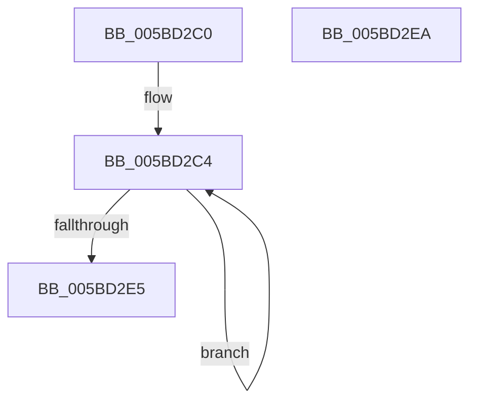

# KiRcuFlushCompletedWorkerRoutine

- RVA: `0x005BD2C0`–`0x005BD2EB` (길이 `43` bytes)
- VA: `0x00000001405BD2C0`
- 실행 섹션: `.text`
- PDB 이름 있음: `예`; PDB Function 태그: `아니요`
- unwind 정보 RVA: `0x0005C788`
- 디코드: `11`개 명령, `43/43` bytes 표시
- 미해석 바이트: `0` (있으면 어셈블리에 `.byte`로 보존)

> 이 문서는 커널 이미지의 기계어와 PDB 기호를 분석해 생성했습니다. 4번과 5번은 함수 원형과 자료형을 바이너리 사용 방식에서 추정한 C 해석이며 원본 소스 복구 결과는 아닙니다.

## 1. Dependencies

- 직접 호출 지점: **1**; 고유 호출 대상: **1**
- 직접 호출자로 확인된 함수: **0**
- RIP 상대 이미지 참조: **2**

### Outgoing calls
- `0x005BD2D1` → [KiRcuFlushCompleted](../20/KiRcuFlushCompleted_function_0020AD38.md) (function, `0x0020AD38`)

### Direct callers
- 이 함수 시작 RVA로 연결되는 직접 call은 확인되지 않았습니다. 간접 호출은 완전히 역산할 수 없습니다.

### Static image references
- `0x005BD2C4` → RVA `0x00F21160` (`.data`; read/write)
- `0x005BD2DB` → RVA `0x00F21160` (`.data`; read)

## 2. Other-region calls and transfers

- 다른 실행 섹션으로 향하는 call: **0**
- 별도 외부 분기/꼬리 이동을 확인하지 못했습니다.

## 3. Assembly (complete function range)

```asm
005BD2C0  48 83 EC 28                     sub rsp, 0x28
005BD2C4  F0 83 25 94 3E 96 00 FD         lock and dword ptr [rip + 0x963e94], 0xfffffffd
005BD2CC  B9 01 00 00 00                  mov ecx, 1
005BD2D1  E8 62 DA C4 FF                  call 0x14020ad38
005BD2D6  33 C9                           xor ecx, ecx
005BD2D8  8D 41 01                        lea eax, [rcx + 1]
005BD2DB  F0 0F B1 0D 7D 3E 96 00         lock cmpxchg dword ptr [rip + 0x963e7d], ecx
005BD2E3  75 DF                           jne 0x1405bd2c4
005BD2E5  48 83 C4 28                     add rsp, 0x28
005BD2E9  C3                              ret
005BD2EA  CC                              int3
```

## 4. C-style interpretation (structured pseudocode)

```c
__int64 __fastcall KiRcuFlushCompletedWorkerRoutine(void)
{
    __int64 result;
    __int64 v_rsp;

    v_rsp = (v_rsp) - (40);
loc_005BD2C4:
    result = KiRcuFlushCompleted(1, a2, a3, a4);
    a1 = 0;
    if (condition_is_not_equal) goto loc_005BD2C4;
    v_rsp = (v_rsp) + (40);
    return a1 + 1;
}
```

## 5. (Beta) C Style

```c
void KiRcuFlushCompletedWorkerRoutine(void)
{
    int64_t result;
    int64_t local_rsp;

    local_rsp = (local_rsp) - (40);
loc_005BD2C4:
    result = KiRcuFlushCompleted(1, a2, a3, a4);
    a1 = 0;
    if (condition_is_not_equal) goto loc_005BD2C4;
    local_rsp = (local_rsp) + (40);
    return a1 + 1;
}
```

## 6. Execution-region graph

[열기: 2D/3D 그래프와 함수 탐색 컨트롤 패널](../../../control-panel.html?section=text&rva=0x005BD2C0&view=graph)

- 2D 그래프는 위에서 아래로 흐르고, 3D 그래프는 빈 공간을 드래그해 회전합니다. Shift+드래그는 이동, 휠은 확대·축소, 함수 노드 선택은 대상 보고서 이동입니다.

### Static fallback


