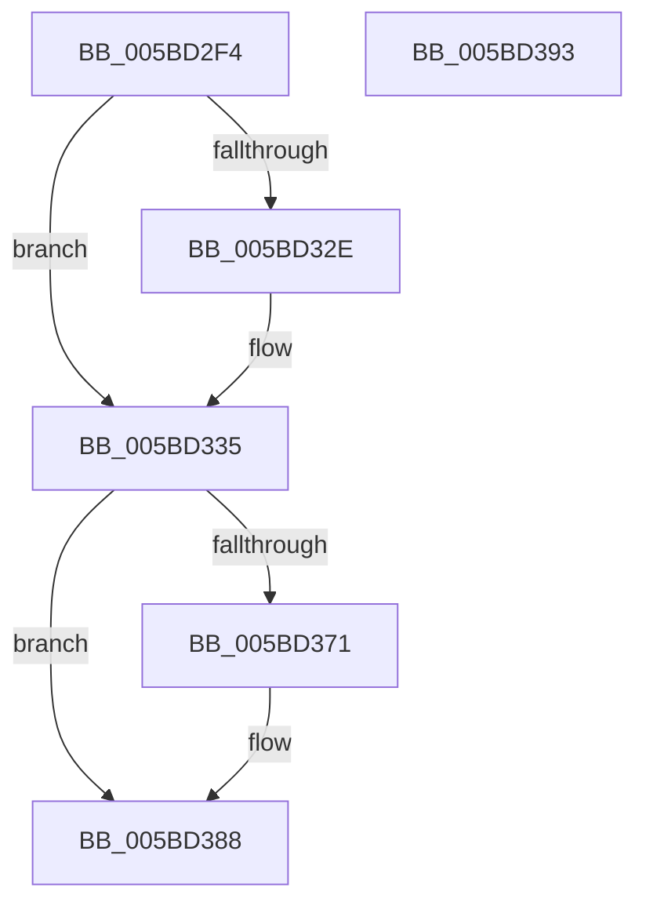

# KiRcuStartGracePeriod

- RVA: `0x005BD2F4`–`0x005BD394` (길이 `160` bytes)
- VA: `0x00000001405BD2F4`
- 실행 섹션: `.text`
- PDB 이름 있음: `예`; PDB Function 태그: `아니요`
- unwind 정보 RVA: `0x00068D5C`
- 디코드: `40`개 명령, `160/160` bytes 표시
- 미해석 바이트: `0` (있으면 어셈블리에 `.byte`로 보존)

> 이 문서는 커널 이미지의 기계어와 PDB 기호를 분석해 생성했습니다. 4번과 5번은 함수 원형과 자료형을 바이너리 사용 방식에서 추정한 C 해석이며 원본 소스 복구 결과는 아닙니다.

## 1. Dependencies

- 직접 호출 지점: **4**; 고유 호출 대상: **4**
- 직접 호출자로 확인된 함수: **3**
- RIP 상대 이미지 참조: **6**

### Outgoing calls
- `0x005BD308` → [KeAcquireSpinLockRaiseToDpc](../20/KeAcquireSpinLockRaiseToDpc_function_00208470.md) (function, `0x00208470`)
- `0x005BD356` → [KeReleaseSpinLock](../39/KeReleaseSpinLock_function_00392BA0.md) (function, `0x00392BA0`)
- `0x005BD366` → [KiRcuForEachParticipatingCpu](../4D/KiRcuForEachParticipatingCpu_function_004D0FE4.md) (function, `0x004D0FE4`)
- `0x005BD383` → [KiRcuFlushCompleted](../20/KiRcuFlushCompleted_function_0020AD38.md) (function, `0x0020AD38`)

### Direct callers
- [KeRcuFreePool](KeRcuFreePool_function_005BD260.md) at `0x005BD281`
- [sub_006E53AC](../6E/Unknown_function_006E53AC.md) at `0x006E53EC`
- [KeRcuSynchronize](../../page/74/KeRcuSynchronize_function_00746450.md) at `0x00746493`

### Static image references
- `0x005BD301` → RVA `0x00F210D8` (`.data`; read)
- `0x005BD30D` → RVA `0x00F210E8` (`.data`; read)
- `0x005BD314` → RVA `0x00F210F0` (`.data`; read)
- `0x005BD322` → RVA `0x00F210F8` (`.data`; read)
- `0x005BD346` → RVA `0x00F210F8` (`.data`; write)
- `0x005BD34D` → RVA `0x00F210E8` (`.data`; write)

## 2. Other-region calls and transfers

- 다른 실행 섹션으로 향하는 call: **0**
- 별도 외부 분기/꼬리 이동을 확인하지 못했습니다.

## 3. Assembly (complete function range)

```asm
005BD2F4  48 89 5C 24 10                  mov qword ptr [rsp + 0x10], rbx
005BD2F9  57                              push rdi
005BD2FA  48 83 EC 20                     sub rsp, 0x20
005BD2FE  48 8B D9                        mov rbx, rcx
005BD301  48 8D 0D D0 3D 96 00            lea rcx, [rip + 0x963dd0]
005BD308  E8 63 B1 C4 FF                  call 0x140208470
005BD30D  48 8B 15 D4 3D 96 00            mov rdx, qword ptr [rip + 0x963dd4]
005BD314  4C 8D 05 D5 3D 96 00            lea r8, [rip + 0x963dd5]
005BD31B  48 FF C2                        inc rdx
005BD31E  48 89 53 10                     mov qword ptr [rbx + 0x10], rdx
005BD322  48 8B 0D CF 3D 96 00            mov rcx, qword ptr [rip + 0x963dcf]
005BD329  4C 39 01                        cmp qword ptr [rcx], r8
005BD32C  74 07                           je 0x1405bd335
005BD32E  B9 03 00 00 00                  mov ecx, 3
005BD333  CD 29                           int 0x29
005BD335  48 89 4B 08                     mov qword ptr [rbx + 8], rcx
005BD339  4C 89 03                        mov qword ptr [rbx], r8
005BD33C  48 89 19                        mov qword ptr [rcx], rbx
005BD33F  48 8D 0D 92 3D 96 00            lea rcx, [rip + 0x963d92]
005BD346  48 89 1D AB 3D 96 00            mov qword ptr [rip + 0x963dab], rbx
005BD34D  48 89 15 94 3D 96 00            mov qword ptr [rip + 0x963d94], rdx
005BD354  8A D0                           mov dl, al
005BD356  E8 45 58 DD FF                  call 0x140392ba0
005BD35B  33 FF                           xor edi, edi
005BD35D  48 8D 54 24 30                  lea rdx, [rsp + 0x30]
005BD362  89 7C 24 30                     mov dword ptr [rsp + 0x30], edi
005BD366  E8 79 3C F1 FF                  call 0x1404d0fe4
005BD36B  39 7C 24 30                     cmp dword ptr [rsp + 0x30], edi
005BD36F  74 17                           je 0x1405bd388
005BD371  48 8B 43 18                     mov rax, qword ptr [rbx + 0x18]
005BD375  48 83 E0 FC                     and rax, 0xfffffffffffffffc
005BD379  48 83 F8 08                     cmp rax, 8
005BD37D  40 0F 92 C7                     setb dil
005BD381  8B CF                           mov ecx, edi
005BD383  E8 B0 D9 C4 FF                  call 0x14020ad38
005BD388  48 8B 5C 24 38                  mov rbx, qword ptr [rsp + 0x38]
005BD38D  48 83 C4 20                     add rsp, 0x20
005BD391  5F                              pop rdi
005BD392  C3                              ret
005BD393  CC                              int3
```

## 4. C-style interpretation (structured pseudocode)

```c
__int64 __fastcall KiRcuStartGracePeriod(__int64 a1)
{
    __int64 result;
    __int64 v_rdi;
    __int64 v_rsp;
    unsigned __int64 v_stack_p10;
    unsigned __int64 v_stack_p8;

    v_stack_p10 = v_rbx;
    v_rsp = (v_rsp) - (32);
    result = KeAcquireSpinLockRaiseToDpc(v_rip + 9846224, a2, a3, a4);
    a2 = (*(unsigned __int64 *)(v_rip + 9846228)) + 1;
    *(unsigned __int64 *)(a1 + 16) = a2;
    if ((*(unsigned __int64 *)(*(unsigned __int64 *)(v_rip + 9846223))) != (v_rip + 9846229)) {
        a1 = 3;
    }
    *(unsigned __int64 *)(a1 + 8) = a1;
    *(unsigned __int64 *)(a1) = v_rip + 9846229;
    *(unsigned __int64 *)(a1) = a1;
    *(unsigned __int64 *)(v_rip + 9846187) = a1;
    *(unsigned __int64 *)(v_rip + 9846164) = a2;
    result = KeReleaseSpinLock(v_rip + 9846162, (unsigned __int8)(result), v_rip + 9846229, a4);
    v_rdi = 0;
    v_stack_p8 = 0;
    result = KiRcuForEachParticipatingCpu(v_rip + 9846162, v_stack_p8, v_rip + 9846229, a4);
    if (v_stack_p8 != 0) {
        result = *(unsigned __int64 *)(a1 + 24);
        result = (result) & (-4);
        v_rdi = (result < 8) ? 1 : 0;
        a1 = (unsigned int)(v_rdi);
        result = KiRcuFlushCompleted(a1, v_stack_p8, v_rip + 9846229, a4);
    }
    v_rsp = (v_rsp) + (32);
    return result;
}
```

## 5. (Beta) C Style

```c
int64_t KiRcuStartGracePeriod(void *Arg1)
{
    uint8_t *arg1 = (uint8_t *)Arg1;

    int64_t result;
    int64_t local_rdi;
    int64_t local_rsp;
    uint64_t v_stack_p10;
    uint64_t v_stack_p8;

    v_stack_p10 = local_rbx;
    local_rsp = (local_rsp) - (32);
    result = KeAcquireSpinLockRaiseToDpc(v_rip + 9846224, a2, a3, a4);
    a2 = (*(uint64_t *)(v_rip + 0x963DD4)) + 1;
    *(uint64_t *)(arg1 + 0x10) = a2;
    if ((*(uint64_t *)(*(uint64_t *)(v_rip + 0x963DCF))) != (v_rip + 9846229)) {
        Arg1 = 3;
    }
    *(void **)(arg1 + 0x8) = Arg1;
    *(uint64_t *)(arg1) = v_rip + 9846229;
    *(void **)(arg1) = Arg1;
    *(void **)(v_rip + 0x963DAB) = Arg1;
    *(uint64_t *)(v_rip + 0x963D94) = a2;
    result = KeReleaseSpinLock(v_rip + 9846162, (uint8_t)(result), v_rip + 9846229, a4);
    local_rdi = 0;
    v_stack_p8 = 0;
    result = KiRcuForEachParticipatingCpu(v_rip + 9846162, v_stack_p8, v_rip + 9846229, a4);
    if (v_stack_p8 != 0) {
        result = *(uint64_t *)(arg1 + 0x18);
        result = (result) & (-4);
        local_rdi = (result < 8) ? 1 : 0;
        Arg1 = (uint32_t)(local_rdi);
        result = KiRcuFlushCompleted(Arg1, v_stack_p8, v_rip + 9846229, a4);
    }
    local_rsp = (local_rsp) + (32);
    return result;
}
```

### 관측된 메모리 오프셋

구조체 형식이 확인되지 않은 접근은 인자 기준의 오프셋으로만 기록했습니다.

| 기준 인자 | 오프셋 표현 | 폭 (bit) | 접근 |
|---|---:|---:|---|
| `Arg1` | `+ 0x0` | `64` | `W` |
| `Arg1` | `+ 0x8` | `64` | `W` |
| `Arg1` | `+ 0x10` | `64` | `W` |
| `Arg1` | `+ 0x18` | `64` | `R` |

## 6. Execution-region graph

[열기: 2D/3D 그래프와 함수 탐색 컨트롤 패널](../../../control-panel.html?section=text&rva=0x005BD2F4&view=graph)

- 2D 그래프는 위에서 아래로 흐르고, 3D 그래프는 빈 공간을 드래그해 회전합니다. Shift+드래그는 이동, 휠은 확대·축소, 함수 노드 선택은 대상 보고서 이동입니다.

### Static fallback


