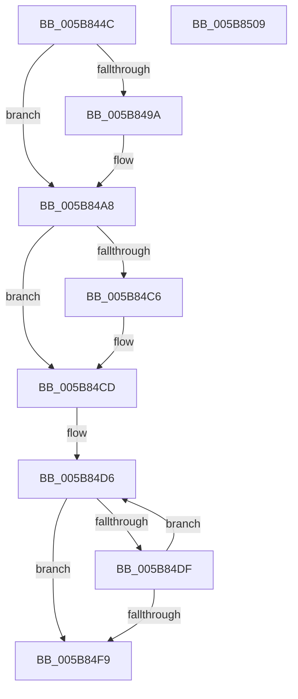

# KiReconfigureSubNodeSchedulingInformation

- RVA: `0x005B844C`–`0x005B850A` (길이 `190` bytes)
- VA: `0x00000001405B844C`
- 실행 섹션: `.text`
- PDB 이름 있음: `예`; PDB Function 태그: `아니요`
- unwind 정보 RVA: `0x00060BC4`
- 디코드: `42`개 명령, `190/190` bytes 표시
- 미해석 바이트: `0` (있으면 어셈블리에 `.byte`로 보존)

> 이 문서는 커널 이미지의 기계어와 PDB 기호를 분석해 생성했습니다. 4번과 5번은 함수 원형과 자료형을 바이너리 사용 방식에서 추정한 C 해석이며 원본 소스 복구 결과는 아닙니다.

## 1. Dependencies

- 직접 호출 지점: **1**; 고유 호출 대상: **1**
- 직접 호출자로 확인된 함수: **1**
- RIP 상대 이미지 참조: **1**

### Outgoing calls
- `0x005B84E9` → [KiRegisterProcessorWithCooperativeIdleSearchContext](../5C/KiRegisterProcessorWithCooperativeIdleSearchContext_function_005C8F30.md) (function, `0x005C8F30`)

### Direct callers
- [KiInitializeDynamicProcessorDpc](../../pagelk/B6/KiInitializeDynamicProcessorDpc_function_00B67A30.md) at `0x00B67BBB`

### Static image references
- `0x005B846C` → RVA `0x00FC8830` (`ALMOSTRO`; read)

## 2. Other-region calls and transfers

- 다른 실행 섹션으로 향하는 call: **0**
- 별도 외부 분기/꼬리 이동을 확인하지 못했습니다.

## 3. Assembly (complete function range)

```asm
005B844C  48 89 5C 24 08                  mov qword ptr [rsp + 8], rbx
005B8451  48 89 74 24 10                  mov qword ptr [rsp + 0x10], rsi
005B8456  57                              push rdi
005B8457  48 83 EC 20                     sub rsp, 0x20
005B845B  48 8B 82 C8 00 00 00            mov rax, qword ptr [rdx + 0xc8]
005B8462  48 8B DA                        mov rbx, rdx
005B8465  48 09 81 A0 00 00 00            or qword ptr [rcx + 0xa0], rax
005B846C  48 8D 15 BD 03 A1 00            lea rdx, [rip + 0xa103bd]
005B8473  44 0F B7 81 88 00 00 00         movzx r8d, word ptr [rcx + 0x88]
005B847B  49 C1 E0 05                     shl r8, 5
005B847F  48 8B 83 C8 00 00 00            mov rax, qword ptr [rbx + 0xc8]
005B8486  49 09 04 10                     or qword ptr [r8 + rdx], rax
005B848A  48 8B 91 A8 00 00 00            mov rdx, qword ptr [rcx + 0xa8]
005B8491  48 85 93 70 8E 00 00            test qword ptr [rbx + 0x8e70], rdx
005B8498  75 0E                           jne 0x1405b84a8
005B849A  48 0B 93 C8 00 00 00            or rdx, qword ptr [rbx + 0xc8]
005B84A1  48 89 91 A8 00 00 00            mov qword ptr [rcx + 0xa8], rdx
005B84A8  48 8B 83 40 8E 00 00            mov rax, qword ptr [rbx + 0x8e40]
005B84AF  48 09 81 98 00 00 00            or qword ptr [rcx + 0x98], rax
005B84B6  48 8B 83 C8 00 00 00            mov rax, qword ptr [rbx + 0xc8]
005B84BD  48 39 83 60 8E 00 00            cmp qword ptr [rbx + 0x8e60], rax
005B84C4  74 07                           je 0x1405b84cd
005B84C6  80 89 B8 00 00 00 01            or byte ptr [rcx + 0xb8], 1
005B84CD  33 F6                           xor esi, esi
005B84CF  48 8D BB 18 94 00 00            lea rdi, [rbx + 0x9418]
005B84D6  48 8B 4F F0                     mov rcx, qword ptr [rdi - 0x10]
005B84DA  48 85 C9                        test rcx, rcx
005B84DD  74 1A                           je 0x1405b84f9
005B84DF  4C 8B 47 10                     mov r8, qword ptr [rdi + 0x10]
005B84E3  48 8B D3                        mov rdx, rbx
005B84E6  48 89 0F                        mov qword ptr [rdi], rcx
005B84E9  E8 42 0A 01 00                  call 0x1405c8f30
005B84EE  FF C6                           inc esi
005B84F0  48 83 C7 08                     add rdi, 8
005B84F4  83 FE 02                        cmp esi, 2
005B84F7  72 DD                           jb 0x1405b84d6
005B84F9  48 8B 5C 24 30                  mov rbx, qword ptr [rsp + 0x30]
005B84FE  48 8B 74 24 38                  mov rsi, qword ptr [rsp + 0x38]
005B8503  48 83 C4 20                     add rsp, 0x20
005B8507  5F                              pop rdi
005B8508  C3                              ret
005B8509  CC                              int3
```

## 4. C-style interpretation (structured pseudocode)

```c
__int64 __fastcall KiReconfigureSubNodeSchedulingInformation(__int64 a1, __int64 a2)
{
    __int64 result;
    __int64 v_rdi;
    __int64 v_rsi;
    __int64 v_rsp;
    unsigned __int64 v_stack_p10;
    unsigned __int64 v_stack_p8;

    v_stack_p8 = v_rbx;
    v_stack_p10 = v_rsi;
    v_rsp = (v_rsp) - (32);
    a3 = (*(unsigned __int16 *)(a1 + 136)) << (5);
    if (((*(unsigned __int64 *)(a2 + 36464)) & (*(unsigned __int64 *)(a1 + 168))) == 0) {
        a2 = (*(unsigned __int64 *)(a1 + 168)) | (*(unsigned __int64 *)(a2 + 200));
        *(unsigned __int64 *)(a1 + 168) = a2;
    }
    if ((*(unsigned __int64 *)(a2 + 36448)) != (*(unsigned __int64 *)(a2 + 200))) {
    }
    v_rsi = 0;
loc_005B84D6:
    if (*(unsigned __int64 *)(a2 + 37912 - 16) == 0) goto loc_005B84F9;
    *(unsigned __int64 *)(a2 + 37912) = *(unsigned __int64 *)(a2 + 37912 - 16);
    result = KiRegisterProcessorWithCooperativeIdleSearchContext(*(unsigned __int64 *)(a2 + 37912 - 16), a2, *(unsigned __int64 *)(a2 + 37912 + 16), a4);
    v_rsi = (unsigned int)((v_rsi) + 1);
    v_rdi = (a2 + 37912) + (8);
    if (((unsigned int)(v_rsi)) < 2) goto loc_005B84D6;
loc_005B84F9:
    v_rsp = (v_rsp) + (32);
    return result;
}
```

## 5. (Beta) C Style

```c
int64_t KiReconfigureSubNodeSchedulingInformation(void *Arg1, void *Arg2)
{
    uint8_t *arg1 = (uint8_t *)Arg1;
    uint8_t *arg2 = (uint8_t *)Arg2;

    int64_t result;
    int64_t local_rdi;
    int64_t local_rsi;
    int64_t local_rsp;
    uint64_t v_stack_p10;
    uint64_t v_stack_p8;

    v_stack_p8 = local_rbx;
    v_stack_p10 = local_rsi;
    local_rsp = (local_rsp) - (32);
    a3 = (*(uint16_t *)(arg1 + 0x88)) << (5);
    if (((*(uint64_t *)(arg2 + 0x8E70)) & (*(uint64_t *)(arg1 + 0xA8))) == 0) {
        Arg2 = (*(uint64_t *)(arg1 + 0xA8)) | (*(uint64_t *)(arg2 + 0xC8));
        *(void **)(arg1 + 0xA8) = Arg2;
    }
    if ((*(uint64_t *)(arg2 + 0x8E60)) != (*(uint64_t *)(arg2 + 0xC8))) {
    }
    local_rsi = 0;
loc_005B84D6:
    if (*(uint64_t *)(arg2 + 0x9418 - 0x10) == 0) goto loc_005B84F9;
    *(uint64_t *)(arg2 + 0x9418) = *(uint64_t *)(arg2 + 0x9418 - 0x10);
    result = KiRegisterProcessorWithCooperativeIdleSearchContext(*(uint64_t *)(arg2 + 0x9418 - 0x10), Arg2, *(uint64_t *)(arg2 + 0x9418 + 0x10), a4);
    local_rsi = (uint32_t)((local_rsi) + 1);
    local_rdi = (Arg2 + 37912) + (8);
    if (((uint32_t)(local_rsi)) < 2) goto loc_005B84D6;
loc_005B84F9:
    local_rsp = (local_rsp) + (32);
    return result;
}
```

### 관측된 메모리 오프셋

구조체 형식이 확인되지 않은 접근은 인자 기준의 오프셋으로만 기록했습니다.

| 기준 인자 | 오프셋 표현 | 폭 (bit) | 접근 |
|---|---:|---:|---|
| `Arg1` | `+ 0x88` | `16` | `R` |
| `Arg1` | `+ 0x98` | `64` | `R/W` |
| `Arg1` | `+ 0xA0` | `64` | `R/W` |
| `Arg1` | `+ 0xA8` | `64` | `R` |
| `Arg1` | `+ 0xA8` | `64` | `W` |
| `Arg1` | `+ 0xB8` | `8` | `R/W` |
| `Arg2` | `- 0x10` | `64` | `R` |
| `Arg2` | `+ 0x0` | `64` | `W` |
| `Arg2` | `+ 0x10` | `64` | `R` |
| `Arg2` | `+ 0xC8` | `64` | `R` |
| `Arg2` | `+ 0x8E40` | `64` | `R` |
| `Arg2` | `+ 0x8E60` | `64` | `R` |
| `Arg2` | `+ 0x8E70` | `64` | `R` |
| `Arg2` | `+ 0x9418` | `64` | `R` |

## 6. Execution-region graph

[열기: 2D/3D 그래프와 함수 탐색 컨트롤 패널](../../../control-panel.html?section=text&rva=0x005B844C&view=graph)

- 2D 그래프는 위에서 아래로 흐르고, 3D 그래프는 빈 공간을 드래그해 회전합니다. Shift+드래그는 이동, 휠은 확대·축소, 함수 노드 선택은 대상 보고서 이동입니다.

### Static fallback


