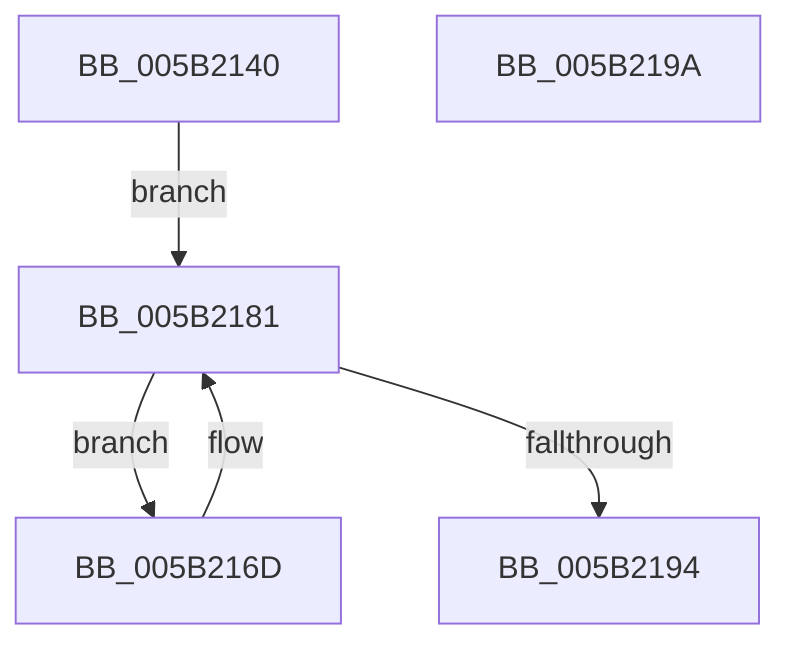

# KiReleasePrcbLocksForGroupAffinity

- RVA: `0x005B2140`–`0x005B219B` (길이 `91` bytes)
- VA: `0x00000001405B2140`
- 실행 섹션: `.text`
- PDB 이름 있음: `예`; PDB Function 태그: `아니요`
- unwind 정보 RVA: `0x000697A4`
- 디코드: `25`개 명령, `91/91` bytes 표시
- 미해석 바이트: `0` (있으면 어셈블리에 `.byte`로 보존)

> 이 문서는 커널 이미지의 기계어와 PDB 기호를 분석해 생성했습니다. 4번과 5번은 함수 원형과 자료형을 바이너리 사용 방식에서 추정한 C 해석이며 원본 소스 복구 결과는 아닙니다.

## 1. Dependencies

- 직접 호출 지점: **1**; 고유 호출 대상: **1**
- 직접 호출자로 확인된 함수: **1**
- RIP 상대 이미지 참조: **1**

### Outgoing calls
- `0x005B218B` → [KeEnumerateNextProcessor](../41/KeEnumerateNextProcessor_function_00415480.md) (function, `0x00415480`)

### Direct callers
- [KiCompleteKernelInit](../../pagelk/B6/KiCompleteKernelInit_function_00B66090.md) at `0x00B66359`

### Static image references
- `0x005B2171` → RVA `0x00FC8C40` (`ALMOSTRO`; read)

## 2. Other-region calls and transfers

- 다른 실행 섹션으로 향하는 call: **0**
- 별도 외부 분기/꼬리 이동을 확인하지 못했습니다.

## 3. Assembly (complete function range)

```asm
005B2140  40 53                           push rbx
005B2142  48 83 EC 40                     sub rsp, 0x40
005B2146  48 8B 11                        mov rdx, qword ptr [rcx]
005B2149  33 DB                           xor ebx, ebx
005B214B  0F B7 41 08                     movzx eax, word ptr [rcx + 8]
005B214F  89 5C 24 32                     mov dword ptr [rsp + 0x32], ebx
005B2153  66 89 5C 24 36                  mov word ptr [rsp + 0x36], bx
005B2158  89 5C 24 50                     mov dword ptr [rsp + 0x50], ebx
005B215C  66 89 44 24 30                  mov word ptr [rsp + 0x30], ax
005B2161  48 89 54 24 28                  mov qword ptr [rsp + 0x28], rdx
005B2166  48 89 5C 24 20                  mov qword ptr [rsp + 0x20], rbx
005B216B  EB 14                           jmp 0x1405b2181
005B216D  8B 44 24 50                     mov eax, dword ptr [rsp + 0x50]
005B2171  48 8D 0D C8 6A A1 00            lea rcx, [rip + 0xa16ac8]
005B2178  48 8B 0C C1                     mov rcx, qword ptr [rcx + rax*8]
005B217C  F0 48 21 59 30                  lock and qword ptr [rcx + 0x30], rbx
005B2181  48 8D 54 24 20                  lea rdx, [rsp + 0x20]
005B2186  48 8D 4C 24 50                  lea rcx, [rsp + 0x50]
005B218B  E8 F0 32 E6 FF                  call 0x140415480
005B2190  85 C0                           test eax, eax
005B2192  74 D9                           je 0x1405b216d
005B2194  48 83 C4 40                     add rsp, 0x40
005B2198  5B                              pop rbx
005B2199  C3                              ret
005B219A  CC                              int3
```

## 4. C-style interpretation (structured pseudocode)

```c
__int64 __fastcall KiReleasePrcbLocksForGroupAffinity(__int64 a1)
{
    __int64 result;
    __int64 v_rbx;
    __int64 v_rsp;
    unsigned __int16 v_stack_m12;
    unsigned int v_stack_m16;
    unsigned __int16 v_stack_m18;
    unsigned __int64 v_stack_m20;
    unsigned __int64 v_stack_m28;
    unsigned int v_stack_p8;

    v_rsp = (v_rsp) - (64);
    v_rbx = 0;
    v_stack_m16 = 0;
    v_stack_m12 = 0;
    v_stack_p8 = 0;
    v_stack_m18 = (unsigned __int16)(*(unsigned __int16 *)(a1 + 8));
    v_stack_m20 = *(unsigned __int64 *)(a1);
    v_stack_m28 = 0;
    goto loc_005B2181;
loc_005B216D:
loc_005B2181:
    result = KeEnumerateNextProcessor(v_stack_p8, v_stack_m28, a3, a4);
    if ((unsigned int)(result) == 0) goto loc_005B216D;
    v_rsp = (v_rsp) + (64);
    return result;
}
```

## 5. (Beta) C Style

```c
int64_t KiReleasePrcbLocksForGroupAffinity(void *Arg1)
{
    uint8_t *arg1 = (uint8_t *)Arg1;

    int64_t result;
    int64_t local_rbx;
    int64_t local_rsp;
    uint16_t v_stack_m12;
    uint32_t v_stack_m16;
    uint16_t v_stack_m18;
    uint64_t v_stack_m20;
    uint64_t v_stack_m28;
    uint32_t v_stack_p8;

    local_rsp = (local_rsp) - (64);
    local_rbx = 0;
    v_stack_m16 = 0;
    v_stack_m12 = 0;
    v_stack_p8 = 0;
    v_stack_m18 = (uint16_t)(*(uint16_t *)(arg1 + 0x8));
    v_stack_m20 = *(uint64_t *)(arg1);
    v_stack_m28 = 0;
    goto loc_005B2181;
loc_005B216D:
loc_005B2181:
    result = KeEnumerateNextProcessor(v_stack_p8, v_stack_m28, a3, a4);
    if ((uint32_t)(result) == 0) goto loc_005B216D;
    local_rsp = (local_rsp) + (64);
    return result;
}
```

### 관측된 메모리 오프셋

구조체 형식이 확인되지 않은 접근은 인자 기준의 오프셋으로만 기록했습니다.

| 기준 인자 | 오프셋 표현 | 폭 (bit) | 접근 |
|---|---:|---:|---|
| `Arg1` | `+ 0x0` | `64` | `R` |
| `Arg1` | `+ 0x8` | `16` | `R` |

## 6. Execution-region graph

[열기: 2D/3D 그래프와 함수 탐색 컨트롤 패널](../../../control-panel.html?section=text&rva=0x005B2140&view=graph)

- 2D 그래프는 위에서 아래로 흐르고, 3D 그래프는 빈 공간을 드래그해 회전합니다. Shift+드래그는 이동, 휠은 확대·축소, 함수 노드 선택은 대상 보고서 이동입니다.

### Static fallback


