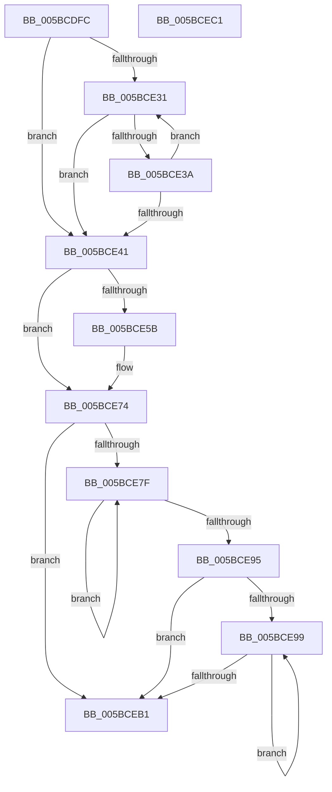

# KiRemoveProcessorFromCoreControlBlock

- RVA: `0x005BCDFC`–`0x005BCEC2` (길이 `198` bytes)
- VA: `0x00000001405BCDFC`
- 실행 섹션: `.text`
- PDB 이름 있음: `예`; PDB Function 태그: `아니요`
- unwind 정보 RVA: `0x00060BC4`
- 디코드: `61`개 명령, `198/198` bytes 표시
- 미해석 바이트: `0` (있으면 어셈블리에 `.byte`로 보존)

> 이 문서는 커널 이미지의 기계어와 PDB 기호를 분석해 생성했습니다. 4번과 5번은 함수 원형과 자료형을 바이너리 사용 방식에서 추정한 C 해석이며 원본 소스 복구 결과는 아닙니다.

## 1. Dependencies

- 직접 호출 지점: **1**; 고유 호출 대상: **1**
- 직접 호출자로 확인된 함수: **1**
- RIP 상대 이미지 참조: **1**

### Outgoing calls
- `0x005BCE6F` → [qsort](../50/qsort_function_005009F0.md) (function, `0x005009F0`)

### Direct callers
- [KiFinalizeCoreControlBlockAssignment](KiFinalizeCoreControlBlockAssignment_function_005B7D0C.md) at `0x005B7DE1`

### Static image references
- `0x005BCE62` → RVA `0x00558EA0` (`HalpNodeCostSort`; read)

## 2. Other-region calls and transfers

- 다른 실행 섹션으로 향하는 call: **0**
- 별도 외부 분기/꼬리 이동을 확인하지 못했습니다.

## 3. Assembly (complete function range)

```asm
005BCDFC  48 89 5C 24 08                  mov qword ptr [rsp + 8], rbx
005BCE01  48 89 74 24 10                  mov qword ptr [rsp + 0x10], rsi
005BCE06  57                              push rdi
005BCE07  48 83 EC 20                     sub rsp, 0x20
005BCE0B  48 8B B9 58 8E 00 00            mov rdi, qword ptr [rcx + 0x8e58]
005BCE12  33 DB                           xor ebx, ebx
005BCE14  8B D3                           mov edx, ebx
005BCE16  48 8B 77 28                     mov rsi, qword ptr [rdi + 0x28]
005BCE1A  48 89 99 58 8E 00 00            mov qword ptr [rcx + 0x8e58], rbx
005BCE21  48 89 99 B8 AE 00 00            mov qword ptr [rcx + 0xaeb8], rbx
005BCE28  44 0F B6 07                     movzx r8d, byte ptr [rdi]
005BCE2C  45 85 C0                        test r8d, r8d
005BCE2F  74 10                           je 0x1405bce41
005BCE31  8B C2                           mov eax, edx
005BCE33  48 39 4C C7 08                  cmp qword ptr [rdi + rax*8 + 8], rcx
005BCE38  74 07                           je 0x1405bce41
005BCE3A  FF C2                           inc edx
005BCE3C  41 3B D0                        cmp edx, r8d
005BCE3F  72 F0                           jb 0x1405bce31
005BCE41  4A 8B 04 C7                     mov rax, qword ptr [rdi + r8*8]
005BCE45  8B CA                           mov ecx, edx
005BCE47  48 89 44 CF 08                  mov qword ptr [rdi + rcx*8 + 8], rax
005BCE4C  0F B6 07                        movzx eax, byte ptr [rdi]
005BCE4F  48 89 1C C7                     mov qword ptr [rdi + rax*8], rbx
005BCE53  8A 07                           mov al, byte ptr [rdi]
005BCE55  2C 01                           sub al, 1
005BCE57  88 07                           mov byte ptr [rdi], al
005BCE59  74 19                           je 0x1405bce74
005BCE5B  0F B6 D0                        movzx edx, al
005BCE5E  48 8D 4F 08                     lea rcx, [rdi + 8]
005BCE62  4C 8D 0D 37 C0 F9 FF            lea r9, [rip - 0x63fc9]
005BCE69  41 B8 08 00 00 00               mov r8d, 8
005BCE6F  E8 7C 3B F4 FF                  call 0x1405009f0
005BCE74  FE 4E 18                        dec byte ptr [rsi + 0x18]
005BCE77  8B D3                           mov edx, ebx
005BCE79  8A 07                           mov al, byte ptr [rdi]
005BCE7B  84 C0                           test al, al
005BCE7D  74 32                           je 0x1405bceb1
005BCE7F  8B C2                           mov eax, edx
005BCE81  48 8B 4C C7 08                  mov rcx, qword ptr [rdi + rax*8 + 8]
005BCE86  89 91 B4 AE 00 00               mov dword ptr [rcx + 0xaeb4], edx
005BCE8C  FF C2                           inc edx
005BCE8E  0F B6 07                        movzx eax, byte ptr [rdi]
005BCE91  3B D0                           cmp edx, eax
005BCE93  72 EA                           jb 0x1405bce7f
005BCE95  84 C0                           test al, al
005BCE97  74 18                           je 0x1405bceb1
005BCE99  8B D3                           mov edx, ebx
005BCE9B  FF C3                           inc ebx
005BCE9D  48 8B 44 D7 08                  mov rax, qword ptr [rdi + rdx*8 + 8]
005BCEA2  8B 48 24                        mov ecx, dword ptr [rax + 0x24]
005BCEA5  48 89 4C D6 20                  mov qword ptr [rsi + rdx*8 + 0x20], rcx
005BCEAA  0F B6 07                        movzx eax, byte ptr [rdi]
005BCEAD  3B D8                           cmp ebx, eax
005BCEAF  72 E8                           jb 0x1405bce99
005BCEB1  48 8B 5C 24 30                  mov rbx, qword ptr [rsp + 0x30]
005BCEB6  48 8B 74 24 38                  mov rsi, qword ptr [rsp + 0x38]
005BCEBB  48 83 C4 20                     add rsp, 0x20
005BCEBF  5F                              pop rdi
005BCEC0  C3                              ret
005BCEC1  CC                              int3
```

## 4. C-style interpretation (structured pseudocode)

```c
__int64 __fastcall KiRemoveProcessorFromCoreControlBlock(__int64 a1)
{
    __int64 result;
    __int64 v_rbx;
    __int64 v_rsp;
    unsigned __int64 v_stack_p10;
    unsigned __int64 v_stack_p8;

    v_stack_p8 = v_rbx;
    v_stack_p10 = v_rsi;
    v_rsp = (v_rsp) - (32);
    v_rbx = 0;
    *(unsigned __int64 *)(a1 + 36440) = 0;
    *(unsigned __int64 *)(a1 + 44728) = 0;
    if ((unsigned int)(*(unsigned __int8 *)(*(unsigned __int64 *)(a1 + 36440))) == 0) goto loc_005BCE41;
loc_005BCE31:
    if ((*(unsigned __int64 *)(*(unsigned __int64 *)(a1 + 36440) + 0 * 8 + 8)) == a1) goto loc_005BCE41;
    a2 = (unsigned int)((0) + 1);
    if (((unsigned int)(a2)) < ((unsigned int)(*(unsigned __int8 *)(*(unsigned __int64 *)(a1 + 36440))))) goto loc_005BCE31;
loc_005BCE41:
    *(unsigned __int64 *)(*(unsigned __int64 *)(a1 + 36440) + (unsigned int)((unsigned int)(a2)) * 8 + 8) = *(unsigned __int64 *)(*(unsigned __int64 *)(a1 + 36440) + *(unsigned __int8 *)(*(unsigned __int64 *)(a1 + 36440)) * 8);
    *(unsigned __int64 *)(*(unsigned __int64 *)(a1 + 36440) + *(unsigned __int8 *)(*(unsigned __int64 *)(a1 + 36440)) * 8) = 0;
    result = (unsigned __int8)((*(unsigned __int8 *)(*(unsigned __int64 *)(a1 + 36440))) - (1));
    *(unsigned __int8 *)(*(unsigned __int64 *)(a1 + 36440)) = (unsigned __int8)(result);
    if (!(condition_is_equal)) {
        a2 = (unsigned __int8)(result);
        a1 = *(unsigned __int64 *)(a1 + 36440) + 8;
        a4 = v_rip - 409545;
        a3 = 8;
        result = qsort(a1, a2, a3, a4);
    }
    if ((unsigned __int8)(*(unsigned __int8 *)(*(unsigned __int64 *)(a1 + 36440))) == 0) goto loc_005BCEB1;
loc_005BCE7F:
    *(unsigned int *)(*(unsigned __int64 *)(*(unsigned __int64 *)(a1 + 36440) + 0 * 8 + 8) + 44724) = 0;
    a2 = (unsigned int)((0) + 1);
    if (((unsigned int)(a2)) < ((unsigned int)(*(unsigned __int8 *)(*(unsigned __int64 *)(a1 + 36440))))) goto loc_005BCE7F;
    if ((unsigned __int8)(*(unsigned __int8 *)(*(unsigned __int64 *)(a1 + 36440))) == 0) goto loc_005BCEB1;
loc_005BCE99:
    v_rbx = (unsigned int)((v_rbx) + 1);
    *(unsigned __int64 *)(*(unsigned __int64 *)(*(unsigned __int64 *)(a1 + 36440) + 40) + 0 * 8 + 32) = (unsigned int)(*(unsigned int *)(*(unsigned __int64 *)(*(unsigned __int64 *)(a1 + 36440) + 0 * 8 + 8) + 36));
    if (((unsigned int)(v_rbx)) < ((unsigned int)(*(unsigned __int8 *)(*(unsigned __int64 *)(a1 + 36440))))) goto loc_005BCE99;
loc_005BCEB1:
    v_rsp = (v_rsp) + (32);
    return *(unsigned __int8 *)(*(unsigned __int64 *)(a1 + 36440));
}
```

## 5. (Beta) C Style

```c
int64_t KiRemoveProcessorFromCoreControlBlock(void *Arg1)
{
    uint8_t *arg1 = (uint8_t *)Arg1;

    int64_t result;
    int64_t local_rbx;
    int64_t local_rsp;
    uint64_t v_stack_p10;
    uint64_t v_stack_p8;

    v_stack_p8 = local_rbx;
    v_stack_p10 = local_rsi;
    local_rsp = (local_rsp) - (32);
    local_rbx = 0;
    *(uint64_t *)(arg1 + 0x8E58) = 0;
    *(uint64_t *)(arg1 + 0xAEB8) = 0;
    if ((uint32_t)(*(uint8_t *)(*(uint64_t *)(arg1 + 0x8E58))) == 0) goto loc_005BCE41;
loc_005BCE31:
    if ((*(uint64_t *)(*(uint64_t *)(arg1 + 0x8E58) + 0x0 * 8 + 0x8)) == Arg1) goto loc_005BCE41;
    a2 = (uint32_t)((0) + 1);
    if (((uint32_t)(a2)) < ((uint32_t)(*(uint8_t *)(*(uint64_t *)(arg1 + 0x8E58))))) goto loc_005BCE31;
loc_005BCE41:
    *(uint64_t *)(*(uint64_t *)(arg1 + 0x8E58) + (uint32_t)((uint32_t)(a2)) * 8 + 0x8) = *(uint64_t *)(*(uint64_t *)(arg1 + 0x8E58) + *(uint8_t *)(*(uint64_t *)(arg1 + 0x8E58)) * 8);
    *(uint64_t *)(*(uint64_t *)(arg1 + 0x8E58) + *(uint8_t *)(*(uint64_t *)(arg1 + 0x8E58)) * 8) = 0;
    result = (uint8_t)((*(uint8_t *)(*(uint64_t *)(arg1 + 0x8E58))) - (1));
    *(uint8_t *)(*(uint64_t *)(arg1 + 0x8E58)) = (uint8_t)(result);
    if (!(condition_is_equal)) {
        a2 = (uint8_t)(result);
        Arg1 = *(uint64_t *)(arg1 + 0x8E58) + 8;
        a4 = v_rip - 409545;
        a3 = 8;
        result = qsort(Arg1, a2, a3, a4);
    }
    if ((uint8_t)(*(uint8_t *)(*(uint64_t *)(arg1 + 0x8E58))) == 0) goto loc_005BCEB1;
loc_005BCE7F:
    *(uint32_t *)(*(uint64_t *)(*(uint64_t *)(arg1 + 0x8E58) + 0x0 * 8 + 0x8) + 0xAEB4) = 0;
    a2 = (uint32_t)((0) + 1);
    if (((uint32_t)(a2)) < ((uint32_t)(*(uint8_t *)(*(uint64_t *)(arg1 + 0x8E58))))) goto loc_005BCE7F;
    if ((uint8_t)(*(uint8_t *)(*(uint64_t *)(arg1 + 0x8E58))) == 0) goto loc_005BCEB1;
loc_005BCE99:
    local_rbx = (uint32_t)((local_rbx) + 1);
    *(uint64_t *)(*(uint64_t *)(*(uint64_t *)(arg1 + 0x8E58) + 0x28) + 0x0 * 8 + 0x20) = (uint32_t)(*(uint32_t *)(*(uint64_t *)(*(uint64_t *)(arg1 + 0x8E58) + 0x0 * 8 + 0x8) + 0x24));
    if (((uint32_t)(local_rbx)) < ((uint32_t)(*(uint8_t *)(*(uint64_t *)(arg1 + 0x8E58))))) goto loc_005BCE99;
loc_005BCEB1:
    local_rsp = (local_rsp) + (32);
    return *(uint8_t *)(*(uint64_t *)(arg1 + 0x8E58));
}
```

### 관측된 메모리 오프셋

구조체 형식이 확인되지 않은 접근은 인자 기준의 오프셋으로만 기록했습니다.

| 기준 인자 | 오프셋 표현 | 폭 (bit) | 접근 |
|---|---:|---:|---|
| `Arg1` | `+ 0x8E58` | `64` | `R` |
| `Arg1` | `+ 0x8E58` | `64` | `W` |
| `Arg1` | `+ 0xAEB8` | `64` | `W` |

## 6. Execution-region graph

[열기: 2D/3D 그래프와 함수 탐색 컨트롤 패널](../../../control-panel.html?section=text&rva=0x005BCDFC&view=graph)

- 2D 그래프는 위에서 아래로 흐르고, 3D 그래프는 빈 공간을 드래그해 회전합니다. Shift+드래그는 이동, 휠은 확대·축소, 함수 노드 선택은 대상 보고서 이동입니다.

### Static fallback


