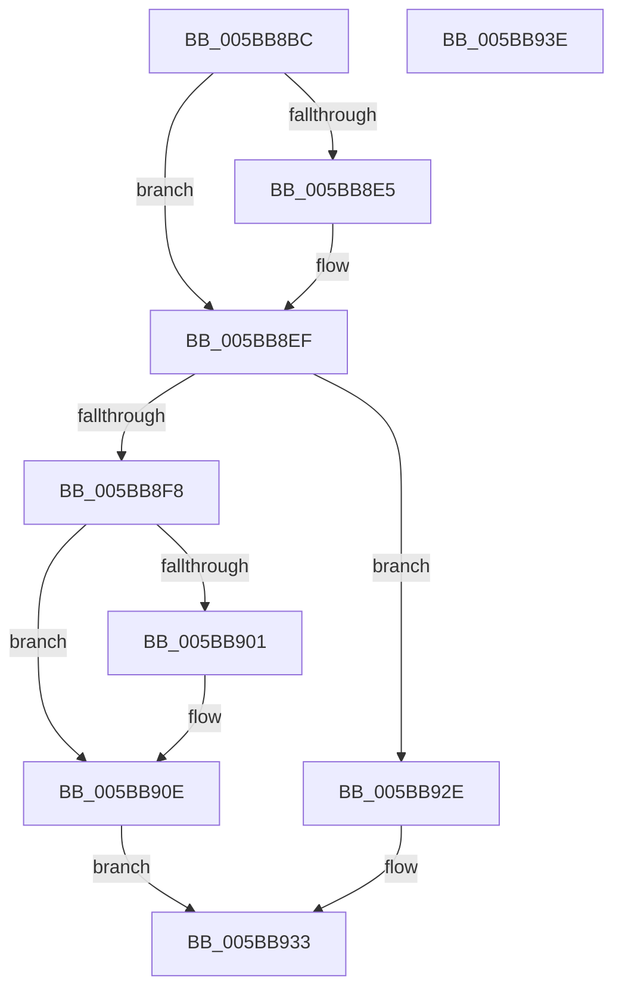

# KiResetClockInterval

- RVA: `0x005BB8BC`–`0x005BB93F` (길이 `131` bytes)
- VA: `0x00000001405BB8BC`
- 실행 섹션: `.text`
- PDB 이름 있음: `예`; PDB Function 태그: `아니요`
- unwind 정보 RVA: `0x00068D5C`
- 디코드: `36`개 명령, `131/131` bytes 표시
- 미해석 바이트: `0` (있으면 어셈블리에 `.byte`로 보존)

> 이 문서는 커널 이미지의 기계어와 PDB 기호를 분석해 생성했습니다. 4번과 5번은 함수 원형과 자료형을 바이너리 사용 방식에서 추정한 C 해석이며 원본 소스 복구 결과는 아닙니다.

## 1. Dependencies

- 직접 호출 지점: **6**; 고유 호출 대상: **6**
- 직접 호출자로 확인된 함수: **1**
- RIP 상대 이미지 참조: **3**

### Outgoing calls
- `0x005BB8D3` → [RtlRbRemoveNode](../2E/RtlRbRemoveNode_function_002E4C10.md) (function, `0x002E4C10`)
- `0x005BB8EA` → [PoTraceSystemTimerResolutionKernel](../2F/PoTraceSystemTimerResolutionKernel_function_002FD154.md) (function, `0x002FD154`)
- `0x005BB906` → [RtlGetInterruptTimePrecise](../20/RtlGetInterruptTimePrecise_function_0020A4C0.md) (function, `0x0020A4C0`)
- `0x005BB91D` → [KiSetClockTimerKTimerDeadlines](../23/KiSetClockTimerKTimerDeadlines_function_0023671C.md) (function, `0x0023671C`)
- `0x005BB927` → [KiSetNextClockTickDueTime](../23/KiSetNextClockTickDueTime_function_002363F0.md) (function, `0x002363F0`)
- `0x005BB92E` → [KiSetClockIntervalToMinimumRequested](../39/KiSetClockIntervalToMinimumRequested_function_0039DF1C.md) (function, `0x0039DF1C`)

### Direct callers
- [KiSetVirtualHeteroClockIntervalRequest](../5C/KiSetVirtualHeteroClockIntervalRequest_function_005C45F8.md) at `0x005C4637`

### Static image references
- `0x005BB8CC` → RVA `0x00E668D8` (`.data`; read)
- `0x005BB8EF` → RVA `0x00FC6A85` (`ALMOSTRO`; read)
- `0x005BB8F8` → RVA `0x00FC6AA5` (`ALMOSTRO`; read)

## 2. Other-region calls and transfers

- 다른 실행 섹션으로 향하는 call: **0**
- 별도 외부 분기/꼬리 이동을 확인하지 못했습니다.

## 3. Assembly (complete function range)

```asm
005BB8BC  48 89 5C 24 10                  mov qword ptr [rsp + 0x10], rbx
005BB8C1  57                              push rdi
005BB8C2  48 83 EC 20                     sub rsp, 0x20
005BB8C6  48 8B D9                        mov rbx, rcx
005BB8C9  48 8B D1                        mov rdx, rcx
005BB8CC  48 8D 0D 05 B0 8A 00            lea rcx, [rip + 0x8ab005]
005BB8D3  E8 38 93 D2 FF                  call 0x1402e4c10
005BB8D8  8B 53 20                        mov edx, dword ptr [rbx + 0x20]
005BB8DB  33 FF                           xor edi, edi
005BB8DD  40 88 7B 18                     mov byte ptr [rbx + 0x18], dil
005BB8E1  85 D2                           test edx, edx
005BB8E3  74 0A                           je 0x1405bb8ef
005BB8E5  41 B0 01                        mov r8b, 1
005BB8E8  33 C9                           xor ecx, ecx
005BB8EA  E8 65 18 D4 FF                  call 0x1402fd154
005BB8EF  40 38 3D 8F B1 A0 00            cmp byte ptr [rip + 0xa0b18f], dil
005BB8F6  74 36                           je 0x1405bb92e
005BB8F8  40 38 3D A6 B1 A0 00            cmp byte ptr [rip + 0xa0b1a6], dil
005BB8FF  74 0D                           je 0x1405bb90e
005BB901  48 8D 4C 24 30                  lea rcx, [rsp + 0x30]
005BB906  E8 B5 EB C4 FF                  call 0x14020a4c0
005BB90B  48 8B F8                        mov rdi, rax
005BB90E  65 48 8B 0C 25 20 00 00 00      mov rcx, qword ptr gs:[0x20]
005BB917  45 33 C0                        xor r8d, r8d
005BB91A  48 8B D7                        mov rdx, rdi
005BB91D  E8 FA AD C7 FF                  call 0x14023671c
005BB922  B2 01                           mov dl, 1
005BB924  48 8B CF                        mov rcx, rdi
005BB927  E8 C4 AA C7 FF                  call 0x1402363f0
005BB92C  EB 05                           jmp 0x1405bb933
005BB92E  E8 E9 25 DE FF                  call 0x14039df1c
005BB933  48 8B 5C 24 38                  mov rbx, qword ptr [rsp + 0x38]
005BB938  48 83 C4 20                     add rsp, 0x20
005BB93C  5F                              pop rdi
005BB93D  C3                              ret
005BB93E  CC                              int3
```

## 4. C-style interpretation (structured pseudocode)

```c
__int64 __fastcall KiResetClockInterval(__int64 a1)
{
    __int64 result;
    __int64 v_rdi;
    __int64 v_rsp;
    unsigned __int64 v_stack_p10;
    unsigned __int64 v_stack_p8;

    v_stack_p10 = v_rbx;
    v_rsp = (v_rsp) - (32);
    result = RtlRbRemoveNode(v_rip + 9089029, a1, a3, a4);
    v_rdi = 0;
    *(unsigned __int8 *)(a1 + 24) = 0;
    if ((unsigned int)((unsigned int)(*(unsigned int *)(a1 + 32))) != 0) {
        a3 = 1;
        a1 = 0;
        result = PoTraceSystemTimerResolutionKernel(a1, (unsigned int)(*(unsigned int *)(a1 + 32)), a3, a4);
    }
    if ((*(unsigned __int8 *)(v_rip + 10531215)) == 0) goto loc_005BB92E;
    if ((*(unsigned __int8 *)(v_rip + 10531238)) != 0) {
        a1 = v_stack_p8;
        result = RtlGetInterruptTimePrecise(a1, (unsigned int)(*(unsigned int *)(a1 + 32)), a3, a4);
        v_rdi = result;
    }
    a3 = 0;
    result = KiSetClockTimerKTimerDeadlines(*(unsigned __int64 *)(gs_base + (0 + 32)), v_rdi, a3, a4);
    result = KiSetNextClockTickDueTime(v_rdi, 1, a3, a4);
    goto loc_005BB933;
loc_005BB92E:
    result = KiSetClockIntervalToMinimumRequested(v_rdi, 1, a3, a4);
loc_005BB933:
    v_rsp = (v_rsp) + (32);
    return result;
}
```

## 5. (Beta) C Style

```c
int64_t KiResetClockInterval(void *Arg1)
{
    uint8_t *arg1 = (uint8_t *)Arg1;

    int64_t result;
    int64_t local_rdi;
    int64_t local_rsp;
    uint64_t v_stack_p10;
    uint64_t v_stack_p8;

    v_stack_p10 = local_rbx;
    local_rsp = (local_rsp) - (32);
    result = RtlRbRemoveNode(v_rip + 9089029, Arg1, a3, a4);
    local_rdi = 0;
    *(uint8_t *)(arg1 + 0x18) = 0;
    if ((uint32_t)((uint32_t)(*(uint32_t *)(arg1 + 0x20))) != 0) {
        a3 = 1;
        Arg1 = 0;
        result = PoTraceSystemTimerResolutionKernel(Arg1, (uint32_t)(*(uint32_t *)(arg1 + 0x20)), a3, a4);
    }
    if ((*(uint8_t *)(v_rip + 0xA0B18F)) == 0) goto loc_005BB92E;
    if ((*(uint8_t *)(v_rip + 0xA0B1A6)) != 0) {
        Arg1 = v_stack_p8;
        result = RtlGetInterruptTimePrecise(Arg1, (uint32_t)(*(uint32_t *)(arg1 + 0x20)), a3, a4);
        local_rdi = result;
    }
    a3 = 0;
    result = KiSetClockTimerKTimerDeadlines(*(uint64_t *)(gs_base + (0 + 0x20)), local_rdi, a3, a4);
    result = KiSetNextClockTickDueTime(local_rdi, 1, a3, a4);
    goto loc_005BB933;
loc_005BB92E:
    result = KiSetClockIntervalToMinimumRequested(local_rdi, 1, a3, a4);
loc_005BB933:
    local_rsp = (local_rsp) + (32);
    return result;
}
```

### 관측된 메모리 오프셋

구조체 형식이 확인되지 않은 접근은 인자 기준의 오프셋으로만 기록했습니다.

| 기준 인자 | 오프셋 표현 | 폭 (bit) | 접근 |
|---|---:|---:|---|
| `Arg1` | `+ 0x18` | `8` | `W` |
| `Arg1` | `+ 0x20` | `32` | `R` |

## 6. Execution-region graph

[열기: 2D/3D 그래프와 함수 탐색 컨트롤 패널](../../../control-panel.html?section=text&rva=0x005BB8BC&view=graph)

- 2D 그래프는 위에서 아래로 흐르고, 3D 그래프는 빈 공간을 드래그해 회전합니다. Shift+드래그는 이동, 휠은 확대·축소, 함수 노드 선택은 대상 보고서 이동입니다.

### Static fallback


