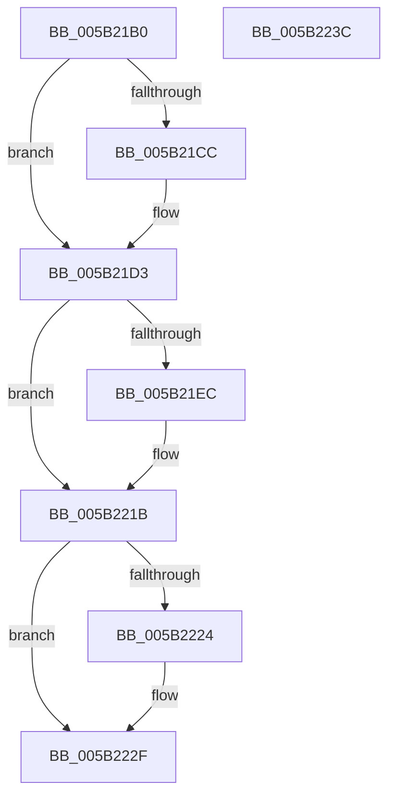

# KiResetProcessorTraceBuffer

- RVA: `0x005B21B0`–`0x005B223D` (길이 `141` bytes)
- VA: `0x00000001405B21B0`
- 실행 섹션: `.text`
- PDB 이름 있음: `예`; PDB Function 태그: `아니요`
- unwind 정보 RVA: `0x0005CF00`
- 디코드: `44`개 명령, `141/141` bytes 표시
- 미해석 바이트: `0` (있으면 어셈블리에 `.byte`로 보존)

> 이 문서는 커널 이미지의 기계어와 PDB 기호를 분석해 생성했습니다. 4번과 5번은 함수 원형과 자료형을 바이너리 사용 방식에서 추정한 C 해석이며 원본 소스 복구 결과는 아닙니다.

## 1. Dependencies

- 직접 호출 지점: **2**; 고유 호출 대상: **2**
- 직접 호출자로 확인된 함수: **1**
- RIP 상대 이미지 참조: **1**

### Outgoing calls
- `0x005B21CE` → [KiRaiseIrqlProcessIrqlFlags](../4F/KiRaiseIrqlProcessIrqlFlags_function_004F56FC.md) (function, `0x004F56FC`)
- `0x005B222A` → [KiLowerIrqlProcessIrqlFlags](../4F/KiLowerIrqlProcessIrqlFlags_function_004F5698.md) (function, `0x004F5698`)

### Direct callers
- [SwapContext](../6B/SwapContext_function_006B9820.md) at `0x006B9E43`

### Static image references
- `0x005B21C3` → RVA `0x00FC6D20` (`ALMOSTRO`; read)

## 2. Other-region calls and transfers

- 다른 실행 섹션으로 향하는 call: **0**
- 별도 외부 분기/꼬리 이동을 확인하지 못했습니다.

## 3. Assembly (complete function range)

```asm
005B21B0  40 53                           push rbx
005B21B2  48 83 EC 20                     sub rsp, 0x20
005B21B6  44 0F 20 C3                     mov rbx, cr8
005B21BA  BA 0F 00 00 00                  mov edx, 0xf
005B21BF  44 0F 22 C2                     mov cr8, rdx
005B21C3  83 3D 56 4B A1 00 00            cmp dword ptr [rip + 0xa14b56], 0
005B21CA  74 07                           je 0x1405b21d3
005B21CC  8A CB                           mov cl, bl
005B21CE  E8 29 35 F4 FF                  call 0x1404f56fc
005B21D3  41 B9 70 05 00 00               mov r9d, 0x570
005B21D9  41 8B C9                        mov ecx, r9d
005B21DC  0F 32                           rdmsr
005B21DE  48 C1 E2 20                     shl rdx, 0x20
005B21E2  48 0B C2                        or rax, rdx
005B21E5  4C 8B C0                        mov r8, rax
005B21E8  A8 01                           test al, 1
005B21EA  74 2F                           je 0x1405b221b
005B21EC  48 8B D0                        mov rdx, rax
005B21EF  48 83 E2 FE                     and rdx, 0xfffffffffffffffe
005B21F3  48 8B C2                        mov rax, rdx
005B21F6  48 C1 EA 20                     shr rdx, 0x20
005B21FA  0F 30                           wrmsr
005B21FC  33 C0                           xor eax, eax
005B21FE  41 8D 49 F1                     lea ecx, [r9 - 0xf]
005B2202  33 D2                           xor edx, edx
005B2204  0F 30                           wrmsr
005B2206  41 8D 49 01                     lea ecx, [r9 + 1]
005B220A  0F 30                           wrmsr
005B220C  49 8B D0                        mov rdx, r8
005B220F  49 8B C0                        mov rax, r8
005B2212  48 C1 EA 20                     shr rdx, 0x20
005B2216  41 8B C9                        mov ecx, r9d
005B2219  0F 30                           wrmsr
005B221B  83 3D FE 4A A1 00 00            cmp dword ptr [rip + 0xa14afe], 0
005B2222  74 0B                           je 0x1405b222f
005B2224  44 0F 20 C1                     mov rcx, cr8
005B2228  8A D3                           mov dl, bl
005B222A  E8 69 34 F4 FF                  call 0x1404f5698
005B222F  0F B6 C3                        movzx eax, bl
005B2232  44 0F 22 C0                     mov cr8, rax
005B2236  48 83 C4 20                     add rsp, 0x20
005B223A  5B                              pop rbx
005B223B  C3                              ret
005B223C  CC                              int3
```

## 4. C-style interpretation (structured pseudocode)

```c
__int64 __fastcall KiResetProcessorTraceBuffer(void)
{
    __int64 result;
    __int64 v_rsp;

    v_rsp = (v_rsp) - (32);
    if ((*(unsigned int *)(v_rip + 10570582)) != 0) {
        a1 = (unsigned __int8)(v_cr8);
        result = KiRaiseIrqlProcessIrqlFlags(a1, 15, a3, a4);
    }
    a2 = (15) << (32);
    result = (result) | (a2);
    if ((((unsigned __int8)(result)) & (1)) != 0) {
        a2 = result;
        a2 = (a2) & (-2);
        result = a2;
        a2 = (a2) >> (32);
        result = 0;
        a1 = (unsigned int)(0x570ULL) - 15;
        a2 = 0;
        a1 = (unsigned int)(0x570ULL) + 1;
        a2 = 0;
        result = 0;
        a2 = (a2) >> (32);
        a1 = (unsigned int)((unsigned int)(0x570ULL));
    }
    if ((*(unsigned int *)(v_rip + 10570494)) != 0) {
        a1 = 15;
        a2 = (unsigned __int8)(v_cr8);
        result = KiLowerIrqlProcessIrqlFlags(a1, a2, result, (unsigned int)(0x570ULL));
    }
    v_rsp = (v_rsp) + (32);
    return (unsigned __int8)(v_cr8);
}
```

## 5. (Beta) C Style

```c
void KiResetProcessorTraceBuffer(void)
{
    int64_t result;
    int64_t local_rsp;

    local_rsp = (local_rsp) - (32);
    if ((*(uint32_t *)(v_rip + 0xA14B56)) != 0) {
        a1 = (uint8_t)(v_cr8);
        result = KiRaiseIrqlProcessIrqlFlags(a1, 15, a3, a4);
    }
    a2 = (15) << (32);
    result = (result) | (a2);
    if ((((uint8_t)(result)) & (1)) != 0) {
        a2 = result;
        a2 = (a2) & (-2);
        result = a2;
        a2 = (a2) >> (32);
        result = 0;
        a1 = (uint32_t)(0x570ULL) - 15;
        a2 = 0;
        a1 = (uint32_t)(0x570ULL) + 1;
        a2 = 0;
        result = 0;
        a2 = (a2) >> (32);
        a1 = (uint32_t)((uint32_t)(0x570ULL));
    }
    if ((*(uint32_t *)(v_rip + 0xA14AFE)) != 0) {
        a1 = 15;
        a2 = (uint8_t)(v_cr8);
        result = KiLowerIrqlProcessIrqlFlags(a1, a2, result, (uint32_t)(0x570ULL));
    }
    local_rsp = (local_rsp) + (32);
    return (uint8_t)(v_cr8);
}
```

## 6. Execution-region graph

[열기: 2D/3D 그래프와 함수 탐색 컨트롤 패널](../../../control-panel.html?section=text&rva=0x005B21B0&view=graph)

- 2D 그래프는 위에서 아래로 흐르고, 3D 그래프는 빈 공간을 드래그해 회전합니다. Shift+드래그는 이동, 휠은 확대·축소, 함수 노드 선택은 대상 보고서 이동입니다.

### Static fallback


