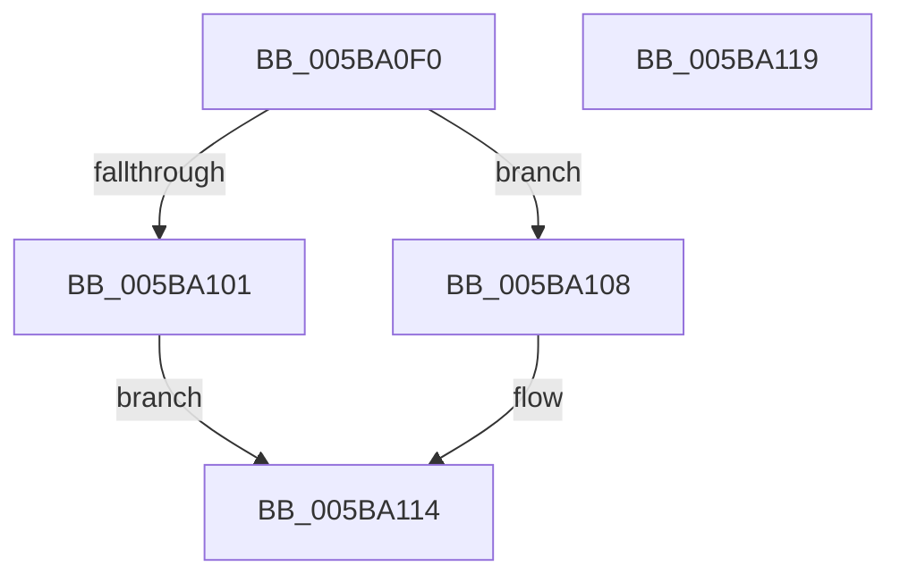

# KiRestoreThreadIptState

- RVA: `0x005BA0F0`–`0x005BA11A` (길이 `42` bytes)
- VA: `0x00000001405BA0F0`
- 실행 섹션: `.text`
- PDB 이름 있음: `예`; PDB Function 태그: `아니요`
- unwind 정보 RVA: `0x0005C788`
- 디코드: `11`개 명령, `42/42` bytes 표시
- 미해석 바이트: `0` (있으면 어셈블리에 `.byte`로 보존)

> 이 문서는 커널 이미지의 기계어와 PDB 기호를 분석해 생성했습니다. 4번과 5번은 함수 원형과 자료형을 바이너리 사용 방식에서 추정한 C 해석이며 원본 소스 복구 결과는 아닙니다.

## 1. Dependencies

- 직접 호출 지점: **2**; 고유 호출 대상: **2**
- 직접 호출자로 확인된 함수: **1**
- RIP 상대 이미지 참조: **0**

### Outgoing calls
- `0x005BA101` → [KiInitIptState](KiInitIptState_function_005B9F7C.md) (function, `0x005B9F7C`)
- `0x005BA10F` → [KiRestoreIptState](../4C/KiRestoreIptState_function_004C3E4C.md) (function, `0x004C3E4C`)

### Direct callers
- [SwapContext](../6B/SwapContext_function_006B9820.md) at `0x006B9D1F`

### Static image references
- 디코드된 RIP-relative 메모리 참조가 없습니다.

## 2. Other-region calls and transfers

- 다른 실행 섹션으로 향하는 call: **0**
- 별도 외부 분기/꼬리 이동을 확인하지 못했습니다.

## 3. Assembly (complete function range)

```asm
005BA0F0  48 83 EC 28                     sub rsp, 0x28
005BA0F4  8B 81 50 02 00 00               mov eax, dword ptr [rcx + 0x250]
005BA0FA  48 0F BA E0 08                  bt rax, 8
005BA0FF  72 07                           jb 0x1405ba108
005BA101  E8 76 FE FF FF                  call 0x1405b9f7c
005BA106  EB 0C                           jmp 0x1405ba114
005BA108  48 8B 89 58 04 00 00            mov rcx, qword ptr [rcx + 0x458]
005BA10F  E8 38 9D F0 FF                  call 0x1404c3e4c
005BA114  48 83 C4 28                     add rsp, 0x28
005BA118  C3                              ret
005BA119  CC                              int3
```

## 4. C-style interpretation (structured pseudocode)

```c
__int64 __fastcall KiRestoreThreadIptState(__int64 a1)
{
    __int64 result;
    __int64 v_rsp;

    v_rsp = (v_rsp) - (40);
    if (condition_is_below) goto loc_005BA108;
    result = KiInitIptState(a1, a2, a3, a4);
    goto loc_005BA114;
loc_005BA108:
    result = KiRestoreIptState(*(unsigned __int64 *)(a1 + 1112), a2, a3, a4);
loc_005BA114:
    v_rsp = (v_rsp) + (40);
    return result;
}
```

## 5. (Beta) C Style

```c
int64_t KiRestoreThreadIptState(void *Arg1)
{
    uint8_t *arg1 = (uint8_t *)Arg1;

    int64_t result;
    int64_t local_rsp;

    local_rsp = (local_rsp) - (40);
    if (condition_is_below) goto loc_005BA108;
    result = KiInitIptState(Arg1, a2, a3, a4);
    goto loc_005BA114;
loc_005BA108:
    result = KiRestoreIptState(*(uint64_t *)(arg1 + 0x458), a2, a3, a4);
loc_005BA114:
    local_rsp = (local_rsp) + (40);
    return result;
}
```

### 관측된 메모리 오프셋

구조체 형식이 확인되지 않은 접근은 인자 기준의 오프셋으로만 기록했습니다.

| 기준 인자 | 오프셋 표현 | 폭 (bit) | 접근 |
|---|---:|---:|---|
| `Arg1` | `+ 0x250` | `32` | `R` |
| `Arg1` | `+ 0x458` | `64` | `R` |

## 6. Execution-region graph

[열기: 2D/3D 그래프와 함수 탐색 컨트롤 패널](../../../control-panel.html?section=text&rva=0x005BA0F0&view=graph)

- 2D 그래프는 위에서 아래로 흐르고, 3D 그래프는 빈 공간을 드래그해 회전합니다. Shift+드래그는 이동, 휠은 확대·축소, 함수 노드 선택은 대상 보고서 이동입니다.

### Static fallback


