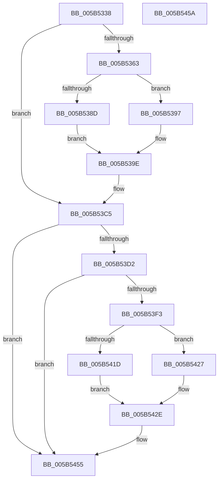

# KiSaveCurrentEtwTraceBuffer

- RVA: `0x005B5338`–`0x005B545B` (길이 `291` bytes)
- VA: `0x00000001405B5338`
- 실행 섹션: `.text`
- PDB 이름 있음: `예`; PDB Function 태그: `아니요`
- unwind 정보 RVA: `0x0005D2F4`
- 디코드: `66`개 명령, `291/291` bytes 표시
- 미해석 바이트: `0` (있으면 어셈블리에 `.byte`로 보존)

> 이 문서는 커널 이미지의 기계어와 PDB 기호를 분석해 생성했습니다. 4번과 5번은 함수 원형과 자료형을 바이너리 사용 방식에서 추정한 C 해석이며 원본 소스 복구 결과는 아닙니다.

## 1. Dependencies

- 직접 호출 지점: **8**; 고유 호출 대상: **2**
- 직접 호출자로 확인된 함수: **1**
- RIP 상대 이미지 참조: **10**

### Outgoing calls
- `0x005B535A` → [EtwGetProcessorBuffer](../64/EtwGetProcessorBuffer_function_0064E630.md) (function, `0x0064E630`)
- `0x005B539E` → [IoAddTriageDumpDataBlock](../42/IoAddTriageDumpDataBlock_function_00428374.md) (function, `0x00428374`)
- `0x005B53AF` → [IoAddTriageDumpDataBlock](../42/IoAddTriageDumpDataBlock_function_00428374.md) (function, `0x00428374`)
- `0x005B53C0` → [IoAddTriageDumpDataBlock](../42/IoAddTriageDumpDataBlock_function_00428374.md) (function, `0x00428374`)
- `0x005B53EA` → [EtwGetProcessorBuffer](../64/EtwGetProcessorBuffer_function_0064E630.md) (function, `0x0064E630`)
- `0x005B542E` → [IoAddTriageDumpDataBlock](../42/IoAddTriageDumpDataBlock_function_00428374.md) (function, `0x00428374`)
- `0x005B543F` → [IoAddTriageDumpDataBlock](../42/IoAddTriageDumpDataBlock_function_00428374.md) (function, `0x00428374`)
- `0x005B5450` → [IoAddTriageDumpDataBlock](../42/IoAddTriageDumpDataBlock_function_00428374.md) (function, `0x00428374`)

### Direct callers
- [KiCollectTriageDumpDataBlocks](KiCollectTriageDumpDataBlocks_function_005B43F8.md) at `0x005B4477`

### Static image references
- `0x005B5374` → RVA `0x00F47550` (`.data`; write)
- `0x005B537E` → RVA `0x00F47558` (`.data`; write)
- `0x005B53A8` → RVA `0x00F47550` (`.data`; read)
- `0x005B53B9` → RVA `0x00F47558` (`.data`; read)
- `0x005B53C5` → RVA `0x00F8D059` (`.data`; read)
- `0x005B53E0` → RVA `0x00E66210` (`.data`; read)
- `0x005B5404` → RVA `0x00F47560` (`.data`; write)
- `0x005B540E` → RVA `0x00F47540` (`.data`; write)
- `0x005B5438` → RVA `0x00F47560` (`.data`; read)
- `0x005B5449` → RVA `0x00F47540` (`.data`; read)

## 2. Other-region calls and transfers

- 다른 실행 섹션으로 향하는 call: **0**
- 별도 외부 분기/꼬리 이동을 확인하지 못했습니다.

## 3. Assembly (complete function range)

```asm
005B5338  48 83 EC 38                     sub rsp, 0x38
005B533C  65 48 8B 14 25 20 00 00 00      mov rdx, qword ptr gs:[0x20]
005B5345  4C 8D 44 24 20                  lea r8, [rsp + 0x20]
005B534A  0F 57 C0                        xorps xmm0, xmm0
005B534D  B9 02 00 00 00                  mov ecx, 2
005B5352  0F 11 44 24 20                  movups xmmword ptr [rsp + 0x20], xmm0
005B5357  8B 52 24                        mov edx, dword ptr [rdx + 0x24]
005B535A  E8 D1 92 09 00                  call 0x14064e630
005B535F  85 C0                           test eax, eax
005B5361  78 62                           js 0x1405b53c5
005B5363  4C 8B 44 24 20                  mov r8, qword ptr [rsp + 0x20]
005B5368  BA 00 20 00 00                  mov edx, 0x2000
005B536D  8B 4C 24 2C                     mov ecx, dword ptr [rsp + 0x2c]
005B5371  49 03 C8                        add rcx, r8
005B5374  4C 89 05 D5 21 99 00            mov qword ptr [rip + 0x9921d5], r8
005B537B  48 8B C1                        mov rax, rcx
005B537E  48 89 0D D3 21 99 00            mov qword ptr [rip + 0x9921d3], rcx
005B5385  49 2B C0                        sub rax, r8
005B5388  48 3B C2                        cmp rax, rdx
005B538B  73 0A                           jae 0x1405b5397
005B538D  41 2B C8                        sub ecx, r8d
005B5390  8B D1                           mov edx, ecx
005B5392  49 8B C8                        mov rcx, r8
005B5395  EB 07                           jmp 0x1405b539e
005B5397  48 81 C1 00 E0 FF FF            add rcx, -0x2000
005B539E  E8 D1 2F E7 FF                  call 0x140428374
005B53A3  BA 08 00 00 00                  mov edx, 8
005B53A8  48 8D 0D A1 21 99 00            lea rcx, [rip + 0x9921a1]
005B53AF  E8 C0 2F E7 FF                  call 0x140428374
005B53B4  BA 08 00 00 00                  mov edx, 8
005B53B9  48 8D 0D 98 21 99 00            lea rcx, [rip + 0x992198]
005B53C0  E8 AF 2F E7 FF                  call 0x140428374
005B53C5  80 3D 8D 7C 9D 00 00            cmp byte ptr [rip + 0x9d7c8d], 0
005B53CC  0F 84 83 00 00 00               je 0x1405b5455
005B53D2  65 48 8B 14 25 20 00 00 00      mov rdx, qword ptr gs:[0x20]
005B53DB  4C 8D 44 24 20                  lea r8, [rsp + 0x20]
005B53E0  0F B7 0D 29 0E 8B 00            movzx ecx, word ptr [rip + 0x8b0e29]
005B53E7  8B 52 24                        mov edx, dword ptr [rdx + 0x24]
005B53EA  E8 41 92 09 00                  call 0x14064e630
005B53EF  85 C0                           test eax, eax
005B53F1  78 62                           js 0x1405b5455
005B53F3  4C 8B 44 24 20                  mov r8, qword ptr [rsp + 0x20]
005B53F8  BA 00 10 00 00                  mov edx, 0x1000
005B53FD  8B 4C 24 2C                     mov ecx, dword ptr [rsp + 0x2c]
005B5401  49 03 C8                        add rcx, r8
005B5404  4C 89 05 55 21 99 00            mov qword ptr [rip + 0x992155], r8
005B540B  48 8B C1                        mov rax, rcx
005B540E  48 89 0D 2B 21 99 00            mov qword ptr [rip + 0x99212b], rcx
005B5415  49 2B C0                        sub rax, r8
005B5418  48 3B C2                        cmp rax, rdx
005B541B  73 0A                           jae 0x1405b5427
005B541D  41 2B C8                        sub ecx, r8d
005B5420  8B D1                           mov edx, ecx
005B5422  49 8B C8                        mov rcx, r8
005B5425  EB 07                           jmp 0x1405b542e
005B5427  48 81 C1 00 F0 FF FF            add rcx, -0x1000
005B542E  E8 41 2F E7 FF                  call 0x140428374
005B5433  BA 08 00 00 00                  mov edx, 8
005B5438  48 8D 0D 21 21 99 00            lea rcx, [rip + 0x992121]
005B543F  E8 30 2F E7 FF                  call 0x140428374
005B5444  BA 08 00 00 00                  mov edx, 8
005B5449  48 8D 0D F0 20 99 00            lea rcx, [rip + 0x9920f0]
005B5450  E8 1F 2F E7 FF                  call 0x140428374
005B5455  48 83 C4 38                     add rsp, 0x38
005B5459  C3                              ret
005B545A  CC                              int3
```

## 4. C-style interpretation (structured pseudocode)

```c
__int64 __fastcall KiSaveCurrentEtwTraceBuffer(void)
{
    __int64 result;
    __int64 v_rsp;
    unsigned __int64 v_stack_m18;
    unsigned int v_stack_mC;

    v_rsp = (v_rsp) - (56);
    v_stack_m18 = v_xmm0;
    result = EtwGetProcessorBuffer(2, (unsigned int)(*(unsigned int *)(*(unsigned __int64 *)(gs_base + (0 + 32)) + 36)), v_stack_m18, a4);
    if (sign_flag) goto loc_005B53C5;
    a1 = ((unsigned int)(v_stack_mC)) + (v_stack_m18);
    *(unsigned __int64 *)(v_rip + 10035669) = v_stack_m18;
    *(unsigned __int64 *)(v_rip + 10035667) = a1;
    result = (a1) - (v_stack_m18);
    if (result >= ((unsigned int)(0x2000ULL))) goto loc_005B5397;
    a1 = (unsigned int)((a1) - ((unsigned int)(v_stack_m18)));
    goto loc_005B539E;
loc_005B5397:
    a1 = (v_stack_m18) + (0xFFFFFFFFFFFFE000ULL);
loc_005B539E:
    result = IoAddTriageDumpDataBlock(a1, (unsigned int)((unsigned int)(a1)), v_stack_m18, a4);
    result = IoAddTriageDumpDataBlock(v_rip + 10035617, 8, v_stack_m18, a4);
    result = IoAddTriageDumpDataBlock(v_rip + 10035608, 8, v_stack_m18, a4);
loc_005B53C5:
    if ((*(unsigned __int8 *)(v_rip + 10321037)) == 0) goto loc_005B5455;
    result = EtwGetProcessorBuffer(*(unsigned __int16 *)(v_rip + 9113129), (unsigned int)(*(unsigned int *)(*(unsigned __int64 *)(gs_base + (0 + 32)) + 36)), v_stack_m18, a4);
    if (sign_flag) goto loc_005B5455;
    a1 = ((unsigned int)(v_stack_mC)) + (v_stack_m18);
    *(unsigned __int64 *)(v_rip + 10035541) = v_stack_m18;
    *(unsigned __int64 *)(v_rip + 10035499) = a1;
    result = (a1) - (v_stack_m18);
    if (result >= ((unsigned int)(0x1000ULL))) goto loc_005B5427;
    a1 = (unsigned int)((a1) - ((unsigned int)(v_stack_m18)));
    goto loc_005B542E;
loc_005B5427:
    a1 = (v_stack_m18) + (0xFFFFFFFFFFFFF000ULL);
loc_005B542E:
    result = IoAddTriageDumpDataBlock(a1, (unsigned int)((unsigned int)(a1)), v_stack_m18, a4);
    result = IoAddTriageDumpDataBlock(v_rip + 10035489, 8, v_stack_m18, a4);
    result = IoAddTriageDumpDataBlock(v_rip + 10035440, 8, v_stack_m18, a4);
loc_005B5455:
    v_rsp = (v_rsp) + (56);
    return result;
}
```

## 5. (Beta) C Style

```c
void KiSaveCurrentEtwTraceBuffer(void)
{
    int64_t result;
    int64_t local_rsp;
    uint64_t v_stack_m18;
    uint32_t v_stack_mC;

    local_rsp = (local_rsp) - (56);
    v_stack_m18 = v_xmm0;
    result = EtwGetProcessorBuffer(2, (uint32_t)(*(uint32_t *)(*(uint64_t *)(gs_base + (0 + 0x20)) + 0x24)), v_stack_m18, a4);
    if (sign_flag) goto loc_005B53C5;
    a1 = ((uint32_t)(v_stack_mC)) + (v_stack_m18);
    *(uint64_t *)(v_rip + 0x9921D5) = v_stack_m18;
    *(uint64_t *)(v_rip + 0x9921D3) = a1;
    result = (a1) - (v_stack_m18);
    if (result >= ((uint32_t)(0x2000ULL))) goto loc_005B5397;
    a1 = (uint32_t)((a1) - ((uint32_t)(v_stack_m18)));
    goto loc_005B539E;
loc_005B5397:
    a1 = (v_stack_m18) + (0xFFFFFFFFFFFFE000ULL);
loc_005B539E:
    result = IoAddTriageDumpDataBlock(a1, (uint32_t)((uint32_t)(a1)), v_stack_m18, a4);
    result = IoAddTriageDumpDataBlock(v_rip + 10035617, 8, v_stack_m18, a4);
    result = IoAddTriageDumpDataBlock(v_rip + 10035608, 8, v_stack_m18, a4);
loc_005B53C5:
    if ((*(uint8_t *)(v_rip + 0x9D7C8D)) == 0) goto loc_005B5455;
    result = EtwGetProcessorBuffer(*(uint16_t *)(v_rip + 0x8B0E29), (uint32_t)(*(uint32_t *)(*(uint64_t *)(gs_base + (0 + 0x20)) + 0x24)), v_stack_m18, a4);
    if (sign_flag) goto loc_005B5455;
    a1 = ((uint32_t)(v_stack_mC)) + (v_stack_m18);
    *(uint64_t *)(v_rip + 0x992155) = v_stack_m18;
    *(uint64_t *)(v_rip + 0x99212B) = a1;
    result = (a1) - (v_stack_m18);
    if (result >= ((uint32_t)(0x1000ULL))) goto loc_005B5427;
    a1 = (uint32_t)((a1) - ((uint32_t)(v_stack_m18)));
    goto loc_005B542E;
loc_005B5427:
    a1 = (v_stack_m18) + (0xFFFFFFFFFFFFF000ULL);
loc_005B542E:
    result = IoAddTriageDumpDataBlock(a1, (uint32_t)((uint32_t)(a1)), v_stack_m18, a4);
    result = IoAddTriageDumpDataBlock(v_rip + 10035489, 8, v_stack_m18, a4);
    result = IoAddTriageDumpDataBlock(v_rip + 10035440, 8, v_stack_m18, a4);
loc_005B5455:
    local_rsp = (local_rsp) + (56);
    return result;
}
```

## 6. Execution-region graph

[열기: 2D/3D 그래프와 함수 탐색 컨트롤 패널](../../../control-panel.html?section=text&rva=0x005B5338&view=graph)

- 2D 그래프는 위에서 아래로 흐르고, 3D 그래프는 빈 공간을 드래그해 회전합니다. Shift+드래그는 이동, 휠은 확대·축소, 함수 노드 선택은 대상 보고서 이동입니다.

### Static fallback


