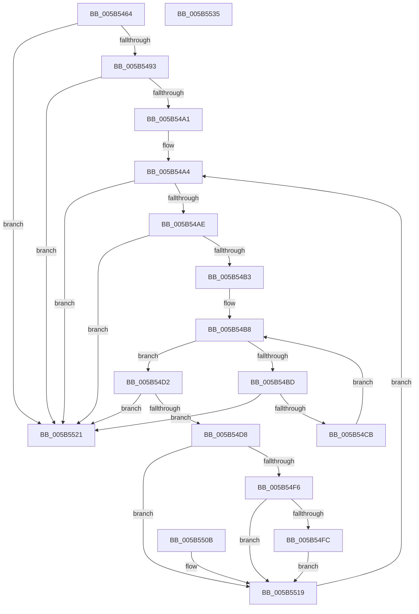

# KiScanBugCheckCallbackList

- RVA: `0x005B5464`–`0x005B5536` (길이 `210` bytes)
- VA: `0x00000001405B5464`
- 실행 섹션: `.text`
- PDB 이름 있음: `예`; PDB Function 태그: `아니요`
- unwind 정보 RVA: `0x000C9D1C`
- 디코드: `62`개 명령, `210/210` bytes 표시
- 미해석 바이트: `0` (있으면 어셈블리에 `.byte`로 보존)

> 이 문서는 커널 이미지의 기계어와 PDB 기호를 분석해 생성했습니다. 4번과 5번은 함수 원형과 자료형을 바이너리 사용 방식에서 추정한 C 해석이며 원본 소스 복구 결과는 아닙니다.

## 1. Dependencies

- 직접 호출 지점: **2**; 고유 호출 대상: **2**
- 직접 호출자로 확인된 함수: **2**
- RIP 상대 이미지 참조: **2**

### Outgoing calls
- `0x005B54C2` → [MmIsAddressValidEx](../27/MmIsAddressValidEx_function_0027FDD0.md) (function, `0x0027FDD0`)
- `0x005B5500` → [guard_dispatch_icall](../6B/guard_dispatch_icall_function_006BAAD0.md) (function, `0x006BAAD0`)

### Direct callers
- [IopWriteTriageDumpToFirmware](../59/IopWriteTriageDumpToFirmware_function_00596984.md) at `0x00596A2D`
- [KeBugCheck2](KeBugCheck2_function_005B27D0.md) at `0x005B2C57`
- [KeBugCheck2](KeBugCheck2_function_005B27D0.md) at `0x005B372C`

### Static image references
- `0x005B5477` → RVA `0x00F23470` (`.data`; read)
- `0x005B5493` → RVA `0x00F23478` (`.data`; read)

## 2. Other-region calls and transfers

- 다른 실행 섹션으로 향하는 call: **0**
- 별도 외부 분기/꼬리 이동을 확인하지 못했습니다.

## 3. Assembly (complete function range)

```asm
005B5464  48 89 5C 24 18                  mov qword ptr [rsp + 0x18], rbx
005B5469  48 89 74 24 20                  mov qword ptr [rsp + 0x20], rsi
005B546E  57                              push rdi
005B546F  41 56                           push r14
005B5471  41 57                           push r15
005B5473  48 83 EC 20                     sub rsp, 0x20
005B5477  48 8D 3D F2 DF 96 00            lea rdi, [rip + 0x96dff2]
005B547E  48 89 7C 24 48                  mov qword ptr [rsp + 0x48], rdi
005B5483  48 8B 1D E6 DF 96 00            mov rbx, qword ptr [rip + 0x96dfe6]
005B548A  48 85 DB                        test rbx, rbx
005B548D  0F 84 8E 00 00 00               je 0x1405b5521
005B5493  48 83 3D DD DF 96 00 00         cmp qword ptr [rip + 0x96dfdd], 0
005B549B  0F 84 80 00 00 00               je 0x1405b5521
005B54A1  4C 8B FF                        mov r15, rdi
005B54A4  48 89 5C 24 40                  mov qword ptr [rsp + 0x40], rbx
005B54A9  48 3B DF                        cmp rbx, rdi
005B54AC  74 73                           je 0x1405b5521
005B54AE  F6 C3 07                        test bl, 7
005B54B1  75 6E                           jne 0x1405b5521
005B54B3  4C 8B F3                        mov r14, rbx
005B54B6  33 F6                           xor esi, esi
005B54B8  83 FE 40                        cmp esi, 0x40
005B54BB  73 15                           jae 0x1405b54d2
005B54BD  33 D2                           xor edx, edx
005B54BF  49 8B CE                        mov rcx, r14
005B54C2  E8 09 A9 CC FF                  call 0x14027fdd0
005B54C7  84 C0                           test al, al
005B54C9  74 56                           je 0x1405b5521
005B54CB  49 FF C6                        inc r14
005B54CE  FF C6                           inc esi
005B54D0  EB E6                           jmp 0x1405b54b8
005B54D2  4C 39 7B 08                     cmp qword ptr [rbx + 8], r15
005B54D6  75 49                           jne 0x1405b5521
005B54D8  8B 53 20                        mov edx, dword ptr [rbx + 0x20]
005B54DB  48 8B 4B 18                     mov rcx, qword ptr [rbx + 0x18]
005B54DF  48 8B 43 10                     mov rax, qword ptr [rbx + 0x10]
005B54E3  4C 8B 43 28                     mov r8, qword ptr [rbx + 0x28]
005B54E7  4C 03 C2                        add r8, rdx
005B54EA  4C 03 C0                        add r8, rax
005B54ED  4C 03 C1                        add r8, rcx
005B54F0  80 7B 38 01                     cmp byte ptr [rbx + 0x38], 1
005B54F4  75 23                           jne 0x1405b5519
005B54F6  4C 39 43 30                     cmp qword ptr [rbx + 0x30], r8
005B54FA  75 1D                           jne 0x1405b5519
005B54FC  C6 43 38 02                     mov byte ptr [rbx + 0x38], 2
005B5500  E8 CB 55 10 00                  call 0x1406baad0
005B5505  C6 43 38 03                     mov byte ptr [rbx + 0x38], 3
005B5509  EB 0E                           jmp 0x1405b5519
005B550B  48 8B 5C 24 40                  mov rbx, qword ptr [rsp + 0x40]
005B5510  C6 43 38 04                     mov byte ptr [rbx + 0x38], 4
005B5514  48 8B 7C 24 48                  mov rdi, qword ptr [rsp + 0x48]
005B5519  4C 8B FB                        mov r15, rbx
005B551C  48 8B 1B                        mov rbx, qword ptr [rbx]
005B551F  EB 83                           jmp 0x1405b54a4
005B5521  48 8B 5C 24 50                  mov rbx, qword ptr [rsp + 0x50]
005B5526  48 8B 74 24 58                  mov rsi, qword ptr [rsp + 0x58]
005B552B  48 83 C4 20                     add rsp, 0x20
005B552F  41 5F                           pop r15
005B5531  41 5E                           pop r14
005B5533  5F                              pop rdi
005B5534  C3                              ret
005B5535  CC                              int3
```

## 4. C-style interpretation (structured pseudocode)

```c
__int64 __fastcall KiScanBugCheckCallbackList(__int64 a1, int a2)
{
    __int64 result;
    __int64 v_r14;
    __int64 v_rsi;
    __int64 v_rsp;
    unsigned __int64 v_stack_p10;
    unsigned __int64 v_stack_p18;
    unsigned __int64 v_stack_p20;
    unsigned __int64 v_stack_p8;

    v_stack_p18 = v_rbx;
    v_stack_p20 = v_rsi;
    v_rsp = (v_rsp) - (32);
    v_stack_p10 = v_rip + 9887730;
    if (*(unsigned __int64 *)(v_rip + 9887718) == 0) goto loc_005B5521;
    if ((*(unsigned __int64 *)(v_rip + 9887709)) == 0) goto loc_005B5521;
loc_005B54A4:
    v_stack_p8 = *(unsigned __int64 *)(v_rip + 9887718);
    if ((*(unsigned __int64 *)(v_rip + 9887718)) == (v_rip + 9887730)) goto loc_005B5521;
    if ((((unsigned __int8)(*(unsigned __int64 *)(v_rip + 9887718))) & (7)) != 0) goto loc_005B5521;
    v_rsi = 0;
loc_005B54B8:
    if (0 >= 64) goto loc_005B54D2;
    a2 = 0;
    result = MmIsAddressValidEx(*(unsigned __int64 *)(v_rip + 9887718), a2, a3, a4);
    if ((unsigned __int8)(result) == 0) goto loc_005B5521;
    v_r14 = (*(unsigned __int64 *)(v_rip + 9887718)) + 1;
    v_rsi = (unsigned int)((v_rsi) + 1);
    goto loc_005B54B8;
loc_005B54D2:
    if ((*(unsigned __int64 *)(*(unsigned __int64 *)(v_rip + 9887718) + 8)) != (v_rip + 9887730)) goto loc_005B5521;
    a3 = (*(unsigned __int64 *)(*(unsigned __int64 *)(v_rip + 9887718) + 40)) + ((unsigned int)(*(unsigned int *)(*(unsigned __int64 *)(v_rip + 9887718) + 32)));
    a3 = (a3) + (*(unsigned __int64 *)(*(unsigned __int64 *)(v_rip + 9887718) + 16));
    a3 = (a3) + (*(unsigned __int64 *)(*(unsigned __int64 *)(v_rip + 9887718) + 24));
    if ((*(unsigned __int8 *)(*(unsigned __int64 *)(v_rip + 9887718) + 56)) != 1) goto loc_005B5519;
    if ((*(unsigned __int64 *)(*(unsigned __int64 *)(v_rip + 9887718) + 48)) != a3) goto loc_005B5519;
    *(unsigned __int8 *)(*(unsigned __int64 *)(v_rip + 9887718) + 56) = 2;
    result = guard_dispatch_icall(*(unsigned __int64 *)(*(unsigned __int64 *)(v_rip + 9887718) + 24), (unsigned int)(*(unsigned int *)(*(unsigned __int64 *)(v_rip + 9887718) + 32)), a3, a4);
    *(unsigned __int8 *)(*(unsigned __int64 *)(v_rip + 9887718) + 56) = 3;
    goto loc_005B5519;
loc_005B5519:
    goto loc_005B54A4;
loc_005B5521:
    v_rsp = (v_rsp) + (32);
    return result;
}
```

## 5. (Beta) C Style

```c
int64_t KiScanBugCheckCallbackList(int64_t Arg1, int32_t Arg2)
{
    int64_t result;
    int64_t local_r14;
    int64_t local_rsi;
    int64_t local_rsp;
    uint64_t v_stack_p10;
    uint64_t v_stack_p18;
    uint64_t v_stack_p20;
    uint64_t v_stack_p8;

    v_stack_p18 = local_rbx;
    v_stack_p20 = local_rsi;
    local_rsp = (local_rsp) - (32);
    v_stack_p10 = v_rip + 9887730;
    if (*(uint64_t *)(v_rip + 0x96DFE6) == 0) goto loc_005B5521;
    if ((*(uint64_t *)(v_rip + 0x96DFDD)) == 0) goto loc_005B5521;
loc_005B54A4:
    v_stack_p8 = *(uint64_t *)(v_rip + 0x96DFE6);
    if ((*(uint64_t *)(v_rip + 0x96DFE6)) == (v_rip + 9887730)) goto loc_005B5521;
    if ((((uint8_t)(*(uint64_t *)(v_rip + 0x96DFE6))) & (7)) != 0) goto loc_005B5521;
    local_rsi = 0;
loc_005B54B8:
    if (0 >= 64) goto loc_005B54D2;
    Arg2 = 0;
    result = MmIsAddressValidEx(*(uint64_t *)(v_rip + 0x96DFE6), Arg2, a3, a4);
    if ((uint8_t)(result) == 0) goto loc_005B5521;
    local_r14 = (*(uint64_t *)(v_rip + 0x96DFE6)) + 1;
    local_rsi = (uint32_t)((local_rsi) + 1);
    goto loc_005B54B8;
loc_005B54D2:
    if ((*(uint64_t *)(*(uint64_t *)(v_rip + 0x96DFE6) + 0x8)) != (v_rip + 9887730)) goto loc_005B5521;
    a3 = (*(uint64_t *)(*(uint64_t *)(v_rip + 0x96DFE6) + 0x28)) + ((uint32_t)(*(uint32_t *)(*(uint64_t *)(v_rip + 0x96DFE6) + 0x20)));
    a3 = (a3) + (*(uint64_t *)(*(uint64_t *)(v_rip + 0x96DFE6) + 0x10));
    a3 = (a3) + (*(uint64_t *)(*(uint64_t *)(v_rip + 0x96DFE6) + 0x18));
    if ((*(uint8_t *)(*(uint64_t *)(v_rip + 0x96DFE6) + 0x38)) != 1) goto loc_005B5519;
    if ((*(uint64_t *)(*(uint64_t *)(v_rip + 0x96DFE6) + 0x30)) != a3) goto loc_005B5519;
    *(uint8_t *)(*(uint64_t *)(v_rip + 0x96DFE6) + 0x38) = 2;
    result = guard_dispatch_icall(*(uint64_t *)(*(uint64_t *)(v_rip + 0x96DFE6) + 0x18), (uint32_t)(*(uint32_t *)(*(uint64_t *)(v_rip + 0x96DFE6) + 0x20)), a3, a4);
    *(uint8_t *)(*(uint64_t *)(v_rip + 0x96DFE6) + 0x38) = 3;
    goto loc_005B5519;
loc_005B5519:
    goto loc_005B54A4;
loc_005B5521:
    local_rsp = (local_rsp) + (32);
    return result;
}
```

## 6. Execution-region graph

[열기: 2D/3D 그래프와 함수 탐색 컨트롤 패널](../../../control-panel.html?section=text&rva=0x005B5464&view=graph)

- 2D 그래프는 위에서 아래로 흐르고, 3D 그래프는 빈 공간을 드래그해 회전합니다. Shift+드래그는 이동, 휠은 확대·축소, 함수 노드 선택은 대상 보고서 이동입니다.

### Static fallback


