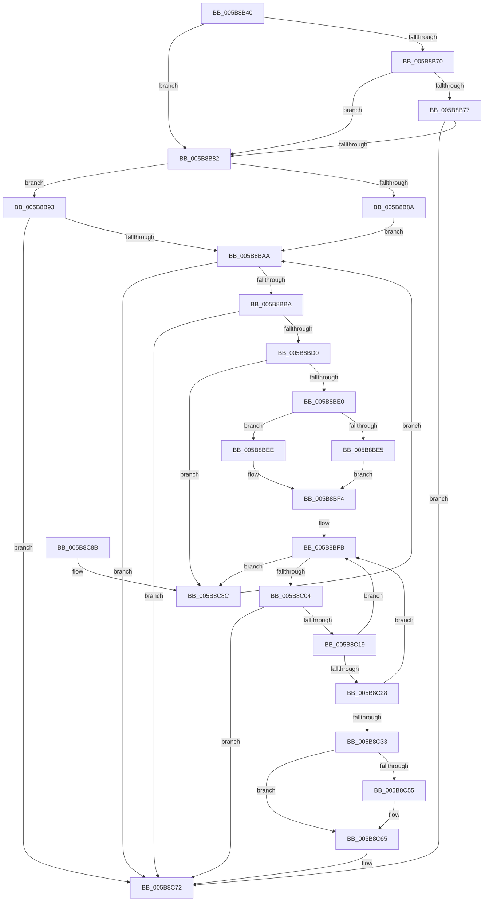

# KiSchedulerAssistBugCheckAddPagesCallback

- RVA: `0x005B8B40`–`0x005B8C94` (길이 `340` bytes)
- VA: `0x00000001405B8B40`
- 실행 섹션: `.text`
- PDB 이름 있음: `예`; PDB Function 태그: `아니요`
- unwind 정보 RVA: `0x000CA004`
- 디코드: `86`개 명령, `340/340` bytes 표시
- 미해석 바이트: `0` (있으면 어셈블리에 `.byte`로 보존)

> 이 문서는 커널 이미지의 기계어와 PDB 기호를 분석해 생성했습니다. 4번과 5번은 함수 원형과 자료형을 바이너리 사용 방식에서 추정한 C 해석이며 원본 소스 복구 결과는 아닙니다.

## 1. Dependencies

- 직접 호출 지점: **3**; 고유 호출 대상: **1**
- 직접 호출자로 확인된 함수: **0**
- RIP 상대 이미지 참조: **4**

### Outgoing calls
- `0x005B8BC3` → [MmIsAddressValidEx](../27/MmIsAddressValidEx_function_0027FDD0.md) (function, `0x0027FDD0`)
- `0x005B8C10` → [MmIsAddressValidEx](../27/MmIsAddressValidEx_function_0027FDD0.md) (function, `0x0027FDD0`)
- `0x005B8C2A` → [MmIsAddressValidEx](../27/MmIsAddressValidEx_function_0027FDD0.md) (function, `0x0027FDD0`)

### Direct callers
- 이 함수 시작 RVA로 연결되는 직접 call은 확인되지 않았습니다. 간접 호출은 완전히 역산할 수 없습니다.

### Static image references
- `0x005B8B8A` → RVA `0x00F067C0` (`.data`; read)
- `0x005B8B93` → RVA `0x00FC6A80` (`ALMOSTRO`; read)
- `0x005B8C55` → RVA `0x00F234D0` (`.data`; read/write)
- `0x005B8C5B` → RVA `0x00F234C0` (`.data`; read)

## 2. Other-region calls and transfers

- 다른 실행 섹션으로 향하는 call: **0**
- 별도 외부 분기/꼬리 이동을 확인하지 못했습니다.

## 3. Assembly (complete function range)

```asm
005B8B40  48 89 5C 24 08                  mov qword ptr [rsp + 8], rbx
005B8B45  48 89 6C 24 10                  mov qword ptr [rsp + 0x10], rbp
005B8B4A  48 89 74 24 18                  mov qword ptr [rsp + 0x18], rsi
005B8B4F  57                              push rdi
005B8B50  41 56                           push r14
005B8B52  41 57                           push r15
005B8B54  48 83 EC 20                     sub rsp, 0x20
005B8B58  49 83 60 18 00                  and qword ptr [r8 + 0x18], 0
005B8B5D  49 8B D8                        mov rbx, r8
005B8B60  41 83 60 08 00                  and dword ptr [r8 + 8], 0
005B8B65  41 8B 40 0C                     mov eax, dword ptr [r8 + 0xc]
005B8B69  3D 9F 00 00 00                  cmp eax, 0x9f
005B8B6E  74 12                           je 0x1405b8b82
005B8B70  3D E2 00 00 00                  cmp eax, 0xe2
005B8B75  74 0B                           je 0x1405b8b82
005B8B77  3D C8 01 00 00                  cmp eax, 0x1c8
005B8B7C  0F 85 F0 00 00 00               jne 0x1405b8c72
005B8B82  49 8B 30                        mov rsi, qword ptr [r8]
005B8B85  48 85 F6                        test rsi, rsi
005B8B88  75 09                           jne 0x1405b8b93
005B8B8A  48 8B 3D 2F DC 94 00            mov rdi, qword ptr [rip + 0x94dc2f]
005B8B91  EB 17                           jmp 0x1405b8baa
005B8B93  8B 05 E7 DE A0 00               mov eax, dword ptr [rip + 0xa0dee7]
005B8B99  48 8B 3E                        mov rdi, qword ptr [rsi]
005B8B9C  8D 0C 80                        lea ecx, [rax + rax*4]
005B8B9F  03 C9                           add ecx, ecx
005B8BA1  39 4E 10                        cmp dword ptr [rsi + 0x10], ecx
005B8BA4  0F 83 C8 00 00 00               jae 0x1405b8c72
005B8BAA  48 8D 05 0F DC 94 00            lea rax, [rip + 0x94dc0f]
005B8BB1  48 3B F8                        cmp rdi, rax
005B8BB4  0F 84 B8 00 00 00               je 0x1405b8c72
005B8BBA  33 D2                           xor edx, edx
005B8BBC  48 8D 8F 28 FE FF FF            lea rcx, [rdi - 0x1d8]
005B8BC3  E8 08 72 CC FF                  call 0x14027fdd0
005B8BC8  84 C0                           test al, al
005B8BCA  0F 84 A2 00 00 00               je 0x1405b8c72
005B8BD0  F7 87 24 04 00 00 00 00 80 00   test dword ptr [rdi + 0x424], 0x800000
005B8BDA  0F 84 AC 00 00 00               je 0x1405b8c8c
005B8BE0  48 85 F6                        test rsi, rsi
005B8BE3  75 09                           jne 0x1405b8bee
005B8BE5  4C 8B B7 98 01 00 00            mov r14, qword ptr [rdi + 0x198]
005B8BEC  EB 06                           jmp 0x1405b8bf4
005B8BEE  4C 8B 76 08                     mov r14, qword ptr [rsi + 8]
005B8BF2  33 F6                           xor esi, esi
005B8BF4  4C 8D BF 98 01 00 00            lea r15, [rdi + 0x198]
005B8BFB  4D 3B F7                        cmp r14, r15
005B8BFE  0F 84 88 00 00 00               je 0x1405b8c8c
005B8C04  49 8D AE 88 FA FF FF            lea rbp, [r14 - 0x578]
005B8C0B  33 D2                           xor edx, edx
005B8C0D  48 8B CD                        mov rcx, rbp
005B8C10  E8 BB 71 CC FF                  call 0x14027fdd0
005B8C15  84 C0                           test al, al
005B8C17  74 59                           je 0x1405b8c72
005B8C19  48 8B 8D C8 03 00 00            mov rcx, qword ptr [rbp + 0x3c8]
005B8C20  4D 8B 36                        mov r14, qword ptr [r14]
005B8C23  48 85 C9                        test rcx, rcx
005B8C26  74 D3                           je 0x1405b8bfb
005B8C28  33 D2                           xor edx, edx
005B8C2A  E8 A1 71 CC FF                  call 0x14027fdd0
005B8C2F  84 C0                           test al, al
005B8C31  74 C8                           je 0x1405b8bfb
005B8C33  48 8B 85 C8 03 00 00            mov rax, qword ptr [rbp + 0x3c8]
005B8C3A  48 8B 0B                        mov rcx, qword ptr [rbx]
005B8C3D  48 89 43 10                     mov qword ptr [rbx + 0x10], rax
005B8C41  48 C7 43 18 01 00 00 00         mov qword ptr [rbx + 0x18], 1
005B8C49  C7 43 08 01 00 00 80            mov dword ptr [rbx + 8], 0x80000001
005B8C50  48 85 C9                        test rcx, rcx
005B8C53  75 10                           jne 0x1405b8c65
005B8C55  21 0D 75 A8 96 00               and dword ptr [rip + 0x96a875], ecx
005B8C5B  48 8D 0D 5E A8 96 00            lea rcx, [rip + 0x96a85e]
005B8C62  48 89 0B                        mov qword ptr [rbx], rcx
005B8C65  48 89 39                        mov qword ptr [rcx], rdi
005B8C68  4C 89 71 08                     mov qword ptr [rcx + 8], r14
005B8C6C  8B 43 18                        mov eax, dword ptr [rbx + 0x18]
005B8C6F  01 41 10                        add dword ptr [rcx + 0x10], eax
005B8C72  48 8B 5C 24 40                  mov rbx, qword ptr [rsp + 0x40]
005B8C77  48 8B 6C 24 48                  mov rbp, qword ptr [rsp + 0x48]
005B8C7C  48 8B 74 24 50                  mov rsi, qword ptr [rsp + 0x50]
005B8C81  48 83 C4 20                     add rsp, 0x20
005B8C85  41 5F                           pop r15
005B8C87  41 5E                           pop r14
005B8C89  5F                              pop rdi
005B8C8A  C3                              ret
005B8C8B  CC                              int3
005B8C8C  48 8B 3F                        mov rdi, qword ptr [rdi]
005B8C8F  E9 16 FF FF FF                  jmp 0x1405b8baa
```

## 4. C-style interpretation (structured pseudocode)

```c
__int64 __fastcall KiSchedulerAssistBugCheckAddPagesCallback(__int64 a1, int a2, __int64 a3)
{
    __int64 result;
    __int64 v_rsi;
    __int64 v_rsp;
    unsigned __int64 v_stack_p10;
    unsigned __int64 v_stack_p18;
    unsigned __int64 v_stack_p8;

    v_stack_p8 = v_rbx;
    v_stack_p10 = v_rbp;
    v_stack_p18 = v_rsi;
    v_rsp = (v_rsp) - (32);
    if (((unsigned int)((unsigned int)(*(unsigned int *)(a3 + 12)))) == 159) goto loc_005B8B82;
    if (((unsigned int)((unsigned int)(*(unsigned int *)(a3 + 12)))) == 226) goto loc_005B8B82;
    if (((unsigned int)((unsigned int)(*(unsigned int *)(a3 + 12)))) != 456) goto loc_005B8C72;
loc_005B8B82:
    if (*(unsigned __int64 *)(a3) != 0) goto loc_005B8B93;
    goto loc_005B8BAA;
loc_005B8B93:
    a1 = (unsigned int)(((unsigned int)(*(unsigned int *)(v_rip + 10542823)) + (unsigned int)(*(unsigned int *)(v_rip + 10542823)) * 4) + ((unsigned int)((unsigned int)(*(unsigned int *)(v_rip + 10542823)) + (unsigned int)(*(unsigned int *)(v_rip + 10542823)) * 4)));
    if ((*(unsigned int *)(*(unsigned __int64 *)(a3) + 16)) >= ((unsigned int)(a1))) goto loc_005B8C72;
loc_005B8BAA:
    if ((*(unsigned __int64 *)(*(unsigned __int64 *)(a3))) == (v_rip + 9755663)) goto loc_005B8C72;
    a2 = 0;
    result = MmIsAddressValidEx(*(unsigned __int64 *)(*(unsigned __int64 *)(a3)) - 472, a2, a3, a4);
    if ((unsigned __int8)(result) == 0) goto loc_005B8C72;
    if (((*(unsigned int *)(*(unsigned __int64 *)(*(unsigned __int64 *)(a3)) + 1060)) & (0x800000ULL)) == 0) goto loc_005B8C8C;
    if (*(unsigned __int64 *)(a3) != 0) goto loc_005B8BEE;
    goto loc_005B8BF4;
loc_005B8BEE:
    v_rsi = 0;
loc_005B8BF4:
loc_005B8BFB:
    if ((*(unsigned __int64 *)(*(unsigned __int64 *)(a3) + 8)) == (*(unsigned __int64 *)(*(unsigned __int64 *)(a3)) + 408)) goto loc_005B8C8C;
    a2 = 0;
    result = MmIsAddressValidEx(*(unsigned __int64 *)(*(unsigned __int64 *)(a3) + 8) - 1400, a2, a3, a4);
    if ((unsigned __int8)(result) == 0) goto loc_005B8C72;
    if (*(unsigned __int64 *)(*(unsigned __int64 *)(*(unsigned __int64 *)(a3) + 8) - 1400 + 968) == 0) goto loc_005B8BFB;
    a2 = 0;
    result = MmIsAddressValidEx(*(unsigned __int64 *)(*(unsigned __int64 *)(*(unsigned __int64 *)(a3) + 8) - 1400 + 968), a2, a3, a4);
    if ((unsigned __int8)(result) == 0) goto loc_005B8BFB;
    *(unsigned __int64 *)(a3 + 16) = *(unsigned __int64 *)(*(unsigned __int64 *)(*(unsigned __int64 *)(a3) + 8) - 1400 + 968);
    *(unsigned __int64 *)(a3 + 24) = 1;
    *(unsigned int *)(a3 + 8) = 0x80000001ULL;
    if (*(unsigned __int64 *)(a3) == 0) {
        a1 = v_rip + 9873502;
        *(unsigned __int64 *)(a3) = a1;
    }
    *(unsigned __int64 *)(a1) = *(unsigned __int64 *)(*(unsigned __int64 *)(a3));
    *(unsigned __int64 *)(a1 + 8) = *(unsigned __int64 *)(*(unsigned __int64 *)(*(unsigned __int64 *)(a3) + 8));
loc_005B8C72:
    v_rsp = (v_rsp) + (32);
    return (unsigned int)(*(unsigned int *)(a3 + 24));
loc_005B8C8C:
    goto loc_005B8BAA;
}
```

## 5. (Beta) C Style

```c
int64_t KiSchedulerAssistBugCheckAddPagesCallback(int64_t Arg1, int32_t Arg2, void *Arg3)
{
    uint8_t *arg3 = (uint8_t *)Arg3;

    int64_t result;
    int64_t local_rsi;
    int64_t local_rsp;
    uint64_t v_stack_p10;
    uint64_t v_stack_p18;
    uint64_t v_stack_p8;

    v_stack_p8 = local_rbx;
    v_stack_p10 = local_rbp;
    v_stack_p18 = local_rsi;
    local_rsp = (local_rsp) - (32);
    if (((uint32_t)((uint32_t)(*(uint32_t *)(arg3 + 0xC)))) == 159) goto loc_005B8B82;
    if (((uint32_t)((uint32_t)(*(uint32_t *)(arg3 + 0xC)))) == 226) goto loc_005B8B82;
    if (((uint32_t)((uint32_t)(*(uint32_t *)(arg3 + 0xC)))) != 456) goto loc_005B8C72;
loc_005B8B82:
    if (*(uint64_t *)(arg3) != 0) goto loc_005B8B93;
    goto loc_005B8BAA;
loc_005B8B93:
    Arg1 = (uint32_t)(((uint32_t)(*(uint32_t *)(v_rip + 0xA0DEE7)) + (uint32_t)(*(uint32_t *)(v_rip + 0xA0DEE7)) * 4) + ((uint32_t)((uint32_t)(*(uint32_t *)(v_rip + 0xA0DEE7)) + (uint32_t)(*(uint32_t *)(v_rip + 0xA0DEE7)) * 4)));
    if ((*(uint32_t *)(*(uint64_t *)(arg3) + 0x10)) >= ((uint32_t)(Arg1))) goto loc_005B8C72;
loc_005B8BAA:
    if ((*(uint64_t *)(*(uint64_t *)(arg3))) == (v_rip + 9755663)) goto loc_005B8C72;
    Arg2 = 0;
    result = MmIsAddressValidEx(*(uint64_t *)(*(uint64_t *)(arg3)) - 472, Arg2, Arg3, a4);
    if ((uint8_t)(result) == 0) goto loc_005B8C72;
    if (((*(uint32_t *)(*(uint64_t *)(*(uint64_t *)(arg3)) + 0x424)) & (0x800000ULL)) == 0) goto loc_005B8C8C;
    if (*(uint64_t *)(arg3) != 0) goto loc_005B8BEE;
    goto loc_005B8BF4;
loc_005B8BEE:
    local_rsi = 0;
loc_005B8BF4:
loc_005B8BFB:
    if ((*(uint64_t *)(*(uint64_t *)(arg3) + 0x8)) == (*(uint64_t *)(*(uint64_t *)(arg3)) + 408)) goto loc_005B8C8C;
    Arg2 = 0;
    result = MmIsAddressValidEx(*(uint64_t *)(*(uint64_t *)(arg3) + 0x8) - 1400, Arg2, Arg3, a4);
    if ((uint8_t)(result) == 0) goto loc_005B8C72;
    if (*(uint64_t *)(*(uint64_t *)(*(uint64_t *)(arg3) + 0x8) - 0x578 + 0x3C8) == 0) goto loc_005B8BFB;
    Arg2 = 0;
    result = MmIsAddressValidEx(*(uint64_t *)(*(uint64_t *)(*(uint64_t *)(arg3) + 0x8) - 0x578 + 0x3C8), Arg2, Arg3, a4);
    if ((uint8_t)(result) == 0) goto loc_005B8BFB;
    *(uint64_t *)(arg3 + 0x10) = *(uint64_t *)(*(uint64_t *)(*(uint64_t *)(arg3) + 0x8) - 0x578 + 0x3C8);
    *(uint64_t *)(arg3 + 0x18) = 1;
    *(uint32_t *)(arg3 + 0x8) = 0x80000001ULL;
    if (*(uint64_t *)(arg3) == 0) {
        Arg1 = v_rip + 9873502;
        *(uint64_t *)(arg3) = Arg1;
    }
    *(uint64_t *)(Arg1) = *(uint64_t *)(*(uint64_t *)(arg3));
    *(uint64_t *)(Arg1 + 0x8) = *(uint64_t *)(*(uint64_t *)(*(uint64_t *)(arg3) + 0x8));
loc_005B8C72:
    local_rsp = (local_rsp) + (32);
    return (uint32_t)(*(uint32_t *)(arg3 + 0x18));
loc_005B8C8C:
    goto loc_005B8BAA;
}
```

### 관측된 메모리 오프셋

구조체 형식이 확인되지 않은 접근은 인자 기준의 오프셋으로만 기록했습니다.

| 기준 인자 | 오프셋 표현 | 폭 (bit) | 접근 |
|---|---:|---:|---|
| `Arg3` | `+ 0x0` | `64` | `R` |
| `Arg3` | `+ 0x0` | `64` | `W` |
| `Arg3` | `+ 0x8` | `32` | `R/W` |
| `Arg3` | `+ 0x8` | `32` | `W` |
| `Arg3` | `+ 0xC` | `32` | `R` |
| `Arg3` | `+ 0x10` | `64` | `W` |
| `Arg3` | `+ 0x18` | `32` | `R` |
| `Arg3` | `+ 0x18` | `64` | `R/W` |
| `Arg3` | `+ 0x18` | `64` | `W` |

## 6. Execution-region graph

[열기: 2D/3D 그래프와 함수 탐색 컨트롤 패널](../../../control-panel.html?section=text&rva=0x005B8B40&view=graph)

- 2D 그래프는 위에서 아래로 흐르고, 3D 그래프는 빈 공간을 드래그해 회전합니다. Shift+드래그는 이동, 휠은 확대·축소, 함수 노드 선택은 대상 보고서 이동입니다.

### Static fallback


