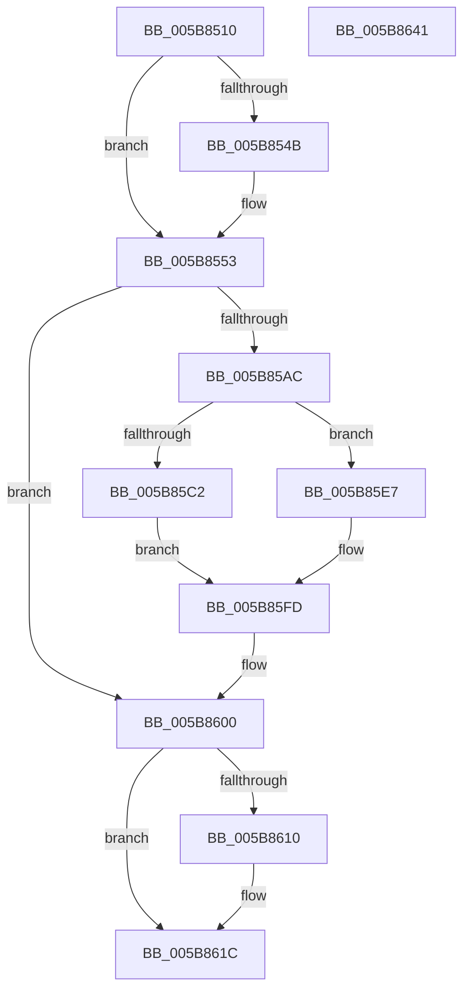

# KiSetProcessorDpcLimits

- RVA: `0x005B8510`–`0x005B8642` (길이 `306` bytes)
- VA: `0x00000001405B8510`
- 실행 섹션: `.text`
- PDB 이름 있음: `예`; PDB Function 태그: `아니요`
- unwind 정보 RVA: `0x0007F3F8`
- 디코드: `71`개 명령, `306/306` bytes 표시
- 미해석 바이트: `0` (있으면 어셈블리에 `.byte`로 보존)

> 이 문서는 커널 이미지의 기계어와 PDB 기호를 분석해 생성했습니다. 4번과 5번은 함수 원형과 자료형을 바이너리 사용 방식에서 추정한 C 해석이며 원본 소스 복구 결과는 아닙니다.

## 1. Dependencies

- 직접 호출 지점: **2**; 고유 호출 대상: **2**
- 직접 호출자로 확인된 함수: **1**
- RIP 상대 이미지 참조: **1**

### Outgoing calls
- `0x005B854E` → [KiRaiseIrqlProcessIrqlFlags](../4F/KiRaiseIrqlProcessIrqlFlags_function_004F56FC.md) (function, `0x004F56FC`)
- `0x005B8617` → [KiLowerIrqlProcessIrqlFlags](../4F/KiLowerIrqlProcessIrqlFlags_function_004F5698.md) (function, `0x004F5698`)

### Direct callers
- [KiApplyProcessorDpcLimits](../../pagelk/B6/KiApplyProcessorDpcLimits_function_00B6600C.md) at `0x00B6605A`

### Static image references
- `0x005B8542` → RVA `0x00FC6D20` (`ALMOSTRO`; read)

## 2. Other-region calls and transfers

- 다른 실행 섹션으로 향하는 call: **0**
- 별도 외부 분기/꼬리 이동을 확인하지 못했습니다.

## 3. Assembly (complete function range)

```asm
005B8510  48 8B C4                        mov rax, rsp
005B8513  48 89 58 08                     mov qword ptr [rax + 8], rbx
005B8517  48 89 70 10                     mov qword ptr [rax + 0x10], rsi
005B851B  48 89 78 18                     mov qword ptr [rax + 0x18], rdi
005B851F  4C 89 70 20                     mov qword ptr [rax + 0x20], r14
005B8523  41 57                           push r15
005B8525  48 83 EC 20                     sub rsp, 0x20
005B8529  4D 8B F9                        mov r15, r9
005B852C  49 8B F8                        mov rdi, r8
005B852F  4C 8B F2                        mov r14, rdx
005B8532  48 8B D9                        mov rbx, rcx
005B8535  44 0F 20 C6                     mov rsi, cr8
005B8539  BA 0D 00 00 00                  mov edx, 0xd
005B853E  44 0F 22 C2                     mov cr8, rdx
005B8542  83 3D D7 E7 A0 00 00            cmp dword ptr [rip + 0xa0e7d7], 0
005B8549  74 08                           je 0x1405b8553
005B854B  40 8A CE                        mov cl, sil
005B854E  E8 A9 D1 F3 FF                  call 0x1404f56fc
005B8553  83 A3 5C 86 00 00 00            and dword ptr [rbx + 0x865c], 0
005B855A  83 A3 AC 83 00 00 00            and dword ptr [rbx + 0x83ac], 0
005B8561  41 8B 06                        mov eax, dword ptr [r14]
005B8564  49 83 27 00                     and qword ptr [r15], 0
005B8568  89 83 60 86 00 00               mov dword ptr [rbx + 0x8660], eax
005B856E  41 8B 46 04                     mov eax, dword ptr [r14 + 4]
005B8572  89 83 A8 83 00 00               mov dword ptr [rbx + 0x83a8], eax
005B8578  41 8B 46 08                     mov eax, dword ptr [r14 + 8]
005B857C  89 83 CC 38 00 00               mov dword ptr [rbx + 0x38cc], eax
005B8582  41 8B 46 0C                     mov eax, dword ptr [r14 + 0xc]
005B8586  89 83 D8 38 00 00               mov dword ptr [rbx + 0x38d8], eax
005B858C  41 8B 46 10                     mov eax, dword ptr [r14 + 0x10]
005B8590  89 83 40 87 00 00               mov dword ptr [rbx + 0x8740], eax
005B8596  41 8B 46 14                     mov eax, dword ptr [r14 + 0x14]
005B859A  89 83 B4 83 00 00               mov dword ptr [rbx + 0x83b4], eax
005B85A0  48 8B 83 A8 8E 00 00            mov rax, qword ptr [rbx + 0x8ea8]
005B85A7  48 3B F8                        cmp rdi, rax
005B85AA  74 54                           je 0x1405b8600
005B85AC  83 A3 20 83 00 00 00            and dword ptr [rbx + 0x8320], 0
005B85B3  49 89 07                        mov qword ptr [r15], rax
005B85B6  48 89 BB A8 8E 00 00            mov qword ptr [rbx + 0x8ea8], rdi
005B85BD  48 85 FF                        test rdi, rdi
005B85C0  74 25                           je 0x1405b85e7
005B85C2  41 8B 4E 18                     mov ecx, dword ptr [r14 + 0x18]
005B85C6  BA 00 03 00 00                  mov edx, 0x300
005B85CB  2B CA                           sub ecx, edx
005B85CD  89 93 24 83 00 00               mov dword ptr [rbx + 0x8324], edx
005B85D3  8B C1                           mov eax, ecx
005B85D5  48 03 C7                        add rax, rdi
005B85D8  89 8B DC 38 00 00               mov dword ptr [rbx + 0x38dc], ecx
005B85DE  48 89 83 18 83 00 00            mov qword ptr [rbx + 0x8318], rax
005B85E5  EB 16                           jmp 0x1405b85fd
005B85E7  48 83 A3 18 83 00 00 00         and qword ptr [rbx + 0x8318], 0
005B85EF  83 A3 24 83 00 00 00            and dword ptr [rbx + 0x8324], 0
005B85F6  83 A3 DC 38 00 00 00            and dword ptr [rbx + 0x38dc], 0
005B85FD  48 8B C7                        mov rax, rdi
005B8600  48 89 83 B0 8E 00 00            mov qword ptr [rbx + 0x8eb0], rax
005B8607  83 3D 12 E7 A0 00 00            cmp dword ptr [rip + 0xa0e712], 0
005B860E  74 0C                           je 0x1405b861c
005B8610  44 0F 20 C1                     mov rcx, cr8
005B8614  40 8A D6                        mov dl, sil
005B8617  E8 7C D0 F3 FF                  call 0x1404f5698
005B861C  40 0F B6 C6                     movzx eax, sil
005B8620  44 0F 22 C0                     mov cr8, rax
005B8624  48 8B 5C 24 30                  mov rbx, qword ptr [rsp + 0x30]
005B8629  33 C0                           xor eax, eax
005B862B  48 8B 74 24 38                  mov rsi, qword ptr [rsp + 0x38]
005B8630  48 8B 7C 24 40                  mov rdi, qword ptr [rsp + 0x40]
005B8635  4C 8B 74 24 48                  mov r14, qword ptr [rsp + 0x48]
005B863A  48 83 C4 20                     add rsp, 0x20
005B863E  41 5F                           pop r15
005B8640  C3                              ret
005B8641  CC                              int3
```

## 4. C-style interpretation (structured pseudocode)

```c
__int64 __fastcall KiSetProcessorDpcLimits(__int64 a1, __int64 a2, __int64 a3, __int64 a4)
{
    __int64 result;
    __int64 v_rsp;
    unsigned __int64 v_stack_p10;
    unsigned __int64 v_stack_p18;
    unsigned __int64 v_stack_p20;
    unsigned __int64 v_stack_p8;

    *(unsigned __int64 *)(v_rsp + 8) = v_rbx;
    *(unsigned __int64 *)(v_rsp + 16) = v_rsi;
    *(unsigned __int64 *)(v_rsp + 24) = v_rdi;
    *(unsigned __int64 *)(v_rsp + 32) = v_r14;
    v_rsp = (v_rsp) - (32);
    result = v_rsp;
    if ((*(unsigned int *)(v_rip + 10545111)) != 0) {
        a1 = (unsigned __int8)(v_cr8);
        result = KiRaiseIrqlProcessIrqlFlags(a1, 13, a3, a4);
    }
    *(unsigned int *)(a1 + 34400) = (unsigned int)((unsigned int)(*(unsigned int *)(a2)));
    *(unsigned int *)(a1 + 33704) = (unsigned int)((unsigned int)(*(unsigned int *)(a2 + 4)));
    *(unsigned int *)(a1 + 14540) = (unsigned int)((unsigned int)(*(unsigned int *)(a2 + 8)));
    *(unsigned int *)(a1 + 14552) = (unsigned int)((unsigned int)(*(unsigned int *)(a2 + 12)));
    *(unsigned int *)(a1 + 34624) = (unsigned int)((unsigned int)(*(unsigned int *)(a2 + 16)));
    *(unsigned int *)(a1 + 33716) = (unsigned int)((unsigned int)(*(unsigned int *)(a2 + 20)));
    if (a3 == (*(unsigned __int64 *)(a1 + 36520))) goto loc_005B8600;
    *(unsigned __int64 *)(a4) = *(unsigned __int64 *)(a1 + 36520);
    *(unsigned __int64 *)(a1 + 36520) = a3;
    if (a3 == 0) goto loc_005B85E7;
    a1 = (unsigned int)(((unsigned int)(*(unsigned int *)(a2 + 24))) - (768));
    *(unsigned int *)(a1 + 33572) = 768;
    result = ((unsigned int)((unsigned int)(a1))) + (a3);
    *(unsigned int *)(a1 + 14556) = (unsigned int)(a1);
    *(unsigned __int64 *)(a1 + 33560) = result;
    goto loc_005B85FD;
loc_005B85E7:
loc_005B85FD:
loc_005B8600:
    *(unsigned __int64 *)(a1 + 36528) = a3;
    result = a3;
    if ((*(unsigned int *)(v_rip + 10544914)) != 0) {
        a1 = 13;
        a2 = (unsigned __int8)(v_cr8);
        result = KiLowerIrqlProcessIrqlFlags(a1, a2, a3, a4);
    }
    result = 0;
    v_rsp = (v_rsp) + (32);
    return result;
}
```

## 5. (Beta) C Style

```c
int64_t KiSetProcessorDpcLimits(void *Arg1, void *Arg2, int64_t Arg3, void *Arg4)
{
    uint8_t *arg1 = (uint8_t *)Arg1;
    uint8_t *arg2 = (uint8_t *)Arg2;
    uint8_t *arg4 = (uint8_t *)Arg4;

    int64_t result;
    int64_t local_rsp;
    uint64_t v_stack_p10;
    uint64_t v_stack_p18;
    uint64_t v_stack_p20;
    uint64_t v_stack_p8;

    *(uint64_t *)(local_rsp + 0x8) = local_rbx;
    *(uint64_t *)(local_rsp + 0x10) = local_rsi;
    *(uint64_t *)(local_rsp + 0x18) = local_rdi;
    *(uint64_t *)(local_rsp + 0x20) = local_r14;
    local_rsp = (local_rsp) - (32);
    result = local_rsp;
    if ((*(uint32_t *)(v_rip + 0xA0E7D7)) != 0) {
        Arg1 = (uint8_t)(v_cr8);
        result = KiRaiseIrqlProcessIrqlFlags(Arg1, 13, Arg3, Arg4);
    }
    *(uint32_t *)(arg1 + 0x8660) = (uint32_t)((uint32_t)(*(uint32_t *)(arg2)));
    *(uint32_t *)(arg1 + 0x83A8) = (uint32_t)((uint32_t)(*(uint32_t *)(arg2 + 0x4)));
    *(uint32_t *)(arg1 + 0x38CC) = (uint32_t)((uint32_t)(*(uint32_t *)(arg2 + 0x8)));
    *(uint32_t *)(arg1 + 0x38D8) = (uint32_t)((uint32_t)(*(uint32_t *)(arg2 + 0xC)));
    *(uint32_t *)(arg1 + 0x8740) = (uint32_t)((uint32_t)(*(uint32_t *)(arg2 + 0x10)));
    *(uint32_t *)(arg1 + 0x83B4) = (uint32_t)((uint32_t)(*(uint32_t *)(arg2 + 0x14)));
    if (Arg3 == (*(uint64_t *)(arg1 + 0x8EA8))) goto loc_005B8600;
    *(uint64_t *)(arg4) = *(uint64_t *)(arg1 + 0x8EA8);
    *(uint64_t *)(arg1 + 0x8EA8) = Arg3;
    if (Arg3 == 0) goto loc_005B85E7;
    Arg1 = (uint32_t)(((uint32_t)(*(uint32_t *)(arg2 + 0x18))) - (768));
    *(uint32_t *)(arg1 + 0x8324) = 768;
    result = ((uint32_t)((uint32_t)(Arg1))) + (Arg3);
    *(uint32_t *)(arg1 + 0x38DC) = (uint32_t)(Arg1);
    *(uint64_t *)(arg1 + 0x8318) = result;
    goto loc_005B85FD;
loc_005B85E7:
loc_005B85FD:
loc_005B8600:
    *(uint64_t *)(arg1 + 0x8EB0) = Arg3;
    result = Arg3;
    if ((*(uint32_t *)(v_rip + 0xA0E712)) != 0) {
        Arg1 = 13;
        Arg2 = (uint8_t)(v_cr8);
        result = KiLowerIrqlProcessIrqlFlags(Arg1, Arg2, Arg3, Arg4);
    }
    result = 0;
    local_rsp = (local_rsp) + (32);
    return result;
}
```

### 관측된 메모리 오프셋

구조체 형식이 확인되지 않은 접근은 인자 기준의 오프셋으로만 기록했습니다.

| 기준 인자 | 오프셋 표현 | 폭 (bit) | 접근 |
|---|---:|---:|---|
| `Arg1` | `+ 0x38CC` | `32` | `W` |
| `Arg1` | `+ 0x38D8` | `32` | `W` |
| `Arg1` | `+ 0x38DC` | `32` | `R/W` |
| `Arg1` | `+ 0x38DC` | `32` | `W` |
| `Arg1` | `+ 0x8318` | `64` | `R/W` |
| `Arg1` | `+ 0x8318` | `64` | `W` |
| `Arg1` | `+ 0x8320` | `32` | `R/W` |
| `Arg1` | `+ 0x8324` | `32` | `R/W` |
| `Arg1` | `+ 0x8324` | `32` | `W` |
| `Arg1` | `+ 0x83A8` | `32` | `W` |
| `Arg1` | `+ 0x83AC` | `32` | `R/W` |
| `Arg1` | `+ 0x83B4` | `32` | `W` |
| `Arg1` | `+ 0x865C` | `32` | `R/W` |
| `Arg1` | `+ 0x8660` | `32` | `W` |
| `Arg1` | `+ 0x8740` | `32` | `W` |
| `Arg1` | `+ 0x8EA8` | `64` | `R` |
| `Arg1` | `+ 0x8EA8` | `64` | `W` |
| `Arg1` | `+ 0x8EB0` | `64` | `W` |
| `Arg2` | `+ 0x0` | `32` | `R` |
| `Arg2` | `+ 0x4` | `32` | `R` |
| `Arg2` | `+ 0x8` | `32` | `R` |
| `Arg2` | `+ 0xC` | `32` | `R` |
| `Arg2` | `+ 0x10` | `32` | `R` |
| `Arg2` | `+ 0x14` | `32` | `R` |
| `Arg2` | `+ 0x18` | `32` | `R` |
| `Arg4` | `+ 0x0` | `64` | `R/W` |
| `Arg4` | `+ 0x0` | `64` | `W` |

## 6. Execution-region graph

[열기: 2D/3D 그래프와 함수 탐색 컨트롤 패널](../../../control-panel.html?section=text&rva=0x005B8510&view=graph)

- 2D 그래프는 위에서 아래로 흐르고, 3D 그래프는 빈 공간을 드래그해 회전합니다. Shift+드래그는 이동, 휠은 확대·축소, 함수 노드 선택은 대상 보고서 이동입니다.

### Static fallback


