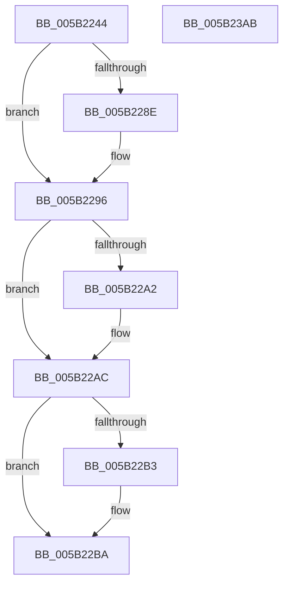

# KiSetupTimeIncrement

- RVA: `0x005B2244`–`0x005B23AC` (길이 `360` bytes)
- VA: `0x00000001405B2244`
- 실행 섹션: `.text`
- PDB 이름 있음: `예`; PDB Function 태그: `아니요`
- unwind 정보 RVA: `0x000C9BE4`
- 디코드: `75`개 명령, `360/360` bytes 표시
- 미해석 바이트: `0` (있으면 어셈블리에 `.byte`로 보존)

> 이 문서는 커널 이미지의 기계어와 PDB 기호를 분석해 생성했습니다. 4번과 5번은 함수 원형과 자료형을 바이너리 사용 방식에서 추정한 C 해석이며 원본 소스 복구 결과는 아닙니다.

## 1. Dependencies

- 직접 호출 지점: **3**; 고유 호출 대상: **3**
- 직접 호출자로 확인된 함수: **1**
- RIP 상대 이미지 참조: **14**

### Outgoing calls
- `0x005B22D3` → [RtlpComputeFraction](../4F/RtlpComputeFraction_function_004FC140.md) (function, `0x004FC140`)
- `0x005B22F0` → [KeQueryPerformanceCounter](../37/KeQueryPerformanceCounter_function_0037E7E0.md) (function, `0x0037E7E0`)
- `0x005B230B` → [RtlGenerateQpcToIncrementConstants](../4B/RtlGenerateQpcToIncrementConstants_function_004BCB20.md) (function, `0x004BCB20`)

### Direct callers
- [KeInitializeClock](../../init/C7/KeInitializeClock_function_00C70C30.md) at `0x00C71115`

### Static image references
- `0x005B2270` → RVA `0x00FC50EC` (`ALMOSTRO`; read)
- `0x005B2279` → RVA `0x00FC6B3C` (`ALMOSTRO`; write)
- `0x005B2283` → RVA `0x00FC6AA0` (`ALMOSTRO`; write)
- `0x005B2290` → RVA `0x00FC50EC` (`ALMOSTRO`; write)
- `0x005B2296` → RVA `0x00FC5128` (`ALMOSTRO`; read)
- `0x005B22A5` → RVA `0x00FC5128` (`ALMOSTRO`; write)
- `0x005B22BF` → RVA `0x00E66898` (`.data`; write)
- `0x005B22DE` → RVA `0x00FC7318` (`ALMOSTRO`; write)
- `0x005B22E5` → RVA `0x00FC6BC6` (`ALMOSTRO`; write)
- `0x005B2301` → RVA `0x00FC7070` (`ALMOSTRO`; write)
- `0x005B2310` → RVA `0x00FC5008` (`ALMOSTRO`; read)
- `0x005B2393` → RVA `0x00FC6AA0` (`ALMOSTRO`; read)
- `0x005B2399` → RVA `0x00FC52A8` (`ALMOSTRO`; write)
- `0x005B239F` → RVA `0x00F231A8` (`.data`; write)

## 2. Other-region calls and transfers

- 다른 실행 섹션으로 향하는 call: **0**
- 별도 외부 분기/꼬리 이동을 확인하지 못했습니다.

## 3. Assembly (complete function range)

```asm
005B2244  48 89 5C 24 20                  mov qword ptr [rsp + 0x20], rbx
005B2249  57                              push rdi
005B224A  48 83 EC 20                     sub rsp, 0x20
005B224E  45 33 D2                        xor r10d, r10d
005B2251  4C 8B C1                        mov r8, rcx
005B2254  B9 88 13 00 00                  mov ecx, 0x1388
005B2259  4C 89 54 24 40                  mov qword ptr [rsp + 0x40], r10
005B225E  3B D1                           cmp edx, ecx
005B2260  44 88 54 24 30                  mov byte ptr [rsp + 0x30], r10b
005B2265  41 B9 5A 62 02 00               mov r9d, 0x2625a
005B226B  8B C2                           mov eax, edx
005B226D  0F 46 C1                        cmovbe eax, ecx
005B2270  8B 0D 76 2E A1 00               mov ecx, dword ptr [rip + 0xa12e76]
005B2276  4D 3B C1                        cmp r8, r9
005B2279  89 05 BD 48 A1 00               mov dword ptr [rip + 0xa148bd], eax
005B227F  45 0F 42 C8                     cmovb r9d, r8d
005B2283  44 89 0D 16 48 A1 00            mov dword ptr [rip + 0xa14816], r9d
005B228A  3B D1                           cmp edx, ecx
005B228C  76 08                           jbe 0x1405b2296
005B228E  8B CA                           mov ecx, edx
005B2290  89 15 56 2E A1 00               mov dword ptr [rip + 0xa12e56], edx
005B2296  48 8B 05 8B 2E A1 00            mov rax, qword ptr [rip + 0xa12e8b]
005B229D  4C 3B C0                        cmp r8, rax
005B22A0  73 0A                           jae 0x1405b22ac
005B22A2  49 8B C0                        mov rax, r8
005B22A5  48 89 05 7C 2E A1 00            mov qword ptr [rip + 0xa12e7c], rax
005B22AC  8B D1                           mov edx, ecx
005B22AE  48 3B C2                        cmp rax, rdx
005B22B1  73 07                           jae 0x1405b22ba
005B22B3  48 89 15 6E 2E A1 00            mov qword ptr [rip + 0xa12e6e], rdx
005B22BA  4C 8D 44 24 38                  lea r8, [rsp + 0x38]
005B22BF  44 89 0D D2 45 8B 00            mov dword ptr [rip + 0x8b45d2], r9d
005B22C6  41 8B D1                        mov edx, r9d
005B22C9  44 88 54 24 38                  mov byte ptr [rsp + 0x38], r10b
005B22CE  B9 01 00 00 00                  mov ecx, 1
005B22D3  E8 68 9E F4 FF                  call 0x1404fc140
005B22D8  8A 4C 24 38                     mov cl, byte ptr [rsp + 0x38]
005B22DC  F6 D9                           neg cl
005B22DE  48 89 05 33 50 A1 00            mov qword ptr [rip + 0xa15033], rax
005B22E5  88 0D DB 48 A1 00               mov byte ptr [rip + 0xa148db], cl
005B22EB  48 8D 4C 24 40                  lea rcx, [rsp + 0x40]
005B22F0  E8 EB C4 DC FF                  call 0x14037e7e0
005B22F5  48 8B 5C 24 40                  mov rbx, qword ptr [rsp + 0x40]
005B22FA  48 8D 54 24 30                  lea rdx, [rsp + 0x30]
005B22FF  8B CB                           mov ecx, ebx
005B2301  48 89 1D 68 4D A1 00            mov qword ptr [rip + 0xa14d68], rbx
005B2308  48 8B F8                        mov rdi, rax
005B230B  E8 10 A8 F0 FF                  call 0x1404bcb20
005B2310  48 8B 0D F1 2C A1 00            mov rcx, qword ptr [rip + 0xa12cf1]
005B2317  8A 54 24 30                     mov dl, byte ptr [rsp + 0x30]
005B231B  48 89 99 00 03 00 00            mov qword ptr [rcx + 0x300], rbx
005B2322  48 8B 0D DF 2C A1 00            mov rcx, qword ptr [rip + 0xa12cdf]
005B2329  48 8B 5C 24 48                  mov rbx, qword ptr [rsp + 0x48]
005B232E  48 89 81 60 03 00 00            mov qword ptr [rcx + 0x360], rax
005B2335  48 8B 0D CC 2C A1 00            mov rcx, qword ptr [rip + 0xa12ccc]
005B233C  88 91 69 03 00 00               mov byte ptr [rcx + 0x369], dl
005B2342  33 D2                           xor edx, edx
005B2344  48 A1 60 03 00 00 80 F7 FF FF   movabs rax, qword ptr [0xfffff78000000360]
005B234E  48 8B 0D B3 2C A1 00            mov rcx, qword ptr [rip + 0xa12cb3]
005B2355  48 89 81 58 03 00 00            mov qword ptr [rcx + 0x358], rax
005B235C  A0 69 03 00 00 80 F7 FF FF      movabs al, byte ptr [0xfffff78000000369]
005B2365  48 8B 0D 9C 2C A1 00            mov rcx, qword ptr [rip + 0xa12c9c]
005B236C  88 81 68 03 00 00               mov byte ptr [rcx + 0x368], al
005B2372  48 8B 05 8F 2C A1 00            mov rax, qword ptr [rip + 0xa12c8f]
005B2379  48 89 B8 48 03 00 00            mov qword ptr [rax + 0x348], rdi
005B2380  48 8B 05 81 2C A1 00            mov rax, qword ptr [rip + 0xa12c81]
005B2387  48 89 B8 50 03 00 00            mov qword ptr [rax + 0x350], rdi
005B238E  B8 80 96 98 00                  mov eax, 0x989680
005B2393  F7 35 07 47 A1 00               div dword ptr [rip + 0xa14707]
005B2399  89 05 09 2F A1 00               mov dword ptr [rip + 0xa12f09], eax
005B239F  89 05 03 0E 97 00               mov dword ptr [rip + 0x970e03], eax
005B23A5  48 83 C4 20                     add rsp, 0x20
005B23A9  5F                              pop rdi
005B23AA  C3                              ret
005B23AB  CC                              int3
```

## 4. C-style interpretation (structured pseudocode)

```c
__int64 __fastcall KiSetupTimeIncrement(__int64 a1, int a2)
{
    __int64 result;
    __int64 v_r10;
    __int64 v_rsp;
    unsigned __int64 v_stack_p10;
    unsigned __int64 v_stack_p18;
    unsigned __int64 v_stack_p20;
    unsigned __int8 v_stack_p8;

    v_stack_p20 = v_rbx;
    v_rsp = (v_rsp) - (32);
    v_r10 = 0;
    v_stack_p18 = 0;
    v_stack_p8 = 0;
    result = (unsigned int)(a2);
    if (a2 <= ((unsigned int)((unsigned int)(0x1388ULL)))) { result = (unsigned int)((unsigned int)(0x1388ULL)); }
    *(unsigned int *)(v_rip + 10569917) = (unsigned int)(result);
    a4 = (unsigned int)(0x2625AULL);
    if (a1 < ((unsigned int)(0x2625AULL))) { a4 = (unsigned int)(a1); }
    *(unsigned int *)(v_rip + 10569750) = (unsigned int)(a4);
    if (a2 >= = ((unsigned int)((unsigned int)(*(unsigned int *)(v_rip + 10563190))))) {
        a1 = a2;
        *(unsigned int *)(v_rip + 10563158) = a2;
    }
    result = *(unsigned __int64 *)(v_rip + 10563211);
    if (a1 < (*(unsigned __int64 *)(v_rip + 10563211))) {
        result = a1;
        *(unsigned __int64 *)(v_rip + 10563196) = result;
    }
    if (result < ((unsigned int)((unsigned int)(a1)))) {
        *(unsigned __int64 *)(v_rip + 10563182) = (unsigned int)((unsigned int)(a1));
    }
    *(unsigned int *)(v_rip + 9127378) = (unsigned int)(a4);
    v_stack_p10 = 0;
    result = RtlpComputeFraction(1, (unsigned int)((unsigned int)(a4)), v_stack_p10, a4);
    a1 = (unsigned __int8)(-(v_stack_p10));
    *(unsigned __int64 *)(v_rip + 10571827) = result;
    *(unsigned __int8 *)(v_rip + 10569947) = (unsigned __int8)(a1);
    result = KeQueryPerformanceCounter(v_stack_p18, (unsigned int)((unsigned int)(a4)), v_stack_p10, a4);
    *(unsigned __int64 *)(v_rip + 10571112) = v_stack_p18;
    result = RtlGenerateQpcToIncrementConstants((unsigned int)((unsigned int)(v_stack_p18)), v_stack_p8, v_stack_p10, a4);
    *(unsigned __int64 *)(*(unsigned __int64 *)(v_rip + 10562801) + 768) = v_stack_p18;
    *(unsigned __int64 *)(*(unsigned __int64 *)(v_rip + 10562783) + 864) = result;
    *(unsigned __int8 *)(*(unsigned __int64 *)(v_rip + 10562764) + 873) = (unsigned __int8)(v_stack_p8);
    a2 = 0;
    *(unsigned __int64 *)(*(unsigned __int64 *)(v_rip + 10562739) + 856) = result;
    *(unsigned __int8 *)(*(unsigned __int64 *)(v_rip + 10562716) + 872) = (unsigned __int8)(result);
    *(unsigned __int64 *)(*(unsigned __int64 *)(v_rip + 10562703) + 840) = result;
    *(unsigned __int64 *)(*(unsigned __int64 *)(v_rip + 10562689) + 848) = result;
    *(unsigned int *)(v_rip + 10563337) = (unsigned int)((unsigned int)(0x989680ULL));
    *(unsigned int *)(v_rip + 9899523) = (unsigned int)((unsigned int)(0x989680ULL));
    v_rsp = (v_rsp) + (32);
    return (unsigned int)(0x989680ULL);
}
```

## 5. (Beta) C Style

```c
int64_t KiSetupTimeIncrement(int64_t Arg1, int32_t Arg2)
{
    int64_t result;
    int64_t local_r10;
    int64_t local_rsp;
    uint64_t v_stack_p10;
    uint64_t v_stack_p18;
    uint64_t v_stack_p20;
    uint8_t v_stack_p8;

    v_stack_p20 = local_rbx;
    local_rsp = (local_rsp) - (32);
    local_r10 = 0;
    v_stack_p18 = 0;
    v_stack_p8 = 0;
    result = (uint32_t)(Arg2);
    if (Arg2 <= ((uint32_t)((uint32_t)(0x1388ULL)))) { result = (uint32_t)((uint32_t)(0x1388ULL)); }
    *(uint32_t *)(v_rip + 0xA148BD) = (uint32_t)(result);
    a4 = (uint32_t)(0x2625AULL);
    if (Arg1 < ((uint32_t)(0x2625AULL))) { a4 = (uint32_t)(Arg1); }
    *(uint32_t *)(v_rip + 0xA14816) = (uint32_t)(a4);
    if (Arg2 >= = ((uint32_t)((uint32_t)(*(uint32_t *)(v_rip + 0xA12E76))))) {
        Arg1 = Arg2;
        *(uint32_t *)(v_rip + 0xA12E56) = Arg2;
    }
    result = *(uint64_t *)(v_rip + 0xA12E8B);
    if (Arg1 < (*(uint64_t *)(v_rip + 0xA12E8B))) {
        result = Arg1;
        *(uint64_t *)(v_rip + 0xA12E7C) = result;
    }
    if (result < ((uint32_t)((uint32_t)(Arg1)))) {
        *(uint64_t *)(v_rip + 0xA12E6E) = (uint32_t)((uint32_t)(Arg1));
    }
    *(uint32_t *)(v_rip + 0x8B45D2) = (uint32_t)(a4);
    v_stack_p10 = 0;
    result = RtlpComputeFraction(1, (uint32_t)((uint32_t)(a4)), v_stack_p10, a4);
    Arg1 = (uint8_t)(-(v_stack_p10));
    *(uint64_t *)(v_rip + 0xA15033) = result;
    *(uint8_t *)(v_rip + 0xA148DB) = (uint8_t)(Arg1);
    result = KeQueryPerformanceCounter(v_stack_p18, (uint32_t)((uint32_t)(a4)), v_stack_p10, a4);
    *(uint64_t *)(v_rip + 0xA14D68) = v_stack_p18;
    result = RtlGenerateQpcToIncrementConstants((uint32_t)((uint32_t)(v_stack_p18)), v_stack_p8, v_stack_p10, a4);
    *(uint64_t *)(*(uint64_t *)(v_rip + 0xA12CF1) + 0x300) = v_stack_p18;
    *(uint64_t *)(*(uint64_t *)(v_rip + 0xA12CDF) + 0x360) = result;
    *(uint8_t *)(*(uint64_t *)(v_rip + 0xA12CCC) + 0x369) = (uint8_t)(v_stack_p8);
    Arg2 = 0;
    *(uint64_t *)(*(uint64_t *)(v_rip + 0xA12CB3) + 0x358) = result;
    *(uint8_t *)(*(uint64_t *)(v_rip + 0xA12C9C) + 0x368) = (uint8_t)(result);
    *(uint64_t *)(*(uint64_t *)(v_rip + 0xA12C8F) + 0x348) = result;
    *(uint64_t *)(*(uint64_t *)(v_rip + 0xA12C81) + 0x350) = result;
    *(uint32_t *)(v_rip + 0xA12F09) = (uint32_t)((uint32_t)(0x989680ULL));
    *(uint32_t *)(v_rip + 0x970E03) = (uint32_t)((uint32_t)(0x989680ULL));
    local_rsp = (local_rsp) + (32);
    return (uint32_t)(0x989680ULL);
}
```

## 6. Execution-region graph

[열기: 2D/3D 그래프와 함수 탐색 컨트롤 패널](../../../control-panel.html?section=text&rva=0x005B2244&view=graph)

- 2D 그래프는 위에서 아래로 흐르고, 3D 그래프는 빈 공간을 드래그해 회전합니다. Shift+드래그는 이동, 휠은 확대·축소, 함수 노드 선택은 대상 보고서 이동입니다.

### Static fallback


