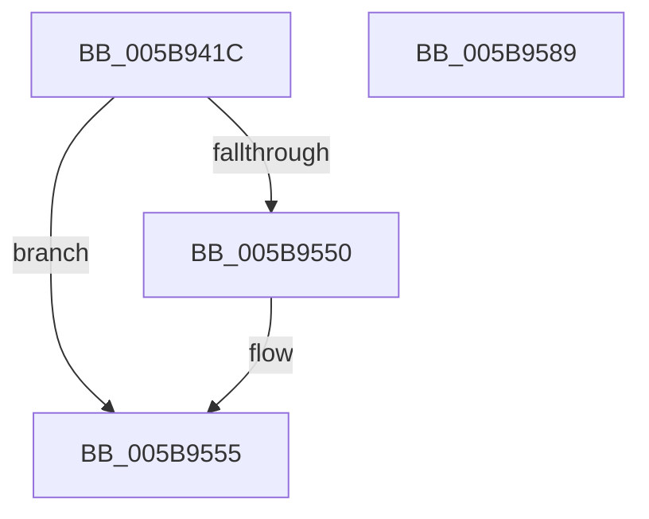

# KiStartPrcbThread

- RVA: `0x005B941C`–`0x005B958A` (길이 `366` bytes)
- VA: `0x00000001405B941C`
- 실행 섹션: `.text`
- PDB 이름 있음: `예`; PDB Function 태그: `아니요`
- unwind 정보 RVA: `0x000CA080`
- 디코드: `83`개 명령, `366/366` bytes 표시
- 미해석 바이트: `0` (있으면 어셈블리에 `.byte`로 보존)

> 이 문서는 커널 이미지의 기계어와 PDB 기호를 분석해 생성했습니다. 4번과 5번은 함수 원형과 자료형을 바이너리 사용 방식에서 추정한 C 해석이며 원본 소스 복구 결과는 아닙니다.

## 1. Dependencies

- 직접 호출 지점: **9**; 고유 호출 대상: **5**
- 직접 호출자로 확인된 함수: **3**
- RIP 상대 이미지 참조: **4**

### Outgoing calls
- `0x005B9452` → [memset](../6C/memset_function_006C6C40.md) (function, `0x006C6C40`)
- `0x005B9473` → [memset](../6C/memset_function_006C6C40.md) (function, `0x006C6C40`)
- `0x005B947F` → [KeAddProcessorAffinityEx](../25/KeAddProcessorAffinityEx_function_0025B6F0.md) (function, `0x0025B6F0`)
- `0x005B948F` → [KeStartThread](../3C/KeStartThread_function_003C21B8.md) (function, `0x003C21B8`)
- `0x005B94A9` → [memset](../6C/memset_function_006C6C40.md) (function, `0x006C6C40`)
- `0x005B94C6` → [memset](../6C/memset_function_006C6C40.md) (function, `0x006C6C40`)
- `0x005B94D8` → [KeAddProcessorAffinityEx](../25/KeAddProcessorAffinityEx_function_0025B6F0.md) (function, `0x0025B6F0`)
- `0x005B9506` → [KiCopyAffinityEx](../2C/KiCopyAffinityEx_function_002CE860.md) (function, `0x002CE860`)
- `0x005B9571` → [_security_check_cookie](../6A/_security_check_cookie_function_006AC640.md) (function, `0x006AC640`)

### Direct callers
- [KiCompleteBootProcessorContextInitialization](KiCompleteBootProcessorContextInitialization_function_005B7634.md) at `0x005B7773`
- [KiCompleteBootProcessorContextInitialization](KiCompleteBootProcessorContextInitialization_function_005B7634.md) at `0x005B778F`
- [KiStartPrcbThreads](KiStartPrcbThreads_function_005B8648.md) at `0x005B865B`
- [KiStartPrcbThreads](KiStartPrcbThreads_function_005B8648.md) at `0x005B866A`
- [KiStartIdleThread](../5C/KiStartIdleThread_function_005C46B0.md) at `0x005C4724`

### Static image references
- `0x005B942B` → RVA `0x00E0A740` (`.data`; read)
- `0x005B9512` → RVA `0x00FD0270` (`CACHEALI`; read)
- `0x005B9544` → RVA `0x00FD0278` (`CACHEALI`; read)
- `0x005B955F` → RVA `0x00FD0278` (`CACHEALI`; write)

## 2. Other-region calls and transfers

- 다른 실행 섹션으로 향하는 call: **0**
- 별도 외부 분기/꼬리 이동을 확인하지 못했습니다.

## 3. Assembly (complete function range)

```asm
005B941C  48 89 5C 24 18                  mov qword ptr [rsp + 0x18], rbx
005B9421  55                              push rbp
005B9422  56                              push rsi
005B9423  57                              push rdi
005B9424  48 81 EC 40 01 00 00            sub rsp, 0x140
005B942B  48 8B 05 0E 13 85 00            mov rax, qword ptr [rip + 0x85130e]
005B9432  48 33 C4                        xor rax, rsp
005B9435  48 89 84 24 30 01 00 00         mov qword ptr [rsp + 0x130], rax
005B943D  48 8B FA                        mov rdi, rdx
005B9440  48 8B F1                        mov rsi, rcx
005B9443  BB 00 01 00 00                  mov ebx, 0x100
005B9448  48 8D 4C 24 28                  lea rcx, [rsp + 0x28]
005B944D  44 8B C3                        mov r8d, ebx
005B9450  33 D2                           xor edx, edx
005B9452  E8 E9 D7 10 00                  call 0x1406c6c40
005B9457  83 64 24 24 00                  and dword ptr [rsp + 0x24], 0
005B945C  48 8D 4C 24 28                  lea rcx, [rsp + 0x28]
005B9461  44 8B C3                        mov r8d, ebx
005B9464  C7 44 24 20 01 00 20 00         mov dword ptr [rsp + 0x20], 0x200001
005B946C  33 D2                           xor edx, edx
005B946E  BD 01 00 00 00                  mov ebp, 1
005B9473  E8 C8 D7 10 00                  call 0x1406c6c40
005B9478  33 D2                           xor edx, edx
005B947A  48 8D 4C 24 20                  lea rcx, [rsp + 0x20]
005B947F  E8 6C 22 CA FF                  call 0x14025b6f0
005B9484  45 33 C0                        xor r8d, r8d
005B9487  48 8D 54 24 20                  lea rdx, [rsp + 0x20]
005B948C  48 8B CE                        mov rcx, rsi
005B948F  E8 24 8D E0 FF                  call 0x1403c21b8
005B9494  48 8B 9E 40 02 00 00            mov rbx, qword ptr [rsi + 0x240]
005B949B  33 D2                           xor edx, edx
005B949D  44 0F B7 03                     movzx r8d, word ptr [rbx]
005B94A1  48 8D 4B 08                     lea rcx, [rbx + 8]
005B94A5  49 C1 E0 03                     shl r8, 3
005B94A9  E8 92 D7 10 00                  call 0x1406c6c40
005B94AE  66 89 2B                        mov word ptr [rbx], bp
005B94B1  33 D2                           xor edx, edx
005B94B3  48 8B 9E 28 02 00 00            mov rbx, qword ptr [rsi + 0x228]
005B94BA  44 0F B7 03                     movzx r8d, word ptr [rbx]
005B94BE  48 8D 4B 08                     lea rcx, [rbx + 8]
005B94C2  49 C1 E0 03                     shl r8, 3
005B94C6  E8 75 D7 10 00                  call 0x1406c6c40
005B94CB  66 89 2B                        mov word ptr [rbx], bp
005B94CE  8B 57 24                        mov edx, dword ptr [rdi + 0x24]
005B94D1  48 8B 8E 28 02 00 00            mov rcx, qword ptr [rsi + 0x228]
005B94D8  E8 13 22 CA FF                  call 0x14025b6f0
005B94DD  0F B6 87 D0 00 00 00            movzx eax, byte ptr [rdi + 0xd0]
005B94E4  48 8B 8E 40 02 00 00            mov rcx, qword ptr [rsi + 0x240]
005B94EB  4C 8B 86 28 02 00 00            mov r8, qword ptr [rsi + 0x228]
005B94F2  66 89 86 30 02 00 00            mov word ptr [rsi + 0x230], ax
005B94F9  8B 47 24                        mov eax, dword ptr [rdi + 0x24]
005B94FC  89 86 C4 00 00 00               mov dword ptr [rsi + 0xc4], eax
005B9502  0F B7 51 02                     movzx edx, word ptr [rcx + 2]
005B9506  E8 55 53 D1 FF                  call 0x1402ce860
005B950B  0F B6 87 D0 00 00 00            movzx eax, byte ptr [rdi + 0xd0]
005B9512  48 8D 0D 57 6D A1 00            lea rcx, [rip + 0xa16d57]
005B9519  66 89 86 48 02 00 00            mov word ptr [rsi + 0x248], ax
005B9520  8B 47 24                        mov eax, dword ptr [rdi + 0x24]
005B9523  89 86 4C 02 00 00               mov dword ptr [rsi + 0x24c], eax
005B9529  8B 47 24                        mov eax, dword ptr [rdi + 0x24]
005B952C  83 4E 74 08                     or dword ptr [rsi + 0x74], 8
005B9530  89 86 18 02 00 00               mov dword ptr [rsi + 0x218], eax
005B9536  C6 86 C3 00 00 00 3F            mov byte ptr [rsi + 0xc3], 0x3f
005B953D  48 81 C6 78 05 00 00            add rsi, 0x578
005B9544  48 8B 05 2D 6D A1 00            mov rax, qword ptr [rip + 0xa16d2d]
005B954B  48 39 08                        cmp qword ptr [rax], rcx
005B954E  74 05                           je 0x1405b9555
005B9550  8D 4D 02                        lea ecx, [rbp + 2]
005B9553  CD 29                           int 0x29
005B9555  48 89 0E                        mov qword ptr [rsi], rcx
005B9558  48 89 46 08                     mov qword ptr [rsi + 8], rax
005B955C  48 89 30                        mov qword ptr [rax], rsi
005B955F  48 89 35 12 6D A1 00            mov qword ptr [rip + 0xa16d12], rsi
005B9566  48 8B 8C 24 30 01 00 00         mov rcx, qword ptr [rsp + 0x130]
005B956E  48 33 CC                        xor rcx, rsp
005B9571  E8 CA 30 0F 00                  call 0x1406ac640
005B9576  48 8B 9C 24 70 01 00 00         mov rbx, qword ptr [rsp + 0x170]
005B957E  48 81 C4 40 01 00 00            add rsp, 0x140
005B9585  5F                              pop rdi
005B9586  5E                              pop rsi
005B9587  5D                              pop rbp
005B9588  C3                              ret
005B9589  CC                              int3
```

## 4. C-style interpretation (structured pseudocode)

```c
__int64 __fastcall KiStartPrcbThread(__int64 a1, __int64 a2)
{
    __int64 result;
    __int64 v_rsi;
    __int64 v_rsp;
    unsigned __int64 v_stack_m130;
    unsigned int v_stack_m134;
    unsigned int v_stack_m138;
    unsigned __int64 v_stack_m28;
    unsigned __int64 v_stack_p18;

    v_stack_p18 = v_rbx;
    v_rsp = (v_rsp) - (320);
    result = (*(unsigned __int64 *)(v_rip + 8721166)) ^ (v_rsp);
    v_stack_m28 = result;
    a2 = 0;
    result = memset(v_stack_m130, a2, 256, a4);
    v_stack_m138 = 0x200001ULL;
    a2 = 0;
    result = memset(v_stack_m130, a2, 256, a4);
    a2 = 0;
    result = KeAddProcessorAffinityEx(v_stack_m138, a2, 256, a4);
    a3 = 0;
    result = KeStartThread(a1, v_stack_m138, a3, a4);
    a2 = 0;
    a3 = (*(unsigned __int16 *)(*(unsigned __int64 *)(a1 + 576))) << (3);
    result = memset(*(unsigned __int64 *)(a1 + 576) + 8, a2, a3, a4);
    *(unsigned __int16 *)(*(unsigned __int64 *)(a1 + 576)) = 1;
    a2 = 0;
    a3 = (*(unsigned __int16 *)(*(unsigned __int64 *)(a1 + 552))) << (3);
    result = memset(*(unsigned __int64 *)(a1 + 552) + 8, a2, a3, a4);
    *(unsigned __int16 *)(*(unsigned __int64 *)(a1 + 552)) = 1;
    result = KeAddProcessorAffinityEx(*(unsigned __int64 *)(a1 + 552), (unsigned int)(*(unsigned int *)(a2 + 36)), a3, a4);
    *(unsigned __int16 *)(a1 + 560) = (unsigned __int16)(*(unsigned __int8 *)(a2 + 208));
    *(unsigned int *)(a1 + 196) = (unsigned int)((unsigned int)(*(unsigned int *)(a2 + 36)));
    result = KiCopyAffinityEx(*(unsigned __int64 *)(a1 + 576), *(unsigned __int16 *)(*(unsigned __int64 *)(a1 + 576) + 2), *(unsigned __int64 *)(a1 + 552), a4);
    *(unsigned __int16 *)(a1 + 584) = (unsigned __int16)(*(unsigned __int8 *)(a2 + 208));
    *(unsigned int *)(a1 + 588) = (unsigned int)((unsigned int)(*(unsigned int *)(a2 + 36)));
    *(unsigned int *)(a1 + 536) = (unsigned int)((unsigned int)(*(unsigned int *)(a2 + 36)));
    *(unsigned __int8 *)(a1 + 195) = 63;
    v_rsi = (a1) + (0x578ULL);
    if ((*(unsigned __int64 *)(*(unsigned __int64 *)(v_rip + 10579245))) != (v_rip + 10579287)) {
        a1 = 1 + 2;
    }
    *(unsigned __int64 *)(v_rsi) = a1;
    *(unsigned __int64 *)(v_rsi + 8) = *(unsigned __int64 *)(v_rip + 10579245);
    *(unsigned __int64 *)(*(unsigned __int64 *)(v_rip + 10579245)) = v_rsi;
    *(unsigned __int64 *)(v_rip + 10579218) = v_rsi;
    a1 = (v_stack_m28) ^ (v_rsp);
    result = _security_check_cookie(a1, *(unsigned __int16 *)(*(unsigned __int64 *)(a1 + 576) + 2), *(unsigned __int64 *)(a1 + 552), a4);
    v_rsp = (v_rsp) + (320);
    return result;
}
```

## 5. (Beta) C Style

```c
int64_t KiStartPrcbThread(void *Arg1, void *Arg2)
{
    uint8_t *arg1 = (uint8_t *)Arg1;
    uint8_t *arg2 = (uint8_t *)Arg2;

    int64_t result;
    int64_t local_rsi;
    int64_t local_rsp;
    uint64_t v_stack_m130;
    uint32_t v_stack_m134;
    uint32_t v_stack_m138;
    uint64_t v_stack_m28;
    uint64_t v_stack_p18;

    v_stack_p18 = local_rbx;
    local_rsp = (local_rsp) - (320);
    result = (*(uint64_t *)(v_rip + 0x85130E)) ^ (local_rsp);
    v_stack_m28 = result;
    Arg2 = 0;
    result = memset(v_stack_m130, Arg2, 256, a4);
    v_stack_m138 = 0x200001ULL;
    Arg2 = 0;
    result = memset(v_stack_m130, Arg2, 256, a4);
    Arg2 = 0;
    result = KeAddProcessorAffinityEx(v_stack_m138, Arg2, 256, a4);
    a3 = 0;
    result = KeStartThread(Arg1, v_stack_m138, a3, a4);
    Arg2 = 0;
    a3 = (*(uint16_t *)(*(uint64_t *)(arg1 + 0x240))) << (3);
    result = memset(*(uint64_t *)(arg1 + 0x240) + 8, Arg2, a3, a4);
    *(uint16_t *)(*(uint64_t *)(arg1 + 0x240)) = 1;
    Arg2 = 0;
    a3 = (*(uint16_t *)(*(uint64_t *)(arg1 + 0x228))) << (3);
    result = memset(*(uint64_t *)(arg1 + 0x228) + 8, Arg2, a3, a4);
    *(uint16_t *)(*(uint64_t *)(arg1 + 0x228)) = 1;
    result = KeAddProcessorAffinityEx(*(uint64_t *)(arg1 + 0x228), (uint32_t)(*(uint32_t *)(arg2 + 0x24)), a3, a4);
    *(uint16_t *)(arg1 + 0x230) = (uint16_t)(*(uint8_t *)(arg2 + 0xD0));
    *(uint32_t *)(arg1 + 0xC4) = (uint32_t)((uint32_t)(*(uint32_t *)(arg2 + 0x24)));
    result = KiCopyAffinityEx(*(uint64_t *)(arg1 + 0x240), *(uint16_t *)(*(uint64_t *)(arg1 + 0x240) + 0x2), *(uint64_t *)(arg1 + 0x228), a4);
    *(uint16_t *)(arg1 + 0x248) = (uint16_t)(*(uint8_t *)(arg2 + 0xD0));
    *(uint32_t *)(arg1 + 0x24C) = (uint32_t)((uint32_t)(*(uint32_t *)(arg2 + 0x24)));
    *(uint32_t *)(arg1 + 0x218) = (uint32_t)((uint32_t)(*(uint32_t *)(arg2 + 0x24)));
    *(uint8_t *)(arg1 + 0xC3) = 63;
    local_rsi = (Arg1) + (0x578ULL);
    if ((*(uint64_t *)(*(uint64_t *)(v_rip + 0xA16D2D))) != (v_rip + 10579287)) {
        Arg1 = 1 + 2;
    }
    *(void **)(local_rsi) = Arg1;
    *(uint64_t *)(local_rsi + 0x8) = *(uint64_t *)(v_rip + 0xA16D2D);
    *(uint64_t *)(*(uint64_t *)(v_rip + 0xA16D2D)) = local_rsi;
    *(uint64_t *)(v_rip + 0xA16D12) = local_rsi;
    Arg1 = (v_stack_m28) ^ (local_rsp);
    result = _security_check_cookie(Arg1, *(uint16_t *)(*(uint64_t *)(arg1 + 0x240) + 0x2), *(uint64_t *)(arg1 + 0x228), a4);
    local_rsp = (local_rsp) + (320);
    return result;
}
```

### 관측된 메모리 오프셋

구조체 형식이 확인되지 않은 접근은 인자 기준의 오프셋으로만 기록했습니다.

| 기준 인자 | 오프셋 표현 | 폭 (bit) | 접근 |
|---|---:|---:|---|
| `Arg1` | `+ 0x0` | `64` | `W` |
| `Arg1` | `+ 0x8` | `64` | `W` |
| `Arg1` | `+ 0x74` | `32` | `R/W` |
| `Arg1` | `+ 0xC3` | `8` | `W` |
| `Arg1` | `+ 0xC4` | `32` | `W` |
| `Arg1` | `+ 0x218` | `32` | `W` |
| `Arg1` | `+ 0x228` | `64` | `R` |
| `Arg1` | `+ 0x230` | `16` | `W` |
| `Arg1` | `+ 0x240` | `64` | `R` |
| `Arg1` | `+ 0x248` | `16` | `W` |
| `Arg1` | `+ 0x24C` | `32` | `W` |
| `Arg2` | `+ 0x24` | `32` | `R` |
| `Arg2` | `+ 0xD0` | `8` | `R` |

## 6. Execution-region graph

[열기: 2D/3D 그래프와 함수 탐색 컨트롤 패널](../../../control-panel.html?section=text&rva=0x005B941C&view=graph)

- 2D 그래프는 위에서 아래로 흐르고, 3D 그래프는 빈 공간을 드래그해 회전합니다. Shift+드래그는 이동, 휠은 확대·축소, 함수 노드 선택은 대상 보고서 이동입니다.

### Static fallback


