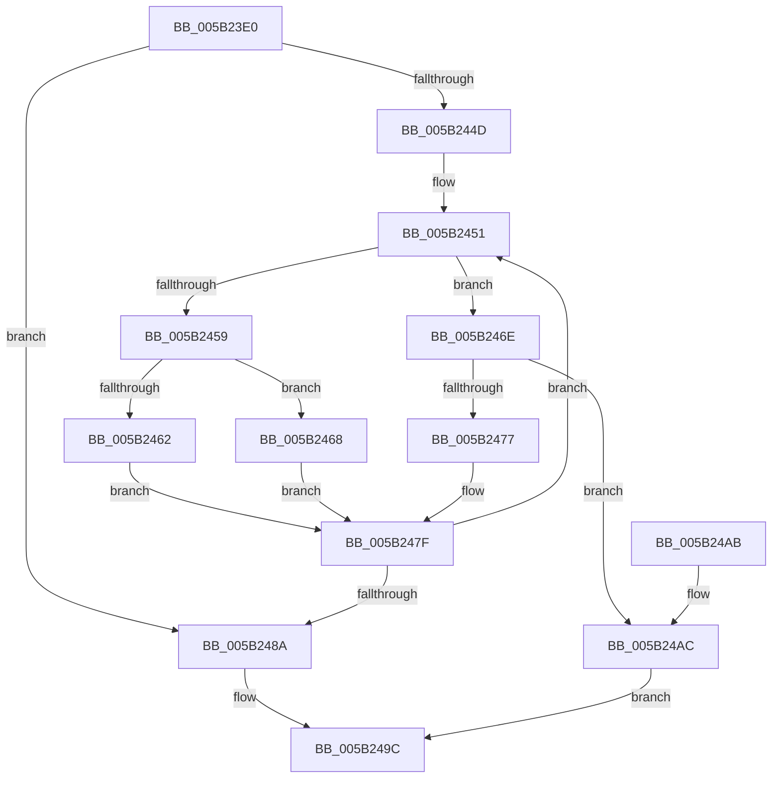

# KiTryUpgradeIsolationUnitLockHandle

- RVA: `0x005B23E0`–`0x005B24BF` (길이 `223` bytes)
- VA: `0x00000001405B23E0`
- 실행 섹션: `.text`
- PDB 이름 있음: `예`; PDB Function 태그: `아니요`
- unwind 정보 RVA: `0x000C9BB4`
- 디코드: `72`개 명령, `223/223` bytes 표시
- 미해석 바이트: `0` (있으면 어셈블리에 `.byte`로 보존)

> 이 문서는 커널 이미지의 기계어와 PDB 기호를 분석해 생성했습니다. 4번과 5번은 함수 원형과 자료형을 바이너리 사용 방식에서 추정한 C 해석이며 원본 소스 복구 결과는 아닙니다.

## 1. Dependencies

- 직접 호출 지점: **3**; 고유 호출 대상: **2**
- 직접 호출자로 확인된 함수: **1**
- RIP 상대 이미지 참조: **0**

### Outgoing calls
- `0x005B2420` → [KiPrcbArrayForIsolationWidth](../3F/KiPrcbArrayForIsolationWidth_function_003F5930.md) (function, `0x003F5930`)
- `0x005B2433` → [KiPrcbArrayForIsolationWidth](../3F/KiPrcbArrayForIsolationWidth_function_003F5930.md) (function, `0x003F5930`)
- `0x005B24B8` → [KzReleaseAdditionalPrcbLocks](../20/KzReleaseAdditionalPrcbLocks_function_00202B70.md) (function, `0x00202B70`)

### Direct callers
- [KiAcquirePrcbLocksForPreemptionAttemptSlowPath](../43/KiAcquirePrcbLocksForPreemptionAttemptSlowPath_function_00434910.md) at `0x0043495A`

### Static image references
- 디코드된 RIP-relative 메모리 참조가 없습니다.

## 2. Other-region calls and transfers

- 다른 실행 섹션으로 향하는 call: **0**
- 별도 외부 분기/꼬리 이동을 확인하지 못했습니다.

## 3. Assembly (complete function range)

```asm
005B23E0  48 89 5C 24 10                  mov qword ptr [rsp + 0x10], rbx
005B23E5  55                              push rbp
005B23E6  56                              push rsi
005B23E7  57                              push rdi
005B23E8  48 8B EC                        mov rbp, rsp
005B23EB  48 83 EC 40                     sub rsp, 0x40
005B23EF  48 8B 01                        mov rax, qword ptr [rcx]
005B23F2  4C 8D 4D 30                     lea r9, [rbp + 0x30]
005B23F6  33 DB                           xor ebx, ebx
005B23F8  8B F2                           mov esi, edx
005B23FA  8B 11                           mov edx, dword ptr [rcx]
005B23FC  4C 8D 45 38                     lea r8, [rbp + 0x38]
005B2400  48 83 E0 FE                     and rax, 0xfffffffffffffffe
005B2404  48 89 5D 38                     mov qword ptr [rbp + 0x38], rbx
005B2408  4C 8B D1                        mov r10, rcx
005B240B  48 89 45 F8                     mov qword ptr [rbp - 8], rax
005B240F  83 E2 01                        and edx, 1
005B2412  89 5D 30                        mov dword ptr [rbp + 0x30], ebx
005B2415  48 8D 4D F8                     lea rcx, [rbp - 8]
005B2419  48 89 5D F0                     mov qword ptr [rbp - 0x10], rbx
005B241D  89 5D 20                        mov dword ptr [rbp + 0x20], ebx
005B2420  E8 0B 35 E4 FF                  call 0x1403f5930
005B2425  48 8D 4D F8                     lea rcx, [rbp - 8]
005B2429  8B D6                           mov edx, esi
005B242B  4C 8D 4D 20                     lea r9, [rbp + 0x20]
005B242F  4C 8D 45 F0                     lea r8, [rbp - 0x10]
005B2433  E8 F8 34 E4 FF                  call 0x1403f5930
005B2438  48 8B 7D 38                     mov rdi, qword ptr [rbp + 0x38]
005B243C  44 8B C3                        mov r8d, ebx
005B243F  44 8B 5D 20                     mov r11d, dword ptr [rbp + 0x20]
005B2443  8B D3                           mov edx, ebx
005B2445  4C 8B 0F                        mov r9, qword ptr [rdi]
005B2448  45 85 DB                        test r11d, r11d
005B244B  74 3D                           je 0x1405b248a
005B244D  48 8B 4D F0                     mov rcx, qword ptr [rbp - 0x10]
005B2451  48 8B 01                        mov rax, qword ptr [rcx]
005B2454  49 3B C1                        cmp rax, r9
005B2457  75 15                           jne 0x1405b246e
005B2459  41 FF C0                        inc r8d
005B245C  44 3B 45 30                     cmp r8d, dword ptr [rbp + 0x30]
005B2460  75 06                           jne 0x1405b2468
005B2462  49 83 C9 FF                     or r9, 0xffffffffffffffff
005B2466  EB 17                           jmp 0x1405b247f
005B2468  4E 8B 0C C7                     mov r9, qword ptr [rdi + r8*8]
005B246C  EB 11                           jmp 0x1405b247f
005B246E  F0 48 0F BA 68 30 00            lock bts qword ptr [rax + 0x30], 0
005B2475  72 35                           jb 0x1405b24ac
005B2477  48 8B 7D 38                     mov rdi, qword ptr [rbp + 0x38]
005B247B  44 8B 5D 20                     mov r11d, dword ptr [rbp + 0x20]
005B247F  FF C2                           inc edx
005B2481  48 83 C1 08                     add rcx, 8
005B2485  41 3B D3                        cmp edx, r11d
005B2488  72 C7                           jb 0x1405b2451
005B248A  48 8B D6                        mov rdx, rsi
005B248D  B3 01                           mov bl, 1
005B248F  49 33 12                        xor rdx, qword ptr [r10]
005B2492  48 83 E2 FE                     and rdx, 0xfffffffffffffffe
005B2496  48 33 D6                        xor rdx, rsi
005B2499  49 89 12                        mov qword ptr [r10], rdx
005B249C  8A C3                           mov al, bl
005B249E  48 8B 5C 24 68                  mov rbx, qword ptr [rsp + 0x68]
005B24A3  48 83 C4 40                     add rsp, 0x40
005B24A7  5F                              pop rdi
005B24A8  5E                              pop rsi
005B24A9  5D                              pop rbp
005B24AA  C3                              ret
005B24AB  CC                              int3
005B24AC  4C 8B 45 38                     mov r8, qword ptr [rbp + 0x38]
005B24B0  48 8B 4D F0                     mov rcx, qword ptr [rbp - 0x10]
005B24B4  44 8B 4D 30                     mov r9d, dword ptr [rbp + 0x30]
005B24B8  E8 B3 06 C5 FF                  call 0x140202b70
005B24BD  EB DD                           jmp 0x1405b249c
```

## 4. C-style interpretation (structured pseudocode)

```c
__int64 __fastcall KiTryUpgradeIsolationUnitLockHandle(__int64 a1, int a2)
{
    __int64 result;
    __int64 v_rbx;
    __int64 v_rsp;
    unsigned __int64 v_stack_m20;
    unsigned __int64 v_stack_m28;
    unsigned __int64 v_stack_p10;
    unsigned __int64 v_stack_p18;
    unsigned __int64 v_stack_p20;
    unsigned int v_stack_p8;

    v_stack_p10 = v_rbx;
    v_rsp = (v_rsp) - (64);
    v_rbx = 0;
    result = (*(unsigned __int64 *)(a1)) & (-2);
    v_stack_p20 = 0;
    v_stack_m20 = result;
    a2 = (unsigned int)(((unsigned int)(*(unsigned int *)(a1))) & (1));
    v_stack_p18 = 0;
    v_stack_m28 = 0;
    v_stack_p8 = 0;
    result = KiPrcbArrayForIsolationWidth(v_stack_m20, a2, v_stack_p20, v_stack_p18);
    result = KiPrcbArrayForIsolationWidth(v_stack_m20, (unsigned int)((unsigned int)((unsigned int)(a2))), v_stack_m28, v_stack_p8);
    if ((unsigned int)((unsigned int)(v_stack_p8)) == 0) goto loc_005B248A;
loc_005B2451:
    if ((*(unsigned __int64 *)(v_stack_m28)) != (*(unsigned __int64 *)(v_stack_p20))) goto loc_005B246E;
    a3 = (unsigned int)((0) + 1);
    if (((unsigned int)(a3)) != v_stack_p18) goto loc_005B2468;
    a4 = (*(unsigned __int64 *)(v_stack_p20)) | (-1);
    goto loc_005B247F;
loc_005B2468:
    goto loc_005B247F;
loc_005B246E:
    if (condition_is_below) goto loc_005B24AC;
loc_005B247F:
    a2 = (unsigned int)((0) + 1);
    a1 = (v_stack_m28) + (8);
    if (a2 < ((unsigned int)((unsigned int)(v_stack_p8)))) goto loc_005B2451;
loc_005B248A:
    a2 = ((unsigned int)(a2)) ^ (*(unsigned __int64 *)(a1));
    a2 = (a2) & (-2);
    a2 = (a2) ^ ((unsigned int)(a2));
    *(unsigned __int64 *)(a1) = a2;
loc_005B249C:
    v_rsp = (v_rsp) + (64);
    return 1;
loc_005B24AC:
    result = KzReleaseAdditionalPrcbLocks(v_stack_m28, a2, v_stack_p20, (unsigned int)(v_stack_p18));
    goto loc_005B249C;
}
```

## 5. (Beta) C Style

```c
int64_t KiTryUpgradeIsolationUnitLockHandle(void *Arg1, int32_t Arg2)
{
    uint8_t *arg1 = (uint8_t *)Arg1;

    int64_t result;
    int64_t local_rbx;
    int64_t local_rsp;
    uint64_t v_stack_m20;
    uint64_t v_stack_m28;
    uint64_t v_stack_p10;
    uint64_t v_stack_p18;
    uint64_t v_stack_p20;
    uint32_t v_stack_p8;

    v_stack_p10 = local_rbx;
    local_rsp = (local_rsp) - (64);
    local_rbx = 0;
    result = (*(uint64_t *)(arg1)) & (-2);
    v_stack_p20 = 0;
    v_stack_m20 = result;
    Arg2 = (uint32_t)(((uint32_t)(*(uint32_t *)(arg1))) & (1));
    v_stack_p18 = 0;
    v_stack_m28 = 0;
    v_stack_p8 = 0;
    result = KiPrcbArrayForIsolationWidth(v_stack_m20, Arg2, v_stack_p20, v_stack_p18);
    result = KiPrcbArrayForIsolationWidth(v_stack_m20, (uint32_t)((uint32_t)((uint32_t)(Arg2))), v_stack_m28, v_stack_p8);
    if ((uint32_t)((uint32_t)(v_stack_p8)) == 0) goto loc_005B248A;
loc_005B2451:
    if ((*(uint64_t *)(v_stack_m28)) != (*(uint64_t *)(v_stack_p20))) goto loc_005B246E;
    a3 = (uint32_t)((0) + 1);
    if (((uint32_t)(a3)) != v_stack_p18) goto loc_005B2468;
    a4 = (*(uint64_t *)(v_stack_p20)) | (-1);
    goto loc_005B247F;
loc_005B2468:
    goto loc_005B247F;
loc_005B246E:
    if (condition_is_below) goto loc_005B24AC;
loc_005B247F:
    Arg2 = (uint32_t)((0) + 1);
    Arg1 = (v_stack_m28) + (8);
    if (Arg2 < ((uint32_t)((uint32_t)(v_stack_p8)))) goto loc_005B2451;
loc_005B248A:
    Arg2 = ((uint32_t)(Arg2)) ^ (*(uint64_t *)(arg1));
    Arg2 = (Arg2) & (-2);
    Arg2 = (Arg2) ^ ((uint32_t)(Arg2));
    *(uint64_t *)(arg1) = Arg2;
loc_005B249C:
    local_rsp = (local_rsp) + (64);
    return 1;
loc_005B24AC:
    result = KzReleaseAdditionalPrcbLocks(v_stack_m28, Arg2, v_stack_p20, (uint32_t)(v_stack_p18));
    goto loc_005B249C;
}
```

### 관측된 메모리 오프셋

구조체 형식이 확인되지 않은 접근은 인자 기준의 오프셋으로만 기록했습니다.

| 기준 인자 | 오프셋 표현 | 폭 (bit) | 접근 |
|---|---:|---:|---|
| `Arg1` | `+ 0x0` | `32` | `R` |
| `Arg1` | `+ 0x0` | `64` | `R` |

## 6. Execution-region graph

[열기: 2D/3D 그래프와 함수 탐색 컨트롤 패널](../../../control-panel.html?section=text&rva=0x005B23E0&view=graph)

- 2D 그래프는 위에서 아래로 흐르고, 3D 그래프는 빈 공간을 드래그해 회전합니다. Shift+드래그는 이동, 휠은 확대·축소, 함수 노드 선택은 대상 보고서 이동입니다.

### Static fallback


