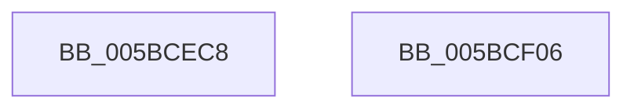

# KiUnassignProcessorNumberFromPrcb

- RVA: `0x005BCEC8`–`0x005BCF07` (길이 `63` bytes)
- VA: `0x00000001405BCEC8`
- 실행 섹션: `.text`
- PDB 이름 있음: `예`; PDB Function 태그: `아니요`
- unwind 정보 RVA: `0x000DB714`
- 디코드: `14`개 명령, `63/63` bytes 표시
- 미해석 바이트: `0` (있으면 어셈블리에 `.byte`로 보존)

> 이 문서는 커널 이미지의 기계어와 PDB 기호를 분석해 생성했습니다. 4번과 5번은 함수 원형과 자료형을 바이너리 사용 방식에서 추정한 C 해석이며 원본 소스 복구 결과는 아닙니다.

## 1. Dependencies

- 직접 호출 지점: **0**; 고유 호출 대상: **0**
- 직접 호출자로 확인된 함수: **1**
- RIP 상대 이미지 참조: **2**

### Outgoing calls
- 직접 디코드된 call 명령이 없습니다.

### Direct callers
- [KiStartDynamicProcessor](../../page/74/KiStartDynamicProcessor_function_007456C8.md) at `0x00745CD0`

### Static image references
- `0x005BCEC8` → RVA `0x00F231B0` (`.data`; read)
- `0x005BCEEC` → RVA `0x00F231B8` (`.data`; read)

## 2. Other-region calls and transfers

- 다른 실행 섹션으로 향하는 call: **0**
- 별도 외부 분기/꼬리 이동을 확인하지 못했습니다.

## 3. Assembly (complete function range)

```asm
005BCEC8  48 8B 05 E1 62 96 00            mov rax, qword ptr [rip + 0x9662e1]
005BCECF  45 33 D2                        xor r10d, r10d
005BCED2  8B 51 24                        mov edx, dword ptr [rcx + 0x24]
005BCED5  44 0F B6 81 D0 00 00 00         movzx r8d, byte ptr [rcx + 0xd0]
005BCEDD  44 0F B6 89 D1 00 00 00         movzx r9d, byte ptr [rcx + 0xd1]
005BCEE5  44 89 14 90                     mov dword ptr [rax + rdx*4], r10d
005BCEE9  41 8B D0                        mov edx, r8d
005BCEEC  48 8B 05 C5 62 96 00            mov rax, qword ptr [rip + 0x9662c5]
005BCEF3  48 C1 E2 06                     shl rdx, 6
005BCEF7  49 03 D1                        add rdx, r9
005BCEFA  44 89 14 90                     mov dword ptr [rax + rdx*4], r10d
005BCEFE  4C 89 91 C0 00 00 00            mov qword ptr [rcx + 0xc0], r10
005BCF05  C3                              ret
005BCF06  CC                              int3
```

## 4. C-style interpretation (structured pseudocode)

```c
__int64 __fastcall KiUnassignProcessorNumberFromPrcb(__int64 a1)
{
    __int64 v_r10;

    v_r10 = 0;
    *(unsigned int *)(*(unsigned __int64 *)(v_rip + 9855713) + (unsigned int)(*(unsigned int *)(a1 + 36)) * 4) = 0;
    a2 = ((unsigned int)((unsigned int)(*(unsigned __int8 *)(a1 + 208)))) << (6);
    a2 = (a2) + (*(unsigned __int8 *)(a1 + 209));
    *(unsigned int *)(*(unsigned __int64 *)(v_rip + 9855685) + a2 * 4) = 0;
    *(unsigned __int64 *)(a1 + 192) = 0;
    return *(unsigned __int64 *)(v_rip + 9855685);
}
```

## 5. (Beta) C Style

```c
int64_t KiUnassignProcessorNumberFromPrcb(void *Arg1)
{
    uint8_t *arg1 = (uint8_t *)Arg1;

    int64_t local_r10;

    local_r10 = 0;
    *(uint32_t *)(*(uint64_t *)(v_rip + 0x9662E1) + (uint32_t)(*(uint32_t *)(arg1 + 0x24)) * 4) = 0;
    a2 = ((uint32_t)((uint32_t)(*(uint8_t *)(arg1 + 0xD0)))) << (6);
    a2 = (a2) + (*(uint8_t *)(arg1 + 0xD1));
    *(uint32_t *)(*(uint64_t *)(v_rip + 0x9662C5) + a2 * 4) = 0;
    *(uint64_t *)(arg1 + 0xC0) = 0;
    return *(uint64_t *)(v_rip + 0x9662C5);
}
```

### 관측된 메모리 오프셋

구조체 형식이 확인되지 않은 접근은 인자 기준의 오프셋으로만 기록했습니다.

| 기준 인자 | 오프셋 표현 | 폭 (bit) | 접근 |
|---|---:|---:|---|
| `Arg1` | `+ 0x24` | `32` | `R` |
| `Arg1` | `+ 0xC0` | `64` | `W` |
| `Arg1` | `+ 0xD0` | `8` | `R` |
| `Arg1` | `+ 0xD1` | `8` | `R` |

## 6. Execution-region graph

[열기: 2D/3D 그래프와 함수 탐색 컨트롤 패널](../../../control-panel.html?section=text&rva=0x005BCEC8&view=graph)

- 2D 그래프는 위에서 아래로 흐르고, 3D 그래프는 빈 공간을 드래그해 회전합니다. Shift+드래그는 이동, 휠은 확대·축소, 함수 노드 선택은 대상 보고서 이동입니다.

### Static fallback


