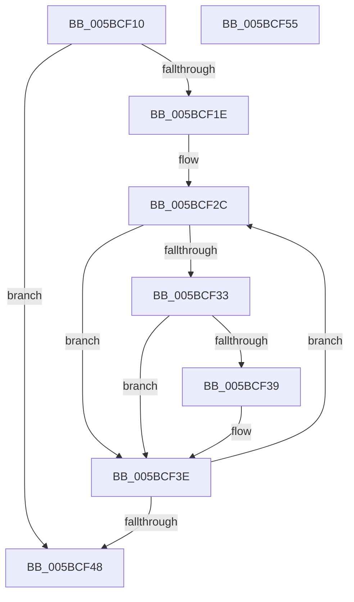

# KiUncommitGroupSubNodeAssignments

- RVA: `0x005BCF10`–`0x005BCF56` (길이 `70` bytes)
- VA: `0x00000001405BCF10`
- 실행 섹션: `.text`
- PDB 이름 있음: `예`; PDB Function 태그: `아니요`
- unwind 정보 RVA: `0x000DB714`
- 디코드: `21`개 명령, `70/70` bytes 표시
- 미해석 바이트: `0` (있으면 어셈블리에 `.byte`로 보존)

> 이 문서는 커널 이미지의 기계어와 PDB 기호를 분석해 생성했습니다. 4번과 5번은 함수 원형과 자료형을 바이너리 사용 방식에서 추정한 C 해석이며 원본 소스 복구 결과는 아닙니다.

## 1. Dependencies

- 직접 호출 지점: **0**; 고유 호출 대상: **0**
- 직접 호출자로 확인된 함수: **2**
- RIP 상대 이미지 참조: **3**

### Outgoing calls
- 직접 디코드된 call 명령이 없습니다.

### Direct callers
- [KiAllocateProcessorNumber](KiAllocateProcessorNumber_function_005BC2FC.md) at `0x005BC3C9`
- [KiFreeProcessorNumber](KiFreeProcessorNumber_function_005BCA68.md) at `0x005BCB0B`

### Static image references
- `0x005BCF10` → RVA `0x00F21AC8` (`.data`; read)
- `0x005BCF1E` → RVA `0x00F21AF0` (`.data`; read)
- `0x005BCF4D` → RVA `0x00E668F8` (`.data`; read/write)

## 2. Other-region calls and transfers

- 다른 실행 섹션으로 향하는 call: **0**
- 별도 외부 분기/꼬리 이동을 확인하지 못했습니다.

## 3. Assembly (complete function range)

```asm
005BCF10  0F B7 15 B1 4B 96 00            movzx edx, word ptr [rip + 0x964bb1]
005BCF17  33 C0                           xor eax, eax
005BCF19  66 3B C2                        cmp ax, dx
005BCF1C  73 2A                           jae 0x1405bcf48
005BCF1E  48 8B 05 CB 4B 96 00            mov rax, qword ptr [rip + 0x964bcb]
005BCF25  44 8B C2                        mov r8d, edx
005BCF28  48 83 C0 05                     add rax, 5
005BCF2C  8A 10                           mov dl, byte ptr [rax]
005BCF2E  F6 C2 01                        test dl, 1
005BCF31  75 0B                           jne 0x1405bcf3e
005BCF33  66 39 48 01                     cmp word ptr [rax + 1], cx
005BCF37  75 05                           jne 0x1405bcf3e
005BCF39  80 E2 FD                        and dl, 0xfd
005BCF3C  88 10                           mov byte ptr [rax], dl
005BCF3E  48 83 C0 18                     add rax, 0x18
005BCF42  49 83 E8 01                     sub r8, 1
005BCF46  75 E4                           jne 0x1405bcf2c
005BCF48  B8 FF FF 00 00                  mov eax, 0xffff
005BCF4D  66 01 05 A4 99 8A 00            add word ptr [rip + 0x8a99a4], ax
005BCF54  C3                              ret
005BCF55  CC                              int3
```

## 4. C-style interpretation (structured pseudocode)

```c
__int64 __fastcall KiUncommitGroupSubNodeAssignments(unsigned __int16 a1)
{
    __int64 result;

    result = 0;
    if (0 >= ((unsigned __int16)(*(unsigned __int16 *)(v_rip + 9849777)))) goto loc_005BCF48;
    result = (*(unsigned __int64 *)(v_rip + 9849803)) + (5);
loc_005BCF2C:
    if ((((unsigned __int8)(*(unsigned __int8 *)(result))) & (1)) != 0) goto loc_005BCF3E;
    if ((*(unsigned __int16 *)(result + 1)) == a1) {
        a2 = (unsigned __int8)((*(unsigned __int8 *)(result)) & (253));
        *(unsigned __int8 *)(result) = (unsigned __int8)(a2);
    }
    result = (result) + (24);
    a3 = ((unsigned int)((unsigned int)(*(unsigned __int16 *)(v_rip + 9849777)))) - (1);
    if (condition_is_not_equal) goto loc_005BCF2C;
loc_005BCF48:
    return (unsigned int)(0xFFFFULL);
}
```

## 5. (Beta) C Style

```c
int64_t KiUncommitGroupSubNodeAssignments(uint16_t Arg1)
{
    int64_t result;

    result = 0;
    if (0 >= ((uint16_t)(*(uint16_t *)(v_rip + 0x964BB1)))) goto loc_005BCF48;
    result = (*(uint64_t *)(v_rip + 0x964BCB)) + (5);
loc_005BCF2C:
    if ((((uint8_t)(*(uint8_t *)(result))) & (1)) != 0) goto loc_005BCF3E;
    if ((*(uint16_t *)(result + 0x1)) == Arg1) {
        a2 = (uint8_t)((*(uint8_t *)(result)) & (253));
        *(uint8_t *)(result) = (uint8_t)(a2);
    }
    result = (result) + (24);
    a3 = ((uint32_t)((uint32_t)(*(uint16_t *)(v_rip + 0x964BB1)))) - (1);
    if (condition_is_not_equal) goto loc_005BCF2C;
loc_005BCF48:
    return (uint32_t)(0xFFFFULL);
}
```

## 6. Execution-region graph

[열기: 2D/3D 그래프와 함수 탐색 컨트롤 패널](../../../control-panel.html?section=text&rva=0x005BCF10&view=graph)

- 2D 그래프는 위에서 아래로 흐르고, 3D 그래프는 빈 공간을 드래그해 회전합니다. Shift+드래그는 이동, 휠은 확대·축소, 함수 노드 선택은 대상 보고서 이동입니다.

### Static fallback


