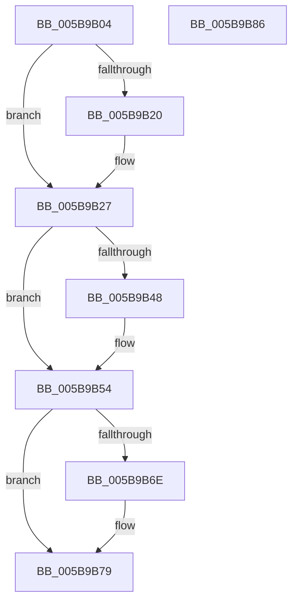

# KiUpdateSystemAvailableCpuState

- RVA: `0x005B9B04`–`0x005B9B87` (길이 `131` bytes)
- VA: `0x00000001405B9B04`
- 실행 섹션: `.text`
- PDB 이름 있음: `예`; PDB Function 태그: `아니요`
- unwind 정보 RVA: `0x0005CF00`
- 디코드: `32`개 명령, `131/131` bytes 표시
- 미해석 바이트: `0` (있으면 어셈블리에 `.byte`로 보존)

> 이 문서는 커널 이미지의 기계어와 PDB 기호를 분석해 생성했습니다. 4번과 5번은 함수 원형과 자료형을 바이너리 사용 방식에서 추정한 C 해석이며 원본 소스 복구 결과는 아닙니다.

## 1. Dependencies

- 직접 호출 지점: **6**; 고유 호출 대상: **6**
- 직접 호출자로 확인된 함수: **2**
- RIP 상대 이미지 참조: **4**

### Outgoing calls
- `0x005B9B22` → [KiRaiseIrqlProcessIrqlFlags](../4F/KiRaiseIrqlProcessIrqlFlags_function_004F56FC.md) (function, `0x004F56FC`)
- `0x005B9B2E` → [RtlWriteAcquireTickLock](../39/RtlWriteAcquireTickLock_function_0039D3B4.md) (function, `0x0039D3B4`)
- `0x005B9B3A` → [KiQueryCpuPartitionAffinity](../4F/KiQueryCpuPartitionAffinity_function_004F548C.md) (function, `0x004F548C`)
- `0x005B9B3F` → [KeIsForceParkingEnabled](../21/KeIsForceParkingEnabled_function_00218F20.md) (function, `0x00218F20`)
- `0x005B9B4F` → [KiRemoveForceParkedProcessorsFromAffinity](../42/KiRemoveForceParkedProcessorsFromAffinity_function_00427F70.md) (function, `0x00427F70`)
- `0x005B9B74` → [KiLowerIrqlProcessIrqlFlags](../4F/KiLowerIrqlProcessIrqlFlags_function_004F5698.md) (function, `0x004F5698`)

### Direct callers
- [KeTransitionProcessorParkState](../35/KeTransitionProcessorParkState_function_003527EC.md) at `0x00352AEA`
- [KeCpuPartitionMoveCpus](../5C/KeCpuPartitionMoveCpus_function_005C0B70.md) at `0x005C0D80`

### Static image references
- `0x005B9B17` → RVA `0x00FC6D20` (`ALMOSTRO`; read)
- `0x005B9B27` → RVA `0x00F23460` (`.data`; read)
- `0x005B9B33` → RVA `0x00F22EA0` (`.data`; read)
- `0x005B9B65` → RVA `0x00F23460` (`.data`; write)

## 2. Other-region calls and transfers

- 다른 실행 섹션으로 향하는 call: **0**
- 별도 외부 분기/꼬리 이동을 확인하지 못했습니다.

## 3. Assembly (complete function range)

```asm
005B9B04  40 53                           push rbx
005B9B06  48 83 EC 20                     sub rsp, 0x20
005B9B0A  44 0F 20 C3                     mov rbx, cr8
005B9B0E  BA 02 00 00 00                  mov edx, 2
005B9B13  44 0F 22 C2                     mov cr8, rdx
005B9B17  83 3D 02 D2 A0 00 00            cmp dword ptr [rip + 0xa0d202], 0
005B9B1E  74 07                           je 0x1405b9b27
005B9B20  8A CB                           mov cl, bl
005B9B22  E8 D5 BB F3 FF                  call 0x1404f56fc
005B9B27  48 8D 0D 32 99 96 00            lea rcx, [rip + 0x969932]
005B9B2E  E8 81 38 DE FF                  call 0x14039d3b4
005B9B33  48 8D 15 66 93 96 00            lea rdx, [rip + 0x969366]
005B9B3A  E8 4D B9 F3 FF                  call 0x1404f548c
005B9B3F  E8 DC F3 C5 FF                  call 0x140218f20
005B9B44  84 C0                           test al, al
005B9B46  74 0C                           je 0x1405b9b54
005B9B48  48 8D 0D 51 93 96 00            lea rcx, [rip + 0x969351]
005B9B4F  E8 1C E4 E6 FF                  call 0x140427f70
005B9B54  48 8B 05 05 99 96 00            mov rax, qword ptr [rip + 0x969905]
005B9B5B  48 FF C0                        inc rax
005B9B5E  83 3D BB D1 A0 00 00            cmp dword ptr [rip + 0xa0d1bb], 0
005B9B65  48 89 05 F4 98 96 00            mov qword ptr [rip + 0x9698f4], rax
005B9B6C  74 0B                           je 0x1405b9b79
005B9B6E  44 0F 20 C1                     mov rcx, cr8
005B9B72  8A D3                           mov dl, bl
005B9B74  E8 1F BB F3 FF                  call 0x1404f5698
005B9B79  0F B6 C3                        movzx eax, bl
005B9B7C  44 0F 22 C0                     mov cr8, rax
005B9B80  48 83 C4 20                     add rsp, 0x20
005B9B84  5B                              pop rbx
005B9B85  C3                              ret
005B9B86  CC                              int3
```

## 4. C-style interpretation (structured pseudocode)

```c
__int64 __fastcall KiUpdateSystemAvailableCpuState(void)
{
    __int64 result;
    __int64 v_rsp;

    v_rsp = (v_rsp) - (32);
    if ((*(unsigned int *)(v_rip + 10539522)) != 0) {
        a1 = (unsigned __int8)(v_cr8);
        result = KiRaiseIrqlProcessIrqlFlags(a1, 2, a3, a4);
    }
    result = RtlWriteAcquireTickLock(v_rip + 9869618, 2, a3, a4);
    result = KiQueryCpuPartitionAffinity(v_rip + 9869618, v_rip + 9868134, a3, a4);
    result = KeIsForceParkingEnabled(v_rip + 9869618, v_rip + 9868134, a3, a4);
    if ((unsigned __int8)(result) != 0) {
        a1 = v_rip + 9868113;
        result = KiRemoveForceParkedProcessorsFromAffinity(a1, v_rip + 9868134, a3, a4);
    }
    result = (*(unsigned __int64 *)(v_rip + 9869573)) + 1;
    *(unsigned __int64 *)(v_rip + 9869556) = result;
    if ((*(unsigned int *)(v_rip + 10539451)) != 0) {
        a1 = 2;
        a2 = (unsigned __int8)(v_cr8);
        result = KiLowerIrqlProcessIrqlFlags(a1, a2, a3, a4);
    }
    v_rsp = (v_rsp) + (32);
    return (unsigned __int8)(v_cr8);
}
```

## 5. (Beta) C Style

```c
void KiUpdateSystemAvailableCpuState(void)
{
    int64_t result;
    int64_t local_rsp;

    local_rsp = (local_rsp) - (32);
    if ((*(uint32_t *)(v_rip + 0xA0D202)) != 0) {
        a1 = (uint8_t)(v_cr8);
        result = KiRaiseIrqlProcessIrqlFlags(a1, 2, a3, a4);
    }
    result = RtlWriteAcquireTickLock(v_rip + 9869618, 2, a3, a4);
    result = KiQueryCpuPartitionAffinity(v_rip + 9869618, v_rip + 9868134, a3, a4);
    result = KeIsForceParkingEnabled(v_rip + 9869618, v_rip + 9868134, a3, a4);
    if ((uint8_t)(result) != 0) {
        a1 = v_rip + 9868113;
        result = KiRemoveForceParkedProcessorsFromAffinity(a1, v_rip + 9868134, a3, a4);
    }
    result = (*(uint64_t *)(v_rip + 0x969905)) + 1;
    *(uint64_t *)(v_rip + 0x9698F4) = result;
    if ((*(uint32_t *)(v_rip + 0xA0D1BB)) != 0) {
        a1 = 2;
        a2 = (uint8_t)(v_cr8);
        result = KiLowerIrqlProcessIrqlFlags(a1, a2, a3, a4);
    }
    local_rsp = (local_rsp) + (32);
    return (uint8_t)(v_cr8);
}
```

## 6. Execution-region graph

[열기: 2D/3D 그래프와 함수 탐색 컨트롤 패널](../../../control-panel.html?section=text&rva=0x005B9B04&view=graph)

- 2D 그래프는 위에서 아래로 흐르고, 3D 그래프는 빈 공간을 드래그해 회전합니다. Shift+드래그는 이동, 휠은 확대·축소, 함수 노드 선택은 대상 보고서 이동입니다.

### Static fallback


