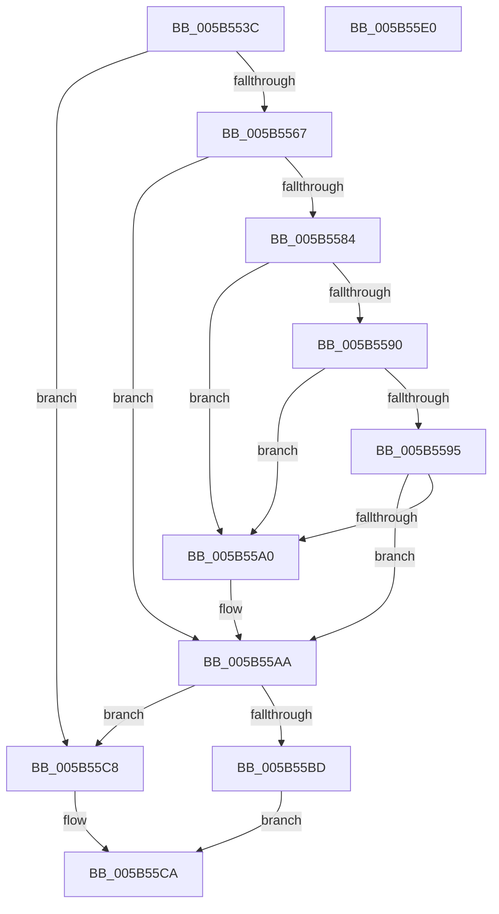

# KiValidateComponentName

- RVA: `0x005B553C`–`0x005B55E1` (길이 `165` bytes)
- VA: `0x00000001405B553C`
- 실행 섹션: `.text`
- PDB 이름 있음: `예`; PDB Function 태그: `아니요`
- unwind 정보 RVA: `0x000BF8F0`
- 디코드: `50`개 명령, `165/165` bytes 표시
- 미해석 바이트: `0` (있으면 어셈블리에 `.byte`로 보존)

> 이 문서는 커널 이미지의 기계어와 PDB 기호를 분석해 생성했습니다. 4번과 5번은 함수 원형과 자료형을 바이너리 사용 방식에서 추정한 C 해석이며 원본 소스 복구 결과는 아닙니다.

## 1. Dependencies

- 직접 호출 지점: **3**; 고유 호출 대상: **2**
- 직접 호출자로 확인된 함수: **2**
- RIP 상대 이미지 참조: **0**

### Outgoing calls
- `0x005B555E` → [MmIsAddressValidEx](../27/MmIsAddressValidEx_function_0027FDD0.md) (function, `0x0027FDD0`)
- `0x005B5597` → [MmIsAddressValidEx](../27/MmIsAddressValidEx_function_0027FDD0.md) (function, `0x0027FDD0`)
- `0x005B55B4` → [RtlStringCbLengthA](../56/RtlStringCbLengthA_function_00561494.md) (function, `0x00561494`)

### Direct callers
- [IopLiveDumpAddTriageDumpData](../59/IopLiveDumpAddTriageDumpData_function_00599190.md) at `0x00599277`
- [KiInvokeBugCheckAddTriageDumpDataCallbacks](KiInvokeBugCheckAddTriageDumpDataCallbacks_function_005B4F88.md) at `0x005B50BB`

### Static image references
- 디코드된 RIP-relative 메모리 참조가 없습니다.

## 2. Other-region calls and transfers

- 다른 실행 섹션으로 향하는 call: **0**
- 별도 외부 분기/꼬리 이동을 확인하지 못했습니다.

## 3. Assembly (complete function range)

```asm
005B553C  48 8B C4                        mov rax, rsp
005B553F  48 89 58 08                     mov qword ptr [rax + 8], rbx
005B5543  48 89 70 10                     mov qword ptr [rax + 0x10], rsi
005B5547  48 89 78 20                     mov qword ptr [rax + 0x20], rdi
005B554B  41 56                           push r14
005B554D  48 83 EC 20                     sub rsp, 0x20
005B5551  48 83 60 18 00                  and qword ptr [rax + 0x18], 0
005B5556  4C 8B F2                        mov r14, rdx
005B5559  33 D2                           xor edx, edx
005B555B  48 8B F1                        mov rsi, rcx
005B555E  E8 6D A8 CC FF                  call 0x14027fdd0
005B5563  84 C0                           test al, al
005B5565  74 61                           je 0x1405b55c8
005B5567  48 8B DE                        mov rbx, rsi
005B556A  48 8B C6                        mov rax, rsi
005B556D  48 81 E3 00 F0 FF FF            and rbx, 0xfffffffffffff000
005B5574  BF 01 01 00 00                  mov edi, 0x101
005B5579  48 2B C3                        sub rax, rbx
005B557C  48 3D FF 0E 00 00               cmp rax, 0xeff
005B5582  76 26                           jbe 0x1405b55aa
005B5584  48 8D 8B 00 10 00 00            lea rcx, [rbx + 0x1000]
005B558B  48 3B CB                        cmp rcx, rbx
005B558E  72 10                           jb 0x1405b55a0
005B5590  48 85 C9                        test rcx, rcx
005B5593  74 0B                           je 0x1405b55a0
005B5595  33 D2                           xor edx, edx
005B5597  E8 34 A8 CC FF                  call 0x14027fdd0
005B559C  84 C0                           test al, al
005B559E  75 0A                           jne 0x1405b55aa
005B55A0  8B FB                           mov edi, ebx
005B55A2  2B FE                           sub edi, esi
005B55A4  81 C7 00 10 00 00               add edi, 0x1000
005B55AA  8B D7                           mov edx, edi
005B55AC  4C 8D 44 24 40                  lea r8, [rsp + 0x40]
005B55B1  48 8B CE                        mov rcx, rsi
005B55B4  E8 DB BE FA FF                  call 0x140561494
005B55B9  85 C0                           test eax, eax
005B55BB  78 0B                           js 0x1405b55c8
005B55BD  8B 44 24 40                     mov eax, dword ptr [rsp + 0x40]
005B55C1  41 89 06                        mov dword ptr [r14], eax
005B55C4  B0 01                           mov al, 1
005B55C6  EB 02                           jmp 0x1405b55ca
005B55C8  32 C0                           xor al, al
005B55CA  48 8B 5C 24 30                  mov rbx, qword ptr [rsp + 0x30]
005B55CF  48 8B 74 24 38                  mov rsi, qword ptr [rsp + 0x38]
005B55D4  48 8B 7C 24 48                  mov rdi, qword ptr [rsp + 0x48]
005B55D9  48 83 C4 20                     add rsp, 0x20
005B55DD  41 5E                           pop r14
005B55DF  C3                              ret
005B55E0  CC                              int3
```

## 4. C-style interpretation (structured pseudocode)

```c
__int64 __fastcall KiValidateComponentName(__int64 a1, __int64 a2)
{
    __int64 result;
    __int64 v_rbx;
    __int64 v_rdi;
    __int64 v_rsp;
    unsigned __int64 v_stack_p10;
    unsigned __int64 v_stack_p18;
    unsigned __int64 v_stack_p20;
    unsigned __int64 v_stack_p8;

    *(unsigned __int64 *)(v_rsp + 8) = v_rbx;
    *(unsigned __int64 *)(v_rsp + 16) = v_rsi;
    *(unsigned __int64 *)(v_rsp + 32) = v_rdi;
    v_rsp = (v_rsp) - (32);
    a2 = 0;
    result = MmIsAddressValidEx(a1, a2, a3, a4);
    if ((unsigned __int8)(result) == 0) goto loc_005B55C8;
    v_rbx = (a1) & (0xFFFFFFFFFFFFF000ULL);
    result = (a1) - (v_rbx);
    if (result <= 0xEFFULL) goto loc_005B55AA;
    if ((v_rbx + 4096) < v_rbx) goto loc_005B55A0;
    if (v_rbx + 4096 == 0) goto loc_005B55A0;
    a2 = 0;
    result = MmIsAddressValidEx(v_rbx + 4096, a2, a3, a4);
    v_rdi = 257;
    if ((unsigned __int8)(result) == 0) {
        v_rdi = (unsigned int)(v_rbx);
        v_rdi = (unsigned int)((v_rdi) - ((unsigned int)(a1)));
        v_rdi = (unsigned int)((v_rdi) + (0x1000ULL));
    }
    result = RtlStringCbLengthA(a1, (unsigned int)((unsigned int)(v_rdi)), v_stack_p18, a4);
    if (sign_flag) goto loc_005B55C8;
    *(unsigned int *)(a2) = (unsigned int)((unsigned int)(v_stack_p18));
    goto loc_005B55CA;
loc_005B55C8:
    result = 0;
loc_005B55CA:
    v_rsp = (v_rsp) + (32);
    return result;
}
```

## 5. (Beta) C Style

```c
int64_t KiValidateComponentName(void *Arg1, void *Arg2)
{
    uint8_t *arg1 = (uint8_t *)Arg1;
    uint8_t *arg2 = (uint8_t *)Arg2;

    int64_t result;
    int64_t local_rbx;
    int64_t local_rdi;
    int64_t local_rsp;
    uint64_t v_stack_p10;
    uint64_t v_stack_p18;
    uint64_t v_stack_p20;
    uint64_t v_stack_p8;

    *(uint64_t *)(local_rsp + 0x8) = local_rbx;
    *(uint64_t *)(local_rsp + 0x10) = local_rsi;
    *(uint64_t *)(local_rsp + 0x20) = local_rdi;
    local_rsp = (local_rsp) - (32);
    Arg2 = 0;
    result = MmIsAddressValidEx(Arg1, Arg2, a3, a4);
    if ((uint8_t)(result) == 0) goto loc_005B55C8;
    local_rbx = (Arg1) & (0xFFFFFFFFFFFFF000ULL);
    result = (Arg1) - (local_rbx);
    if (result <= 0xEFFULL) goto loc_005B55AA;
    if ((local_rbx + 4096) < local_rbx) goto loc_005B55A0;
    if (local_rbx + 4096 == 0) goto loc_005B55A0;
    Arg2 = 0;
    result = MmIsAddressValidEx(local_rbx + 4096, Arg2, a3, a4);
    local_rdi = 257;
    if ((uint8_t)(result) == 0) {
        local_rdi = (uint32_t)(local_rbx);
        local_rdi = (uint32_t)((local_rdi) - ((uint32_t)(Arg1)));
        local_rdi = (uint32_t)((local_rdi) + (0x1000ULL));
    }
    result = RtlStringCbLengthA(Arg1, (uint32_t)((uint32_t)(local_rdi)), v_stack_p18, a4);
    if (sign_flag) goto loc_005B55C8;
    *(uint32_t *)(arg2) = (uint32_t)((uint32_t)(v_stack_p18));
    goto loc_005B55CA;
loc_005B55C8:
    result = 0;
loc_005B55CA:
    local_rsp = (local_rsp) + (32);
    return result;
}
```

### 관측된 메모리 오프셋

구조체 형식이 확인되지 않은 접근은 인자 기준의 오프셋으로만 기록했습니다.

| 기준 인자 | 오프셋 표현 | 폭 (bit) | 접근 |
|---|---:|---:|---|
| `Arg1` | `+ 0x1000` | `64` | `R` |
| `Arg2` | `+ 0x0` | `32` | `W` |

## 6. Execution-region graph

[열기: 2D/3D 그래프와 함수 탐색 컨트롤 패널](../../../control-panel.html?section=text&rva=0x005B553C&view=graph)

- 2D 그래프는 위에서 아래로 흐르고, 3D 그래프는 빈 공간을 드래그해 회전합니다. Shift+드래그는 이동, 휠은 확대·축소, 함수 노드 선택은 대상 보고서 이동입니다.

### Static fallback


